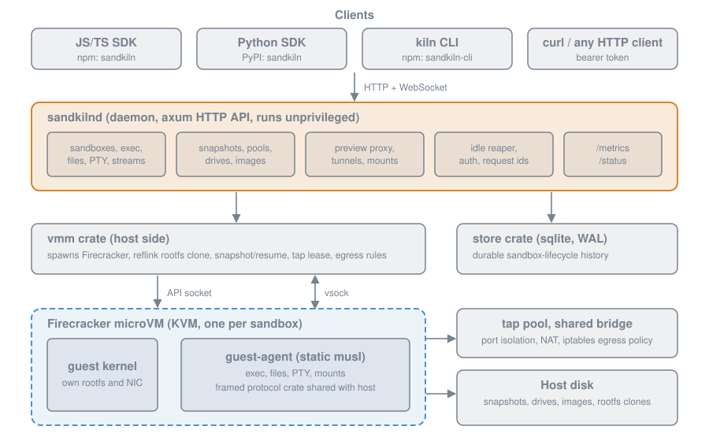
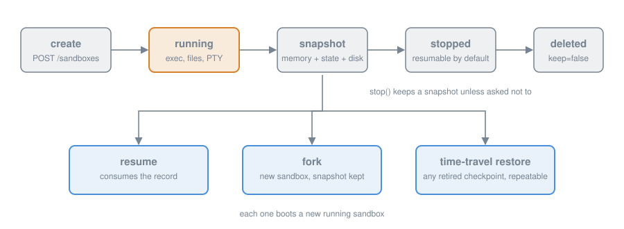

# sandkiln

[](https://github.com/SumitKumar-17/sandkiln/actions/workflows/ci-rust.yml)
[](https://www.npmjs.com/package/sandkiln)
[](https://www.npmjs.com/package/sandkiln-cli)
[](https://pypi.org/project/sandkiln/)
[](LICENSE)

**Run untrusted or AI-generated code in hardware-isolated Firecracker microVMs, through an HTTP API, SDKs and a CLI.**

Each sandbox is a real microVM with its own kernel, filesystem and network interface, not a container sharing the host kernel. You run the `sandkilnd` daemon yourself on a Linux host with KVM; there is no hosted service. A client creates a sandbox, runs commands, reads and writes files, snapshots it, forks it, and stops it. A cold sandbox answers its first command in about 215ms, and a resumed one in about 8ms.

- Docs: <https://sandkiln.mintlify.site/>
- Website and engineering deep-dives: <https://sandkiln.vercel.app>



## Features

**Isolation and security**
- One Firecracker microVM per sandbox: separate kernel, rootfs and NIC, enforced by KVM.
- The daemon runs unprivileged with only ambient `CAP_NET_ADMIN`; optional Firecracker jailer hardening (opt-in, not yet proven on real hardware).
- Bearer-token auth compared in constant time, and daemon-side input validation (for example path-traversal checks on drive ids).
- Sandbox-to-sandbox traffic is blocked at the bridge with port isolation, not only at the API.

**Speed**
- Reflink-cloned rootfs: cold `POST /sandboxes` in about 18ms on a reflink filesystem.
- Resume from snapshot in about 4ms at the VMM layer; pre-warmed snapshot pools skip per-create setup.

**Snapshots and time travel**
- Snapshot, resume and fork the full memory and disk state; stopping keeps a resumable snapshot by default, durable across daemon restarts.
- Named sandboxes (`get-or-create`, look up by name), snapshot lineage and time-travel restore from retired checkpoints (HTTP API only today).
- Orderly shutdown: on `SIGTERM` the daemon drains requests and snapshots every live sandbox.

**Networking and egress policy**
- Per-sandbox tap device from a pre-created pool, shared bridge, NAT, and a guest DNS forwarder.
- Per-sandbox egress policy (`allow_all` or `deny_all` with allow and deny CIDRs) applied as an iptables chain and preserved across snapshot, resume and fork.

**Drives and mounts**
- Persistent drives that outlive a sandbox, with read-only sharing and conflict detection.
- Custom and managed rootfs images; S3-compatible remote storage mounts (FUSE and rclone).

**Execution**
- Exec with exit codes and env, a full file API (read, write, chmod, rename, symlink, listing), streamed background exec with logs, and an interactive PTY over WebSocket.

**Pools, previews and tunnels**
- Pre-warmed snapshot pools with `max_count` and queueing.
- Dev-server preview proxy at `/sandboxes/:id/preview/:port`, and a local tunnel that exposes a service on your machine to code inside a sandbox (Node SDK and CLI).
- Idle lifecycle: auto-suspend, auto-destroy and archive, configured by the daemon operator.

**Observability**
- Request ids, Prometheus-style `/metrics` (create phase timings, rootfs clone method), durable lifecycle history in sqlite.
- `GET /status` (counts, tap pool, disk headroom, warnings) and `kiln status`, which exits 2 when there are warnings.

Planned, not built: OCI image conversion, multi-node, snapshot encryption at rest, per-caller auth scoping. The live done, partial and planned list is [ROADMAP.md](ROADMAP.md).



## Measured performance

One shared dev box (Intel i9-13900K, Firecracker v1.16.1), small samples, directional only. The latency a caller feels is time to first command, because `POST /sandboxes` returns before the guest is ready.


| Measurement | Result |
| --- | --- |
| Time to first command, cold | 413ms before, 214.5ms after trimming guest boot |
| Cold create, ext4 full-copy rootfs | 187.5ms mean of 20 |
| Cold create, reflinked rootfs (XFS) | 17.9ms mean of 20 |
| Firecracker spawn to `InstanceStart` (internal phase) | 12.6-14.0ms |
| Resumed first command | 18ms before, 8.4ms after |
| Resume from snapshot | 3.7-4.0ms |
| `exec` round trip, open connection | about 245us |

Method, history, the per-phase profile and caveats are in [docs/benchmarks.md](docs/benchmarks.md); the reflink setup is in [Startup latency](https://sandkiln.mintlify.site/architecture/startup-latency).

## Quick start

Needs a Linux x86_64 host with `/dev/kvm` accessible to your user, `sudo` for one-time setup, Rust via [rustup](https://rustup.rs), and `dnsmasq-base`. The full walk-through is the [self-hosting quickstart](https://sandkiln.mintlify.site/getting-started/self-hosting); settings and systemd are in [SELF_HOSTING.md](SELF_HOSTING.md).

```bash
git clone https://github.com/SumitKumar-17/sandkiln.git && cd sandkiln
scripts/setup.sh                 # idempotent: build, Firecracker, test image, tap pool, DNS forwarder, config
scripts/sandkilnd-ctl.sh start   # starts the daemon and waits for /healthz
```

Then, over plain HTTP:

```bash
curl -s -X POST http://127.0.0.1:7777/sandboxes -d '{}'      # {"id":"<sandbox-id>"}
curl -s -X POST http://127.0.0.1:7777/sandboxes/<sandbox-id>/exec \
  -H 'Content-Type: application/json' \
  -d '{"command":"echo","args":["hello from a microVM"]}'
```

`setup.sh` boots a small test image with no language runtimes; `scripts/setup.sh --production` builds an Ubuntu image with Node.js and Python. With no `auth_token` set, every route except `/healthz` and `/metrics` is open to anyone who can reach the port: set one before listening beyond localhost.

## SDKs and CLI

| Client | Install | Docs |
| --- | --- | --- |
| JS/TS SDK | `npm install sandkiln` | [JS quickstart](https://sandkiln.mintlify.site/getting-started/js), [reference](https://sandkiln.mintlify.site/api-reference/js-sdk/overview) |
| Python SDK | `pip install sandkiln` | [Python quickstart](https://sandkiln.mintlify.site/getting-started/python), [reference](https://sandkiln.mintlify.site/api-reference/python-sdk/overview) |
| `kiln` CLI | `npm install -g sandkiln-cli` | [CLI quickstart](https://sandkiln.mintlify.site/getting-started/cli), [reference](https://sandkiln.mintlify.site/api-reference/cli/overview) |

All three read `SANDKILN_DAEMON_URL` and `SANDKILN_AUTH_TOKEN`. The Python SDK has a synchronous `Sandbox` and an `AsyncSandbox`; it has no PTY or streamed exec yet (use the CLI or HTTP API).

TypeScript:

```ts
import { Sandbox } from "sandkiln";

const sandbox = await Sandbox.create({ tags: { env: "demo" } });
await sandbox.writeFile("/tmp/hello.py", "print(21 * 2)");
const result = await sandbox.runCommand("python3", ["/tmp/hello.py"]);
console.log(result.stdout.trim(), result.exitCode); // 42 0

const snapshotId = await sandbox.snapshot();   // pauses and stops the VM
const copy = await Sandbox.fork(snapshotId);   // new sandbox, snapshot kept
```

Python:

```python
from sandkiln import Sandbox

sandbox = Sandbox.create(tags={"env": "demo"}, egress_mode="deny_all")
result = sandbox.run_command("python3", ["-c", "print(21 * 2)"])
print(result.stdout.strip(), result.exit_code)  # 42 0
sandbox.stop()  # kept as a resumable snapshot by default
```

CLI:

```bash
kiln sandbox create --tag env=demo --egress-mode deny_all
kiln sandbox exec <id> -- python3 -c "print(21 * 2)"
kiln sandbox snapshot <id>          # then: kiln sandbox resume|fork <snapshot-id>
kiln sandbox preview <id> 3000      # preview URL for a dev server in the guest
kiln status                         # daemon health and capacity, exit 2 on warnings
```

The `python3` examples need the production image.

## Repository layout

| Path | Contents |
| --- | --- |
| `core/crates/protocol/` | wire format shared by host and guest |
| `core/crates/guest-agent/` | static musl binary that runs inside the VM |
| `core/crates/vmm/` | drives Firecracker, rootfs clones, networking (host side) |
| `core/crates/store/` | durable sandbox-lifecycle history (sqlite) |
| `core/crates/daemon/` | axum HTTP API (`sandkilnd`) |
| `packages/sdk/`, `packages/python/`, `packages/cli/` | `sandkiln` (npm), `sandkiln` (PyPI), `kiln` CLI |
| `images/` | kernel and rootfs build scripts, agent injection |
| `scripts/` | setup, daemon control, tests, benchmarks |
| `website/`, `docs-site/`, `docs/` | project site (Astro), full docs (Mintlify), design notes and benchmarks |
| `examples/` | runnable reference projects |

## Build and test

KVM, Firecracker and real networking cannot be faked locally, so only the pure-logic tests run anywhere; everything else needs a KVM host.

```bash
scripts/dev.sh build                   # cargo build --release --workspace
scripts/dev.sh unit-test               # same as: cd core && cargo test --workspace (no KVM needed)
scripts/dev.sh integration-test        # full API against a live sandkilnd (24 topics, run concurrently)
scripts/dev.sh bench-report 20         # fast regression check against /metrics, diffed with the last run
scripts/dev.sh load-test 10 20         # concurrency and latency under load
cargo bench -p sandkiln-vmm --bench vm_lifecycle   # boot, exec, snapshot, resume (real Firecracker)
```

`setcap` does not survive a rebuild: re-run `scripts/host-setup/grant-net-admin.sh <binary>` after each build (details in [AGENTS.md](AGENTS.md)). `SANDKILN_INTEGRATION_TEST_ONLY=<substring>` runs one integration topic. The packages build with `npm run build` and test with `npm test` in `packages/sdk` and `packages/cli`. `scripts/dev.sh help` lists every subcommand.

## Documentation map

| Where | What |
| --- | --- |
| [docs-site/](docs-site/) ([live](https://sandkiln.mintlify.site/)) | concepts, guides, HTTP/SDK/CLI reference, self-hosting, architecture |
| [SELF_HOSTING.md](SELF_HOSTING.md) | host setup, every `SANDKILN_*` setting, systemd |
| [docs/](docs/README.md) | benchmarks, findings and design notes |
| [website/](website/) ([live](https://sandkiln.vercel.app)) | marketing pages and engineering posts |
| [ROADMAP.md](ROADMAP.md) | what works, what is partial, what is planned |
| [CHANGELOG.md](CHANGELOG.md) | release history |
| [AGENTS.md](AGENTS.md) | engineering standard for contributors, human or agent |

## License

MIT, see [LICENSE](LICENSE).
