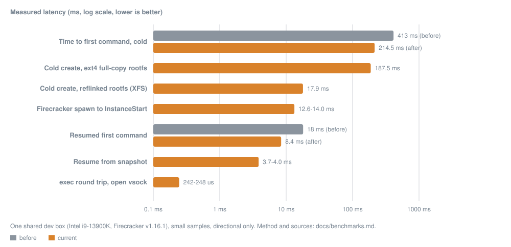

# sandkiln

[](https://github.com/SumitKumar-17/sandkiln/actions/workflows/ci-rust.yml)
[](https://www.npmjs.com/package/sandkiln)
[](https://pypi.org/project/sandkiln/)
[](LICENSE)

**Run untrusted or AI-generated code in hardware-isolated Firecracker microVMs, through an HTTP API, SDKs and a CLI.**

Every sandbox is a real microVM with its own kernel, filesystem and network interface. You run the `sandkilnd` daemon yourself on a Linux host with KVM. A cold sandbox answers its first command in about 215ms and a resumed one in about 8ms. You can snapshot, fork and time-travel a sandbox, give it an egress policy, attach persistent drives, and keep pre-warmed pools.


## Quick start

Needs a Linux x86_64 host with `/dev/kvm`, `sudo` for one-time setup, and Rust ([rustup](https://rustup.rs)).

```bash
git clone https://github.com/SumitKumar-17/sandkiln.git && cd sandkiln
scripts/setup.sh                 # build, Firecracker, test image, tap pool, DNS forwarder, config
scripts/sandkilnd-ctl.sh start   # start the daemon and wait for /healthz
npm install -g sandkiln-cli && kiln sandbox create
```

Set an `auth_token` before listening beyond localhost. Full walk-through: [self-hosting quickstart](https://sandkiln.mintlify.site/getting-started/self-hosting).

## Speed

Measured on one shared dev box (directional): time to first command 214ms, cold create 18ms on a reflinked rootfs, resume 4ms, exec round trip 245us.



Method, history and caveats: [docs/benchmarks.md](docs/benchmarks.md).

## Where to go

| I want to | Go to |
| --- | --- |
| See every capability | [Introduction](https://sandkiln.mintlify.site/getting-started/introduction) |
| Use it from JS/TS, Python or the CLI | [JS](https://sandkiln.mintlify.site/getting-started/js), [Python](https://sandkiln.mintlify.site/getting-started/python), [CLI](https://sandkiln.mintlify.site/getting-started/cli) (`npm i sandkiln`, `pip install sandkiln`) |
| Look up an endpoint or method | [API reference](https://sandkiln.mintlify.site/api-reference/http-api/overview) |
| Self-host and configure | [Self-hosting](https://sandkiln.mintlify.site/getting-started/self-hosting), [SELF_HOSTING.md](SELF_HOSTING.md) |
| Understand how it works | [Architecture](https://sandkiln.mintlify.site/architecture/overview), [engineering posts](https://sandkiln.vercel.app/engineering) |
| Read decisions and findings | [docs/](docs/README.md) |
| See what is done and planned | [ROADMAP.md](ROADMAP.md), [CHANGELOG.md](CHANGELOG.md) |
| Contribute | [docs/development.md](docs/development.md), [AGENTS.md](AGENTS.md) |

MIT licensed, see [LICENSE](LICENSE).
