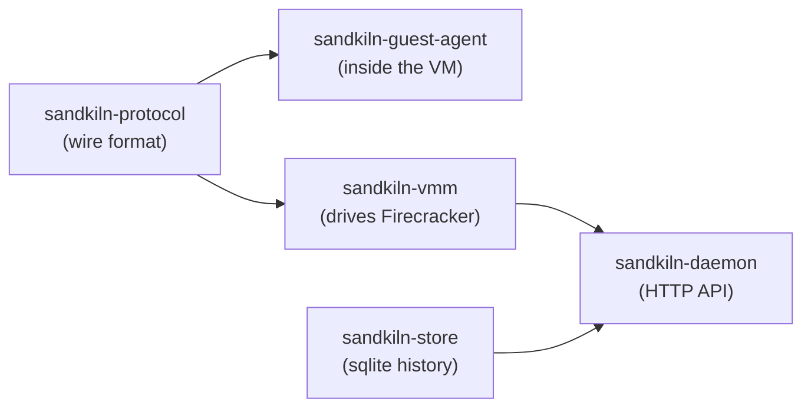
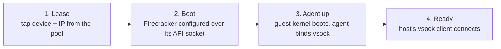

The core is a Rust workspace, kept deliberately modular: the daemon can change without touching the guest agent, and the guest agent ships as its own static binary independent of everything that talks to it.

## The four crates

- **`sandkiln-protocol`** carries the wire format shared by host and guest: length-prefixed JSON, kept dependency-light so neither side reaches into the other.
- **`sandkiln-guest-agent`** runs inside the microVM as a systemd service. It listens on vsock and answers exec/read/write/list, shipping as a static musl binary.
- **`sandkiln-vmm`** drives Firecracker directly: boot, snapshot/resume, network leasing, drives, the vsock client. A hand-rolled HTTP client talks to Firecracker's own API socket.
- **`sandkiln-daemon`** is the axum + tokio HTTP API wrapping the lifecycle (create, exec, list, stop, snapshot, images, drives) with auth, tags, and tracing built in from day one.

Dependencies point one way, daemon-ward — `sandkiln-protocol` depends on nothing, and nothing depends on `sandkiln-daemon`. That's what lets the guest agent ship as an independent static binary and `sandkiln-vmm` stay usable standalone, outside the daemon entirely.

## Boot lifecycle

1. **Lease.** A tap device and IP are leased from the pool, attached to the bridge.
2. **Boot.** Firecracker starts; boot-source, drive, machine-config, and vsock are configured over its API socket.
3. **Agent up.** The guest kernel boots, systemd starts the guest agent, it binds its vsock port.
4. **Ready.** The host's vsock client connects; the sandbox can run anything sent to it.

Measured end to end: 10.5–10.9ms (was 32.3–33.1ms before a fixed 20ms socket-wait sleep was found and fixed; see [Startup latency & the pre-warmed pool](/architecture/startup-latency)).

## Deeper dives

Each of the following came from hitting a real constraint on real hardware, not a whiteboard preference:

- [Jailer & privilege model](/internals/jailer-privilege-model): ambient `CAP_NET_ADMIN`, a static tap pool, and a root that stays out of the hot path.
- [vsock wire protocol](/internals/vsock-wire-protocol): vsock, a length-prefixed JSON frame, and a client that doesn't reach for a full HTTP stack.
- [Snapshot, resume, and fork](/internals/snapshot-resume-fork): sandbox vs. session, and why a snapshot points at paths instead of carrying values.
- [Bug hunt: the vsock timeout](/architecture/bug-hunt-vsock-timeout), a case study of a real bug that could hang a stop forever.
- [SDK and CLI design](/architecture/sdk-cli-design): zero runtime dependencies, and why async Python is a fully separate client, not a mode of the sync one.
- [Testing and benchmarking](/architecture/testing-and-benchmarking): the 24-topic concurrent integration suite and the criterion benchmarks behind every "live-verified" claim in these docs.
