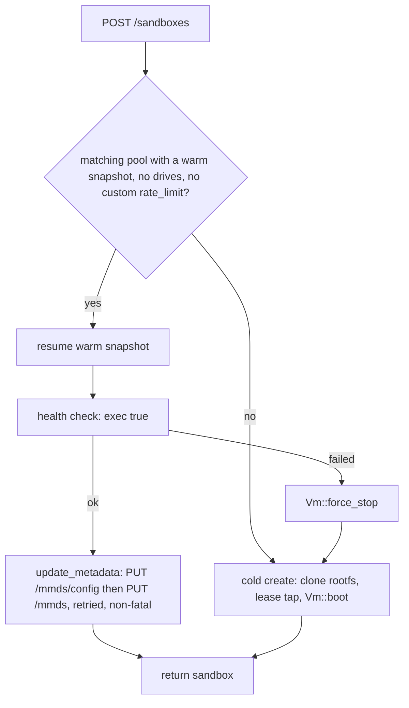

**Claim:** the latency a caller feels is the time from `POST /sandboxes` to the first successful command, and it was 413ms on a cold sandbox before guest boot was trimmed, 214.5ms after (2026-11-24, `scripts/bench-report.sh 20`, `first_exec_client`). The `POST` itself returns earlier than that: it takes 187.5ms when the per-sandbox rootfs is a full byte copy on ext4 and 17.9ms when the rootfs directory shares a reflink-capable filesystem (XFS) with the base image. The rootfs clone, not VM boot or networking, is the cost of the `POST`; the guest's own boot is the cost of the first command. See [Guest boot time](https://sandkiln.vercel.app/engineering/28-opt-guest-boot-time/).

## Evidence

Both runs: mean of 20 sequential cold creates on the dev box (ext4 host, 2 vCPU / 512MiB guest, 2026-11-23), one at a time with nothing else running.

| Phase | ext4, byte copy | XFS, reflink |
| --- | --- | --- |
| Total `POST /sandboxes` | 187.5ms | 17.9ms (re-run: 18.4ms) |
| Rootfs clone | 127.9ms | 0.08ms (re-run: 0.084ms) |
| `Vm::boot` | 14.9ms | 13.4ms (re-run) |
| Network lease | 3.5ms | 3.1ms (re-run) |

Reproduce with `scripts/bench-report.sh [iterations]` against a running daemon. It reads the daemon's own `create_phase_duration_ms{phase=...}` and `boot_duration_ms` histograms from `/metrics`, and diffs them against the previous run. `scripts/dev-tools/profile-cold-create.sh` drives a finer per-step profile (log filter is the binary name: `RUST_LOG=sandkilnd=debug`).

## What was wrong

`clone_rootfs` always wrote the per-sandbox copy into the OS temp dir, which on the dev box is on a different filesystem from the base image. A reflink cannot cross filesystems, so every clone was a full byte copy, and nothing reported which one happened. An earlier XFS experiment moved only the base image and saw no latency change, and the project wrongly concluded that the copy was hidden behind the concurrent network lease. A per-phase profile showed the lease at about 4ms, so nothing could hide the 124ms clone. The destination directory was the real cause.

## What changed

- `core/crates/vmm/src/rootfs.rs` clones with a native `FICLONE` ioctl and falls back to a byte copy only on `EOPNOTSUPP`, `EXDEV`, `EINVAL`, `ENOTTY` or `ENOSYS`. The method used is returned to the caller.
- `/metrics` exposes `rootfs_clone_total{method="reflink"|"copy"}`, so a silent fallback is visible.
- `SANDKILN_ROOTFS_DIR` sets where per-sandbox copies live. `SANDKILN_STATE_DIR` (default `~/sandkiln-tools/state`) holds `snapshots/` and `snapshot-history/`, which used to sit in the OS temp dir.
- `scripts/host-setup/create-reflink-volume.sh <owner-user> [size-gib]` builds an XFS loopback volume on an ext4-only host. It is not persistent across reboots.

## What to do

1. Put `SANDKILN_ROOTFS_DIR` on the same reflink-capable filesystem (XFS with `reflink=1`, or Btrfs) as `SANDKILN_BASE_ROOTFS`.
2. After the first creates, check `rootfs_clone_total{method="copy"}` on `/metrics`. If it increments, the two paths are on different filesystems.
3. Do not read a `rootfs_clone` latency outlier as "slow disk" without checking that counter first.

## A second fixed cost: the API socket wait

The same profile found `Vm::boot` sleeping a flat 20ms (20.11ms on all 20 boots, min 20.04, max 20.18) before connecting to Firecracker's API socket. It now retries the connect itself on a 200us to 5ms backoff (`connect_api_with_retry` in `core/crates/vmm/src/vm/mod.rs`). Retrying the connect also avoids a race: the socket file appears at `bind()`, slightly before `listen()`. Measured then: socket wait 20.11ms to 0.67ms, boot 34.00ms to about 11.3ms, create 167.65ms to about 144ms. That run is earlier than the table above and on a differently loaded box, so the totals are not comparable across the two.

Under `criterion` (`cargo bench -p sandkiln-vmm --bench vm_lifecycle`) on the same box, cold boot (spawn to `InstanceStart`, an internal phase and not the time to a usable sandbox) read 10.5-10.9ms in an earlier run and 12.6-14.0ms on 2026-11-23 (kernel 6.8). The same run read an exec on an open connection at 242-248us, resume from a snapshot at 3.7-4.0ms, and snapshot take at 485-727ms (earlier: 310-335ms). Both sets are directional, from one shared box; neither is authoritative.

## Create returns before the sandbox is usable

The numbers in this section predate the guest boot change: the default kernel command line is now `quiet loop.max_loop=1` (plus any `kernel_args` you set), which cut `first_exec_client` from 413.25ms to 214.5ms and `first_exec_resumed` from 18ms to 8.4ms. Roughly 125ms of what remains is guest systemd userspace. The earlier measurements below are kept for the record.

`POST /sandboxes` returns 200 once Firecracker's `InstanceStart` succeeds, not once the guest agent is listening. The first `exec` on a cold sandbox measured about 420-460ms; every later `exec` on the same sandbox measured 3-5ms. The first `exec` on a sandbox resumed from a snapshot whose agent was already live measured about 4-18ms. `scripts/bench-report.sh` tracks both as `first_exec_client` and `first_exec_resumed`.

Whether `create` should block until the agent answers once is undecided: it would make 200 mean "ready", and make `create` report that 420-460ms as its own latency. Until then, time `create` plus the first command, not `create` alone.

## Pre-warmed pools

`POST /pools` takes `{id, image_id?, vcpu_count?, mem_size_mib?, warm_count}`. A background replenisher keeps `warm_count` resumable snapshots per pool. A plain `POST /sandboxes` matching a pool's image and resources resumes one instead of cold-booting, unless the request passes `drives` or a custom `rate_limit` (both are fixed at boot, and a warm snapshot has neither). There is no separate "create from pool" call. SDKs expose `Pool.create/list/delete`; the CLI has `kiln pool create|ls|rm`.

An optional `max_count` caps warm plus claimed instances. A create over the cap queues, wakes when a slot frees, and returns `503` after 30 seconds. Pool configuration is held in memory only: re-`POST /pools` after a daemon restart.

### Claim flow

### Resume failure and the health check

### Known limitation

A resumed guest kernel can panic early in boot. The serial console log showed a divide-by-zero in the console driver's init path, after which the Firecracker process exits. In isolated single-claim runs the failure rate was roughly 1 in 3 to 2 in 3 resumes. The root cause is unconfirmed; clock-source drift between snapshot and restore is a hypothesis only. The regular snapshot integration check passes because it resumes once per run.

A related effect remains in the full 4-way-parallel integration suite: 2 to 3 of about 320 checks fail because a freshly resumed guest panics ("Attempted to kill the idle task!", about 20ms after restore) and its Firecracker exits. 160 of 160 resume and re-snapshot cycles were clean in isolated and in 4-way-parallel loops, so it needs a specific concurrent condition; the root cause has not been found.

Every pool claim therefore runs `exec true` against the resumed sandbox before returning it; only then is the metadata refreshed. On failure the sandbox is torn down with `Vm::force_stop`, which skips the pre-kill `sync` (a dead guest cannot answer it, and waiting cost a second 5s timeout: about 10.3s down to about 5.4s), and the request falls back to a cold create. The caller always receives a working sandbox, slower on the unlucky path.

Two related constraints in the resume path:

- A resumed VM's MMDS store comes back uninitialized, so `Vm::update_metadata` redoes `PUT /mmds/config` then `PUT /mmds` instead of a `PATCH`.
- That call can still be rejected right after a resume under load, so the claim retries it for a bounded time. Why it is rejected is unconfirmed.

## Open

- Snapshot-take costs 485-727ms in the latest criterion run (guest memory is written in full every time). See `docs/benchmarks.md`.
- Whether to make reflink the default for production setups.
