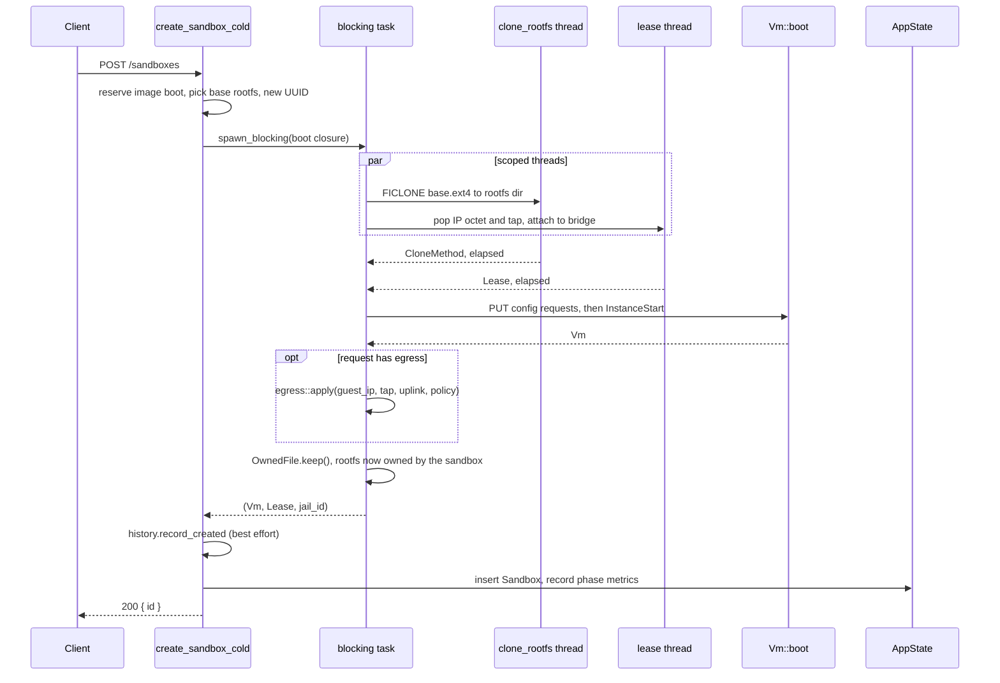
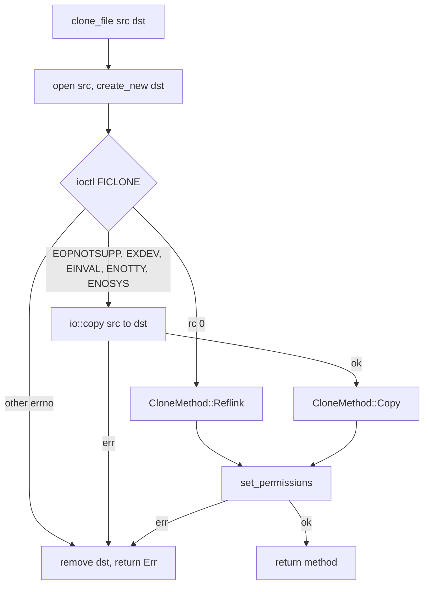
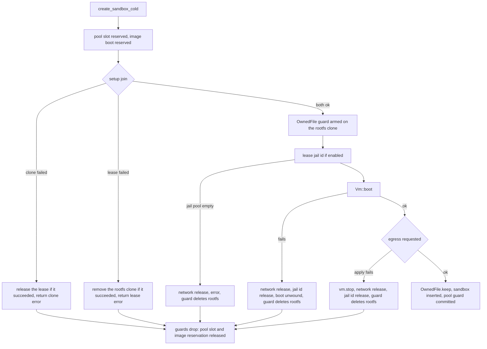

A cold `POST /sandboxes` is the one operation every other feature is built on. A snapshot, a fork and a pool slot all start life as one. This post describes how that request is implemented: the phases it is split into, which of them run concurrently, how the per-sandbox rootfs is produced, what the metrics report, and what is released when a step fails.

The daemon-side code lives in `core/crates/daemon/src/http/routes/sandbox.rs` (the function `create_sandbox_cold`, line 230), the on-disk layout and the `OwnedFile` scope guard in `core/crates/daemon/src/storage.rs`, the clone primitive in `core/crates/vmm/src/rootfs.rs`, and the VM boot sequence in `core/crates/vmm/src/vm/boot.rs`. The daemon only parses, validates and sequences. Anything that touches Firecracker or the filesystem layout of a VM lives in `sandkiln-vmm`.

## Entry points and what they decide

`create_sandbox` parses the body (an empty body is a default request) and, if the request carries a `name`, validates it and takes the per-name lock before checking that nobody else holds the name. That lock stays held until the request finishes, so two concurrent creates of the same name cannot both pass the uniqueness check. It then calls `create_sandbox_core`, which is shared with the get-or-create-by-name route.

`create_sandbox_core` makes every decision that does not need a VM: drive existence and exclusivity (`drive_holders`, `can_attach_read_only`), vCPU and memory overrides (`resolve_resource_override` rejects `0` or above-ceiling values with a 400 and never clamps), rate-limit and egress resolution (a malformed CIDR is a 400 naming the entry, not an iptables error deep in a boot task), and a bounded pre-warmed pool claim attempt when the request has no `drives` and no `rate_limit`.

Drives and rate limits are baked into a VM at boot time, which is why they disqualify a pool claim: a warm snapshot was booted with neither. Egress is host-side iptables applied after boot, so it does not disqualify one. Pools are described in the [pre-warmed pools page](https://sandkiln.mintlify.site/internals/pre-warmed-pools). The rest of this post is the cold path.

## Anatomy of `create_sandbox_cold`

The function has a fixed shape. Everything that can fail cheaply happens first, on the async side. Everything that touches the disk, the network stack or Firecracker happens inside one `spawn_blocking` closure. The result is committed to `AppState` only after that closure returns.



### Reservations before the slow work

Two RAII guards are created before anything slow happens. A third, `OwnedFile`, is armed later and is covered under failure unwinding.

- `PoolClaimGuard` (`core/crates/daemon/src/lifecycle/pool_claim.rs:91`) holds a reserved `max_count` slot when the pool logic handed back a `ColdSlot`. It releases the slot on drop and is only disarmed by `commit()` once the `Sandbox` is in the map.
- `PendingImageBootGuard` (`http/routes/sandbox.rs:106`) marks that an image is about to be read by this boot. A concurrent `DELETE /images/:id` checks the same marker, which closes the window in which the delete could remove the file the clone is reading. The guard releases on every exit path, including an early `?` and a panic unwind.

The base rootfs is the registered image's path when `image_id` is set and the daemon default (`base_rootfs_path`) otherwise. The sandbox id is a fresh UUID, generated here because it names the rootfs file, goes into the MMDS metadata, and keys the later map entry.

### Concurrent clone and lease

The two setup steps are independent: the clone reads a base image and writes a new file, the lease pops two free-list entries and shells out to `ip` and `bridge`. They run on two scoped threads inside the blocking task and are timed individually, because a timer around the join cannot tell which of the two was slow.

```rust
let ((copy_result, copy_elapsed), (lease_result, lease_elapsed)) = std::thread::scope(|scope| {
    let copy_handle = scope.spawn(|| span.in_scope(|| timed(|| clone_rootfs(&base_rootfs_source, &rootfs_path, &state.metrics))));
    let lease_handle = scope.spawn(|| span.in_scope(|| timed(|| state.network.lease())));
    (copy_handle.join().expect("rootfs copy thread panicked"), lease_handle.join().expect("lease thread panicked"))
});
```

`std::thread::scope` is used instead of two `spawn_blocking` tasks for a plain reason: the closures borrow `state`, the paths and the tracing span, and a scoped thread may borrow from its parent frame while a `spawn_blocking` task needs `'static`. The span is entered explicitly on each thread because `tracing`'s current span is thread-local and a fresh thread starts with none. Without that, the debug lines from inside `sandkiln-vmm` would lose the request id.

Only the join is on the critical path, so the `setup` phase records the wall time of the join and the two component phases are recorded separately. They do not sum to `setup`, and the metric help text says so.

### Boot

`Vm::boot` is called with the leased network config, the optional extra drives, the rate limiter and a metadata blob (`id`, `name`, `tags`) that becomes the guest's MMDS content. What matters here is the shape of the sequence in `core/crates/vmm/src/vm/boot.rs`: the process is spawned, a list of configuration `PUT`s is built by `configuration_requests` and issued in order, and then one final request starts the guest.

```rust
put_checked(&mut api, "/actions", &json!({"action_type": "InstanceStart"}))?;
```

That call is `core/crates/vmm/src/vm/boot.rs:218`. The configuration requests before it only record intent. `InstanceStart` is where vCPUs begin running the guest kernel, so it is timed on its own in the debug-level phase breakdown. The daemon records the whole `Vm::boot` call as `boot_duration_ms`.

### Commit

After the blocking task returns, the daemon records the creation in the history store (best effort: the VM is already running, so a write failure is logged as a warning and does not fail the request), builds the `Sandbox` record, inserts it into the map, increments the creation counter, commits the pool guard (ownership of the slot now lives in `Sandbox::source_pool_id`) and records the `total` phase.

## The rootfs clone

Every sandbox boots from its own writable rootfs file. The base image is never attached to a VM, because guests write to their root device. The primitive that produces the private file is `clone_file` in `core/crates/vmm/src/rootfs.rs`. The same wrapper, `clone_rootfs`, is also what gives a fork, a history-retaining resume and a restore their own disk, and there the clone must be made before the resume and handed to Firecracker explicitly (see [post 6](/engineering/06-snapshots-resume-fork) and [post 27](/engineering/27-correctness-snapshot-disk-corruption)).

```rust
pub fn clone_file(src: &Path, dst: &Path) -> io::Result<CloneMethod> {
    let mut src_file = File::open(src)?;
    let mode = src_file.metadata()?.permissions();
    let mut dst_file = OpenOptions::new().write(true).create_new(true).open(dst)?;

    let result = clone_into(&mut src_file, &mut dst_file).and_then(|method| {
        fs::set_permissions(dst, mode)?;
        Ok(method)
    });
    if result.is_err() {
        let _ = fs::remove_file(dst);
    }
    result
}
```

Three invariants are visible in those lines (`core/crates/vmm/src/rootfs.rs:38-50`):

1. The destination is opened with `create_new(true)`, so a clone can never overwrite an existing file. A UUID collision or a logic error that reuses an id surfaces as `AlreadyExists` instead of silently clobbering a live sandbox's disk. A test pins this behaviour.
2. The source's permission bits are copied onto the destination.
3. On any error the partial destination is removed, so a failed clone leaves nothing behind.

### FICLONE and the fallback

The actual copy is one ioctl.

```rust
let rc = unsafe { libc::ioctl(dst.as_raw_fd(), FICLONE, src.as_raw_fd()) };
if rc == 0 {
    return Ok(CloneMethod::Reflink);
}
let err = io::Error::last_os_error();
match err.raw_os_error() {
    Some(libc::EOPNOTSUPP) | Some(libc::EXDEV) | Some(libc::EINVAL) | Some(libc::ENOTTY) | Some(libc::ENOSYS) => {
        io::copy(src, dst)?;
        Ok(CloneMethod::Copy)
    }
    _ => Err(err),
}
```

This is `core/crates/vmm/src/rootfs.rs:56-70`, with `FICLONE` defined at line 16 (the request number `_IOW(0x94, 9, int)`, written as the constant `0x4004_9409`). A reflink makes the destination share the source's data extents, copy on write, so the cost is metadata only and no data moves. The ioctl only works when both files are on the same filesystem and that filesystem implements it (XFS with reflink enabled, Btrfs). On ext4 it fails with `EOPNOTSUPP`, and across mount points it fails with `EXDEV`. The five errnos in the match mean "this combination cannot reflink", and they fall back to `io::copy`. Any other errno (an I/O error, `ENOSPC`, a permissions failure) is a real failure and is returned.



### The method is returned, not hidden

`CloneMethod` has exactly two variants and the function returns it to the caller. The daemon's `clone_rootfs` wrapper records it in a counter and logs it.

```rust
let method = sandkiln_vmm::rootfs::clone_file(src, dst)?;
metrics.record_rootfs_clone(method);
```

`/metrics` exposes this as `rootfs_clone_total{method="reflink"}` and `rootfs_clone_total{method="copy"}`. This is a deliberate design choice, and the alternatives were worse:

- Shelling out to `cp --reflink=auto` was rejected because it swallows the answer. It reflinks when it can and copies when it cannot, and the caller learns nothing. A latency histogram cannot distinguish "this disk is slow" from "this host never reflinks".
- `--reflink=always` was rejected because it turns a missing capability into a hard failure on any ext4 development machine, where a byte copy is a perfectly valid, slower outcome.
- A native ioctl with a typed result keeps the one-syscall fast path, makes the fallback explicit, and makes the outcome observable. The `unsafe` block is one `ioctl` call with a stated safety argument: both fds are live for the duration of the call and the kernel does not retain either.

### Why the destination must share a filesystem with the base image

A reflink is a property of two files on one filesystem, not of a directory or a mount option on its own. So the question "will this clone be instant" is answered by where the destination file lands relative to the base image, not by how fast the disk is.

That is why the destination is configurable and why the layout is explicit. The daemon's `storage.rs` holds a process-wide `StorageLayout` with a `rootfs_dir`, a `snapshots_root` and a `retired_root`, initialised once at startup before anything touches disk. A test layout falls back to a temporary directory. `rootfs_path(id)` is pure path arithmetic.

```text
state_dir   (SANDKILN_STATE_DIR, default ~/sandkiln-tools/state)
  snapshots/             held snapshots, one directory per id
  snapshot-history/      retired checkpoints (see the snapshot post)
rootfs_dir  (SANDKILN_ROOTFS_DIR, default <state dir>/rootfs)
  sandkiln-rootfs-<sandbox id>.ext4     one per live sandbox
```

Per-sandbox rootfs files are kept in their own directory, separate from snapshot state, because the two have opposite placement needs. Snapshot state is documented as durable across restarts, which an OS temp directory cannot promise. The rootfs directory is the one an operator puts on the same reflink-capable filesystem as the base image. `scripts/host-setup/create-reflink-volume.sh` builds an XFS loopback volume for hosts whose main filesystem is ext4, copies the base image in, and prints the two settings to use (`base_rootfs` and `rootfs_dir`, or their `SANDKILN_BASE_ROOTFS` and `SANDKILN_ROOTFS_DIR` environment variables; the resolution order is env, then `sandkiln.toml`, then default). Loop mounts do not persist across reboots, so the script is re-run to remount.

Every path that gives a new mutating sandbox its own file (cold create, history-retaining resume, fork, restore) goes through the same wrapper; see the [snapshot post](/engineering/06-snapshots-resume-fork).

### What that decision was worth

The destination directory used to be the OS temp directory, which made reflink structurally impossible whenever the base image lived elsewhere. Nothing reported it. The effect is visible in the measured cold-create path. Mean of 20 cold `POST /sandboxes` runs:

| Rootfs placement | Total | Rootfs clone | VM boot | Network lease |
| --- | --- | --- | --- | --- |
| Full byte copy, ext4 | 187.5 ms | 127.9 ms | 14.9 ms | 3.5 ms |
| Reflink, same XFS filesystem as the base image (earlier run) | 17.9 ms | 0.08 ms | not itemised here | not itemised here |
| Reflink, same XFS filesystem (bench-report, 2026-11-23) | 18.4 ms | 0.084 ms | 13.4 ms | 3.1 ms |

These are directional numbers from one shared development box, taken from the repository's roadmap and not a controlled benchmark. The later reflink row is the mean of 20 cold creates from `scripts/bench-report.sh`; the two reflink rows are close, which is as much as a shared box can say, and neither is authoritative. The useful part is the shape: on the copy path the clone is the majority of the request, and on the reflink path it effectively disappears. That is the evidence behind making the directory configurable and the method a metric, and it is why the clone counters exist. Whether reflink should be the default for production setups is still an open item.

## Observability of the path

The phases are first-class metrics, not log lines. `CreatePhase` is a small enum with an `ALL` array, indexed positionally into a `Vec<Histogram>`, and a test asserts the discriminants match the array order so a reordered variant cannot silently relabel a series.

| Series | What it measures |
| --- | --- |
| `create_phase_duration_ms{phase="rootfs_clone"}` | The clone thread alone. |
| `create_phase_duration_ms{phase="network_lease"}` | `NetworkManager::lease` alone, including the bridge attach. |
| `create_phase_duration_ms{phase="setup"}` | The scoped-thread join. Not the sum of the two above. |
| `create_phase_duration_ms{phase="egress_apply"}` | Only recorded when a create requests a policy. |
| `create_phase_duration_ms{phase="total"}` | Request entry to the sandbox being in the map. |
| `boot_duration_ms` | `Vm::boot`. Kept as a separate family because external scrapers already expect it. |
| `rootfs_clone_total{method}` | Clones by method. |

The setup phases are recorded before the `?` that propagates their errors, so a create that fails partway still contributes the timing it produced. Per-PUT Firecracker detail stays at debug level (the `vm boot phase breakdown` event), because the vmm crate has no access to the daemon's metrics and because per-endpoint timings are profiling data, not something to alert on. The daemon binary's log target is `sandkilnd`, so the filter is `RUST_LOG=sandkilnd=debug`.

The reason the phases are measured individually at all is a single finding: an early profile showed the API-socket wait in `Vm::boot` taking 20.11 ms on every boot, the signature of one quantized `sleep(20ms)`, and replacing it with a connect-with-backoff took it to about 0.7 ms. A total latency number would never have shown that. `scripts/dev-tools/profile-cold-create.sh` drives sequential cold creates and prints one client-observed line per create, to be read alongside the debug events. `scripts/bench-report.sh` is the repeatable version: it reads `/metrics`, diffs against the previous run, and also tracks first-exec latency (below).

For the VM boot step in isolation, the criterion figures on the dev box (kernel 6.8, 2026-11-23) are 12.6 to 14.0 ms cold boot and 242 to 248 microseconds per exec round trip. The earlier run recorded 10.5 to 10.9 ms and 220 to 250 microseconds. Both are directional, from one shared box, and neither is authoritative.

## Failure unwinding

The create path allocates in this order: pool slot, image-boot reservation, rootfs file and network lease (concurrently), jail id (if the jailer is enabled), Firecracker process, egress chain. The rule from the project standard is that every intermediate failure leaves the system valid. This is what each step does.



The details, step by step:

- **Rootfs clone.** `clone_file` removes its own partial destination on any error, so the clone step is self-cleaning.
- **The setup join.** The clone and the lease ran concurrently, so either can succeed while the other fails. The closure matches on both results together (`http/routes/sandbox.rs:311-329`): if the clone succeeded it removes the file, if the lease succeeded it releases it, and then it returns whichever error occurred. A failed clone therefore no longer strands a lease, and a failed lease no longer strands a rootfs file.
- **`OwnedFile`.** Once both halves succeed, the closure wraps the rootfs path in `storage::OwnedFile` (`core/crates/daemon/src/storage.rs:74-103`), a scope guard whose `Drop` deletes the file unless `keep()` was called. Every early return between the clone and the sandbox existing (jail id exhausted, `Vm::boot` failing, egress failing) deletes the multi-hundred-MiB clone without each branch having to remember to. `keep()` is called only on the success path, immediately before the `Vm` and lease are handed back. Unit tests cover deleted-on-drop, kept-after-`keep()` and a file that is already gone.
- **Lease inside `NetworkManager::lease`.** The function pops an IP octet and then a tap. If no tap is free it pushes the octet back before returning an error. If the bridge attach fails it pushes both back. A failed lease therefore never shrinks the pools (`core/crates/vmm/src/network.rs:112`).
- **Jail id.** It is an in-memory pop. If it fails, the network lease is released before the error is returned.
- **`Vm::boot`.** If any configuration request fails, the vmm boot function kills the child, waits on it, removes the API and vsock sockets and removes the half-built jail directory if there is one (`core/crates/vmm/src/vm/boot.rs:65-80`). The guest console log path is appended to the error so a pre-vsock kernel panic is diagnosable. In the daemon, a failed boot releases the lease and the jail id.
- **Egress.** A policy that fails to apply is treated like a failed boot, not a warning, so a sandbox is never left silently unrestricted: the VM is stopped, the lease and jail id are released, and the error is returned. This is the opposite choice from resume and fork, where the one-way operation has already succeeded and the failure is logged loudly instead.
- **Guards.** `PoolClaimGuard` and `PendingImageBootGuard` release on drop regardless of which return path was taken.
- **History.** A history-store write failure is a warning only. The VM is already running and the record is best effort.

### What still is not cleaned up

Ownership is now explicit for the resources the create closure acquires, but two things remain outside it. Both are the same limit: they need a process that is still alive to run any cleanup.

- A daemon crash or `SIGKILL` between the clone and `keep()` leaves the rootfs file on disk, and a crash after boot leaves the Firecracker process running. Drop-based guards cannot run in a process that is gone. An orderly `SIGTERM` is different: the shutdown path snapshots or destroys every live sandbox (see the [system overview](/engineering/01-system-overview)).
- The daemon performs no startup sweep of rootfs files that no snapshot or sandbox owns. The file name carries a UUID that is never reused, so a stranded file corrupts nothing, but it occupies disk until an operator removes it. A sweep at startup, mirroring how snapshots are reconciled from the filesystem, is the natural fix and is not built.

## The first-exec gap

`POST /sandboxes` returns 200 when `Vm::boot` returns, that is, when Firecracker accepted `InstanceStart`. It does not wait for the guest agent to answer. The guest kernel and userspace still have to come up and the agent has to bind its vsock port.

`Vm::call` absorbs that race on the caller's side: `retry_while` retries a failed vsock connect with a 1 ms to 20 ms backoff for up to five seconds, and never retries a request that was already written (see the [protocol post](/engineering/02-vsock-protocol-and-guest-agent)). In the repository's measurements, the first real exec after a cold create costs roughly 420 to 460 ms end to end, while later execs on the same sandbox cost a few milliseconds. A resumed sandbox, whose agent is already running inside the restored memory image, answers its first exec in roughly 4 to 18 ms. Those figures are measured by `scripts/bench-report.sh` as `first_exec_client` (cold) and `first_exec_resumed`.

The consequence is that the request's own latency (17.9 to 18.4 ms on the reflink path) is not the number that matters for "how long until my code runs". The first caller silently pays the agent's start-up time and it shows up as "exec is slow".

There are two obvious designs and neither is chosen yet. Making the create wait for an agent readiness probe makes the response honest and the first exec fast, but adds hundreds of milliseconds to every create, including ones from callers who do not need the agent immediately. Keeping the fast return and documenting the gap leaves the cost with the first caller. The pre-warmed pool sidesteps the problem for the common profile, because a claim resumes an already-warm agent, but cold creates with drives or rate limits still pay it. It remains an open product question, tracked as a measurement so any change is visible.
