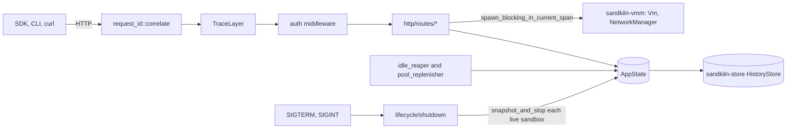
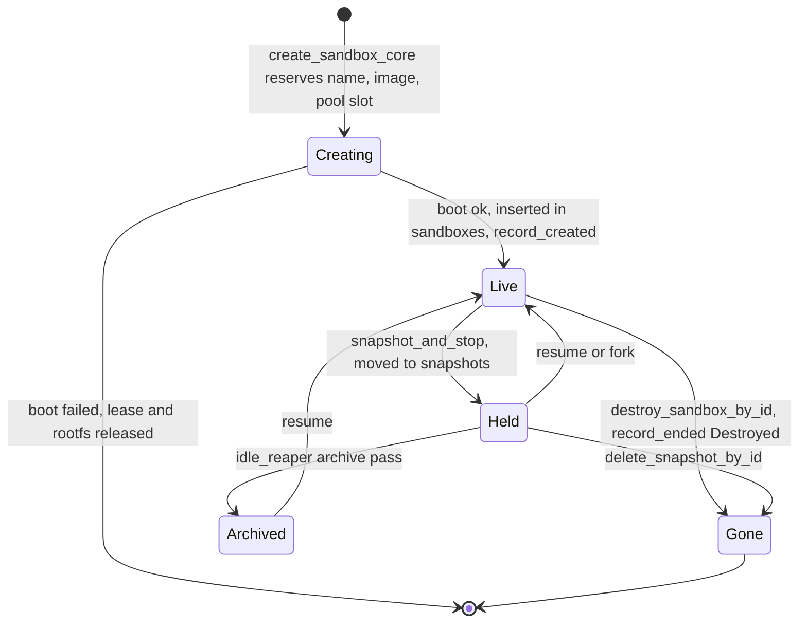

`sandkilnd` is an axum and Tokio HTTP server that wraps the `sandkiln-vmm` crate. The crate's rule is that business logic for VMs and networking stays in `sandkiln-vmm`, and the daemon parses requests, calls it, and shapes responses. What the daemon adds on top is everything that makes many concurrent sandboxes safe to operate: a single shared state object, ownership checks across resources, request correlation, metrics, and two background loops.

The daemon source is organized by concern under `core/crates/daemon/src/`:

| Path | Holds |
| --- | --- |
| `main.rs` | Bootstrap only: parse flags, load config, raise capabilities, start the runtime, wire up state and serve |
| `config/` | `mod.rs` (the typed `Config` and `Config::load`), `settings.rs` (the setting registry), `source.rs` (the resolver), `cli.rs` (the flags); see post 10 |
| `http/` | `mod.rs` (`build_router`), `auth.rs`, `error.rs`, `request_id.rs`, and `routes/` with one file per resource |
| `lifecycle/` | `idle_reaper.rs`, `pool.rs`, `pool_claim.rs`, `pool_replenisher.rs`, `shutdown.rs` |
| `snapshots/` | `held.rs` (live snapshots and reconcile), `retired.rs` (time-travel checkpoints) |
| top level | `state.rs` (`AppState`), `sandbox.rs`, `storage.rs`, `metrics.rs`, `log_session.rs`, `tracing_util.rs` |



## Startup: capabilities first, runtime second

The binary's `main` is a plain `fn main`, not `#[tokio::main]`:

```rust
fn main() {
    // ... parse flags, load and validate config (may exit) ...
    raise_net_admin_ambient();

    tokio::runtime::Builder::new_multi_thread()
        .enable_all()
        .build()
        .expect("build tokio runtime")
        .block_on(async_main());
}
```

(`main` in `core/crates/daemon/src/main.rs`, shown without the flag handling that precedes the raise.)

The reason is credentials. Linux threads copy their credentials from the creating thread at spawn time. The daemon needs `CAP_NET_ADMIN` for netlink operations on existing interfaces and for the iptables and `ip` child processes it shells out to, and that only reaches children if the capability is in the *ambient* set. Raising it into the ambient set requires it to be in the Permitted and Inheritable sets first. The file capability sets Permitted at exec time but Inheritable comes from the parent shell, so the function raises Inheritable and then Ambient. If a Tokio runtime had already started, its worker and blocking-pool threads would carry the pre-raise credentials, and any `ip` or `iptables` child spawned from one of them would not have the capability. Building the runtime by hand after the raise guarantees every thread has the post-raise set.

The capability is a file capability applied with `setcap`, and `setcap` does not survive a rebuild, so the project script that grants it is re-run after every build. Creating a tap device needs real root rather than `CAP_NET_ADMIN`, which is why taps are pre-created once and the daemon only leases them (see the networking post).

Before the raise, `main` parses the command line and loads the configuration, because `--help`, `--version`, `--check-config`, `--print-config` and `--config-reference` must work without `CAP_NET_ADMIN` and exit without starting anything (post 10 covers the config system). A configuration error exits with status 2 and every problem listed, not a panic. Only a normal run reaches the capability raise.

`async_main` then does a fixed sequence, and the order matters:

1. Initialize tracing (JSON or pretty, by the `log_format` setting) and log which config file was loaded and any warnings the loader produced.
2. Initialize the storage layout (`storage::init`) and create the state and rootfs directories.
3. Detect or read the uplink interface, build the `NetworkManager`, and call `ensure_ready`.
4. Open the drive store and the image store.
5. `snapshots::held::reconcile`, which rebuilds the snapshot table from disk and pulls each reconciled snapshot's tap device out of the `NetworkManager` free pool. This must run before `AppState` takes ownership of the manager and before the listener binds, so no live create can race a reconciled snapshot for the same tap.
6. `snapshots::retired::reconcile` for retired checkpoints (these hold no lease, so ordering relative to step 5 does not matter).
7. Open the history database and mark unended records as orphaned (see the persistence post).
8. Validate jailer settings if enabled.
9. Build `AppState`, spawn the two background tasks, build the router (`http::build_router`), bind, and serve with graceful shutdown (see the last section).

Most setup failures `expect`, which aborts the process with the message. For an infrastructure daemon that is intentional: an unusable network bridge or a missing directory is not something to limp past. Configuration is the exception, because a bad value is the operator's input and gets a complete, readable report instead of a backtrace.

## AppState: one shared object, many independent locks

Every handler receives `State<Arc<AppState>>`. `AppState` is one struct holding the config, the `NetworkManager`, the drive and image stores, the optional jailer id pool, the metrics registry, a pooled HTTP client for previews, the history store, and a set of `std::sync::Mutex`-guarded maps:

| Field | Holds | Durable? |
| --- | --- | --- |
| `sandboxes` | Live `Sandbox` records by id | No |
| `snapshots` | Held `Snapshot` records | Rebuilt from disk by `reconcile` |
| `retired_snapshots` | Retired checkpoints for time-travel restore | Rebuilt from disk |
| `pools` | Pool configuration (see the pools post) | No |
| `name_locks` | Per-name async mutexes | No |
| `tunnels` | Receivers handed between the tunnel POST and its WebSocket | No |
| `pending_image_boots`, `pending_tap_restores` | In-flight reservations | No |

### Locking strategy

There is no single global lock. Each map has its own `std::sync::Mutex`, and the rules are:

- A std mutex is held only for short, non-async critical sections. Handlers never `.await` while holding one. Anything that does real I/O (boot, vsock calls, snapshotting, iptables) runs inside `spawn_blocking`, and the std mutex is released first or taken inside the blocking closure.
- When a function must hold more than one lock at once, it takes them in a fixed order: sandboxes, then snapshots, then retired checkpoints. `image_holder` takes all three in that order. `tap_device_holder` takes sandboxes then snapshots. Where a function only needs to read each map independently (`name_holder`, `resolve_name`, `drive_holders`) it takes and drops them one at a time instead.
- The only async mutexes are the per-name locks, which exist precisely because their critical section spans several awaits.

The alternative, one `RwLock` around a struct of all maps, was not used. It would serialize unrelated operations (a pool claim and an image delete) and would invite holding it across slow calls. Separate small locks plus the "never across an await" rule keep contention low and make deadlocks a matter of checking one ordering.

### Reservation guards

Several invariants need a claim to exist *before* the thing it protects is visible in a map, and to be released on every exit path. The daemon uses RAII guards for each:

| Guard or pair | Protects |
| --- | --- |
| `lock_name` returning `NameLockGuard` | Two concurrent creates of one new name both seeing "free"; unrelated names are not blocked, and entries are swept when unreferenced |
| `reserve_pending_image_boot` / `ImagePendingBootGuard` | `DELETE /images/:id` racing a clone that is still reading the image file; refcounted per image id |
| `try_reserve_pending_tap_restore` / `PendingTapRestoreGuard` | Two restores of retired checkpoints that share a frozen tap, IP and MAC |
| `PoolClaimGuard` | A pool slot reserved before the sandbox exists |

### Who holds this? One place per resource

The ownership question for a shared resource is answered in one place, and everything that would attach, delete or reuse it asks that place. `drive_holders(drive_id)` is the canonical example. It walks live sandboxes, held snapshots and retired checkpoints and returns every holder with its read-only flag:

```rust
holders.extend(self.snapshots.lock().unwrap().values().filter_map(|s| {
    s.attached_drives
        .iter()
        .find(|d| d.drive_id == drive_id)
        .map(|d| DriveHold { holder: format!("snapshot {}", s.id), read_only: d.read_only })
}));
```

(Excerpt from `AppState::drive_holders`.)

A snapshot counts as a holder because it freezes the drive's host path into its saved state: there is no VM running, but the drive is still in use. A retired checkpoint counts for the same reason, since otherwise a drive it depends on read-write could be attached read-write elsewhere and a later restore would hand two live VMs the same mutable file. The function returns every matching holder rather than the first because multiple read-only holders are legitimate, and `can_attach_read_only` decides whether a new attach may stack. `image_holder` and `tap_device_holder` share a `first_match` walk helper, since for them one holder is enough to refuse.

The pure decision helpers (`find_named`, `first_match`) are separated from the lock-taking methods so they can be unit tested without constructing a `Sandbox` or `Snapshot`, both of which need KVM to build.

## The sandbox lifecycle

There is no `SandboxState` enum, and that is a design statement rather than an omission: a sandbox's state is *which table owns it*. The record moves between owners, and each move is an explicit function.



`Sandbox` itself is a plain struct: id, the `Vm` handle, `Option<Lease>`, the private rootfs path, attached drives, image id, jail id, tags, name, timestamps, `last_activity` behind its own `Mutex<Instant>`, and several lineage and policy fields. A few fields encode invariants through their shape:

- `network` is `None` only for a fork. The source snapshot keeps owning the lease while a fork lives, so a fork's teardown must never release it. The `Sandbox` type makes that visible instead of relying on a flag.
- `source_snapshot_id` and `parent_snapshot_id` are separate on purpose. The first is what refuses to re-snapshot a fork and must be `None` after a resume; the second is lineage and is `Some` on both resume and fork.
- `pty_session_count` is an `Arc<AtomicU32>` because the RAII guard that decrements it can outlive the sandbox's reachability through the map.
- `source_pool_id` marks a pool slot owned by this sandbox and is deliberately not carried onto the resulting snapshot.

The two terminal paths are shared by everything. `stop_sandbox_by_id(state, id, keep)` (`http/routes/sandbox.rs`) is used by `DELETE /sandboxes/:id`, the idle reaper and orderly shutdown: with `keep` true it tries `snapshot_and_stop` and falls back to `destroy_sandbox_by_id` when the sandbox is a fork (nothing to preserve), while a jailed sandbox returns `CannotPreserve` so the caller can decide. `destroy_sandbox_by_id` removes the record from the map first, then in one `spawn_blocking` closure stops the VM, removes egress rules, releases the lease, deletes the rootfs clone and returns the jailer id, and finally records the end in history. Removing from the map before doing the slow teardown means no other request can pick up a half-destroyed sandbox.

## Errors: one type, one mapping

Every handler returns `Result<_, AppError>`. The enum (`http/error.rs`) has nine variants, and a single `status_and_message` function is the only place that maps them to HTTP status codes:

| Variant | Status |
| --- | --- |
| `NotFound`, `DriveNotFound`, `ImageNotFound` | 404 |
| `BadRequest` | 400 |
| `Conflict` | 409 |
| `BadGateway` | 502 |
| `GatewayTimeout` | 504 |
| `ServiceUnavailable` | 503 |
| `Internal(io::Error)` | 500 |

The same function feeds both `IntoResponse` (status plus `{"error": "<message>"}`) and `Display`, so a log line from a background task that has no HTTP response shows exactly the text a client would have seen. `From<io::Error>` makes `?` on VM calls produce `Internal`. The error body shape is pinned by tests per variant, since every SDK depends on the `error` field. Distinct 502, 503 and 504 variants exist because those are not the daemon's fault: a preview request to a dead port is a gateway problem, and a full pool is temporary, so a client retry is the correct response rather than a 4xx.

## Auth

Authentication (`http/auth.rs`) is a bearer-token middleware applied with `route_layer` to the `/sandboxes*`, `/drives`, `/images`, `/pools` and snapshot routers. `/healthz` and `/metrics` are not behind it. When the `auth_token` setting (`SANDKILN_AUTH_TOKEN`) is unset the middleware is a no-op and `main` logs a warning that the API is unauthenticated.

The check is pulled out as a pure function so it can be tested without an `AppState`:

```rust
fn token_matches(header_value: Option<&str>, expected: &str) -> bool {
    header_value.and_then(|value| value.strip_prefix("Bearer ")).is_some_and(|provided| constant_time_eq(provided, expected))
}
```

(`core/crates/daemon/src/http/auth.rs:30`.)

The comparison is constant time. `constant_time_eq` folds the length difference and every byte difference into one accumulator and loops over the longer of the two inputs, with no early exit on the first mismatch, so response time does not reveal how much of a guessed token was right. Only the token length can leak. It used to be an ordinary string comparison, which was a timing side channel on a network-reachable secret. The tests cover exact, case-sensitive matching, a missing header, a missing `Bearer ` prefix and a wrong scheme. The property holds by construction; nothing here benchmarks the timing.

A second middleware, `require_preview_token`, guards the preview, PTY, exec-stream log and tunnel WebSocket routes. A browser tab, an iframe, and the WebSocket constructors in browsers and Node cannot set an `Authorization` header, so this variant also accepts the token as a `?token=` query parameter. It reuses `token_matches` for the header path and `constant_time_eq` for the query token. Those routes live in their own routers so that the two middlewares cannot be mixed up. A preview URL containing a token is therefore a bearer credential in URL form, which the daemon's own notes record as an accepted tradeoff.

## Request correlation and tracing

`request_id::correlate` (`http/request_id.rs`) is the outermost layer. It accepts a caller's `X-Request-Id` if it is non-empty, at most 200 characters, and all printable ASCII without whitespace, and otherwise generates a UUID. That validation exists because the value is written into every log line and the response header. It wraps the rest of the request in an `http_request` span carrying the id and echoes it back.

Span context is thread-local, and VM operations run on blocking-pool threads, so a bare `spawn_blocking` would lose it. `spawn_blocking_in_current_span` captures both the current span and the default dispatcher and re-establishes them on the blocking thread:

```rust
let span = tracing::Span::current();
let dispatch = tracing::dispatcher::get_default(tracing::Dispatch::clone);
tokio::task::spawn_blocking(move || tracing::dispatcher::with_default(&dispatch, || span.in_scope(f)))
    .await
    .expect(panic_message)
```

(From `core/crates/daemon/src/tracing_util.rs`.)

Both are needed because a blocking thread has neither. The module's test installs a thread-local subscriber with no global default and asserts the `request_id` appears in a JSON line emitted from inside a blocking closure. The effect is that a log line from deep inside `sandkiln-vmm` carries the id of the HTTP request that triggered it.

## Metrics

Metrics (`metrics.rs`) are rendered as Prometheus text exposition format by hand rather than through the `prometheus` crate. The rationale in the module is proportionality: a few counters and histograms behind atomics and small mutexes do not justify a dependency and its registry abstraction.

The `Metrics` struct holds `AtomicU64` counters (sandboxes created, rootfs clones by method) and `Histogram` values for `boot_duration_ms`, `exec_latency_ms` and a `create_phase_duration_ms` family indexed by the `CreatePhase` enum (rootfs clone, network lease, setup, egress apply, total). Histograms keep per-bucket counts, a sum and a count inside a `Mutex`, and render cumulative `le` buckets plus `+Inf`. Bucket bounds are chosen around measured values: boot buckets (10, 25, 50, 100, 250, 1000 ms) bracket the cold boot, which measured about 13 ms on the 2026-11-23 run (the comment next to the bounds still says about 30 ms), exec buckets span sub-millisecond to a second, and every create phase shares one layout so the family can be aggregated in a single query. A second family, `snapshot_take_phase_duration_ms`, indexed by `SnapshotPhase` (pause, create, force stop, release, persist, total), splits a snapshot take the same way.

`CreatePhase::Setup` is the join of the concurrent rootfs clone and network lease, not their sum, which the HELP text states. `boot_duration_ms` is deliberately not a variant of the family because it predates it and external scrapers may already depend on its name. `sandboxes_active` is not a separate counter: `/metrics` reads `sandboxes.len()` at render time, since a second counter could drift from the map. The route (`http/routes/metrics.rs`) is unauthenticated like `/healthz`, as it exposes daemon operations rather than sandbox data.

## Background loops and the idle reaper

Two tasks are spawned unconditionally from `main.rs`: `run` in `lifecycle/pool_replenisher.rs` and `run` in `lifecycle/idle_reaper.rs`. An unconditional task with nothing configured is a cheap empty scan, which is simpler than conditional spawning keyed on configuration.

The reaper runs three tiers, each controlled by its own setting (the table names the `SANDKILN_` environment form) and each optional:

| Tier | Trigger | Action |
| --- | --- | --- |
| Auto-suspend | idle past `SANDKILN_AUTO_SUSPEND_TIMEOUT_SECS` | `snapshot_and_stop` |
| Destroy | idle past `SANDKILN_IDLE_TIMEOUT_SECS` | `stop_sandbox_by_id` with `keep` true, falling back to destroy |
| Archive | a held snapshot older than `SANDKILN_ARCHIVE_TIMEOUT_SECS` | `archive_snapshot_by_id` into `SANDKILN_ARCHIVE_DIR` |

Each tick, `reap_once` runs auto-suspend first and destroy second. A suspended sandbox leaves the `sandboxes` map, so destroy never sees it in the same tick. Together with the config invariant that the suspend timeout is shorter than the destroy timeout, this makes destroy a backstop instead of a race. The archive pass is independent: it is about a snapshot's age, so it runs whenever an archive timeout is configured, regardless of the other two. It skips snapshots that are already archived or that have a live fork.

The decisions are pure functions: `is_idle(last_activity, now, timeout)` is a saturating subtraction compared with the timeout, `is_archive_due` is the wall-clock equivalent, and `compute_check_interval` halves the shortest configured timeout and clamps it to between 1 and 30 seconds. All three are unit tested, which is the pattern the project calls out: pull the decision out of the loop. The scan itself clones ids out under the lock and then acts on them one by one, treating `NotFound` as a benign race with an explicit stop. `last_activity` is refreshed by the shared exec helper on every exec, read-file and write-file.

Failure handling inside each tier is explicit. A sandbox that cannot be snapshotted (jailed, or a fork) is logged at debug level and left running, since the condition can repeat every tick. A snapshot that fails mid-way degrades to stop and release, logged as a warning, because there is no way to un-pause a half-paused VM; the sandbox is gone either way and is not retried.

## Route modules and the split rule

`http::build_router` (`http/mod.rs`) assembles the router from one file per concern in `http/routes/`: `sandbox`, `sandbox_name`, `exec`, `fs`, `logs`, `mounts`, `tunnel`, `pty`, `preview`, `drives`, `images`, `pool`, `snapshot`, `snapshot_history` and `metrics`. Routes are grouped into `Router` values by auth policy: bearer-gated routes, WebSocket and preview routes with the query-token fallback, and the two unauthenticated endpoints (`/healthz`, `/metrics`). Shared mechanics live once and are `pub(crate)`: `snapshot_and_stop`, `resume_snapshot_by_id`, `delete_snapshot_by_id`, `stop_sandbox_by_id`, and `call_agent` for guest RPC. A module that touches the sandbox map gets its own file, which keeps parallel work on separate routes from colliding.

### Calling the guest without holding the sandbox lock

`call_agent` (`http/routes/exec.rs:122`) is the path every exec, file and filesystem request takes. It used to hold the daemon-wide `sandboxes` mutex across the whole vsock call, so one command running for a minute froze every other sandbox operation. It now takes the lock only long enough to refresh `last_activity` and copy out an `AgentEndpoint` (`Vm::agent_endpoint`, a small value holding the VM id and its vsock socket path), releases the lock, and makes the call on a blocking thread with the `exec_timeout_secs` bound (default 600). A reply that does not arrive in time is an `AppError::GatewayTimeout`, HTTP 504, with a message saying the command may still be running in the guest. The regression test is `scripts/integration-tests/25-long-running-commands.sh`, which also covers a command silent for several seconds running once and not twice, and the fast snapshot path. One call site still holds the lock across a blocking call: the pool claim health check, which makes a single control-plane call bounded to 3 seconds.

## Orderly shutdown and orphaned VMs

`SIGTERM` and `SIGINT` are handled by `lifecycle/shutdown.rs`. `main.rs` serves with axum's graceful shutdown: on the signal the listener stops accepting, in-flight requests get `REQUEST_GRACE` (30 seconds), and then `drain_sandboxes` runs. It snapshots every live sandbox concurrently through `stop_sandbox_by_id(.., keep = true)`, so each one lands as an ordinary held snapshot with the same persistence and history record as a client-requested stop. A sandbox that structurally cannot be snapshotted (`CannotPreserve`, which is the jailed case) is destroyed instead. A fork is destroyed too, as in the normal stop path, because its source snapshot already holds its identity. The drain has a `DRAIN_DEADLINE` of 60 seconds; if it passes, the daemon logs a warning and exits with sandboxes still stopping.

Verified live on 2026-11-24: three sandboxes were snapshotted in 0.75s, the daemon exited in about a second, no Firecracker process was left, and the snapshots were resumable after a restart (`scripts/restart-test.sh`). Because snapshots are reconciled from disk at startup, a restart now keeps sandboxes where it used to lose them.

What it does not cover is an unclean exit. `Vm` has no `Drop` implementation and the Firecracker child is started with `std::process::Command::spawn` with no parent-death signal (`core/crates/vmm/src/vm/boot.rs:119`), so a `SIGKILL`, an out-of-memory kill or a crash still leaves every Firecracker process running with its tap device, rootfs clone and sockets in place. Live sandboxes are an in-memory table with no serializable representation, so the next start cannot reattach to them. For that case the answer is honest bookkeeping: at startup the history store marks every record that never ended as orphaned (the persistence post covers exactly what is marked), and cleaning up leftover processes and devices is an operator task.

## Testing

Pure logic is tested in place: token matching, request-id validation, the error body per variant, idle and archive decisions, check-interval clamping, histogram rendering, holder lookups and name matching. These contribute to the 340 tests in `cargo test --workspace` (222 in the daemon crate, as of 2026-11-24). Anything involving a real VM is covered by the integration suite against a live daemon, about 320 checks across 25 topics, and `SANDKILN_INTEGRATION_TEST_ONLY=<substring>` runs a single topic. The project convention is that compiling is not proof: the DELETE status-code bug compiled and passed lint and was still wrong.
