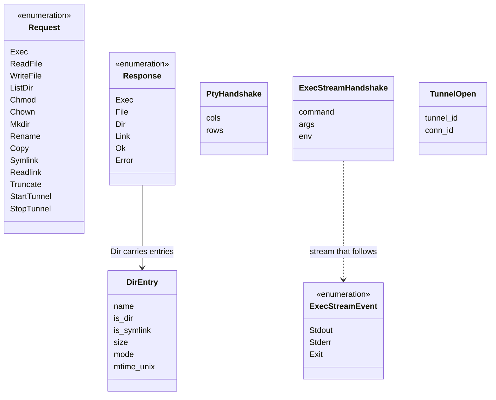
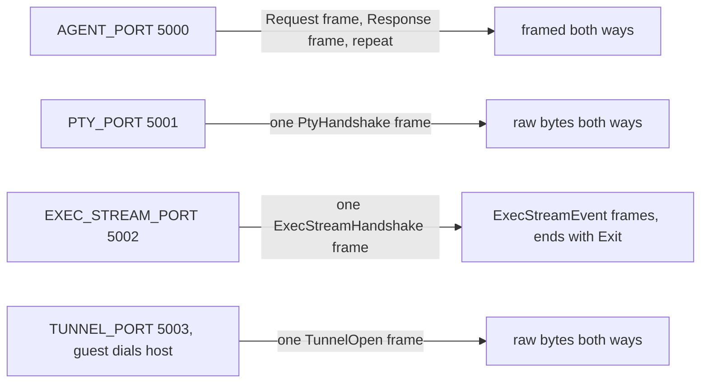
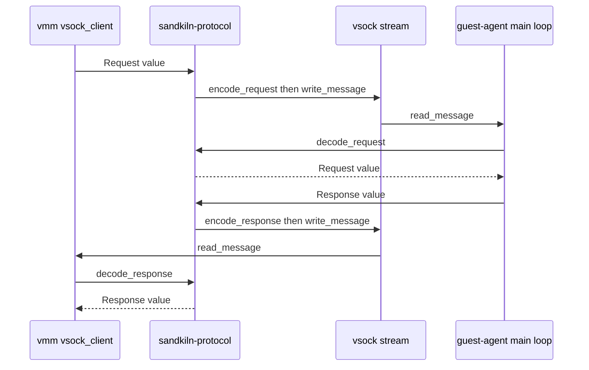

`sandkiln-protocol` is a contract, not a feature. The host-side `sandkiln-vmm` crate and the in-VM `sandkiln-guest-agent` binary both depend on it, and nothing else does. It has two dependencies (`serde` with `derive`, and `serde_json`), no knowledge of what a vsock is, and no knowledge of HTTP or Firecracker. If a change needs a socket, a process, or a path, it does not belong here.

This post is the crate-level tour. The [vsock protocol and guest agent](/engineering/02-vsock-protocol-and-guest-agent) post covers how the messages travel and how the two ends avoid hanging; the docs-site page [vsock and the host-guest wire protocol](https://sandkiln.mintlify.site/internals/vsock-wire-protocol) has the prose introduction and a captured exchange. Here the focus is the shape of the crate itself: what it exports, what invariants each type carries, and how the tests keep the contract from drifting. It assumes you have read the [system overview](/engineering/01-system-overview).

## Public API surface

Everything public comes from `core/crates/protocol/src/lib.rs`. The crate root declares two private modules and re-exports from them:

```rust
mod framing;
mod messages;

pub use framing::{read_message, write_message};
pub use messages::{DirEntry, ExecStreamEvent, ExecStreamHandshake, PtyHandshake, Request, Response, TunnelOpen};
```

(`core/crates/protocol/src/lib.rs:6-10`.) Nothing in `framing` or `messages` is reachable except through those re-exports, so a consumer cannot name a path like `sandkiln_protocol::messages::Request`. That keeps module layout an internal choice.

| Export | Kind | Role |
| --- | --- | --- |
| `AGENT_PORT` (5000) | `u32` const | Request/response: exec, file ops, tunnel control |
| `PTY_PORT` (5001) | `u32` const | One framed handshake, then raw bytes |
| `EXEC_STREAM_PORT` (5002) | `u32` const | One framed handshake, then framed events |
| `TUNNEL_PORT` (5003) | `u32` const | Guest-initiated: one framed handshake, then raw bytes |
| `Request`, `Response` | enums | The `AGENT_PORT` conversation |
| `DirEntry` | struct | One `ListDir` entry |
| `PtyHandshake`, `ExecStreamHandshake`, `TunnelOpen` | structs | Opening message of the three long-lived shapes |
| `ExecStreamEvent` | enum | `Stdout`, `Stderr`, `Exit` frames on `EXEC_STREAM_PORT` |
| `read_message`, `write_message` | functions | Length-prefixed framing over any `Read`/`Write` |
| `CodecError` | type alias | `serde_json::Error`, so callers need no direct `serde_json` dependency |
| `encode_*`, `decode_*` | functions | One pair per message type that crosses the wire |

The `encode_*`/`decode_*` helpers are deliberately thin wrappers over `serde_json::to_vec` and `from_slice`. Their purpose is to keep the JSON choice an implementation detail: the `CodecError` alias says in one line that the wire encoding is not part of the public contract, only the byte-level framing and message shapes are. Each helper's doc comment also names which side calls it (`encode_request` is "host-side client", `decode_request` is "guest agent side"), which doubles as a map of who speaks which half of the protocol.

## Module tour

The crate is three files and 696 lines in total.

| File | Lines | Responsibility |
| --- | --- | --- |
| `src/framing.rs` | 90 | `read_message`, `write_message`, the 64 MiB cap |
| `src/messages.rs` | 430 | Every message type, plus a wire-shape test per variant |
| `src/lib.rs` | 176 | Re-exports, port constants, codec helpers, pipeline tests |

`messages.rs` is the largest file but is not a candidate for splitting: it is a flat list of type definitions followed by tests, one concern. The root `AGENTS.md` says to split when a file mixes independently workable concerns, and this one does not.

### Framing

The framing module is 25 lines of code. A frame is a four-byte little-endian length followed by that many bytes:

```rust
const MAX_MESSAGE_LEN: u32 = 64 * 1024 * 1024;

pub fn read_message(r: &mut impl Read) -> io::Result<Vec<u8>> {
    let mut len_buf = [0u8; 4];
    r.read_exact(&mut len_buf)?;
    let len = u32::from_le_bytes(len_buf);
    if len > MAX_MESSAGE_LEN {
        return Err(io::Error::new(io::ErrorKind::InvalidData, "message too large"));
    }
    let mut buf = vec![0u8; len as usize];
    r.read_exact(&mut buf)?;
    Ok(buf)
}
```

(`core/crates/protocol/src/framing.rs:6-18`.) The cap check happens before the allocation. That ordering is the whole point of the constant: a corrupt or hostile length prefix must not turn into a multi-gigabyte `vec!` inside a small static binary. `write_message` is the mirror image: write the length, write the payload, `flush`.

The functions take `impl Read` and `impl Write`, not a socket type. That is why the same two functions serve a `UnixStream` on the host, a `VsockStream` in the guest, a `Vec<u8>` in a unit test, and a `Cursor` when the tests replay bytes. The protocol crate never needs to know which.

### Messages

`messages.rs` holds three kinds of type. The first is the request/response pair for `AGENT_PORT`. The second is the three handshake structs that open the long-lived connection shapes. The third is `ExecStreamEvent`, the one enum that keeps framing for the whole life of a stream.

The two request/response enums use serde's internal tagging, with different tag field names:

```rust
#[derive(Debug, Serialize, Deserialize)]
#[serde(tag = "cmd", rename_all = "snake_case")]
pub enum Request {
    Exec {
        command: String,
        #[serde(default)]
        args: Vec<String>,
        #[serde(default)]
        env: HashMap<String, String>,
    },
    ReadFile { path: String },
    // ...
}
```

(`core/crates/protocol/src/messages.rs:4-19`, trimmed.) `Request` is tagged `cmd`, `Response` is tagged `status`, and `ExecStreamEvent` is tagged `stream`. A captured frame therefore reveals its direction and kind at a glance: `{"cmd":"read_file",...}` can only be host to guest, `{"status":"file",...}` only guest to host.



The two relationships drawn are the only ones in the type graph. `Response::Dir` holds a `Vec<DirEntry>`. An `ExecStreamHandshake` is followed by a sequence of `ExecStreamEvent`s, but that is a runtime ordering, not a field. Everything else is a standalone type.

## Four ports, four connection shapes

The port constants live in `lib.rs` for one reason: both sides must agree on them, so they cannot be defined on either side. Each constant's doc comment records why it exists as its own port rather than a new `Request` variant, and that reasoning is the real design of the protocol.



- **`AGENT_PORT`** is ordinary request/response. Every frame in both directions is a framed JSON message.
- **`PTY_PORT`** is one long-lived connection per session. After a single framed `PtyHandshake { cols, rows }`, framing stops and every byte goes straight to a pty. A terminal is a byte stream, and wrapping it in JSON would add latency and base64 overhead to every keystroke.
- **`EXEC_STREAM_PORT`** is long-lived too, but never drops to raw bytes. A caller needs to know which stream a chunk came from and what the exit code was, so each chunk is an `ExecStreamEvent` and the sequence ends with exactly one `Exit`.
- **`TUNNEL_PORT`** is the single exception to "the host connects in and the guest only listens". The event being carried is "something inside the guest just tried to connect", which the host cannot have initiated. The constant's doc comment explains the Firecracker mechanism: a guest connection to this port is forwarded to a Unix socket the host already has listening at `<uds_path>_<port>`, with no `CONNECT` handshake line. The `TunnelOpen { tunnel_id, conn_id }` frame is sandkiln's own handshake layered on top, so the host can route the connection to the right tunnel.

The wire encoding for file content and process output is base64 (`content_base64`, `data_base64`), because JSON strings cannot carry arbitrary bytes and process output is not guaranteed to be UTF-8. That costs roughly a third more bytes on the wire, a trade the crate makes explicitly in the `ExecStreamEvent` doc comment.

## Key types and their invariants

A protocol crate has few invariants, but the ones it has are load-bearing.

**Defaults make additions backward compatible at the field level.** `Exec::args`, `Exec::env`, `Mkdir::parents`, `ExecStreamHandshake::args` and `::env` are all `#[serde(default)]`. A frame that omits them still decodes, and tests pin it (`exec_request_args_and_env_default_to_empty_when_omitted`, `mkdir_request_parents_defaults_to_false_when_omitted`). This is not version negotiation; see below.

**`env` arrives already resolved.** The doc comment on `Exec::env` states that the daemon has merged create-time defaults with per-call overrides before the request is built, per-call winning. The guest agent has no notion of "sandbox-level" versus "call-level" environment. It adds the map on top of the process's own inherited environment rather than replacing it. Keeping the merge out of the protocol means the guest stays a dumb executor.

**`mode` is raw permission bits.** `Chmod::mode` and `DirEntry::mode` are both plain `u32` permission bits such as `0o644`, not symbolic strings. The guest masks file-type bits off `st_mode` for `DirEntry::mode`, so listing a directory and feeding an entry's `mode` straight back to `Chmod` round-trips.

**`Response::Ok` and `Response::Error` are shared.** Operations with no payload (`Chmod`, `Mkdir`, `Rename`, `StartTunnel`, and others) all answer `Response::Ok`. Failure of any operation is `Response::Error { message }`, carrying the guest's OS error text.

**A `PtyHandshake` is `Copy`; the others are not.** `PtyHandshake` is two `u16`s and derives `Clone, Copy`. `ExecStreamHandshake` and `TunnelOpen` derive `Clone` only, since they own strings and maps. Neither `Request` nor `Response` derives `PartialEq`; a comment in the test module explains it would be derived only for the tests, so the roundtrip test compares re-serialized bytes instead.

## Error model

There are three layers, and they do not mix.

1. **Transport errors** are `io::Error`. `read_message` returns `UnexpectedEof` when the stream ends mid-frame or before a length prefix, and `InvalidData` when the length exceeds the 64 MiB cap. A framing failure means the connection is no longer trustworthy, and callers treat it as fatal for that connection.
2. **Codec errors** are `CodecError`, an alias for `serde_json::Error`. A malformed body or an unknown `cmd` tag is a decode failure, not a panic. Both the host client and the guest agent convert it at their own boundary: the host maps it to `io::ErrorKind::InvalidData` (`to_io_err` in `vsock_client.rs`), and the guest answers a bad request with `Response::Error { message: "bad request: ..." }` and keeps the connection open for the next frame.
3. **Operation errors** are data, not errors in the Rust sense. `Response::Error { message }` is a successful protocol exchange whose content is "the operation failed". The host's call returns `Ok(Response::Error { .. })`, and the daemon decides how to surface it.

The separation matters for failure paths (root `AGENTS.md` section 7). A guest that rejects a request must not look like a dead guest. Only layers 1 and 2 indicate a broken connection; layer 3 is normal traffic. One consequence for the host: a transport error after a request was fully written does not say whether the guest ran it, which is why `sandkiln-vmm` tracks that fact separately and never retries such a call (see the [vmm tour](/engineering/13-crate-vmm)).

## How the pieces compose

The crate's own composition test exercises the exact pipeline a real request takes: encode, frame, transmit, unframe, decode.



`full_request_pipeline_host_to_guest` and `full_response_pipeline_guest_to_host` in `lib.rs` run both directions against a `Cursor`, so the test needs no socket and no VM. The comment on the first one states the division of labour: each piece has unit tests in its own file, and this test proves they compose.

## Test strategy

`cargo test -p sandkiln-protocol` (re-run 2026-11-24) runs 39 tests, all pure and instant: 7 in `framing.rs`, 4 in `lib.rs`, and 28 in `messages.rs`. There is no I/O beyond in-memory buffers.

**Framing tests** target the failure modes of a length-prefixed format. A payload containing `\n`, a NUL and high bytes round-trips (`roundtrips_bytes_that_look_like_frame_boundaries`), which is the argument for length prefixing over newline delimiting, expressed as a test. An empty payload round-trips. `write_message_prefixes_exact_little_endian_length` pins the byte layout. `read_message_rejects_oversized_length_prefix` sends `MAX_MESSAGE_LEN + 1` and asserts `InvalidData`. Truncated input and a missing length prefix both fail with `UnexpectedEof` rather than hanging or panicking.

**Wire-shape tests** in `messages.rs` assert exact JSON strings, one per variant:

```rust
#[test]
fn chmod_request_wire_shape() {
    let req = Request::Chmod { path: "/tmp/x".to_string(), mode: 0o644 };
    let json = serde_json::to_string(&req).unwrap();
    assert_eq!(json, r#"{"cmd":"chmod","path":"/tmp/x","mode":420}"#);
}
```

(`core/crates/protocol/src/messages.rs:239-244`.) The comment above the group explains why a plain roundtrip is not enough: serde would happily round-trip a renamed tag or a reshaped variant through itself. Comparing against a fixed string is what catches an accidental rename. These tests are also the executable form of the rule in the crate's `AGENTS.md`: a new operation gets a variant, a wire-shape test, and an entry in `every_request_variant_roundtrips`.

**Defaulting tests** decode JSON with optional fields omitted and assert the defaults, which keeps the `#[serde(default)]` attributes from being silently dropped.

**Decode-rejection tests** in `lib.rs` feed `decode_request` the bytes `not json` and a well-formed object with an unknown `cmd`, and assert both are errors. A host should never be able to make the guest execute something it cannot name.

What is not tested here is behaviour that needs a live guest. The crate's `AGENTS.md` is explicit that there is no live-testable behaviour in a types-plus-framing crate; a behavioural change needs the full guest-agent plus daemon verification against a real microVM.

## How neighbours consume it

| Consumer | What it uses |
| --- | --- |
| `sandkiln-vmm` `vsock_client` | `encode_request`, `decode_response`, `write_message`, `read_message`, the handshake encoders, `ExecStreamEvent` decoding by callers; `call` also reports, through its own `CallError`, whether the full request frame was written |
| `sandkiln-vmm` `tunnel` | `read_message`, `decode_tunnel_open`, `TUNNEL_PORT` |
| `sandkiln-vmm` `Vm` | `AGENT_PORT`, `PTY_PORT`, `EXEC_STREAM_PORT`, `Request`, `Response` |
| `sandkiln-guest-agent` | `decode_request`, `encode_response`, all handshake decoders, `encode_exec_stream_event`, `encode_tunnel_open`, all four ports |
| `sandkiln-daemon` | `Request`/`Response` to build and read agent calls (`http/routes/exec.rs`, `fs.rs`, `mounts.rs`), plus `read_message` and `decode_exec_stream_event` in the streamed-exec log pump (`http/routes/logs.rs`) |

The daemon depends on the protocol crate directly, as well as through `vmm`, because its routes build `Request` values and pattern-match `Response` variants. On the host, `vsock_client` owns the request/response and handshake codec calls. The one place the daemon touches framing itself is its streamed-exec log pump (`core/crates/daemon/src/http/routes/logs.rs:176`), which reads `ExecStreamEvent` frames off a stream that `Vm::open_exec_stream` handed back.

Because host and guest link the same definitions, a message change is a lockstep change. There is no version negotiation: the crate's `AGENTS.md` says plainly that both `guest-agent` and `vmm`/`daemon` must be rebuilt and redeployed together, and that a new `Request` variant needs both sides' `match` statements updated. Rust's exhaustive matching helps here only if both sides are actually rebuilt, so the guest agent has to be baked into a fresh rootfs image whenever the protocol changes.

## Design alternatives rejected

**Newline-delimited JSON.** Rejected because output bytes can contain newlines, NULs, or invalid UTF-8, and any delimiter inside a payload would corrupt the stream. Length prefixing is immune by construction, and a test asserts it.

**A binary schema format.** Rejected as unnecessary weight for a protocol with a handful of message shapes: it would add a schema compiler and a build step, and the frames would no longer be readable in a packet capture while debugging. JSON with tagged enums is self-describing and good enough.

**New `Request` variants for interactive sessions.** A pty, a streamed exec, and a tunnel connection are not request/response shaped, so folding them into `Request` and `Response` would have forced a second, ad hoc framing rule inside the existing one. Giving each its own port keeps `AGENT_PORT` a clean one-request-one-response loop and lets each long-lived shape choose its own post-handshake framing.

**Defining ports on each side.** Rejected because it invites drift. The constants live in the one crate both sides link, so changing a port number is a compile-time change on both ends at once.

**Putting environment merging in the protocol.** Rejected because it would give the guest a second code path to maintain. The daemon resolves the final map, and the protocol carries exactly one.

**Depending on `serde_json` directly in consumers.** Avoided with `CodecError` and the `encode_*`/`decode_*` helpers, so swapping the encoding later would touch one crate.
