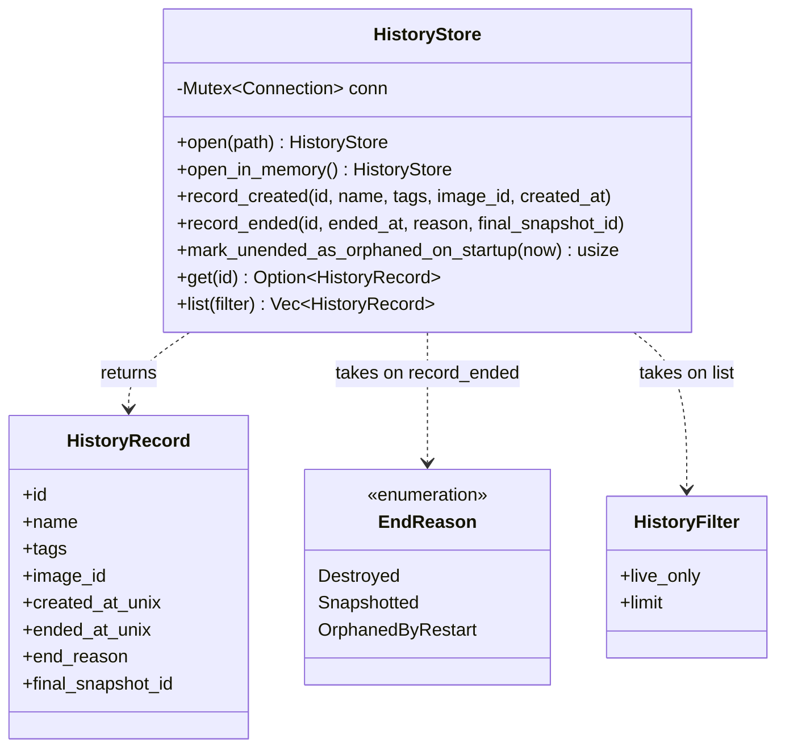
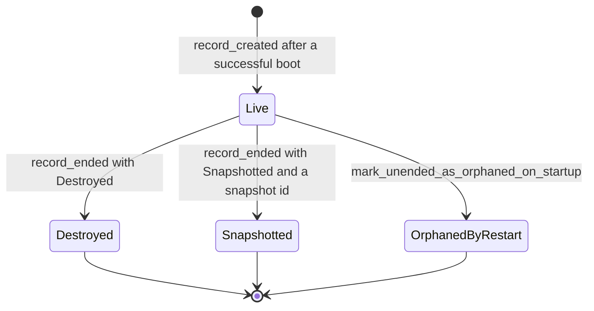
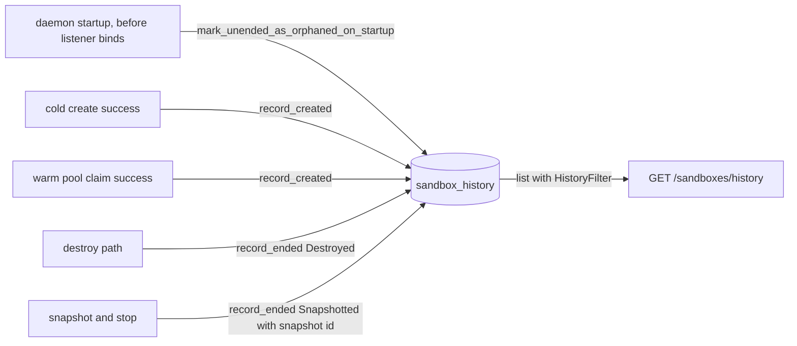

`sandkiln-store` answers one question: did this sandbox exist, and how did it end? It does not answer "can I get it back". That distinction is the whole reason the crate is small, and the first thing its documentation says.

A live sandbox owns a real OS process, a Firecracker child with an open API socket and an open vsock connection. None of that has a serializable form, and no code in this project re-adopts an orphaned Firecracker process after a daemon restart. The daemon's in-memory sandbox map therefore dies with the daemon, and `GET /sandboxes` goes blank. What survives a restart as a working sandbox is a snapshot, which has its own durability story. An orderly shutdown (`SIGTERM` or `SIGINT`) turns every live sandbox into a snapshot before the daemon exits, so a planned restart loses nothing; a `SIGKILL` or crash still leaves orphaned processes, and those are exactly the rows this crate marks `OrphanedByRestart`. This crate fills the gap between the two: a durable, queryable record of every sandbox that was ever created, with when, what tags and name, and how its life ended.

This is the crate-level tour. The docs-site page [SQLite: the history store](https://sandkiln.mintlify.site/internals/sqlite-history-store) explains the pragma choice for a general reader and shows a live request; this post covers the Rust surface, invariants, tests and boundaries. Read the [system overview](/engineering/01-system-overview) first if the daemon's role is new to you.

## Public API surface

The crate is one file, `core/crates/store/src/lib.rs`, with everything public defined directly in it. There is no re-export layer because there is nothing to hide.

| Item | Kind | Purpose |
| --- | --- | --- |
| `HistoryStore` | struct | The handle: `open`, `open_in_memory`, and the five operations below |
| `HistoryRecord` | struct (`Serialize`) | One row as returned to callers |
| `EndReason` | enum | `Destroyed`, `Snapshotted`, `OrphanedByRestart`, `VmExited` |
| `HistoryFilter` | struct (`Default`) | `live_only: Option<bool>`, `limit: Option<u32>` |
| `DEFAULT_LIST_LIMIT` | `u32` const (100) | The cap applied when no limit is given |

`HistoryStore`'s operations are `record_created`, `record_ended`, `mark_unended_as_orphaned_on_startup`, `get`, and `list`. Every one returns `rusqlite::Result`. The surface is exactly the set of lifecycle events the daemon has: a sandbox is born, a sandbox ends, the daemon starts and sweeps what a dead predecessor left behind, and a caller reads.



`open_in_memory` is `pub` but marked `#[doc(hidden)]`: it exists so the daemon's own tests and this crate's tests can build a store without touching disk, and it is not part of the supported surface. It deliberately skips the WAL pragmas, since write-ahead logging is meaningless for a `:memory:` database.

The dependencies are `rusqlite` 0.43 with the `bundled` feature, `serde` with `derive`, and `serde_json`; `tempfile` is a dev-dependency only. `bundled` compiles sqlite from source as part of this crate, so a self-hoster needs no `libsqlite3-dev`, which matches the project's "clone and build" story.

## Module tour

There is only one module, so the tour is a tour of the file. It has three layers.

**The type layer** (`EndReason`, `HistoryRecord`, `HistoryFilter`) is plain data. `EndReason::as_str` is private: the stored strings `destroyed`, `snapshotted` and `orphaned_by_restart` are an on-disk detail, not an API. Note that `HistoryRecord::end_reason` is `Option<String>`, not `Option<EndReason>`. The record is what a caller reads and serialises straight into an HTTP response, so it carries the stable string form and never forces a client to depend on the enum.

**The connection layer** is `open`, `configure_for_write_latency`, and `init_schema`. `open` creates missing parent directories (mapping a failure to a `SQLITE_CANTOPEN` error that carries the underlying message), opens the connection, applies two pragmas, and ensures the schema:

```rust
fn configure_for_write_latency(conn: &Connection) -> rusqlite::Result<()> {
    conn.pragma_update(None, "journal_mode", "WAL")?;
    conn.pragma_update(None, "synchronous", "NORMAL")?;
    Ok(())
}
```

(`core/crates/store/src/lib.rs:148-152`.) sqlite's defaults fsync twice per write, once for the rollback journal and once for the main database file. That measured about 9.24 ms on a real create's critical path, a lot for a store this code treats as best-effort. With write-ahead logging and `synchronous=NORMAL`, an isolated A/B on the same disk measured about 37 microseconds. The trade is documented at the function: WAL with `NORMAL` is durable against an application crash, and against an OS or power loss except for transactions in the last, not yet checkpointed part of the log. For a store whose callers already tolerate failure, that risk is absorbed without a design change.

The schema is one table and two indexes:

```sql
CREATE TABLE IF NOT EXISTS sandbox_history (
    id               TEXT PRIMARY KEY,
    name             TEXT,
    tags_json        TEXT NOT NULL,
    image_id         TEXT,
    created_at_unix  INTEGER NOT NULL,
    ended_at_unix    INTEGER,
    end_reason       TEXT,
    final_snapshot_id TEXT
);
CREATE INDEX IF NOT EXISTS idx_sandbox_history_created_at ON sandbox_history(created_at_unix);
CREATE INDEX IF NOT EXISTS idx_sandbox_history_ended_at ON sandbox_history(ended_at_unix);
```

(`core/crates/store/src/lib.rs:156-167`.) There is no migration framework. The `AGENTS.md` rule is that a schema change extends `init_schema`'s `CREATE TABLE IF NOT EXISTS` with nullable columns instead, which is sufficient for a single-table store of this scale. Tags are stored as a JSON string in `tags_json`, which keeps the table flat and means tag filtering is not a database feature today (nothing in the filter type asks for it).

**The operations layer** is the five methods. `list` is the only one that builds SQL dynamically, and it does so safely: the `WHERE` fragment is chosen from a closed three-way match on `Option<bool>`, never from caller text, and the limit is bound as a parameter.

```rust
let where_clause = match filter.live_only {
    Some(true) => " WHERE ended_at_unix IS NULL",
    Some(false) => " WHERE ended_at_unix IS NOT NULL",
    None => "",
};
let sql = format!("SELECT * FROM sandbox_history{where_clause} ORDER BY created_at_unix DESC LIMIT ?1");
```

(`core/crates/store/src/lib.rs:233-238`.) The default limit of 100 is deliberate. The table only grows, so an unbounded default would get slower and larger forever; a caller who wants more passes an explicit `limit`.

## Record lifecycle and the "live" invariant

A record's state is encoded by two nullable columns: `ended_at_unix` and `end_reason`. `NULL` means "live as of the last write". That claim is only trustworthy while the daemon that wrote the row is still running, which is exactly why `mark_unended_as_orphaned_on_startup` exists.



There is no transition out of an ended state, and no code path attempts one. `mark_unended_as_orphaned_on_startup` only touches rows where `ended_at_unix IS NULL`, so a sandbox that ended properly before the restart keeps its true reason. A test pins that (`mark_unended_as_orphaned_only_touches_still_live_rows`). The doc comment explains why the sweep is unconditionally correct rather than a heuristic: nothing survives a daemon restart that could still be genuinely live, so every row without an end belongs to a dead process.

`record_ended` is a plain `UPDATE ... WHERE id = ?`. Called with an unknown id it updates zero rows and returns `Ok`, a silent no-op, because a sandbox created by a daemon build older than the store has nothing to update and that is expected. `final_snapshot_id` is only meaningful for `Snapshotted`; a destroy passes `None`.

## Error model

Everything surfaces `rusqlite::Error`. There is no wrapper enum, because the daemon treats every failure from this crate the same way: log a warning and carry on. The one place the crate builds its own error is `open`, where `create_dir_all` failure is translated into `SQLITE_CANTOPEN` with the directory path and OS error in the message, so a bad `history_db_path` setting (environment variable `SANDKILN_HISTORY_DB_PATH`, TOML key `history_db_path`, default `~/sandkiln-tools/history.db`; see [config, SDKs and CLI](/engineering/10-config-sdks-and-cli)) produces a readable startup failure.

Two choices are worth naming. `row_to_record` parses `tags_json` with `unwrap_or_default()`, so a corrupt tags column yields an empty map rather than failing the whole listing. A bad row degrades; it does not poison a read of the other rows. And `record_created` uses `.expect` on tag serialisation, which cannot fail for a `String` to `String` map; a panic there would be a genuine bug rather than a runtime condition. Mutex poisoning is not handled: every method locks with `.unwrap()`, so a panic while a thread holds the connection would make later calls panic too. For a store with no code that panics under the lock, that is an accepted simplification.

The more important error-handling decision is on the daemon's side of the boundary. The call sites treat store errors as non-fatal:

```rust
if let Err(e) = state.history.record_created(&id, request.name.as_deref(), &request.tags, request.image_id.as_deref(), created_at) {
    tracing::warn!(error = %e, sandbox_id = %id, "failed to record sandbox creation in history store");
}
```

(`core/crates/daemon/src/http/routes/sandbox.rs:409`, in `create_sandbox_cold`; the same pattern wraps the `record_ended` calls.) The VM has already booted by the time history is written, so failing the request would waste a real running sandbox for a bookkeeping error. That tolerance is the reason loosening `synchronous` to `NORMAL` was a reasonable choice rather than a compromise: the write was never allowed to block correctness, only to cost time.

## How neighbours consume it

The daemon is the only consumer. `AppState` owns one `HistoryStore` (`core/crates/daemon/src/state.rs:76`), opened once at startup from the `history_db_path` setting (`core/crates/daemon/src/main.rs:117`). The wiring is five call sites and one read endpoint.



- **Created.** `record_created` fires from the cold-create path (`create_sandbox_cold`, `http/routes/sandbox.rs:409`) and from the pool-claim path (`lifecycle/pool_claim.rs:241`), each only after the boot or resume has succeeded. A failed boot never appears in history, matching `GET /sandboxes` only ever listing sandboxes that exist.
- **Ended.** `record_ended` fires from the shared destroy path (`destroy_sandbox_by_id`, `http/routes/sandbox.rs:743`) with `Destroyed`, and from `snapshot_and_stop` (`http/routes/snapshot.rs:258`) with `Snapshotted` plus the new snapshot id. The idle reaper, `DELETE`, the pool replenisher and the orderly-shutdown drain (`lifecycle/shutdown.rs`) all go through those shared functions, so no lifecycle exit path can forget to record. A graceful shutdown therefore writes `Snapshotted` (or `Destroyed` for a jailed sandbox that cannot be snapshotted) for every live sandbox, and the orphan sweep below only ever finds rows left by a crash or `SIGKILL`.
- **Orphaned.** The startup sweep runs in `main` (`core/crates/daemon/src/main.rs:126`), before the HTTP listener binds, alongside snapshot reconciliation, so no request can observe a stale "live" row.
- **Read.** `sandbox_history` (`http/routes/sandbox.rs:548`) parses `?live_only=` and `?limit=` into a `HistoryFilter`, runs `list` inside `spawn_blocking` (the store is synchronous), and maps each `HistoryRecord` into a response body.

There is no write endpoint. Every write is a side effect of an existing lifecycle operation, which keeps the history honest: it cannot be edited through the API. A search of the SDK and CLI packages finds no reference to the history endpoint; only the docs-site API reference documents it, so today it is an HTTP-level feature.

Resource ownership is simple. The crate owns the sqlite file and its `-wal` and `-shm` companions, and the daemon owns when to open it. If the daemon crashes, the next `open` recovers the WAL automatically, and the next startup sweep marks anything left live.

## Test strategy

`cargo test -p sandkiln-store` runs 13 tests, all in-process:

- **Round trips.** `record_created_then_get_round_trips_every_field` writes name, tags and image id and reads each back. `get_on_a_nonexistent_id_returns_none_not_an_error` pins the `Option` contract.
- **End states.** One test each for `Snapshotted` (reason and snapshot id both stored) and `Destroyed` (snapshot id absent), plus the unknown-id no-op.
- **The startup sweep.** `mark_unended_as_orphaned_only_touches_still_live_rows` creates two live rows and one already-destroyed row, runs the sweep, and asserts the returned count is exactly 2 and that the destroyed row keeps `destroyed`.
- **Listing.** Default ordering is newest-created first (three rows inserted out of order), `live_only` excludes ended rows, an explicit limit is honoured, and an empty store returns an empty vector rather than an error.
- **Durability.** `open_creates_missing_parent_directories`, `open_on_an_existing_database_preserves_prior_rows` (write, drop, reopen, read), and `open_sets_wal_and_synchronous_normal_for_write_latency`, which queries the pragmas back from sqlite and asserts `wal` and the integer level `1`.

Most tests use `open_in_memory`; the three that need a real file use `tempfile`. The WAL test matters because the pragma is a performance decision with no visible functional effect, and without a test a refactor could silently drop it and re-add the 9 ms fsync cost.

Not covered by unit tests: behaviour across a real daemon restart. The integration topic `scripts/integration-tests/16-sandbox-history.sh` checks create, destroy and snapshot recording against a live daemon, but its own header says it deliberately does not restart the daemon mid-suite, since that would tear down every other topic's sandboxes. The orphan-marking across a true restart was verified manually, per the comment there. Concurrent writes are also untested, which is consistent with the single-mutex design.

## Design alternatives rejected

**An async database layer (`sqlx`).** Every VM-touching daemon route already runs in `spawn_blocking`, so a synchronous `rusqlite` call fits with no new concurrency model. Adding an async pool for one small store would introduce a second way of doing I/O.

**A connection pool.** One `Mutex<Connection>` is enough for a single daemon at low request rates. A pool would bring real complexity, `busy_timeout` tuning and sqlite's concurrent-writer semantics, for volume this daemon will never produce.

**Re-adopting live sandboxes from this store.** Impossible by construction, as above: a live `Sandbox` owns a process handle and sockets with no serialisable form. Rather than half-build it, the crate documents that it cannot and scopes itself to history.

**A schema migration framework.** Rejected as unwarranted for one table; nullable columns added to `init_schema` cover the foreseeable changes.

**Leaving sqlite's default pragmas.** Rejected on measurement: roughly 9.24 ms versus about 37 microseconds per write, in an isolated comparison.

**Unbounded `list`.** Rejected because the table only grows. The default limit stays, and callers page with an explicit `limit`.

**Tracking history in the daemon's own JSON files.** The snapshot system already uses atomic JSON plus directory reconciliation for state that must resume. History is a different shape, append-mostly and queryable, and sqlite gives ordering and filtering without writing that logic by hand. The two systems solve different problems and deliberately do not overlap.
