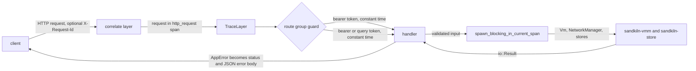
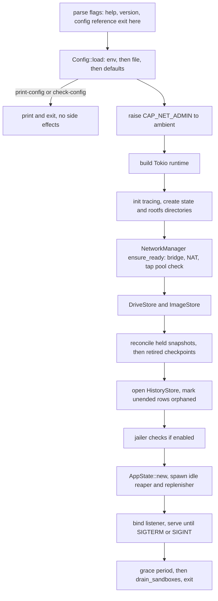
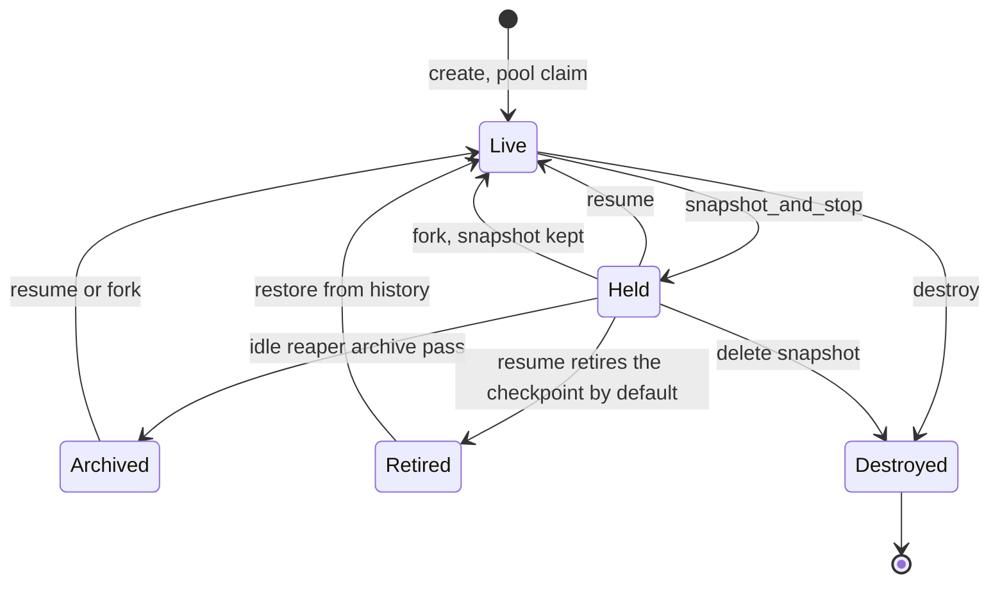
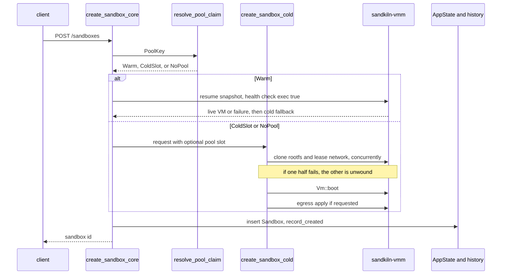

`sandkiln-daemon` builds the `sandkilnd` binary: the process that SDKs, the CLI and curl actually talk to. Its own `AGENTS.md` states the division of labour in a sentence: keep business logic, meaning VM lifecycle and networking, in `sandkiln-vmm`, and let this crate parse requests, call `vmm`, and shape responses.

That sentence undersells what is left for the daemon to do. It owns every piece of shared mutable state in the system: which sandboxes are live, which snapshots are held, which drives and images and network identities are claimed, which pools are warm. `sandkiln-vmm` is a library of mechanisms. The daemon is where those mechanisms get ownership, ordering and cleanup.

This is the crate-level tour. The earlier [daemon internals](/engineering/08-daemon-internals) post takes a request-flow view; this one is organised by the same headings as the other crate tours, and it names real files under `core/crates/daemon/src/`. Read the [system overview](/engineering/01-system-overview) first.

## Module layout

The source tree is split by concern, not by size. `main.rs` is bootstrap only (231 lines): parse flags, load config, raise capabilities, build the runtime, wire state, serve, drain.

```
src/
  main.rs            bootstrap and shutdown sequencing
  state.rs           AppState and its ownership queries
  storage.rs         on-disk layout, OwnedFile scope guard
  sandbox.rs         the live Sandbox record
  metrics.rs         hand-rolled Prometheus rendering
  log_session.rs     one streamed exec session's ring buffer
  tracing_util.rs    spawn_blocking_in_current_span
  config/            mod.rs, settings.rs, source.rs, cli.rs
  http/              mod.rs (build_router), auth.rs, error.rs, request_id.rs
    routes/          sandbox, sandbox_name, exec, fs, logs, mounts, tunnel,
                     pty, preview, drives, images, pool, snapshot,
                     snapshot_history, metrics
  lifecycle/         idle_reaper, pool, pool_claim, pool_replenisher, shutdown
  snapshots/         held.rs, retired.rs
```

`http/routes/mod.rs` lists one module per API resource, and `http/mod.rs` (`build_router`, line 18) is the only place that assembles them and decides which auth layer guards which. `lifecycle/` holds everything that outlives a single request, and `snapshots/` holds the on-disk snapshot state: `held.rs` is the live set of resumable snapshots (each pins a network lease), `retired.rs` is lease-free checkpoints kept for time-travel restore. They use separate roots so reconciling one never has to understand the other's invariants.

## Public API surface

This is a binary crate with no library target, so there is no Rust API to export. The public surface is the HTTP API, assembled in `build_router`. Auth is attached per router group, not globally:

| Group | Routes | Guard |
| --- | --- | --- |
| Open | `GET /healthz`, `GET /metrics` | none: operational data, not sandbox data |
| Sandboxes | `POST/GET /sandboxes`, `GET /sandboxes/history`, `POST /sandboxes/get-or-create`, `GET /sandboxes/by-name/:name`, `DELETE /sandboxes/:id` | bearer token |
| Guest operations | `exec`, `read-file`, `write-file`, `chmod`, `chown`, `mkdir`, `rename`, `copy`, `symlink`, `readlink`, `truncate`, `list-dir`, `exec-stream`, mounts, tunnel create/delete, all under `/sandboxes/:id/` | bearer token |
| Drives | `POST/GET /drives`, `DELETE /drives/:id` | bearer token |
| Images | `POST/GET /images`, `DELETE /images/:id` | bearer token |
| Pools | `POST/GET /pools`, `DELETE /pools/:id` | bearer token |
| Snapshots | `POST /sandboxes/:id/snapshot`, `GET /snapshots`, `POST /snapshots/:id/resume`, `POST /snapshots/:id/fork`, `DELETE /snapshots/:id`, `GET /snapshots/history`, `POST /snapshots/history/:id/restore`, `DELETE /snapshots/history/:id` | bearer token |
| Preview | `ANY /sandboxes/:id/preview/:port` and subpaths | bearer header or `?token=` |
| WebSocket | `GET /sandboxes/:id/pty`, `.../exec-stream/:session_id/logs`, `.../tunnel/:tunnel_id/ws` | bearer header or `?token=` |

The second guard (`require_preview_token`, `http/auth.rs:53`) exists because a browser tab, an `<iframe>`, and every runtime's native `WebSocket` constructor cannot set an `Authorization` header. A preview URL is therefore a bearer credential in URL form, an accepted and documented tradeoff. When `auth_token` is unset (the `SANDKILN_AUTH_TOKEN` variable or the `auth_token` key in `sandkiln.toml`), both guards are no-ops and `main` logs a warning that the API is unauthenticated.

The pure part of the bearer check is separated from the axum plumbing so it can be tested without constructing an `AppState`, and the comparison itself is constant time:

```rust
fn token_matches(header_value: Option<&str>, expected: &str) -> bool {
    header_value.and_then(|value| value.strip_prefix("Bearer ")).is_some_and(|provided| constant_time_eq(provided, expected))
}

fn constant_time_eq(a: &str, b: &str) -> bool {
    let (a, b) = (a.as_bytes(), b.as_bytes());
    let mut diff = a.len() ^ b.len();
    for i in 0..a.len().max(b.len()) {
        diff |= usize::from(a.get(i).copied().unwrap_or(0) ^ b.get(i).copied().unwrap_or(0));
    }
    diff == 0
}
```

(`core/crates/daemon/src/http/auth.rs:30-43`.) An ordinary `==` on strings returns at the first differing byte, so response timing would reveal how much of a guessed token was right. This version always walks the longer of the two inputs, folds every byte difference into one accumulator, and only the token's length itself can leak. The preview guard's `preview_token_matches` (line 73) applies the same function to the header form and to the `?token=` form. Tests include `constant_time_eq_agrees_with_plain_equality`.

Layering order matters. The request-correlation layer (`request_id::correlate`, `http/request_id.rs:33`) is outermost, wrapping the tracing layer, so the request id is already the active span before any per-request log line, including the tracing layer's own request-complete line.



## Module tour

| Concern | Files and items |
| --- | --- |
| Startup and wiring | `main.rs`: `main`, `async_main`, `raise_net_admin_ambient` |
| Configuration | `config/mod.rs` (`Config`, `Loaded`, `ConfigError`), `settings.rs` (`SETTINGS`), `source.rs` (`Resolver`), `cli.rs` |
| Shared state | `state.rs` (`AppState`), `sandbox.rs` (`Sandbox`), `snapshots/held.rs` (`Snapshot`), `snapshots/retired.rs` (`RetiredSnapshot`), `lifecycle/pool.rs` (`Pool`) |
| Lifecycle operations | `http/routes/sandbox.rs` (`create_sandbox_core`, `create_sandbox_cold`, `stop_sandbox_by_id`), `http/routes/snapshot.rs` (`snapshot_and_stop`, resume, fork), each defined once and reused by routes and background tasks |
| Pools | `lifecycle/pool_claim.rs` (`resolve_pool_claim`, `PoolClaimGuard`, `claim_from_pool`), `lifecycle/pool_replenisher.rs` |
| Background tasks | `lifecycle/idle_reaper.rs`, `lifecycle/pool_replenisher.rs`, `lifecycle/shutdown.rs` |
| Guest operations | `http/routes/exec.rs` (`call_agent`, `resolve_env`, `agent_call_error`) |
| Long-lived sessions | `log_session.rs` (`LogSession`), `http/routes/pty.rs`, `http/routes/tunnel.rs`, `http/routes/logs.rs` |
| Cross-cutting | `http/error.rs` (`AppError`), `metrics.rs` (`Metrics`), `http/request_id.rs` (`correlate`), `tracing_util.rs` (`spawn_blocking_in_current_span`), `storage.rs` |

### Configuration

Configuration is one registry and one resolver. `config/settings.rs` defines `SETTINGS`, a table of 31 `Setting` entries (key, default, group, documentation, and a `secret` flag). Everything that used to be a scattered environment read now derives from that table: value lookup, unknown-key detection in the config file, `--print-config`, and the generated settings reference that `sandkilnd --config-reference` prints, so the documented defaults cannot drift from the real ones.

Values resolve in a fixed order (`Resolver` in `config/source.rs`): environment variable, then `sandkiln.toml`, then the registry default. A set-but-empty environment variable counts as unset, so `export SANDKILN_X=` clears a file value. Every problem is accumulated into one `ConfigError` instead of panicking on the first, so one startup attempt reports everything wrong. Unknown keys in the file are rejected with a did-you-mean hint, and an `auth_token` in a file readable by group or others produces a warning (`config/mod.rs:205-226`). The file is found from `--config`, then `$SANDKILN_CONFIG`, then `./sandkiln.toml`, then `~/.config/sandkiln/sandkiln.toml` (`discover_file`, `config/mod.rs:176`).

`config/cli.rs` hand-parses the six flags, `--config`, `--check-config`, `--print-config`, `--config-reference`, `--help` and `--version`, because a dependency for six flags would cost more than it saves. `--check-config` and `--print-config` run before the capability raise and the Tokio runtime ever start. `sandkiln.example.toml` at the repository root is guarded by a unit test (`example_file_covers_every_setting_and_is_valid_when_fully_uncommented`, `config/mod.rs:538`), and `scripts/setup.sh`, `scripts/sandkilnd-ctl.sh` and `scripts/preflight-check.sh` use the same machinery. The full story, including how the scripts read effective config, is in [configuration, the SDKs and the CLI](/engineering/10-config-sdks-and-cli).

### Startup

`main` is a plain `fn main()`, not `#[tokio::main]`. After handling the flags it raises `CAP_NET_ADMIN` into the ambient set, then builds the Tokio runtime by hand. The ordering is load-bearing: the runtime's worker and blocking threads clone credentials at spawn time, so a raise that happens after the runtime starts is never seen by them. Ambient raise needs the capability in both the permitted and inheritable sets, and only the file capability sets permitted, so `raise_net_admin_ambient` (`main.rs:220`) adds inheritable itself before raising ambient. The child processes (`ip`, `iptables`, `bridge`) inherit it.



Reconciliation runs before the listener binds, and snapshot reconciliation runs before `AppState` takes ownership of the `NetworkManager`. A reconciled snapshot's tap device has to leave the free pool, via `NetworkManager::reserve`, before any live create can race it for the same tap. The history orphan sweep follows the same logic, as covered in the [store tour](/engineering/14-crate-store).

### Orderly shutdown

Without a shutdown path, a restart or a plain `SIGTERM` left every sandbox's Firecracker process running with nothing owning it: leaked memory, leaked tap devices, and sandboxes lost for good. `lifecycle/shutdown.rs` closes that gap with three steps:

1. `signal()` resolves on `SIGINT` or `SIGTERM`. `main` then tells axum to stop accepting, and in-flight requests get `REQUEST_GRACE` (30 seconds) to finish.
2. `drain_sandboxes` snapshots every live sandbox concurrently via `stop_sandbox_by_id(.., keep = true)`. A sandbox that cannot be snapshotted (`StopError::CannotPreserve`, which in practice means a jailed one) is destroyed instead, so nothing is left running.
3. The whole drain is bounded by `DRAIN_DEADLINE` (60 seconds); if it expires the daemon exits anyway and logs a warning.

Snapshots are already durable and are reconciled on the next start, so "snapshot on the way out" is how the "persistent by default" promise survives a restart. Verified live on 2026-11-24 (`scripts/restart-test.sh`): three sandboxes were snapshotted in 0.75 s, the daemon exited in about a second, zero Firecracker processes remained, and the snapshots resumed after the restart. The history rows are written by the same shared stop path, so a graceful shutdown records `Snapshotted` and leaves the orphan sweep nothing to do. The limit is stated plainly: `SIGKILL` or a crash skips all of this and still orphans processes, which is why the startup sweep and reconciliation still exist.

## Key types and invariants

### AppState: the ownership maps

`AppState` (`core/crates/daemon/src/state.rs:45`) is shared as `Arc<AppState>`. Its fields group into three kinds.

**Resource managers**, built once at startup: `NetworkManager`, `DriveStore`, `ImageStore`, an optional `JailerIdPool` (present exactly when jailing is enabled), and the `HistoryStore`.

**Ownership maps**, each behind a `std::sync::Mutex<HashMap<..>>`: `sandboxes` (live), `snapshots` (held, restorable), `retired_snapshots` (checkpoints kept for time-travel restore), `pools`, `tunnels`, and per-name `name_locks`.

**Reservation sets**, covering the gap between "decided" and "visible in a map": `pending_image_boots` (refcounted, so a concurrent image delete cannot remove a file an in-flight clone is reading) and `pending_tap_restores`.

The invariant this structure serves is the one the root `AGENTS.md` names in section 8: for every resource, one place answers "who holds this". That is `drive_holders` (`state.rs:140`), `image_holder` (`:211`) and `tap_device_holder` (`:238`). They walk live sandboxes, held snapshots and retired checkpoints, so a drive attached read-write to a snapshot cannot be re-attached read-write elsewhere, and an image cannot be deleted from under a checkpoint that would later be restored. `image_holder` and `tap_device_holder` share one small generic walk (`first_match`, `:315`). `drive_holders` stays separate because it returns every matching holder, since several read-only holders are legitimate.

Names get the same treatment. `name_holder` and `resolve_name` check live sandboxes before held snapshots, and `lock_name` (`:277`) returns a guard serialising concurrent claims of one name, so two simultaneous creates of a brand-new name cannot both see it as free, without blocking unrelated names.

### Sandbox and Snapshot: where identity lives

A `Sandbox` (`sandbox.rs`) owns a `Vm`, a network `Lease`, and a private rootfs file. A `Snapshot` (`snapshots/held.rs`) takes those over when a sandbox is stopped with its state kept: it holds the exact `Lease`, because guest IP and MAC are frozen into the saved memory image, and it keeps the rootfs path, because Firecracker's snapshot records only the file's host path. Anything resumed from it must be given its own disk explicitly (`rootfs_override`), or it would write into the snapshot's file (post 27). Several fields exist to protect these invariants:

- **`forked_into`** on a snapshot is a lock ruling out two live descendants sharing one tap device and network identity (each fork has its own rootfs clone, so the disk is no longer a reason for it). It is set while a fork runs and cleared only after that descendant's `Vm` has actually been killed.
- **`source_snapshot_id` and `parent_snapshot_id` are separate on purpose.** The first is `Some` only for a fork, and is what refuses re-snapshotting one. The second is lineage and must be `Some` on both resume and fork. Conflating them was a real bug, caught live, as the field's own doc comment records.
- **`network` and `egress` are `None` for a fork.** The snapshot owns the lease and the iptables chain tied to it.
- **A `RetiredSnapshot` holds a bare `NetworkConfig`, not a live `Lease`.** Nothing is reserved from the free pool just by sitting in history; a lease is taken only at restore time, gated by `tap_device_holder`.



The diagram is conceptual: `Live`, `Held` and `Retired` are different records in different maps, not one record with a status field. That is a deliberate modelling choice, set out in the field comment on `retired_snapshots`: a retired checkpoint holds no live `Lease`, which is structurally unlike every `snapshots` entry, so it gets its own map rather than a flag. `check_snapshottable` (`http/routes/snapshot.rs:101`) encodes the two ways a live sandbox cannot move to `Held`:

```rust
fn check_snapshottable(is_jailed: bool, source_snapshot_id: Option<&str>) -> Result<(), SnapshotBlocked> {
    if is_jailed {
        return Err(SnapshotBlocked::Jailed);
    }
    if let Some(source) = source_snapshot_id {
        return Err(SnapshotBlocked::ForkedFrom(source.to_string()));
    }
    Ok(())
}
```

A jailed sandbox bakes in-jail paths into its snapshot and `Vm::resume` only spawns directly, and a fork does not own its lease. Callers react to the two reasons differently: an explicit snapshot request turns both into errors, while the default stop path (`stop_sandbox_by_id`, `http/routes/sandbox.rs:669`) treats a fork as a harmless fall-through to destroy and only a jailed sandbox as a real conflict.

The snapshot itself runs through `snapshot_and_stop` (`http/routes/snapshot.rs:147`), shared by the explicit route, the default stop path, the idle reaper, the pool replenisher and shutdown, so the mechanics cannot drift. Inside it the VM is paused, snapshotted, and then stopped with `Vm::force_stop`, not `stop`. The old `stop()` first asked the guest to `sync`, a request a paused guest can never answer, so every snapshot sat out a doomed timeout: 6.8 s end to end for about 0.5 s of real work. With `force_stop` the same request measured 0.56 s (live, 2026-11-24, directional). See the [vmm tour](/engineering/13-crate-vmm) for the stop variants.

## Create path and failure handling

`create_sandbox_core` (`http/routes/sandbox.rs:154`) is the shared boot logic, used by plain create and by get-or-create (both resolve name uniqueness first, under the same `lock_name` guard). It validates drives (they must exist, and `drive_holders` plus `can_attach_read_only` decide whether they can attach), resolves vCPU and memory overrides, the rate limit and the egress policy, and then tries a warm pool claim when the request has no `drives` and no `rate_limit`. Both are baked into a VM at boot, so a warm snapshot cannot satisfy them. Egress policy does not disqualify a claim, since it is host-side iptables applied after boot. A claim that fails its post-resume health check is retried against the pool a bounded number of times (`MAX_POOL_CLAIM_ATTEMPTS`, `lifecycle/pool_claim.rs:26`) before falling back to a cold create. `create_sandbox_cold` (`:230`) reserves the pending image boot and picks the rootfs source.



Every arrow into `sandkiln-vmm` is inside a `spawn_blocking_in_current_span`. Within the cold path, the rootfs clone and the network lease run on separate scoped threads and are timed individually, with a `setup` phase recording the join. Failure handling follows root `AGENTS.md` section 7 literally: each resource is released on the specific failure it would otherwise leak on.

The two halves run concurrently, so either can succeed while the other fails, and an earlier version only handled the case where both succeeded. The current code unwinds whichever half holds a resource:

```rust
let lease = match (copy_result, lease_result) {
    (Ok(()), Ok(lease)) => lease,
    (copy, lease) => {
        if copy.is_ok() {
            let _ = std::fs::remove_file(&rootfs_path);
        }
        let lease_err = match lease {
            Ok(lease) => {
                let _ = state.network.release(lease);
                None
            }
            Err(e) => Some(e),
        };
        return Err(copy.err().or(lease_err).expect("one half failed"));
    }
};
```

(`core/crates/daemon/src/http/routes/sandbox.rs:313-330`.) If the clone worked but the lease failed, the multi-hundred-MiB rootfs copy is deleted. If the lease worked but the clone failed, the lease goes back to the pool.

After that point the rootfs is protected by a scope guard, `storage::OwnedFile` (`core/crates/daemon/src/storage.rs`). It deletes its path on `Drop` unless `keep()` was called, which `create_sandbox_cold` does only once the VM has booted and any egress policy has applied (`:389`). Every early return in between, a failed jailer id lease, a failed boot, a failed egress apply, removes the clone without a hand-written cleanup line at each site.

```rust
Err(e) => {
    let _ = state.network.release(lease);
    if let (Some(id), Some(pool)) = (jail_id, &state.jailer_ids) {
        pool.release(id);
    }
    Err(e)
}
```

(The `Vm::boot` failure arm, `:392`.) A failed boot releases the lease and the jailer id, and the `OwnedFile` guard removes the rootfs. A failed egress apply tears down the VM, releases the lease and the jailer id, and again drops the rootfs, because handing back a sandbox the caller asked to restrict, but which is unrestricted, would be a security gap. A failed jailer id lease releases the lease already taken.

Two RAII guards cover the other exits no `match` arm can see. `PendingImageBootGuard` (`http/routes/sandbox.rs:106`) releases the pending image reference on every path, including early returns. `PoolClaimGuard` (`lifecycle/pool_claim.rs:91`) releases a reserved pool slot on drop unless `commit()` ran first:

```rust
impl Drop for PoolClaimGuard {
    fn drop(&mut self) {
        if self.committed {
            return;
        }
        if let Some(pool_id) = &self.pool_id {
            if let Some(pool) = self.state.pools.lock().unwrap().get_mut(pool_id) {
                pool.record_release();
            }
        }
    }
}
```

The slot is reserved before the slow resume or boot so a concurrent claim cannot over-commit past `max_count`, and it is committed only once a real `Sandbox` durably owns it. See [pre-warmed pools](/engineering/07-pre-warmed-pools) and the docs-site page [pre-warmed pools](https://sandkiln.mintlify.site/internals/pre-warmed-pools) for the queueing design.

**Known limitation.** In the full four-way-parallel integration suite, two or three of roughly 320 checks fail because a freshly resumed guest kernel panics ("Attempted to kill the idle task!" about 20 ms after restore) and its Firecracker process exits. 160 of 160 resume and re-snapshot cycles were clean in isolated and four-way-parallel loops, so it needs a specific concurrent condition, and the root cause has not been found. The pool-claim path is protected by the post-resume health check described above, which falls back to a cold create; an explicit resume or fork has no such net.

### Guest calls and the sandbox lock

The sandbox map lock is a `std::sync::Mutex`, held across blocking calls inside `spawn_blocking` and never across an `.await`. It is also no longer held across a guest call. `call_agent` (`http/routes/exec.rs:122`) used to keep the daemon-wide `sandboxes` mutex for the whole vsock exchange, so one slow command froze every other sandbox operation. Now it copies out a cheap owned handle and releases the lock first:

```rust
let endpoint = {
    let sandboxes = state.sandboxes.lock().unwrap();
    let sandbox = sandboxes.get(&id).ok_or_else(|| AppError::NotFound(id.clone()))?;
    *sandbox.last_activity.lock().unwrap() = Instant::now();
    sandbox.vm.agent_endpoint()
};
let timeout = state.config.exec_timeout;
```

(`core/crates/daemon/src/http/routes/exec.rs:126-132`.) The call then goes through `AgentEndpoint::call_with_timeout` with the `exec_timeout_secs` setting (default 600 seconds) as the reply bound. User commands can stay silent for as long as they run, so they must not inherit the 3 second control-plane bound, and the retry loop underneath never re-sends a request the guest already accepted; the earlier behavior ran any command silent for more than three seconds twice. When the reply bound expires, `agent_call_error` (`:146`) maps the timeout to `AppError::GatewayTimeout`, a `504`, not a `500`: the sandbox is fine, the command just has not finished, and the message says it may still be running in the guest. Every route that forwards one request to the agent (exec, read, write, and every filesystem handler) goes through `call_agent`. `scripts/integration-tests/25-long-running-commands.sh` pins the behavior against a real daemon: a command silent for 4 seconds succeeds and runs exactly once, `GET /sandboxes` answers in under a second while another command runs, and a snapshot request completes in under 3 seconds. `resolve_pool_claim` shows the same lock discipline: lock, decide or clone the pool's `Notify`, unlock, optionally await with a bounded timeout (`POOL_QUEUE_TIMEOUT`, 30 seconds, ending in a real `503`), loop with fresh state.

`tracing`'s current span is thread-local, so a bare `spawn_blocking` silently drops request correlation. The helper that every VM-touching route uses (`tracing_util.rs:27`) captures both the span and the default dispatcher and re-establishes them on the blocking-pool thread:

```rust
let span = tracing::Span::current();
let dispatch = tracing::dispatcher::get_default(tracing::Dispatch::clone);
tokio::task::spawn_blocking(move || tracing::dispatcher::with_default(&dispatch, || span.in_scope(f)))
    .await
    .expect(panic_message)
```

That is how an event deep inside `sandkiln-vmm`'s `Vm::boot` carries the request id the outermost layer assigned. The `correlate` layer accepts a caller's `X-Request-Id` only if it is well-formed (non-empty, at most 200 ASCII-graphic characters), because the value is written verbatim into every log line.

## Error model

Every handler returns `AppError` (`http/error.rs`), one enum with a status code per variant, rendered as `{"error": "<message>"}`:

| Variant | Status |
| --- | --- |
| `NotFound`, `DriveNotFound`, `ImageNotFound` | 404 |
| `BadRequest` | 400 |
| `Conflict` | 409 |
| `BadGateway`, `GatewayTimeout` | 502, 504 (preview proxy, and an agent reply that exceeded `exec_timeout_secs`) |
| `ServiceUnavailable` | 503 (pool queue timed out) |
| `Internal(io::Error)` | 500, via `From<io::Error>` |

One function, `status_and_message`, produces both the response and the `Display` text, so log lines and HTTP bodies cannot drift. Domain-specific error types sit below it where a non-HTTP caller needs to branch: `StopError` and `SnapshotStopError` are separate from `AppError` so the idle reaper and the shutdown drain can react to "cannot preserve" by falling back to a full destroy without an HTTP-shaped type.

Validation happens at the server boundary even when clients already validate: a bad egress CIDR is a `400` naming it, and resource overrides above the configured maximum are rejected rather than clamped. Non-fatal side effects degrade loudly: a history write failure logs a warning, and an egress re-apply failure on resume or fork warns rather than destroying a sandbox that already resumed.

## Background tasks

Two tasks spawn unconditionally from `main`, since a tick with nothing configured is a cheap no-op scan. The pool replenisher (`lifecycle/pool_replenisher.rs`) tops each pool up by one warm slot per two-second tick (`CHECK_INTERVAL`), gradual rather than a load spike. The idle reaper (`lifecycle/idle_reaper.rs`) computes its interval from the shortest configured timeout (`idle_timeout_secs`, `auto_suspend_timeout_secs`, `archive_timeout_secs`, each also readable as a `SANDKILN_` environment variable), halved and clamped between one and thirty seconds. Each tick runs auto-suspend, then destroy, then an independent archive pass over held snapshots. Ordering is the design: a successfully suspended sandbox leaves the live map, so the destroy pass never sees it, and with the enforced invariant that the suspend timeout is below the destroy timeout, destroy is a backstop rather than a race. The decision itself is the pure function `is_idle` (`idle_reaper.rs:195`), a saturating subtraction compared against the timeout. Every exec, read and write updates a sandbox's `last_activity` through the shared agent-call helper. The third lifecycle task, shutdown, is not periodic and is described above.

## Test strategy

`cargo test --workspace` from `core/` was re-run on 2026-11-24, with these per-crate results:

| Crate | Tests |
| --- | --- |
| `sandkiln-daemon` | 222 |
| `sandkiln-protocol` | 39 |
| `sandkiln-vmm` | 66 |
| `sandkiln-store` | 13 |
| `sandkiln-guest-agent` | 0 |
| Total | 340 |

None needs KVM. The daemon's approach is to pull decisions out of framework plumbing and construction-heavy types (a real `Sandbox` or `Snapshot` needs a VM) and test them as pure functions: `token_matches` and `constant_time_eq`, `is_idle`, `find_named`, `first_match`, `check_snapshottable`, `resolve_egress_policy`, request-id validation, `agent_call_error`. By file, counting `#[test]` attributes (one more than the runner total, so treat as approximate):

| Area | Tests | What they cover |
| --- | --- | --- |
| `state.rs` | 29 | Holder lookups, name resolution and `lock_name`, drive attach rules, reservation sets |
| `config/` (`mod`, `source`, `cli`, `settings`) | 35 | Layered resolution, error accumulation, unknown-key hints, flag parsing, registry consistency, the `sandkiln.example.toml` guard |
| `http/routes/sandbox.rs`, `sandbox_name.rs` | 23 | Resource override resolution, egress policy validation, query parsing, name routes |
| Snapshots (`held.rs`, `retired.rs`, `routes/snapshot.rs`) | 34 | Atomic metadata write, round trip, defaults for metadata from older builds, skipping directories missing files or with corrupt metadata, reserving the snapshot's tap on reconcile, `check_snapshottable` |
| `routes/preview.rs` | 15 | Target URI building, token query extraction and stripping, hop-by-hop and `Authorization` header stripping |
| `lifecycle/idle_reaper.rs` | 13 | Idle and archive-due predicates, check-interval clamping |
| `lifecycle/pool.rs` | 11 | Warm queue, claim and release accounting, `max_count` headroom |
| `http/` (`request_id`, `auth`, `error`) | 12, 11, 9 | Id validation, token matching including constant-time equality, status mapping |
| `metrics.rs`, `log_session.rs`, `mounts.rs`, `storage.rs`, `tracing_util.rs`, `routes/exec.rs` | 8, 6, 6, 5, 4, 2 | Rendering, ring buffer, mount validation, layout and `OwnedFile`, span propagation, 504 versus 500 mapping |

The span-propagation test emits an event through `spawn_blocking_in_current_span` on a real blocking-pool thread with no dispatcher of its own and asserts the logged JSON carries the request id, which proves both the span and the dispatcher capture are necessary. The error tests pin the exact `{"error": ...}` body per variant, since every client depends on it.

The honest limit, stated in the crate's `AGENTS.md`: `cargo build` catches compile errors only, and every route needs live verification against a real daemon. A DELETE status-code bug compiled and passed clippy but was still wrong. That is what the numbered topic files under `scripts/integration-tests/` are for. The suite now has 26 topic files (00 through 25) and about 320 checks; they run against a real `sandkilnd` and compare exact id sets rather than global counts so concurrent topics do not make them flaky. The orderly-shutdown path is verified by `scripts/restart-test.sh` rather than a unit test, since it needs real sandboxes to snapshot, and `OwnedFile`'s unwinding is covered by its own unit tests in `storage.rs` plus the live create path.

## How neighbours consume it

Downward, the daemon depends on `sandkiln-vmm` for every VM, network, drive and image operation, on `sandkiln-store` for history, and on `sandkiln-protocol` for the `Request` and `Response` values it builds. Upward, the JavaScript SDK, the Python SDK and the `kiln` CLI are all clients of the HTTP surface above. A new endpoint with no SDK method, CLI command or integration topic is, per the root `AGENTS.md`, "started" rather than "done", which is worth keeping in mind for the history endpoint noted in the store tour, since it has no SDK or CLI surface today.

## Design alternatives rejected

**A metrics crate.** Metrics are hand-rolled Prometheus text: six metric families behind atomics and a histogram are not enough surface to justify the dependency.

**A status flag on `Snapshot` for retired checkpoints.** Rejected for a separate map, since a retired checkpoint structurally has no `Lease`.

**Relying on `tap_device_holder` alone for restore.** Insufficient: two restores of checkpoints in one lineage share a tap identity, so both could pass a liveness check before either reserved it. The reservation set `pending_tap_restores` closes that race.

**Rebuilding live sandboxes after a restart.** Not attempted: a live `Sandbox` owns a process with no serialisable form. The daemon instead snapshots live sandboxes on an orderly shutdown, reconciles snapshots from disk on start, and marks history rows orphaned for anything a crash left behind.

**Hand-written cleanup at every early return.** Rejected for `OwnedFile` and the pool and image guards: a scope guard makes the unwinding the default, so a new early return cannot forget it.

**A clap-style flag parser for `sandkilnd`.** Rejected: six flags are parsed by hand in `config/cli.rs`.
