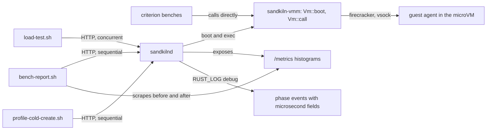
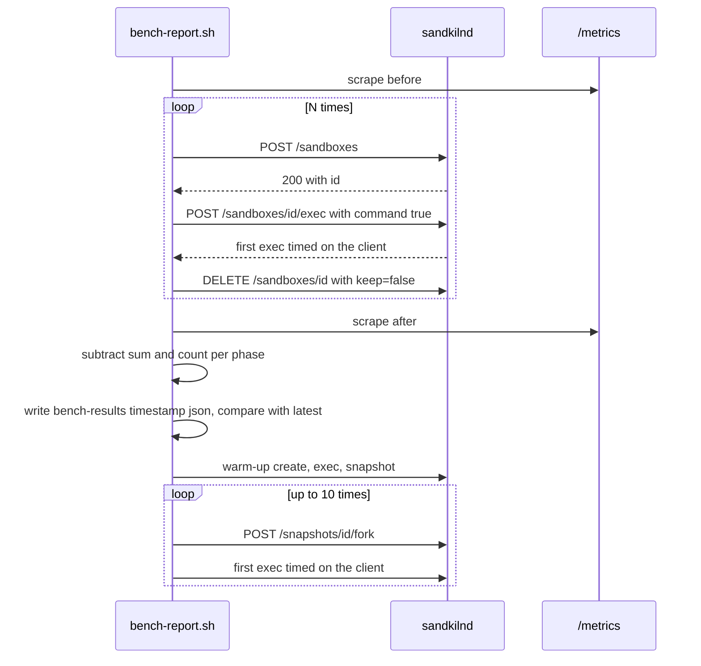
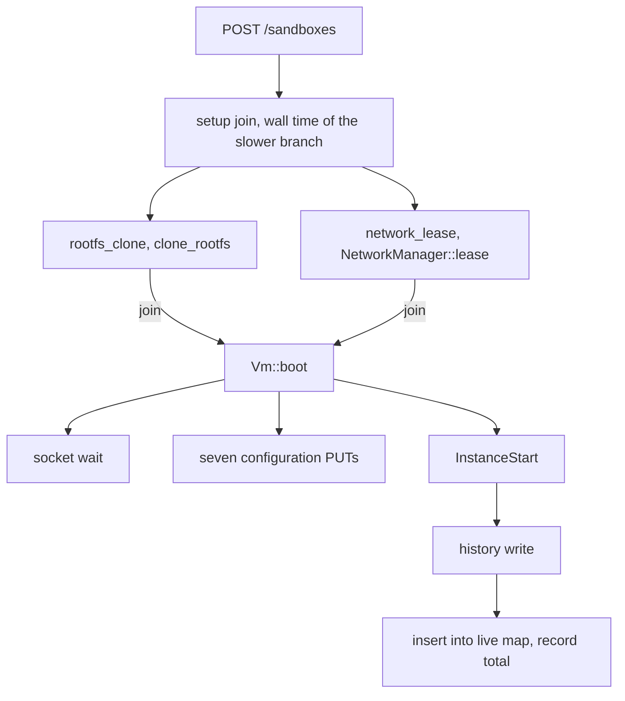

sandkiln has several performance tools, and each one measures a different slice of the same system. A criterion bench times the VMM crate in isolation. A load script times the HTTP API under concurrency. A metrics histogram times the daemon's own phases. A client-side stopwatch times what a caller actually experiences. Quoting a number without saying which tool produced it is how this project has misread its own data before, so this post is the map: what each tool covers, how to run it, and how to read the result.

The headline latency is **time to first command**: from `POST /sandboxes` until the first exec succeeds, measured by `first_exec_client` in `scripts/bench-report.sh`. It was 413.25 ms and is 214.5 ms after the guest boot change (-48%), described in [Guest boot time](/engineering/28-opt-guest-boot-time). The cold boot figures that appear below, and `InstanceStart` in the phase tables, are internal phases measured at the VMM. They end when Firecracker starts the vCPUs, before the guest kernel, init or agent has run, so they are not the boot time a caller waits for.

Every figure below is from one shared development box with a real Firecracker and KVM, never a dedicated benchmark machine. The numbers are directional. They are good enough to rank bottlenecks and to see a 10x change, and not good enough to quote to two decimal places as a promise.

## Four layers, four tools

The measurement stack is layered on purpose. Each tool trades realism for precision.

| Tool | What it times | Realism | Where it lives |
| --- | --- | --- | --- |
| criterion benches | `Vm::boot`, one vsock exec, snapshot take, resume, no daemon, no HTTP | VMM only | `core/crates/vmm/benches/vm_lifecycle.rs` |
| `/metrics` histograms | the daemon's own view of each create phase, for every request it serves | daemon plus VMM | `create_phase_duration_ms`, `boot_duration_ms`, `exec_latency_ms` |
| `scripts/bench-report.sh` | N sequential cold creates, diffed against the previous run, plus two client-side timings | full HTTP path | `scripts/bench-report.sh` |
| `scripts/load-test.sh` | concurrent create, exec, delete cycles, with min, max, mean and p95 | full HTTP path under contention | `scripts/load-test.sh` |

A fifth tool, `scripts/dev-tools/profile-cold-create.sh`, exists for the case where the histograms are too coarse. It drives sequential creates while the daemon logs debug-level events with microsecond detail.



## Criterion: the VMM in isolation

`core/crates/vmm/benches/vm_lifecycle.rs` defines four benchmarks in one group: `cold_boot` (`vm_lifecycle.rs:109`), `exec_roundtrip` (`vm_lifecycle.rs:144`), `snapshot_take` (`vm_lifecycle.rs:176`) and `resume_from_snapshot` (`vm_lifecycle.rs:214`). They run against the real Firecracker binary, not a mock. The three asset paths come from environment variables:

```bash
SANDKILN_BENCH_FIRECRACKER_BIN=~/sandkiln-tools/bin/firecracker \
SANDKILN_BENCH_KERNEL_PATH=~/sandkiln-tools/images/vmlinux-5.10.223 \
SANDKILN_BENCH_ROOTFS_PATH=~/sandkiln-tools/images/ubuntu-22.04.ext4 \
  cargo bench -p sandkiln-vmm --bench vm_lifecycle
```

Two details decide what these numbers mean. First, `cold_boot` uses `iter_custom` and starts its stopwatch immediately before `Vm::boot` and stops it immediately after. The per-iteration rootfs copy, the `vm.stop()` and the cleanup all happen outside the timed region. So criterion's cold boot is the boot alone, with no clone, no network lease and no HTTP. Second, `exec_roundtrip` boots one VM outside the timed loop and then repeats `vm.call` over an already-open vsock path, so it measures a warm exec and never the first one.

Those two facts mean criterion cannot tell you how long `POST /sandboxes` takes. It can tell you whether a change to `Vm::boot` regressed.

### Boot numbers, stated with their dates

Published boot numbers have moved, and both sets are real:

| When | Cold boot | Exec round trip | Snapshot take | Notes |
| --- | --- | --- | --- | --- |
| Earlier published runs (`docs/benchmarks.md`) | 10.5 to 10.9 ms | 220 to 250 us | about 322 ms (309.6 to 335.0 ms) | earlier kernel and box load |
| Re-measured 2026-11-23 (criterion, kernel 6.8) | 12.6 to 14.0 ms | 242 to 248 us | 485 to 727 ms | same box, different load state |

Neither row is time to first command. That figure is higher because it includes the guest kernel and userspace: 413.25 ms before and 214.5 ms after the guest boot change, with `first_exec_resumed` going from 18 ms to 8.4 ms and the create total from 18.4 ms to 16.4 ms (`bench-report.sh 20`, 2026-11-24).

Resume from snapshot was re-measured in the same criterion run at 3.7 to 4.0 ms. The reflink create has the same old-and-new pairing: a mean of 17.9 ms in the first reflink run and 18.4 ms in the re-measurement (20 sequential cold creates through `scripts/bench-report.sh`, rootfs on a reflink filesystem), itemized further down.

Both rows are directional, one shared box each time, and neither is authoritative. Cold boot differs by a couple of milliseconds, which fits a different kernel and a different background load. The snapshot take difference is larger, and docs/benchmarks.md already explains why: `snapshot_take` writes the guest's whole memory to disk synchronously, and on a box that is also somebody's working desktop it is far more exposed to disk contention than the other benches. The right reading is a load-dependent range, not a single figure.

## `/metrics`: the daemon's own breakdown

The daemon keeps its histograms in plain atomics and mutexes in `core/crates/daemon/src/metrics.rs`. For a cold create it exposes one histogram family, `create_phase_duration_ms`, with a `phase` label:

| Label | What it covers |
| --- | --- |
| `rootfs_clone` | the per-sandbox rootfs clone, `clone_rootfs` |
| `network_lease` | `NetworkManager::lease`: pops a tap and an address, then runs `ip` and `bridge` subprocess calls |
| `setup` | the join of the two above; their concurrent wall time, not their sum |
| `egress_apply` | only recorded when a create asks for an egress policy |
| `total` | request validated to sandbox inserted in the live map |

`boot_duration_ms` is deliberately a separate metric and not a `phase` value, because it already existed and could already be scraped by something external. The bucket layout for the phase family is shared across phases (1, 5, 10, 25, 50, 100, 250, 1000 ms) so that one query can aggregate across labels. The unusual part of this layout is its range: a reflinked rootfs clone is around a millisecond, and a whole create is a few hundred.

Two properties matter when reading it.

1. **`setup` is not `rootfs_clone` plus `network_lease`.** The two run on scoped threads in `create_sandbox_cold`, so `setup` is roughly the slower of the pair. A fast lease contributes almost nothing to the critical path when the clone is slow, and vice versa.
2. **The histograms are cumulative for the process lifetime.** A mean read straight off `_sum` over `_count` blends every create the daemon has ever served. That is why `bench-report.sh` diffs two scrapes instead.

A third metric, `rootfs_clone_total{method="reflink"|"copy"}`, is a counter and not a timing. It exists because a latency histogram alone cannot distinguish "this host has a slow disk" from "this host silently never reflinks". The [reflink post](/engineering/17-opt-rootfs-reflink-clone) is the story of what that ambiguity cost.

## `bench-report.sh`: a repeatable diff

`scripts/bench-report.sh [iterations] [base-url] [--with-criterion] [--markdown]` is the regression check. It scrapes `/metrics`, drives N sequential cold creates (each sandbox destroyed with `keep=false` before the next, because the default snapshot-then-stop would add hundreds of milliseconds of unrelated work), scrapes again, and subtracts sum and count per phase. It saves a per-phase mean breakdown under `scripts/bench-results/` (gitignored, because the numbers are specific to one box) and compares against `latest.json` from the previous run.



It also records two numbers that `/metrics` cannot see, both timed by the client the way a real caller would experience them.

- `first_exec_client`: the first real exec against a freshly created sandbox. `POST /sandboxes` returning 200 means Firecracker's `InstanceStart` succeeded, not that the guest agent is listening. On the box where this was found, the first exec absorbed roughly 420 to 460 ms while every later exec on the same sandbox took about 3 to 5 ms. This is the headline number: it read 413.25 ms and is 214.5 ms after quieting the guest kernel and capping pre-created loop devices ([Guest boot time](/engineering/28-opt-guest-boot-time)).
- `first_exec_resumed`: the same measurement against a sandbox forked from a snapshot of an already warmed one, where the agent was confirmed live before the snapshot. It measured about 4 to 18 ms (8.4 ms after the guest boot change, against 18 ms in the same comparison), a 25 to 100 times difference that a cold-only run would never reveal.

Those two are the reason the performance story for pre-warmed pools is told in terms of "time until the sandbox can run something", not "time until `create()` returned". The run is capped at ten forks regardless of the iteration count, because a forked first exec has far less variance and each sample needs a real resume.

## `load-test.sh`: concurrency, not a profile

`scripts/load-test.sh [concurrency] [iterations] [base-url]` runs N workers each doing create, exec and delete cycles and reports min, max, mean and p95 per phase. It is written with `curl -w` timing and `sort`/`awk` on purpose, since each cycle is stateful and concurrent in a way a repeat-one-command tool does not fit.

The load test answers a different question than the report. It shows how latency degrades when cycles overlap, and it can show a pathology the sequential tools cannot. It says nothing about why. The recorded run (4 workers, 5 cycles, 0 errors) read a `create` mean of 369 ms before the API-socket fix and 211 ms after, with the p95 essentially unchanged near 580 ms and overall throughput flat at around 5.4 to 5.6 cycles per second.

## `profile-cold-create.sh` and the debug events

When the histograms say "clone is slow" but you need to know which of the seven Firecracker configuration calls or which `ip` invocation is responsible, you use debug logging. `scripts/dev-tools/profile-cold-create.sh [iterations] [base-url]` creates, prints one line per create with the client-observed `total_ms`, and deletes with `keep=false`. Run the daemon with the binary's name as the filter:

```bash
RUST_LOG=sandkilnd=debug,sandkiln_vmm=debug scripts/sandkilnd-ctl.sh restart
scripts/dev-tools/profile-cold-create.sh 20
scripts/sandkilnd-ctl.sh logs
```

The filter target is the binary name `sandkilnd`, not the package name `sandkiln-daemon`. Using the package name silently matches nothing, which is an easy way to lose an hour.

These are the events to read, and what each carries:

| Event message | Fields |
| --- | --- |
| `cold create setup phases` | `rootfs_clone_us`, `network_lease_us`, `setup_join_us` |
| `cold create complete` | `boot_task_us`, `history_write_us`, `total_us` |
| `vm boot phase breakdown` | `spawn_us`, `socket_wait_us`, `api_config_us`, `instance_start_us`, `per_put` |
| `attached tap device` | each `ip` and `bridge` subprocess call timed separately |
| `rootfs cloned` | `method`, source and destination |

These stay as debug tracing and not metrics because nobody alerts on "one `ip` exec took 1.4 ms", and because `sandkiln-vmm` has no access to the daemon's `Metrics` struct.

## Where the time goes in a cold create

The structure of a cold create is fixed. Two things run concurrently, then the VM boots, then the daemon records history and inserts the sandbox.



The same structure has had very different weights at different times. The table keeps each run's date and conditions, because they are not interchangeable.

| Phase | 2026-09-14, ext4, original profile | 2026-11-23, ext4, byte copy | 2026-11-23, XFS reflink, first run | 2026-11-23, XFS reflink, re-measured (kernel 6.8) |
| --- | --- | --- | --- | --- |
| rootfs clone | 124.09 ms (74.0%) | 127.9 ms | 0.08 ms | 0.084 ms |
| network lease (concurrent) | 4.36 ms | 3.5 ms | not recorded | 3.1 ms |
| `Vm::boot` total | 34.00 ms | 14.9 ms | not recorded | 13.4 ms |
| of which socket wait | 20.11 ms | not recorded | not recorded | not recorded |
| of which seven PUTs | 1.61 ms | not recorded | not recorded | not recorded |
| of which `InstanceStart` | 11.87 ms | not recorded | not recorded | not recorded |
| history sqlite write | 9.24 ms | not recorded | not recorded | not recorded |
| **create total** | **167.65 ms** | **187.5 ms** | **17.9 ms** | **18.4 ms** |

Three observations follow, and one caution.

First, the original profile is a complete breakdown. The listed phases summed to 167.33 ms of 167.65 ms, 0.32 ms unaccounted. That completeness is what made it trustworthy, and it is why the clone's 74% share could overturn an earlier theory.

Second, the later table columns were measured after fixes that came from this profile: the socket-wait sleep removed (boot fell from 34.00 to about 11.3 ms in the runs made right after that change, and criterion later read 12.6 to 14.0 ms on a different kernel), and the history write moved to WAL. Those are the subject of their own posts: [the socket wait](/engineering/18-opt-boot-socket-wait) and [the history store](/engineering/19-opt-history-store-wal).

Third, on the reflink filesystem the critical path becomes "network lease plus boot", since the clone is no longer the slower branch of the concurrent pair. The first reflink run did not record boot or lease, so for a while that was only a structural inference. The re-measurement supports it: lease 3.1 ms (the slower branch, against a 0.084 ms clone) plus boot 13.4 ms is about 16.5 ms of the 18.4 ms total. The remaining roughly 1.9 ms is arithmetic, not an itemized measurement, and presumably covers the history write and the map insert. The 17.9 and 18.4 ms means differ by 0.5 ms, inside this box's noise.

The caution is on the arithmetic. The drop from 187.5 ms to 17.9 ms is about 169.6 ms, but the clone alone only accounts for about 127.8 ms of it. The remaining roughly 42 ms was not itemized in the first 2026-11-23 runs. A plausible reading is that a 300 MiB byte copy also costs the rest of the path through disk contention and dirty-page writeback, but that is a hypothesis, not a result, and the next measurement should record all phases for both configurations. The 187.5 ms ext4 figure is also higher than the 167.65 ms one from September even though boot became faster in between, so the two ext4 columns are evidence of box-state drift, not of a regression.

## How to read these numbers

A short list of rules, each of which has been learned from a specific mistake.

- **Name the tool.** "Boot is 12 ms" (criterion, VMM only) and "create is 18 ms" (HTTP, full path) are both true on the same day and describe different things.
- **Look for the quantization signature.** A phase that reads the same value on every sample is a sleep or a timeout, not work. The socket wait measured 20.04 to 20.18 ms across twenty boots. Real work has spread.
- **Count to "usable", not to "returned".** `create()` returning and the guest agent answering are different events, with a gap on the order of 420 to 460 ms for a cold sandbox before the guest boot change, and about 214 ms now. `first_exec_client` is the measurement that sees it.
- **Time the operation the caller invokes, end to end.** The criterion `snapshot_take` bench times only `pause` plus `snapshot`; the daemon's snapshot request also stops the VM afterwards. The bench read a fraction of a second while the HTTP request took 6.8 seconds, because the stop was outside the timed region and was waiting on a reply a paused guest cannot give. See [Snapshot stop: 6.8s to 0.56s](/engineering/25-opt-snapshot-stop-force-stop).
- **Expect noise.** One shared desktop-class box, small samples, one create at a time. Phase shares were consistent enough to act on, and absolute totals moved by a few percent run to run. Disk-heavy phases such as snapshot take move far more than that.

## How to reproduce

All of this runs on the remote dev box, since it needs KVM and real Firecracker. From the repository root:

```bash
scripts/remote.sh sync
scripts/remote.sh run scripts/sandkilnd-ctl.sh restart
scripts/remote.sh run scripts/bench-report.sh 20 http://127.0.0.1:7777 --with-criterion --markdown
scripts/remote.sh run scripts/load-test.sh 4 5
```

For a finer look at one create, restart the daemon with `RUST_LOG=sandkilnd=debug,sandkiln_vmm=debug`, run `scripts/dev-tools/profile-cold-create.sh 20`, and read the events above from `scripts/sandkilnd-ctl.sh logs`. Then check `rootfs_clone_total` on `/metrics` before trusting any clone number. If it says `copy`, you measured a byte copy no matter what filesystem you think you are on.
