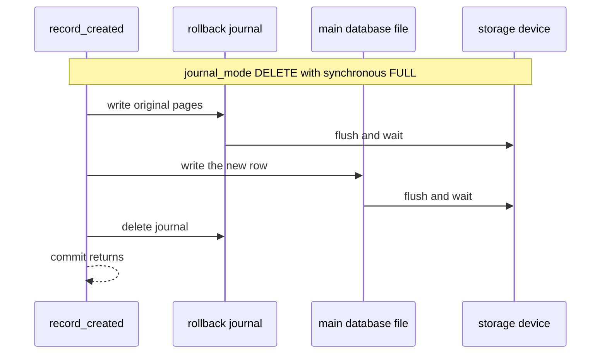
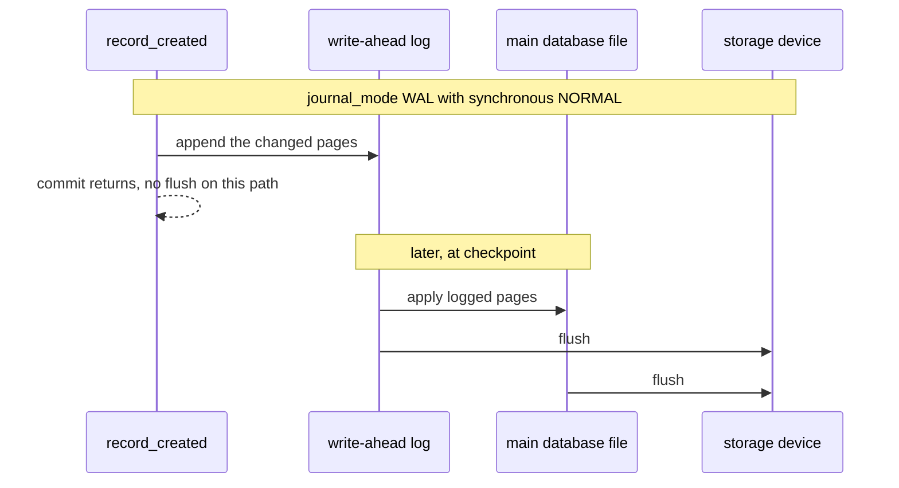

Not every optimization is about the dominant cost. The history store write was 5.5% of a cold create, which is not where anyone would look first. It was worth fixing for a different reason: it was a synchronous disk flush, sitting on the request's critical path, whose result the caller did not need to be durable. This post explains the change, the two measurements behind it (which are deliberately not the same experiment), and the exact durability that was traded away.

The numbers come from the profiling pass of 2026-09-14 and the follow-up change of 2026-09-16, on the shared dev box. They predate the reflink and socket-wait work described in the [reflink post](/engineering/17-opt-rootfs-reflink-clone) and the [socket-wait post](/engineering/18-opt-boot-socket-wait), so a create today has a different total.

## Problem and how it was found

`sandkiln-store` keeps a durable record of every sandbox sandkiln has created: when, with what tags, and how it ended (destroyed, snapshotted, or orphaned by a daemon restart). It is a sqlite database, `~/sandkiln-tools/history.db` by default, set with `SANDKILN_HISTORY_DB_PATH`. The daemon writes to it with `HistoryStore::record_created` once a boot has succeeded.

The per-phase profile of a cold create was added to find where the time went (see the [performance model post](/engineering/16-performance-model-and-measurement) for the tooling). It surfaced one line that nobody had been tracking. The `cold create complete` debug event carries a `history_write_us` field, which times the call in `create_sandbox_cold`. The run was 20 sequential creates on an idle box:

```bash
RUST_LOG=sandkilnd=debug,sandkiln_vmm=debug scripts/sandkilnd-ctl.sh restart
scripts/dev-tools/profile-cold-create.sh 20
scripts/sandkilnd-ctl.sh logs | grep "cold create complete"
```

The mean of `history_write_us` was **9.24 ms**, which was 5.5% of the 167.65 ms total. In that breakdown it was the third largest cost, after the rootfs clone (124.09 ms) and `Vm::boot` (34.00 ms). A 5.5% cost is easy to dismiss, but the context made it hard to leave alone. The call site in `create_sandbox_cold` is explicitly best-effort:

```rust
if let Err(e) = state.history.record_created(&id, request.name.as_deref(), &request.tags, request.image_id.as_deref(), created_at) {
    tracing::warn!(error = %e, sandbox_id = %id, "failed to record sandbox creation in history store");
}
```

The VM has already booted by then, so a failed history write only logs a warning and never fails the request. The request was paying a full synchronous disk flush for a write that the code itself treats as expendable.

## Root cause

`HistoryStore::open` opened the database with sqlite's defaults: `journal_mode=DELETE` and `synchronous=FULL`. In that configuration a commit works against a rollback journal. The old page contents are copied to a journal file, the journal is flushed to disk, the main database file is then modified and flushed to disk, and finally the journal is deleted. The doc comment in the store counts two flushes per write: one for the rollback journal and one for the main database file. Each flush waits for the storage device to confirm the data is durable, which is why a single-row `INSERT` on an ordinary disk costs milliseconds and not microseconds.



It is worth being precise about what the profile did and did not show. It showed that the write cost 9.24 ms on a live daemon. It did not break that cost down by flush, so "the double flush is the cause" is an explanation for the cost, supported by the isolated A/B below and not itself timed inside the live run.

## The change

The fix is a function in `core/crates/store/src/lib.rs` called from `HistoryStore::open` right after the connection opens (`core/crates/store/src/lib.rs:116`):

```rust
fn configure_for_write_latency(conn: &Connection) -> rusqlite::Result<()> {
    conn.pragma_update(None, "journal_mode", "WAL")?;
    conn.pragma_update(None, "synchronous", "NORMAL")?;
    Ok(())
}
```

defined at `core/crates/store/src/lib.rs:148`. Two settings change together.

`journal_mode=WAL` replaces the rollback journal with a write-ahead log. A commit appends the changed pages to a separate log file and flushes that, rather than rewriting the main database file in place and flushing it. The main file is only updated later, in batches, when the log is checkpointed.

`synchronous=NORMAL` relaxes when sqlite waits for the device. In WAL mode, `NORMAL` means the log is flushed at checkpoint time and not after every transaction. This is safe specifically in WAL mode. In the default rollback-journal mode, `NORMAL` carries a different and larger corruption risk, which is why the two settings are changed as a pair and not one at a time.



`HistoryStore::open_in_memory` deliberately does not call it. WAL is not meaningful for `:memory:` (sqlite silently keeps an in-memory journal), and durability is not a concern for a store nothing persists. That constructor is test-only.

### The test

A configuration that can silently fail to apply is a configuration that has not been shipped. sqlite can decline a journal mode switch in some situations, so the test does not merely check that opening the store succeeds. It reads the pragmas back:

```rust
#[test]
fn open_sets_wal_and_synchronous_normal_for_write_latency() {
    let dir = tempfile::tempdir().unwrap();
    let db_path = dir.path().join("history.db");
    let store = HistoryStore::open(&db_path).unwrap();
    let conn = store.conn.lock().unwrap();
    let journal_mode: String = conn.pragma_query_value(None, "journal_mode", |row| row.get(0)).unwrap();
    assert_eq!(journal_mode, "wal");
    let synchronous: i64 = conn.pragma_query_value(None, "synchronous", |row| row.get(0)).unwrap();
    assert_eq!(synchronous, 1);
}
```

It is at `core/crates/store/src/lib.rs:395`. The comment in the source explains the `1`: sqlite reports `synchronous` as an integer level, where 0 is OFF, 1 is NORMAL, 2 is FULL and 3 is EXTRA. A related test in the same file confirms that opening an existing database preserves its rows, since switching a database into WAL mode touches an existing file.

## Result

There are two measurements, and they are not the same experiment.

| Measurement | What was measured | Value |
| --- | --- | --- |
| Live profile, before the change | mean `history_write_us` inside a real cold create on a running daemon, 20 creates | 9.24 ms (5.5% of 167.65 ms) |
| Isolated A/B, default settings | mean of 20 sequential `record_created` calls on a fresh database file, nothing else running | 1897.8 us |
| Isolated A/B, WAL and NORMAL | the same 20 calls, same disk, same conditions | 37.1 us |

The isolated A/B is a cut of about 51 times: 1897.8 us down to 37.1 us.

Do not subtract those numbers from each other, and do not read the A/B as the expected saving on a live create. They are not directly comparable. The 9.24 ms figure came from a live daemon with its real, already populated database and normal background activity. The A/B ran against an isolated fresh database file with nothing else running. The A/B's default-settings figure (1.9 ms) is itself far lower than the live 9.24 ms, which shows how much the conditions differed. What both numbers support is the relative claim: removing the per-write flushes makes a write dramatically cheaper. The live saving after the change was not re-measured as its own `history_write_us` mean, so this post does not claim a specific millisecond figure for a create.

The change was verified with the full workspace tests (300 of 300 passing at the time), a clean `cargo clippy --workspace --all-targets`, and the integration suite, which showed only two already-documented unrelated flakes and nothing involving the store.

## What it cost or risks

The risk is durability, and it should be stated without softening.

With `synchronous=NORMAL` in WAL mode, a transaction is flushed at checkpoint time, not at commit. The store's own doc comment states the consequence. A write is durable against an application crash. Against an operating system crash or power loss, it is durable too, except for whichever transactions landed in the last, not-yet-flushed part of the log. Those could be lost. sqlite documents that this does not corrupt the database in WAL mode; the loss is of recent commits, not of integrity.

That loss is tolerable here for reasons that are specific to this store, and not a general claim that WAL with `NORMAL` is always fine:

- **The write was already best-effort.** A failure to record creation only logs a warning. A power loss that drops the last few unflushed rows is a milder form of the same outcome the code already accepts.
- **History only means something across a restart, and restarts orphan everything.** No live sandbox survives a daemon restart today. `mark_unended_as_orphaned_on_startup` marks every record that was still live as orphaned by restart. A `record_created` row lost to a power cut simply never existed after the reboot, and `record_ended` is documented to be a no-op, not an error, when its row is missing.
- **It is not a ledger.** The store records what happened for the benefit of `GET` history queries. Nothing billing-grade or security-critical depends on it. If that ever changes, the settings should be revisited, and for such a use `synchronous=FULL` is the setting to return to.

Other consequences are mechanical:

- **Sidecar files.** WAL mode creates `-wal` and `-shm` files next to the database. Anything that copies or backs up `history.db` as a single file must account for them, or checkpoint first.
- **A write that is faster in a flush-free way is not free of cost.** The log is checkpointed later, so some of the cost moves from the request to a background step inside sqlite. The request path no longer waits for it.
- **The live saving is unmeasured.** As above: the A/B is isolated, and no live re-measurement of `history_write_us` is recorded, so the end-to-end benefit on a create is expected but not quantified here.
- **Conditions for WAL.** sqlite's WAL mode needs the database on a local filesystem with shared memory support, and is not meant for network filesystems. `SANDKILN_HISTORY_DB_PATH` should point at local storage.

## How to reproduce

The A/B harness that produced the 1897.8 us and 37.1 us figures was not committed, so there is no script in the repository that prints them. The live figure can be read from any running daemon, and the isolated comparison can be rebuilt in a few lines.

To read the live cost on the current code:

```bash
RUST_LOG=sandkilnd=debug scripts/sandkilnd-ctl.sh restart
scripts/dev-tools/profile-cold-create.sh 20
scripts/sandkilnd-ctl.sh logs | grep "cold create complete"
```

Compare `history_write_us` against `total_us` in each event. On the current code the write should be a small fraction of a millisecond, not the 9.24 ms that was measured before the change, though this has not been re-recorded.

To rebuild the isolated A/B, write a throwaway test or bench in `sandkiln-store` that opens two fresh databases on the same disk. Open the first with the store as it is. For the second, open a raw `rusqlite` connection, leave the default pragmas, and apply the same schema (`CREATE TABLE IF NOT EXISTS sandbox_history` plus its two indexes) with `PRAGMA journal_mode=DELETE; PRAGMA synchronous=FULL;`. Time 20 sequential single-row inserts with the same `INSERT` statement `record_created` uses, on each, with nothing else running, and compare the means. Keep it out of the repository, since the result depends entirely on the disk. To confirm the settings took effect on a real database file:

```bash
sqlite3 ~/sandkiln-tools/history.db "PRAGMA journal_mode; PRAGMA synchronous;"
```

Note that `journal_mode=WAL` persists in the database file, so this prints `wal`, but `synchronous` is a per-connection setting and prints sqlite's default (`2`) from a fresh shell. The unit test, which reads the pragmas on the store's own connection, is the accurate check.
