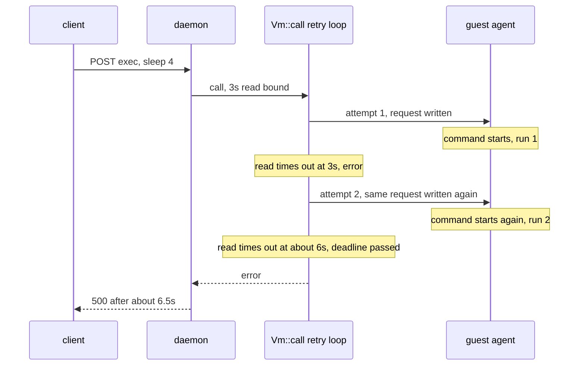
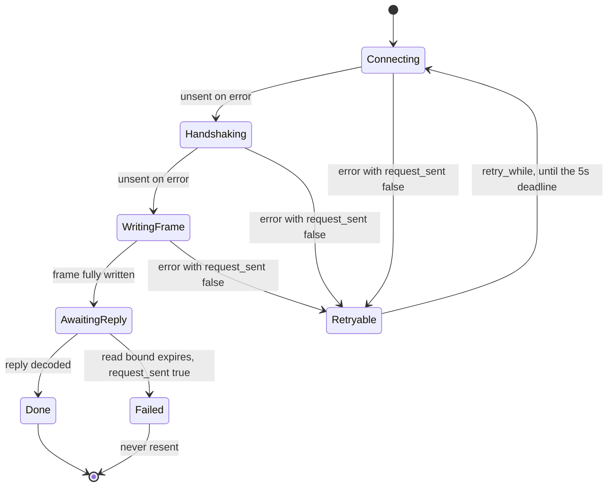
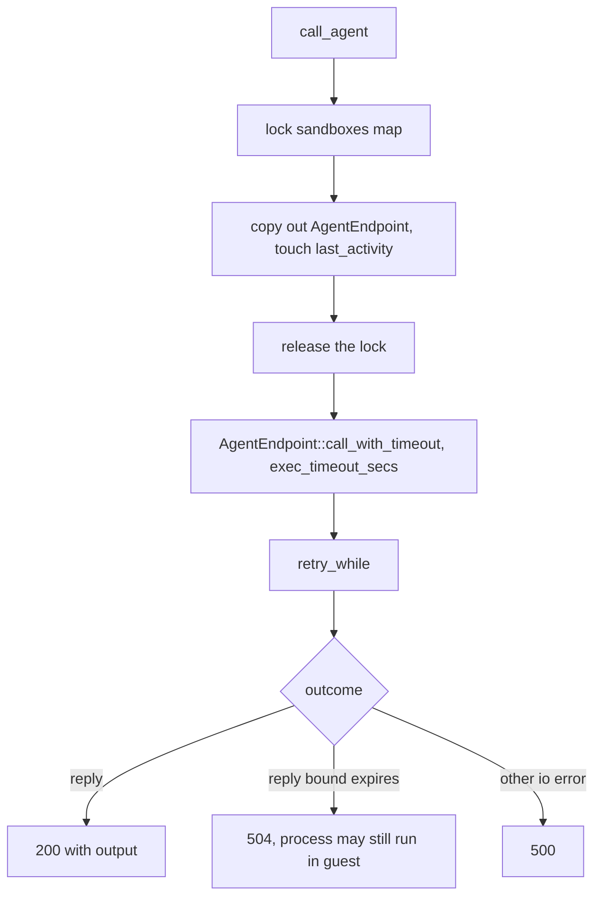

This is a correctness bug, not a performance one, and it is worth a post for the same reason a double charge is worth a post: the system looked like it was working. Run `sleep 4` through the sandbox API and you got an error after a few seconds. Run a command with a side effect and the side effect happened twice. Nothing crashed, nothing was logged as a fault beyond a warning, and the integration suite stayed green, because none of its commands were slow enough to cross the line.

Items are cited with `path:line` references, verified against the current tree. Timings are from one shared dev box and are directional.

## Problem and how it was found

It surfaced during an audit of the exec path after the snapshot latency finding in [Snapshot stop: 6.8s to 0.56s](/engineering/25-opt-snapshot-stop-force-stop). The bounded-vsock fix described in [the vsock timeout post](/engineering/22-opt-bounded-vsock-io) had put a 3 second read timeout on every request and response call. The question the audit asked was what that does to a command that legitimately takes longer than 3 seconds.

The reproduction is small enough to run by hand. A command that appends a line to a marker file and then stays silent for 4 seconds:

```bash
curl -s -X POST http://127.0.0.1:7777/sandboxes/$id/exec \
  -d '{"command":"sh","args":["-c","echo run >> /tmp/f; sleep 4"]}'
```

The request failed after about 6.5 seconds with a server error. Then, reading the marker back:

```bash
curl -s -X POST http://127.0.0.1:7777/sandboxes/$id/exec \
  -d '{"command":"cat","args":["/tmp/f"]}'
```

printed two lines, `run` and `run`. The command had been executed twice, and the client was told it had failed. This is the worst combination available: an error that invites a retry from the caller, plus a hidden execution that already happened, plus a duplicate of the side effect on top. It is not an edge case. Any build step, test run, package install or script that goes quiet for more than 3 seconds hits it, and those are the common workloads for a sandbox.

A second symptom came from the same audit and is a different bug. While a slow command ran in one sandbox, requests to other sandboxes stalled. That turned out to be a lock held for the duration of the call.

## Root cause

There were three separate faults, which compounded.

**The bound was applied to the wrong kind of call.** The 3 second `IO_TIMEOUT` exists to catch a guest that never answers, such as a paused VM. It is correct for control-plane calls, where an answer takes milliseconds. A user command is different: it legitimately stays silent for as long as it runs. Applying the same read timeout to both meant any command silent for 3 seconds looked, to the transport, exactly like a hung guest.

**The retry loop re-sent a request the guest had already accepted.** `Vm::call` wrapped the transport call in a retry loop that retried on any error. That loop exists to absorb a race: right after boot the agent may not yet be listening, so a refused connect should be tried again. It was written for that, and nothing in it distinguished "the connection never reached the agent" from "the agent has the request and is working on it". For a command that took 4 seconds, the sequence was:

1. Attempt 1 connects, completes the handshake and writes the full request frame. The agent starts the command.
2. The read for the reply times out at 3 seconds. This is an error.
3. The retry loop sees an error and a deadline of 5 seconds not yet reached, so it sleeps a millisecond and starts attempt 2.
4. Attempt 2 connects fresh and writes the same request. The agent starts the command again.
5. Its read times out 3 seconds later, at about 6 seconds. The deadline is now passed, the error is returned, and the HTTP layer turns it into a 500.

That accounts for the roughly 6.5 seconds observed, and for the marker file: the `echo` ran at the start of each execution, so two executions left two lines. The guest agent did nothing wrong. It was asked twice.



**The daemon-wide lock was held across the call.** The shared helper for forwarding one request to the guest, `call_agent` (`core/crates/daemon/src/http/routes/exec.rs:122`), looked the sandbox up in the daemon's `sandboxes` map under its mutex and then made the vsock call inside the blocking task while still holding that guard. Every exec, file read, file write and filesystem operation goes through it, and every other operation that needs the map (list, create, delete, snapshot, even a `GET /sandboxes`) takes the same mutex. So while one command ran, the whole daemon's sandbox operations queued behind it. Under the 3 second bound that stall was limited to about 6.5 seconds. With the bound lifted for long commands it would have been the full command duration. Fixing the timeout without fixing the lock would have turned a bounded stall into an unbounded one.

## The change

The fix is commit `cc5573f` (2026-11-24) and has four parts, each of which closes one fault.

**1. A structured error that says whether the request was sent.** `vsock_client::call` now returns `CallError` (`core/crates/vmm/src/vsock_client.rs:30`):

```rust
pub struct CallError {
    pub error: io::Error,
    /// The full request frame was written to the guest. Do not retry.
    pub request_sent: bool,
}
```

The classification follows the order of operations inside the function (`vsock_client.rs:51`). Connecting, configuring the timeouts, the `CONNECT` handshake, encoding and writing the frame are all marked `request_sent: false`. A write that fails part-way is still unsent, because the agent discards an incomplete frame without executing it, and the code comment says so. Only once the full frame is written does the error constructor switch to `request_sent: true`, which covers the wait for the reply and its decoding.



The design point is that the information needed to retry safely exists only at this layer, which knows exactly how far the exchange got. Returning a bare `io::Error` made the right decision impossible for any caller above it.

**2. A retry loop that respects it.** `retry_while` (`core/crates/vmm/src/vm/mod.rs:321`) has the same exponential backoff and deadline as the older helper, but returns immediately when the error says the request was sent:

```rust
Err(e) if e.request_sent || Instant::now() >= deadline => return Err(e),
```

The race the retry exists for, an agent not yet listening, fails before anything is written, so it is still retried. A request the guest may be executing is never re-sent. This makes the call at most once per request, which is the only safe semantics for a command with side effects.

**3. A reply bound that depends on the caller.** `vsock_client::call` takes a `response_timeout` that bounds only the wait for the reply. `Vm::call` (`vm/mod.rs:170`) passes the 3 second control-plane constant, so health checks and tunnel setup keep their fail-fast behaviour. User commands, file operations and filesystem operations go through `AgentEndpoint::call_with_timeout` (`vm/mod.rs:128`) with the daemon's `exec_timeout_secs` setting, 600 seconds by default (`core/crates/daemon/src/config/settings.rs`), and a value of 0 is rejected at configuration time. Connect and write keep the 3 second bound, since those should be fast regardless of what the command does.

**4. A lock released before the call.** `AgentEndpoint` (`vm/mod.rs:122`) is a small owned handle: a VM id and the path of the vsock socket. `call_agent` now takes the lock only long enough to look the sandbox up, update its activity timestamp and copy the endpoint out, then drops the guard before making the call:

```rust
let endpoint = {
    let sandboxes = state.sandboxes.lock().unwrap();
    let sandbox = sandboxes.get(&id).ok_or_else(|| AppError::NotFound(id.clone()))?;
    *sandbox.last_activity.lock().unwrap() = Instant::now();
    sandbox.vm.agent_endpoint()
};
```

Because the handle holds no reference to the `Vm`, it stays valid after the lock is gone. If the sandbox is stopped while a call is in flight, the call simply fails against a socket that no longer exists, which is the correct outcome.



**The 504 contract.** When the reply bound expires, the error is a read timeout, and `agent_call_error` (`exec.rs:146`) maps `WouldBlock` and `TimedOut` to `AppError::GatewayTimeout`, which becomes HTTP 504 (`core/crates/daemon/src/http/error.rs:52`). Every other I/O error stays a 500. The message says what is and is not known: the sandbox is fine, the daemon stopped waiting after `exec_timeout_secs`, and the command may still be running in the guest. The contract callers can rely on is that a 504 is not a failure of the sandbox and not a statement that the command did not run. It means the daemon gave up waiting. The docs-site self-hosting page lists the symptom and the remedy: raise the setting, or use streamed exec for work that is meant to run long.

## Result

Both symptoms are gone, verified against a real daemon and a real microVM on 2026-11-24.

| Behaviour | Before | After |
| --- | --- | --- |
| A command silent for 4s | error after about 6.5s | succeeds, returns its output |
| Executions of that command | 2 | 1 |
| Other API calls while a command runs | queued behind it | answered immediately |
| A command exceeding the bound | 500 after about 6.5s | 504 after `exec_timeout_secs` |

The regression test is `scripts/integration-tests/25-long-running-commands.sh`, which asserts each row:

- It runs `sh -c "echo run >> marker; sleep 4; echo finished"` and requires a 200 with `finished` in the output, so a command past the 3 second bound succeeds.
- It then `cat`s the marker and requires exactly one `run`, so the command was not re-sent. This is the assertion that would have caught the original bug.
- It starts a 4 second `sleep` in the background, waits a second, and times `GET /sandboxes`. It requires an answer in under a second, so the lock is not held across the call.
- It also times a snapshot of the same sandbox, covered in the snapshot post.

The unit tests are at the mapping layer. `read_timeouts_become_504_not_500` and `other_io_errors_stay_internal` in `exec.rs` check that `WouldBlock` and `TimedOut` become a gateway timeout and a refused connection stays an internal error.

## What it cost or risks

- **A 504 can hide a long-running command.** The process keeps running in the guest after the daemon stops waiting. A caller that treats 504 as "did not run" and retries will run it again, which is a smaller version of the original bug, moved from an invisible retry to a visible and documented one. The fix to that is at the caller, with an idempotency key or a streamed exec, and nothing in this change provides it.
- **The default of 600 seconds is a judgement.** It is large enough that ordinary builds and test runs fit and small enough that a wedged guest does not hold a connection for hours. It has no measurement behind it. It is a setting precisely because no single value is right.
- **At-most-once means a lost reply is a failed call.** If the request was sent and the connection then broke, the guest may have run the command, and the API reports an error. That is the right trade for a command with side effects and is the opposite of the old behaviour, which was at-least-once without telling anyone.
- **The lock is released in `call_agent`, not everywhere.** The post-resume pool health check (`core/crates/daemon/src/lifecycle/pool_claim.rs:158`) and the tunnel start and stop calls (`core/crates/daemon/src/http/routes/tunnel.rs:94`, `:124`) still call `Vm::call` while holding the `sandboxes` mutex. They use the 3 second control-plane bound, so the stall is short, and I read this in the code without timing it. It is the same shape of bug and would be a candidate for the same `AgentEndpoint` treatment.
- **The transport timeouts themselves have no unit test.** The test coverage is the live integration topic. A loopback server that accepts, reads the frame and never answers would test the `request_sent` classification and the no-resend rule without KVM, and it has not been written.
- **The bug lived because the suite only used fast commands.** The lesson is about test inputs: a timeout-handling path is only exercised by a command that takes longer than the timeout. The integration suite now has one.

## How to reproduce

Run the regression topic alone against a running daemon:

```bash
scripts/remote.sh run env SANDKILN_INTEGRATION_TEST_ONLY=25-long-running-commands scripts/integration-test.sh
```

To see the 504, lower the bound and run a longer command. Set `exec_timeout_secs = 2` in `sandkiln.toml` (or `SANDKILN_EXEC_TIMEOUT_SECS=2` in the environment), restart the daemon, and run:

```bash
curl -i -X POST http://127.0.0.1:7777/sandboxes/$id/exec \
  -d '{"command":"sleep","args":["5"]}'
```

The response is a 504 after about 2 seconds, and the `sleep` is still running in the guest. (Since changed: [a timeout that kills the process](/engineering/37-a-timeout-that-kills-the-process).) To see the original bug, build the parent of `cc5573f` and run the marker reproduction at the top of this post: the response is a 500 after about 6.5 seconds and the marker contains `run` twice. With the `vsock call failed` warning at `core/crates/vmm/src/vm/mod.rs:135` visible in the daemon log (`RUST_LOG=sandkiln_vmm=debug`), the `request_sent` field shows `true` on the failure the new code refuses to retry.
