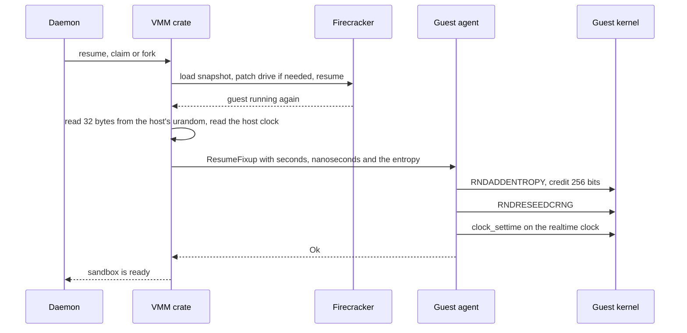

A snapshot is a photograph of a running machine, and a restore starts that machine again from the photograph. Do it twice from one snapshot and you have two machines that are identical down to the last byte of memory. Most of that is exactly what you want. Two things are not: the state of the kernel's random number generator, and the wall clock.

This post is about the fix recorded as finding 28 in `docs/findings.md`. It was found by the latency research in `docs/design-notes/latency-floor.md`, which asked what a restore-based `create` would need for correctness before anyone made it the default. The code is spread over the protocol, guest agent, VMM and daemon crates, so the post follows one request through all four.

## Problem and how it was found

Two forks of one snapshot start with the same memory. The kernel's random pool is in that memory. Unless something changes it, the first random bytes the first fork reads and the first random bytes the second fork reads come from the same state, so they are the same bytes.

That matters wherever randomness is used to keep something secret or unique: session keys, nonces, temporary file names, UUIDs, TLS handshakes. Two clones of one snapshot can generate the same key, the same nonce or the same identifier, and a nonce that repeats can break the guarantee the cipher offered.

The wall clock has the mirror problem. The guest's clock continues from the instant of the snapshot. A sandbox resumed an hour later, or a pool entry claimed after sitting for a day, sees a time that is hours or days stale until something corrects it. Certificate checks, token expiry, build timestamps and log ordering all read that clock.

Firecracker's own guidance describes both. It says that it always enables VMGenID, a device that lets a guest notice it was restored, and that guests on Linux 5.18 and later reseed the kernel's random generator when they see it. Our guest kernel is 5.10.223, which predates that. So on this kernel nothing reseeds automatically after a restore. The same guidance says there is still a window between the vCPUs resuming and the reseed even where VMGenID works, so reseeding explicitly is recommended anyway. It also says that randomness already cached in userspace is not fixed by any of this, and that clones read the same `boot_id` unless it is handled.

The finding notes one limit of what was verified: the behaviour before the fix was not captured. The integration topic described below is evidence that the fix works, not a recorded before and after.

## Root cause

Nothing in the restore path was giving the guest anything new. `Vm::resume` loaded the snapshot and ran the VM, and the daemon carried on. There was no step whose job was to make this clone different from its siblings.

The invariant that was missing is stated in Firecracker's snapshot documentation: resuming the same snapshot state more than once is considered insecure unless the clones are made unique. Forks and retaining resumes resume the same snapshot repeatedly by design, so uniqueness has to be an explicit step.

## The change

One new request, sent after every resume.



### The protocol request

`Request::ResumeFixup` carries three fields (`core/crates/protocol/src/messages.rs`): `unix_secs`, `unix_nanos` and `entropy_base64`. The wire form is a tagged JSON object, and a unit test pins its exact shape so a field rename cannot slip through:

```json
{"cmd":"resume_fixup","unix_secs":1,"unix_nanos":2,"entropy_base64":"AAEC"}
```

The entropy travels base64-encoded because the protocol is JSON lines over vsock. The host supplies both the bytes and the time, because the host is the one party that knows the true time and has a source of entropy that the clones cannot share.

### Host side

`Vm::apply_resume_fixup` (`core/crates/vmm/src/vm/snapshot.rs`) reads 32 bytes from the host's `/dev/urandom`, reads the host's clock, builds the request and calls the agent. It is called from the daemon's `resume_vm` (`core/crates/daemon/src/snapshots/ops/resume.rs`), the one function that fork, resume and restore all go through (the finding states that pool claims are covered too, since they resume a snapshot). That placement is deliberate: a new resume path inherits the fixup, where a call at each site could be forgotten at the next one.

### Guest side

The guest agent's handler (`core/crates/guest-agent/src/fixup.rs`) does three things in order.

1. **`RNDADDENTROPY`** writes the host's bytes into the kernel's pool through `/dev/urandom`. The ioctl takes a `rand_pool_info` structure: the entropy credit in bits, the length in bytes, then the bytes. The agent credits 8 bits per byte, so 256 bits for 32 bytes. Crediting is correct here because the bytes come from the host's random generator. A helper builds the structure, and a unit test checks the layout.
2. **`RNDRESEEDCRNG`** forces the kernel's cryptographic generator to reseed from the pool now. The agent's comment states the purpose: the next random bytes must differ from every other clone of the same snapshot, and an explicit reseed is how that is forced, which Firecracker's guidance also recommends.
3. **`clock_settime`** sets the realtime clock to the host's time.

If any step fails, the agent returns an error response naming the call, and `apply` stops there: a failed reseed means the clock is not set. A second unit test checks that bad base64 is rejected before the system is touched.

## Best-effort semantics

The daemon treats a failed fixup as a warning, not a failed resume (`resume_vm`, the log line "post-resume entropy and clock fixup failed"). The comment at that site gives the reason: an older guest agent does not know the request, and a resume that otherwise worked is not worth failing over it.

This is a real tradeoff and it has a sharp edge. A guest running an old agent resumes without the fixup and the daemon only logs. The finding states the consequence: images must be re-injected with the new agent. `CHANGELOG.md` says the same, and gives the command (`scripts/dev.sh inject-agent`). A deployment that skips that step has restores that look healthy and are not unique.

The alternative, failing the resume when the fixup fails, would make a correct-looking sandbox impossible to get from an old image. Which side to err on is a policy question, and the shipped answer favours availability and says so loudly in the logs and docs. A stricter setting would be a reasonable addition, and it does not exist today.

## What is not covered

The fixup does what its name says and no more. It does not change `boot_id`, which Firecracker's guidance says clones share. It cannot repair randomness a process cached in its own memory before the snapshot, such as a seeded userspace generator, because that state is not in the kernel. And there is a short window between the guest running again and the fixup arriving over vsock in which the guest still has the old pool and old time. A process that reads random bytes in that window gets stale ones. The window is small, since the fixup is sent immediately after the resume, but it is not zero, and the post does not claim to have measured it.

The cost of the fixup is also not isolated. `Sandbox.resume()` through the SDK measured a median of 13.1 ms in the benchmark suite, and that includes the fixup call along with the rest of the daemon's resume work. The 4 ms VMM-level figure is the load call alone. How much of the difference is the fixup was not separated out.

## Result: integration topic 28

`scripts/integration-tests/28-resume-fixup.sh` checks the behaviour against a real daemon and a real microVM. It takes a snapshot, lets it age five seconds so a stale clock would be clearly visible, then forks it twice.

| Check | What passing shows |
| --- | --- |
| The first fork's clock matches the host within 2 seconds | `clock_settime` ran; the clone did not wake five seconds in the past |
| Two forks of one snapshot read different bytes from `/dev/urandom` (a SHA-256 of 16 bytes each) | the two clones do not share a random stream |
| Two forks generate different kernel UUIDs from `/proc/sys/kernel/random/uuid` | the kernel's generator was reseeded differently in each |

The topic passes in the full suite, 353 of 353 on the init-mode image and with the one flaky pool check on the default image recorded in `docs/benchmarks.md`.

Be honest about what that evidence is. A passing check says the two clones differ after the fix. It does not prove they would have matched before, because that run was not made. The checks are also weak against the window described above: they read randomness well after the resume, which is the good case. And the 2-second clock tolerance is a tolerance, not a measure of how close the set time is.

## What it cost or risks

- **An old agent silently skips the fixup.** Covered above. The mitigation is re-injecting the agent into existing images.
- **The clock is stepped, not slewed.** `clock_settime` jumps the realtime clock. Software that measures durations with the realtime clock across the resume would see a jump. The monotonic clock is untouched.
- **Only the kernel's randomness is repaired.** Userspace-cached state and `boot_id` are out of reach of this request, as described above.

## How to reproduce

The topic runs as part of the full suite against a running daemon:

```bash
scripts/integration-test.sh
```

To see it by hand, fork one snapshot twice and compare. On a build with the fixup both commands print different values per fork; on an old agent they match:

```bash
B=http://127.0.0.1:7777
ID=$(curl -s -X POST $B/sandboxes -H 'content-type: application/json' -d '{}' | jq -r .id)
SNAP=$(curl -s -X POST $B/sandboxes/$ID/snapshot | jq -r .snapshot_id)
for i in 1 2; do
  F=$(curl -s -X POST $B/snapshots/$SNAP/fork | jq -r .id)
  curl -s -X POST $B/sandboxes/$F/exec -H 'content-type: application/json' \
    -d '{"command":"sh","args":["-c","cat /proc/sys/kernel/random/uuid; date +%s"]}' | jq -r .stdout
  curl -s -X DELETE "$B/sandboxes/$F?keep=false" >/dev/null
done
date +%s
```

The two UUIDs should differ, and each fork's timestamp should be within a second or two of the last `date`. Only one live fork per snapshot is allowed, which is why each fork is deleted before the next. If an auth token is configured, add the `Authorization` header to each call.
