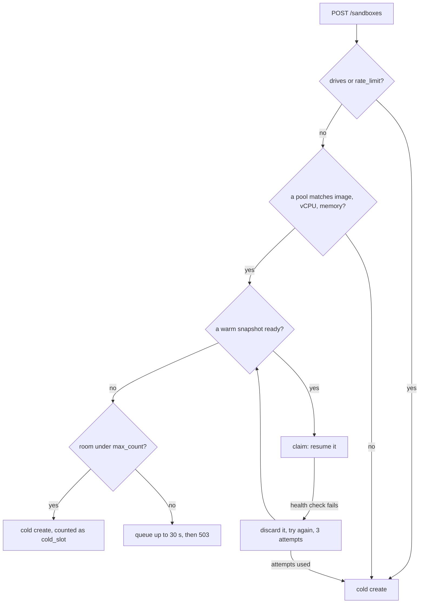
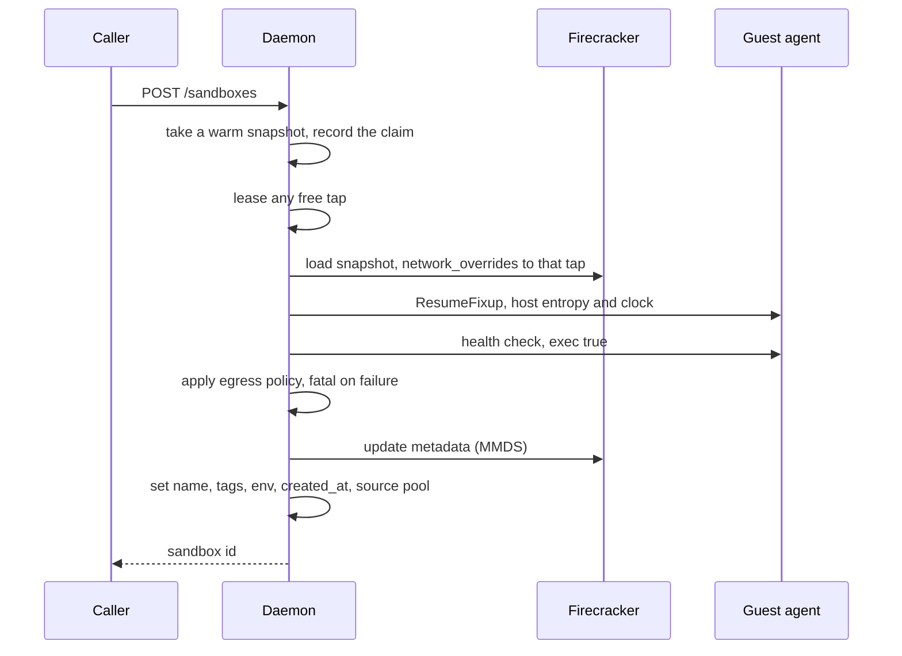
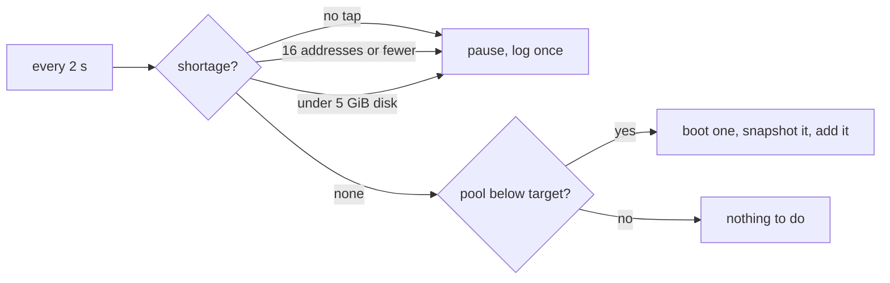

[What a start-latency number means](/engineering/29-what-a-start-latency-number-means) ended on an uncomfortable fact. `create` returns in about 23 ms, and the guest is not ready until about 210 ms later. Everything a caller does next waits for the second number. A restored microVM skips the kernel and init entirely, and the project already measured that path: [resume is a few milliseconds](/engineering/06-snapshots-resume-fork). The idea of this change is simple. If the daemon prepares resumable instances ahead of time, a create can be a resume.

Pre-warmed pools existed before this ([pool pre-warming](/engineering/21-opt-pool-prewarming)), but only as an opt-in `POST /pools`. Nobody who just called `Sandbox.create()` got one. The change here makes a pool of the daemon's own default shape exist from startup, and fixes the two bugs that stopped it from working as a default.

All figures are from `docs/benchmarks.md` (section "Warm pool by default"), `docs/findings.md` (findings 30 and 31) and the committed result files under `examples/benchmark-suite/results/`. The runs are on the one shared development box and are directional.

## The idea and the default pool

`default_warm_count` is a daemon setting, default 2. At startup, if it is above 0, `main.rs` inserts an implicit pool with the id `default`, the daemon's default image, vCPU count and memory size, a `warm_count` of that value and no `max_count`. Setting it to 0 turns the feature off, and a value above 32 is refused at startup.

A pool matches a create when the image, vCPU count and memory size are equal to the pool's. A request that asks for `drives` or a `rate_limit` never matches, because both are baked into Firecracker's boot-time configuration and a snapshot has already fixed it. There is no opt-in call. The caller sends the same request as before and may be handed a resumed sandbox.



The `default` pool has no `max_count`, so the queueing branch never applies to it. It exists for pools created through the API with a ceiling.

## The claim path

A claim is more than a resume. The warm snapshot was taken from a placeholder sandbox that belongs to nobody, and the caller expects a sandbox that is theirs, healthy and correctly restricted.



In order, as `claim_from_pool` and `resume_vm` do it:

1. **Resume.** `resume_snapshot_by_id` consumes the warm snapshot. A tap is leased at this moment, because a held snapshot owns no tap ([the next post](/engineering/36-snapshots-without-taps) explains why), and the interface is repointed with `network_overrides`.
2. **ResumeFixup.** The same request every resume, fork and claim sends, so two claims of the same kind of warm instance do not share a random stream, and the clock is the host's ([clone entropy and clock](/engineering/31-correctness-clone-entropy-and-clock)). It is best effort: a failure is logged, not fatal.
3. **Health check.** A real `exec true` through the guest agent. A resumed guest can still be dead, and handing back the id of a dead VM is the one outcome a claim must never produce. A failed check tears the sandbox down with a forced stop (the check already proved nobody is listening, so there is nothing to sync) and the claim is retried, up to three attempts, before a plain cold create. Each failure is counted as `warm_failed`. This check was written when 1 in 3 to 2 in 3 resumes crashed; [the settling race](/engineering/30-correctness-resume-settling-race) fixed the cause and the check stays as defence in depth.
4. **Egress.** If the caller asked for an egress policy, it is applied now, and a failure destroys the sandbox. This one is fatal on purpose: silently returning an unrestricted sandbox to someone who asked for restrictions is a security gap, not a degraded mode.
5. **Metadata.** The microVM metadata service (MMDS) still describes the placeholder, so the caller's id, name and tags are written with a bounded retry (10 attempts, 300 ms apart). Unlike egress, exhausting it only logs a warning, because the sandbox has already passed its health check.
6. **Identity.** Name, tags, env, creation time and `source_pool_id` are overwritten, the creation is recorded in history, and the sandbox's parent snapshot is cleared, so its lineage starts here.

The guest is already running when step 1 finishes, which is why the first command afterwards answers in about 2.4 ms in the table below. The create call itself is unchanged at about 23.6 ms. What moved is where the guest is when it returns.

## The replenisher

Warm instances come from a background task that wakes every 2 seconds. For each pool below its target it boots one instance, snapshots and stops it, and pushes the snapshot onto the pool. One instance per pool per tick, so a large `warm_count` fills gradually and does not spike boot load. A snapshot also waits for the guest to settle first, the 500 ms floor from the settling-race post, which is paid in the background and not by a caller.

Each warm instance is a full-memory snapshot on disk (512 MiB for the default shape) and holds one guest address for as long as it waits. A background task that takes resources users need is a liability, so it pauses itself.



The three thresholds are in one pure function, `replenish_blocker`, so they are unit tested without a host. An unreadable disk reading does not block. The pause and resume are logged once per transition, not every tick.

## Two bugs that had to be found first

### Finding 30: the replenisher consumed its own pool

The first version booted its warm instances through the ordinary create path. That request has the pool's own shape, so it matched the pool, found a warm snapshot, and resumed it instead of cold booting. A pool wanting 2 could never get past 1: each replenishment ate the instance it had just added to produce an identical one. A pool of 1 worked, which hid the bug. It was found because the default pool, which wants 2, stuck at 1 ready while the count of warm claims grew and nobody had made any.

The fix is a separate entry point, `create_warm_instance`, that goes straight to the cold path. The regression check in the pool integration topic is a pool with `warm_count` 2 that must reach 2.

### Finding 31: claims kept the placeholder as a checkpoint

Resuming a snapshot normally retains the old state as a time-travel checkpoint. A claim did the same: it cloned the placeholder's disk, moved the placeholder into the retired checkpoints and counted it against `retained_checkpoints_max` (16 by default). That had two costs. Every create evicted somebody's real checkpoint to make room for a copy of a state nobody would ever restore. And it cost time, because the disk clone and the file moves sat on the create path. A warm create measured 78 to 117 ms. After the change it measured 26 to 30 ms.

A claim now consumes the warm snapshot. The new sandbox runs on the disk the replenisher already prepared and starts its own lineage with no dangling parent.

The two bugs show how the claim path differs from a user resume. Retaining history is the right default for a snapshot a person took. It is wrong for one the daemon made for itself.

## What was measured

`examples/benchmark-suite --only create --iterations 20`, same daemon and box, pool on against `SANDKILN_DEFAULT_WARM_COUNT=0`. Medians, n=20.

| Metric | Pool off | Pool on, paced (4 s pause) | Pool on, back to back |
| --- | --- | --- | --- |
| `create_call` | 23.6 ms | 23.6 ms | 22.8 ms |
| `first_command_after_create` | 209.7 ms | 2.4 ms | 231.0 ms |
| `create_to_first_command` | 233.9 ms (p95 244.4) | **26.4 ms** (p95 39.4, min 21.6, max 144.3) | 252.7 ms (min 24.2) |

Paced is 8.9 times faster. Three readings matter.

- **Paced is the steady state.** A pause between creates lets the replenisher refill, so every create is a resume.
- **Back to back shows the limit, and it is not flattering.** Twenty creates in a row drain the two warm instances: the first two hit (hence the 24.2 ms minimum), and the rest cold boot while the pool refills, so the median is a cold one. The median is also 252.7 ms against 233.9 ms with the pool off. Why it is slower was not measured. One plausible cause is that the background boots and snapshot writes compete with the foreground cold creates for CPU and disk, but treat that as a guess. A larger `default_warm_count` or more spacing moves the boundary. It is a capacity setting.
- **One sample is left in.** The third paced create took 144.3 ms end to end, and its `create_call` alone was 140.6 ms. The cause is not established, and the maximum and p99 in the result file carry it. Dropping it would make the p95 look better and say nothing true.

## Cost and limits

- **Disk and addresses.** Two warm instances hold two memory files of 512 MiB each and two guest addresses. Every claim triggers a replacement boot and snapshot, so a busy daemon does steady background work.
- **It serves every matching create.** A pool is keyed by shape, so on a shared daemon the shape that is pooled is the shape that is served. The `18-pool` integration topic failed intermittently until it was given shapes no other topic uses (finding 27 in `docs/findings.md` was interference of that kind, not a daemon race).
- **Only the default shape.** A different image, vCPU count or memory size is still a cold create, unless a pool is configured for it. Warm defaults per image are not built.
- **A 2 second tick.** The replenisher does not wake when a claim empties the pool, so the refill starts up to 2 seconds later. Wake-on-claim is not built.
- **Not a fix for snapshot cost.** Taking a snapshot is still hundreds of milliseconds of writing memory. The pool moves that cost off the caller's path. It does not remove it.
- **Observable.** `GET /status` reports `pool_claims` (`warm`, `warm_failed`, `cold_slot`) and `/metrics` has `pool_claims_total{result}`. The hit rate is `warm` over all three. `POST /pools` with the id `default` is a `409`, and `DELETE /pools/default` removes it until the next restart.

## How to reproduce

On a machine with a running daemon, from the repository root:

```bash
# pool off: start the daemon with SANDKILN_DEFAULT_WARM_COUNT=0, then
scripts/dev.sh bench-suite --only create --iterations 20 --pause-ms 4000 --json examples/benchmark-suite/results/off.json

# pool on (the default), paced so the replenisher can refill between creates
scripts/dev.sh bench-suite --only create --iterations 20 --pause-ms 4000 --json examples/benchmark-suite/results/on.json

scripts/dev.sh bench-suite compare examples/benchmark-suite/results/off.json examples/benchmark-suite/results/on.json
```

Without `--pause-ms` the run is back to back and shows the third column. Check `GET /status` for `pool_claims` after a run: a paced run should show `warm` close to the iteration count, and a result with many `cold_slot` entries was not measuring the warm path. The suite refuses a daemon with live sandboxes unless `--allow-busy` is given, and a second job on the box skews both numbers. The committed runs are `2026-11-24-warm-pool-off-paced-i9-13900K.json` and `2026-11-24-warm-pool-on-paced-i9-13900K.json`.
