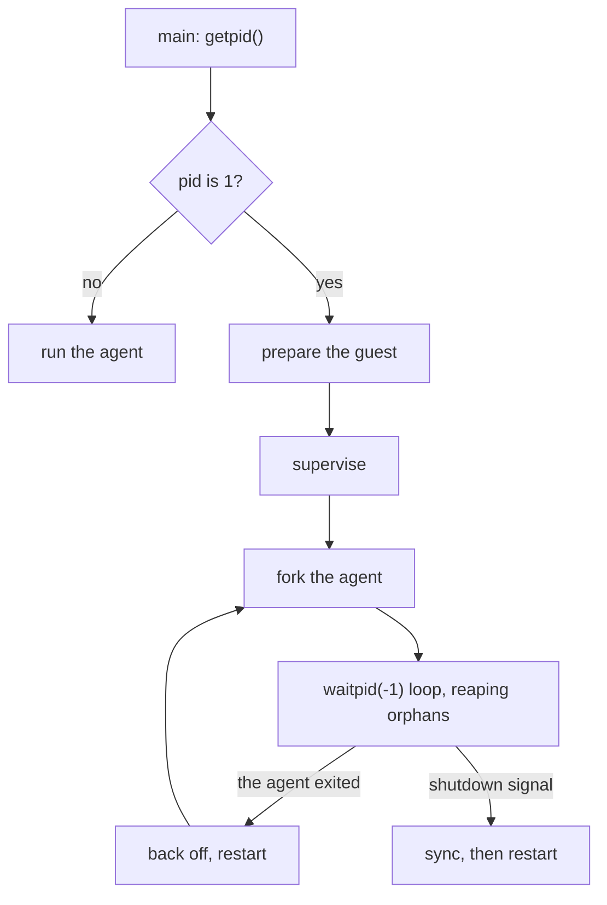
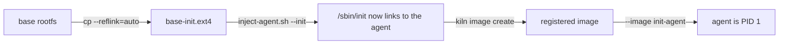

[Guest boot time](/engineering/28-opt-guest-boot-time) took a cold create from 413 ms to 214 ms and ended with a leftover. About 125 ms of the remaining time was systemd userspace, with `dev-vda.device` blamed for 107 ms and `fcnet.service` for 45 ms. That is a general init doing general work, waiting for udev device units and configuring networking for a guest whose whole purpose is to run one program that listens on vsock. The post said replacing it "has NOT been done" and needed a fresh measurement before anyone started.

This post is the result. The guest agent can be the guest's PID 1. It is opt-in per image, and it moves the cold create median from 232 ms to 147 ms. It does not reach the 110 ms goal the plan set, and the reason is instructive.

Numbers come from `docs/benchmarks.md` (section "Init-mode image") and `docs/design-notes/latency-floor.md`. They were measured on the one shared development box with a real Firecracker, and are directional.

## What an init has to do

PID 1 is not an ordinary process. The kernel starts exactly one program after it finishes booting, runs it with no mounts, no hostname and no signal handlers, and panics if it ever exits. That program inherits every orphaned process and must collect their exit statuses, or they remain as zombies. So replacing systemd means taking over a short list of duties that something has to perform.

| Duty | What the agent does |
| --- | --- |
| Mount the pseudo filesystems | `/proc`, `/sys`, `/dev/pts` (with `ptmxmode=666` so a PTY works for any user), `/dev/shm`, `/run`, `/tmp`, and cgroup v2. The kernel has already mounted devtmpfs on `/dev` |
| Create the `/dev` symlinks userland expects | `/dev/fd`, `/dev/stdin`, `/dev/stdout`, `/dev/stderr`, and `/run/lock` |
| Hostname | The first non-comment line of `/etc/hostname`, if it fits the kernel's 64 byte limit |
| Loopback | Bring `lo` up with an ioctl, so tunnels and previews that reach guest services on 127.0.0.1 work |
| Environment and limits | `LANG` and `PATH` only, and a hard `RLIMIT_NOFILE` of 524288, which is what systemd's service default gave the old agent |
| Reap zombies | `waitpid(-1)` for every child that is not the agent's own |
| Keep the agent alive | Restart it if it exits, with a backoff |
| Shut down | On a shutdown signal, `sync` and then restart the guest |

The mount list is not invented. It is the set systemd mounted for the previous default image, minus the systemd-private mounts and the debug filesystems nothing here relies on. A unit test checks that a mount target is never mounted before its parent, that the targets are unique, and that the filesystems PTY and temp-file workloads need are present.

Networking is absent from the table on purpose. The guest's interface is configured by the `ip=` kernel argument, before any init runs. That configuration costs about 18.7 ms in the kernel and is one of the things that remains.

## The design: PID 1 forks the agent

The obvious design is to make the agent PID 1 and add the duties to it. It does not work, for a reason that is easy to miss.

The agent runs commands. `Command::output` forks a child and calls `waitpid` on that specific pid. A PTY session forks a shell. If the same process also called `waitpid(-1)` to reap orphans, it would be racing its own waits and could consume an exit status that `Command::output` was about to read, turning a successful command into an error.

So the binary behaves differently depending on who it is:



PID 1 is the supervisor and forks the agent as an ordinary child. Only orphans reparent to PID 1, so `waitpid(-1)` there never sees the processes the agent is waiting on. The agent's own waits are untouched.

The selector is `getpid() == 1` and nothing else. The same binary stays a plain agent under systemd, and a stray local run on a developer machine can never mount filesystems over the host, because on a host it is not PID 1. No kernel argument, flag or daemon change is involved.

### The supervisor's rules

- **It never exits.** A PID 1 that returns panics the kernel. Setup steps are best effort and logged (`init: mount /sys/fs/cgroup: ...`): a guest with a missing optional mount is still a working sandbox. Even a failed fork falls through to the loop.
- **The agent gets default signals.** The child resets the shutdown signals to their defaults before entering the agent, so it does not inherit PID 1's handlers.
- **Restart with a backoff.** A crash-looping agent is retried after 0, 50, 100, 200, 400 and then 800 ms, so a persistent fault cannot spin the guest CPU or flood the console. An agent that stayed up 10 seconds counts as healthy and resets the count. Both rules are pure functions with unit tests.
- **Signals are handled by flag.** A handler may only do an atomic store, so it records the signal number and returns. The handlers are installed without `SA_RESTART`, so a blocked `waitpid` returns `EINTR` and the loop notices.
- **Shutdown is a restart.** On `SIGTERM`, `SIGINT`, `SIGUSR1` or `SIGUSR2` it calls `sync` and then `reboot(RESTART)`. Restart, not power off, because the kernel arguments include `reboot=k` and Firecracker exits when the guest resets. It has no ACPI power-off path. Ctrl-Alt-Del is turned into a `SIGINT` to PID 1, so it syncs first.

## How the image is built

The init is a mode of the existing agent binary, so there is nothing new to ship. The image is made by pointing `/sbin/init` at it. The kernel runs `/sbin/init` when no `init=` argument is given.



```bash
cp --reflink=auto base.ext4 base-init.ext4
sudo images/inject-agent.sh --init core/target/x86_64-unknown-linux-musl/release/sandkiln-agent base-init.ext4
kiln image create init-agent base-init.ext4
kiln sandbox create --image init-agent
```

Details worth knowing:

- **Always on a copy.** The default images are untouched. Running the script on the same file without `--init` restores systemd, because the original init was kept as `/sbin/init.systemd`.
- **The symlink is resolved inside a chroot.** On a usr-merged image `/sbin` can be an absolute symlink, and resolving it on the host would point at the host's files.
- **The daemon copies a registered image into `images_dir`.** If that directory is on a filesystem that cannot reflink, every create pays a full copy of the 300 MB image. This happened while measuring: two early runs showed `create_call` at 98 ms instead of 22 ms, and the clone counts showed `copy` rising by 60. They were discarded. Keep `images_dir` on the reflink volume.

## What was measured

`examples/benchmark-suite --only create --iterations 30 [--image init-agent]`, default and init runs alternating back to back on an idle daemon. Medians, with p95 and min where recorded.

| Metric | Default (systemd), 4 runs of 30 | Init mode, 2 valid runs of 30 |
| --- | --- | --- |
| `create_call` | 20.8 to 22.7 ms | 19.6 to 21.9 ms |
| `first_command_after_create` | 204.5 to 212.5 ms (p95 228 to 235) | 122.6 to 127.5 ms (p95 134 to 143) |
| `create_to_first_command` | 225.5 to 234.6 ms (p95 248 to 258, min 205 to 219) | 144.6 to 149.7 ms (p95 156 to 167, min 123 to 131) |

Pooled, that is 232 ms to 147 ms, about 83 ms or 36 percent. The create call did not change, as expected: it returns before the guest does. The guest's own clock agrees. Uptime at the first command is 0.10 to 0.15 s on the init image against 0.18 to 0.22 s with systemd, and the agent process starts at 0.08 to 0.11 s of guest uptime.

The plan's goal was 110 ms and it was not met. Look at the last number. The agent starts about 80 to 110 ms after the kernel starts counting, so what remains is mostly the kernel reaching userspace, 80 to 100 ms on this CI kernel including the `ip=` configuration. The init is no longer the large share. The next levers are a trimmed kernel and configuring the interface from the agent, and they are not done.

Two runs are not in the table. The two discarded runs are the copy-versus-reflink trap above. And the parallel benchmark was not measured on this image: another job held a live sandbox and the suite refused to run without `--allow-busy`, which would have produced a number that looked fine and was not. The profile of the kernel stage after the change was also not taken.

## What was verified and what was not

Verified against a real daemon and real microVMs:

- The whole integration suite on the init image, 29 topics, passed 353 of 353. That covers exec, files, PTY, streamed exec, previews and tunnels, egress, snapshots, fork, resume with the entropy and clock fixup, and pools, since pool creates and claims use the same image.
- The same suite on the default image passed 352 of 353 on its one run. The failure was the pool topic's check that deleting a pool cleaned up exactly its own warm snapshot (expected 1, got 2). It passed on rerun on both images, and is recorded as a flake against another job's snapshots on the shared box.
- By hand on the init image: PID 1 is the agent, the mounts match the systemd list minus the systemd-private ones, `lo` is up, a double-forked orphan leaves no zombie, and killing the agent is survived. The supervisor restarts it and the next exec succeeds.

> **Update (2026-11-24, later):** most of the list below was then checked on a private daemon. The full suite passed on the init image with authentication on (457 of 458 with a FUSE kernel, the one miss being a 6-tap pool running out under two concurrent topics, 17 of 17 alone), the remote storage mounts topic passed against a local S3-compatible endpoint, and `SIGTERM` to PID 1, killing the agent (including eight times in a row), zombie reaping and a daemon restart with live init-mode sandboxes were each run for real (`scripts/integration-tests/32-guest-supervision.sh`, `scripts/restart-test.sh`). The jailer could not be tested: with a real setuid `jailer` the daemon cannot reach the jailed Firecracker's API socket on any image ([finding 32](https://github.com/SumitKumar-17/sandkiln/blob/main/docs/findings.md)). Cold `create_to_first_command` was re-measured with the warm pool off, 231.7ms against 147.5ms (n=60 each). `build-universal-image.sh --agent ... --init` now builds the image; building it found two bugs in the script (debootstrap failed after a `/dev` bind mount, and `/etc/resolv.conf` was a dangling symlink, which meant no DNS at all in an init-mode guest). The entropy question is still open.

Not verified:

- **Remote storage mounts.** The mounts topic skips without a FUSE kernel and an object store.
- **Authentication.** The bearer-token path was not run on this image.
- **The jailer.** The jailer topic is not enabled on the daemon used.
- **The shutdown signals.** The by-hand run killed the agent. I did not find a recorded live run of `SIGTERM` to PID 1 and the sync-then-restart path. It has unit tests for the helper logic only, so treat it as written and unproven.
- **Crypto-heavy first commands.** An init-mode guest has no systemd seeding its entropy pool. The kernel's own jitter entropy covered the tests, but the effect on a command that needs randomness the instant it starts is unmeasured.

## What it costs

A guest on this image has no systemd. Units baked into an image never start, so cron, an ssh service or a user's own services do not run. There is no journald and no `systemctl` or `poweroff` talking to a manager: send `SIGTERM` to PID 1 or run `reboot -f`. That is why this is an opt-in image and not a replacement.

## What remains before it can be the default

From the latency note, in its own order:

1. Run the remote-mounts topic with a FUSE kernel and an object store.
2. Decide what to do about images that depend on systemd units, such as those built by `build-universal-image.sh`.
3. Make `build-universal-image.sh` and `scripts/dev.sh inject-agent` take `--init`, so the image is reproducible instead of a hand-made copy.
4. Apply the same to the pool and `kiln doctor` paths, and rerun the parallel benchmark on an idle box.
5. Look at guest entropy at cold boot.

Auth and the jailer belong on that list too, as the roadmap says. Then the kernel levers, which is where the remaining 80 to 100 ms is.

## How to reproduce

```bash
cp --reflink=auto base.ext4 base-init.ext4
sudo images/inject-agent.sh --init <agent-binary> base-init.ext4
kiln image create init-agent base-init.ext4

scripts/dev.sh bench-suite --only create --iterations 30 --json examples/benchmark-suite/results/default.json
scripts/dev.sh bench-suite --only create --iterations 30 --image init-agent --json examples/benchmark-suite/results/init.json
scripts/dev.sh bench-suite compare examples/benchmark-suite/results/default.json examples/benchmark-suite/results/init.json
```

Run them alternately on an idle daemon, with `images_dir` on a reflink filesystem. Check the clone counts in the result's environment block: a rising `copy` count means the run timed byte copies. The integration suite takes the image the same way: `SANDKILN_INTEGRATION_TEST_IMAGE=init-agent scripts/integration-test.sh`. One trap from the later warm pool change: with `default_warm_count` above 0, a create on the default image is a resume and no longer measures a cold boot, so start the daemon with `SANDKILN_DEFAULT_WARM_COUNT=0` for the default-image runs. The init image has its own image id and does not match the default pool. The figures above were taken before the warm pool existed.
