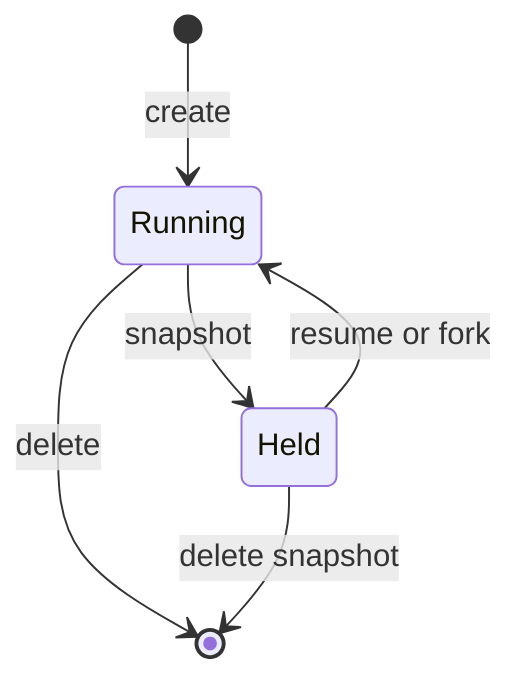

Every sandbox needs a network identity: an address inside the guest, a MAC, and a tap device on the host that the VM's network interface plugs into. The daemon hands these out from pools. The tap devices are created once, ahead of time, because creating one needs real root and the daemon runs with only ambient `CAP_NET_ADMIN`. The addresses come from one /24, 253 of them.

For a long time these were one lease, and a snapshot kept the whole thing. That was correct in the simple case and wrong at scale. This is finding 29 in `docs/findings.md`.

## The failure

`DELETE /sandboxes/:id` keeps a snapshot by default, so deleting a sandbox leaves a held snapshot behind. And a held snapshot kept its tap. With a 32-tap pool, the 33rd snapshot meant the next create failed with "no free tap devices". A stress test found it. From then on every create failed until a snapshot was deleted.

The cost of the tap being pinned was out of all proportion to what it did. A snapshot is a file on disk. It runs nothing and sends no packets. It was consuming a scarce host device for nothing.

## What is frozen and what is not

The way out is to ask which parts of the network identity the snapshot actually has to remember.

| Part | Where it lives | Survives a resume |
| --- | --- | --- |
| Guest IP and gateway | Inside the guest, in its memory image | Frozen. The guest keeps using it |
| Guest MAC | Inside the guest, in its memory image | Frozen |
| Tap device | A host-side port the VM's interface is plugged into | Not remembered by the guest at all |

A guest never learns the name of its tap. The IP and MAC are in the memory image and cannot change without breaking the guest's own view of itself. The tap is plumbing. If a different free tap is attached to the same bridge, the guest cannot tell.

Firecracker v1.16.1 supports exactly this. The snapshot load request takes `network_overrides`, a list of `{iface_id, host_dev_name}` pairs that repoint a restored interface at another host device. The finding records that this was confirmed in its API specification and live.

## Two leases

The lease in `core/crates/vmm/src/network.rs` is now two types with two lifetimes.



A create leases an IP and a tap. A snapshot returns the tap and keeps the IP. A resume or fork leases any free tap. Deleting a running sandbox returns both, and deleting a snapshot returns its IP.

- **`IpLease`**: the address, the MAC and the host octet. Owned by a running sandbox or a held snapshot. It costs one address of the 253.
- **`TapLease`**: one pooled device attached to the bridge. Owned only by a running VM. Taken at boot or at resume and returned at snapshot or stop.
- **`Lease`**: the pair, which is what a running VM owns. `NetworkManager::detach` splits it when the VM stops but the guest lives on in a snapshot, and `IpLease::with_tap` joins an address to a tap for a VM about to run.

The types make the ownership rule visible. A snapshot record can hold an `IpLease` and cannot hold a `TapLease` by accident. Dropping a `TapLease` leaks the device, so the code returns it explicitly through `release_tap`, which detaches it from the bridge and brings it down before it goes back in the free list.

### What leases a tap, and what happens when none is free

Everything that runs a VM from a snapshot leases a tap at that moment and passes it as the override: resume, fork, pool claim, and checkpoint restore. `resume_vm` does the lease inside the blocking task, then calls `Vm::resume` with `tap_override`. If the resume fails, the tap goes back before the error is returned. The caller owns the tap only when the call returns `Ok`.

If none is free, the pool error travels up as a typed `PoolExhausted::Taps`, and the HTTP layer turns it into `503`, not an internal error. The snapshot stays intact. The caller was told to retry, and a retry works once a running sandbox stops. That is the right shape for exhaustion of a shared resource: not a crash, and not data loss.

## Egress rules are keyed by tap

The network egress firewall installs per-sandbox rules keyed by the tap the sandbox is on. Moving a guest to a different tap would silently leave it without its rules. The fix has to deal with this, because a `deny_all` sandbox that comes back from a snapshot unrestricted is a security failure, not a cosmetic one.

So the rule chain follows the guest:

1. **At snapshot time** the chain is removed, because the tap is about to be returned and may be given to another sandbox. It is removed only if one was installed.
2. **At resume, fork, claim and restore** the policy is applied to the tap the resume was just given. The operation is idempotent, so it is also right after a daemon restart or a host reboot that wiped the rules.

The two entry points do not fail the same way, and that is deliberate. A pool claim treats a failed egress application as fatal and destroys the sandbox, since the caller asked for restrictions on a new sandbox and handing back an open one is not acceptable. A plain resume treats it as a loud error log, because the snapshot is already consumed and destroying a freshly resumed sandbox over a firewall hiccup would be data loss. The log line says the sandbox is running without its restrictions. That second choice is a trade-off and the code comment says so.

## Restoring checkpoints without a per-tap set

Retired checkpoints, the time-travel history, have their own wrinkle. Two checkpoints of one lineage share an IP, so two concurrent restores of them must not both succeed. Before the split, a per-tap "pending restore" set enforced that, keyed by the tap the checkpoint was frozen with.

With no tap frozen in a checkpoint, that key is gone. The replacement is simpler and stronger. A restore claims its IP atomically from the free pool with `try_reserve_ip`, which removes the octet from the free list under the pool's lock and returns `None` if someone holds it. Of two concurrent restores of sibling checkpoints exactly one wins, and the other gets a `409` that names the holder. The same call is what stops a restore from being handed an octet a fresh create just took. The special-case set is deleted, because the pool already is the record of who holds what.

At startup, held snapshots are reconciled from disk. `reserve_ip` removes each one's octet from the free pool, and a tap name saved in an older `meta.json` is ignored. That has a useful side effect: a daemon restarted with a smaller or renamed tap pool still works, because nothing depends on the old names.

## Seeing it

`GET /status` now reports both pools.

| Field | Meaning |
| --- | --- |
| `tap_pool` | `size`, `free` and `in_use`. In use means held by a running VM, because that is all that holds one now |
| `ip_pool` | `size` (253), `free` and `held_by_snapshots` |
| `warnings` | Plain sentences when something is about to run out |

The warnings fire early, before an error does. A pool counts as nearly exhausted when its free count is at most a tenth of its size, with a minimum of one, and the message says how many snapshots hold addresses and suggests deleting ones you no longer need.

## What was verified

Verified live on a 32-tap pool, per finding 29:

- 40 snapshots created, all succeeded, none used a tap.
- 8 resumed concurrently on distinct taps, with working gateway traffic.
- A `deny_all` sandbox resumed onto a different tap, and a fork of it on a third, still could not reach an address outside the bridge that a control sandbox reached.
- After a daemon restart, all the snapshots were reconciled and resumed.

The integration topic `29-snapshots-hold-no-taps` encodes it. It takes more snapshots than the pool has taps (the pool size plus 6, so 38 on a 32-tap pool), so the old behaviour cannot pass. It compares exact id sets and per-sandbox facts, never the global tap count, because other topics lease taps concurrently. It then resumes four held snapshots concurrently and checks that each reaches the gateway on its new tap and that they kept distinct frozen IPs, and it forks a held snapshot, destroys the fork, and forks again to prove the tap came back. The egress step needs an address outside the bridge that the host can reach, so it runs only when `SANDKILN_INTEGRATION_TEST_EGRESS_PROBE_IP` is set and prints a skip otherwise. The topic also uses a non-default shape (128 MiB) so its sandboxes cannot claim from another topic's warm pool.

Resume now also attaches a tap, about 4 ms of `ip` and `bridge` calls. End-to-end resume measured 13.6 ms and 14.4 ms median, against 13.1 ms recorded before. The finding calls that within the noise of a shared box, and this post does too. It is two samples against one.

## The new bound, and what is not done

Held snapshots are now bounded by the /24, 253 addresses shared with running sandboxes, and by disk, since each full-memory snapshot costs its memory size. A default pool of warm instances ([the previous post](/engineering/34-making-a-create-a-resume)) holds some of those addresses for itself, and its replenisher pauses at 16 or fewer free ones so it never takes the last of them from users.

Not done, and stated as not done:

- 100 snapshots were not tried. The /24 allows 253, but each full-memory snapshot costs its memory size on disk.
- The /24 is not widened, and a snapshot does not get its IP only on demand. A snapshot that nobody will ever resume still holds an address.
- A drained tap pool is still possible when more sandboxes run than there are taps. That is now the honest limit: one tap per running VM, reported as `503`.

## How to reproduce

```bash
scripts/integration-test.sh   # topic 29-snapshots-hold-no-taps runs with the rest

# Include the egress check by giving it an address outside the bridge that the host can reach:
SANDKILN_INTEGRATION_TEST_EGRESS_PROBE_IP=<address> scripts/integration-test.sh
```

By hand, take more snapshots than `tap_pool.size` and read `GET /status` after:

```bash
B=http://127.0.0.1:7777
for i in $(seq 1 40); do
  ID=$(curl -s -X POST $B/sandboxes -H 'content-type: application/json' -d '{"mem_size_mib":128}' | jq -r .id)
  curl -s -X POST $B/sandboxes/$ID/snapshot >/dev/null
done
curl -s $B/status | jq '{tap_pool, ip_pool}'
```

Expect `tap_pool.in_use` near 0 and `ip_pool.held_by_snapshots` at 40 or more. Delete the snapshots afterwards, each one is a full memory file, and add the `Authorization` header if a token is configured. The shape is 128 MiB so the creates do not claim from the default warm pool, which is sized for the default shape.
