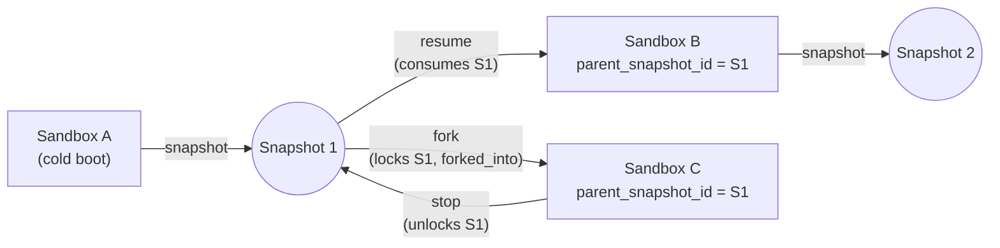
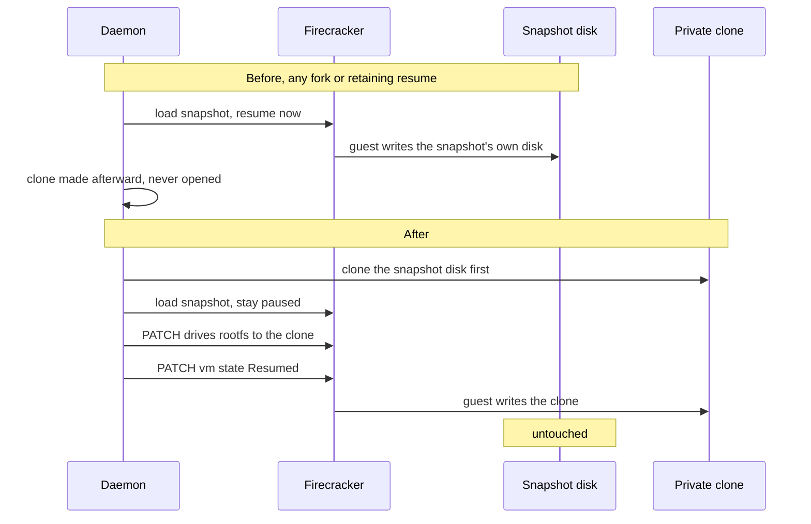

[Snapshots, resume, and fork](/concepts/snapshots) covers how to call this from the API. This page is what's actually happening underneath, which is worth reading before debugging a resumed sandbox that boots into the wrong filesystem or can't reach its own network.

## What it is

A Firecracker "snapshot" is not a copy of a virtual disk, the way a cloud provider's VM snapshot usually is. It's two files: a **memory file** (the guest's RAM, byte for byte, at the instant it was paused) and a **device-state file** (everything about the emulated hardware, serialized to disk: the vCPU registers, the virtio-block/virtio-net device configuration, the vsock setup). Resuming means starting a brand-new Firecracker process and telling it to load those two files instead of running a kernel boot sequence. The guest picks up running from the exact instruction it was paused on, with all of its RAM already in place. No init scripts, no service startup, no dependency loading, because none of that needs to happen again.

Two consequences fall directly out of that shape, and both matter in this codebase specifically:

- **The device-state file records the rootfs drive by its host file path, not its contents.** Firecracker never copies the backing file into the snapshot. Resume reopens whatever file is sitting at that recorded path at the moment you resume. If it's been deleted, moved, or (the bug below) silently mutated by something else, the guest boots believing one filesystem is attached while a different one is actually there.
- **A VM's network identity is guest-OS state, frozen into the memory image.** The guest's IP and MAC address are set via kernel boot arguments at the *original* boot, and the host has no way to reach into a running guest's kernel and rewrite them afterward. A resumed guest keeps addressing packets to whatever it believes its own identity is, so the address has to stay the exact one that was live at snapshot time. The *tap device*, by contrast, is only the host-side port the guest is plugged into. Its name is recorded in the device-state file but is not guest state, and Firecracker can repoint it on load (`network_overrides` in `PUT /snapshot/load`). So a snapshot keeps the guest's IP and MAC and holds no tap; resume plugs the guest into whichever tap is free.

## Why sandkiln uses it here

This is the standard technique for closing the gap between "a cold boot is fast" and "a workload is actually ready to do something": see [Startup latency & the pre-warmed pool](/architecture/startup-latency) for the measured ~25-100x difference between a cold sandbox's first real command and a resumed one's. sandkiln builds three distinct operations on top of the same underlying mechanism, because "boot from a snapshot" turns out to have two genuinely different use cases that need different consumption rules.

## Key terms

| Term | Meaning here |
| --- | --- |
| `pause` / `snapshot` / `resume` | Firecracker's own three-step API: pause the vCPUs, dump state to disk, later load that state into a new process. |
| **Consuming** vs. **non-consuming** | Whether the operation retires the snapshot record afterward. `resume` consumes it (a second resume 404s); `fork` doesn't (the same snapshot can be forked again). |
| `forked_into` | The lock a `Snapshot` record carries while a live fork exists, sandkiln's own answer to "Firecracker has no mechanism to give two live descendants independent guest identities," described below. |
| **Retired checkpoint** | What a consumed snapshot becomes by default instead of being deleted outright. See "Time-travel restore" below. |
| `parent_snapshot_id` | The lineage pointer every snapshot carries: which snapshot its own source sandbox was itself resumed or forked from, `null` for a lineage root. |

## How it works in sandkiln



Resume consumes the snapshot record outright (a second resume `404`s); fork only locks it to at most one live descendant at a time, released once that fork is stopped — both set `parent_snapshot_id`, which is how a lineage like `Snapshot 2 → Sandbox B → Snapshot 1` stays queryable in either direction without a dedicated tree-shaped endpoint.

`Vm::pause`/`Vm::snapshot`/`Vm::resume` (`core/crates/vmm/src/vm/snapshot.rs`) are thin wrappers over Firecracker's own `/vm` (state: Paused) and `/snapshot/create` API calls, nothing more than that at the hypervisor layer. Everything about *which* files, *whose* lease, and *what happens after* is the daemon's own design, in `http/routes/snapshot.rs` and `snapshots/held.rs` under `core/crates/daemon/src`.

**Resume** (`resume_snapshot_by_id`) builds a brand-new `Sandbox` record that owns the snapshot's IP plus a tap leased at resume time (any free one) outright and, by default, a private rootfs clone that the VM actually runs on: structurally identical to a cold `POST /sandboxes` in everything except how the VM itself boots. The snapshot record is consumed, so a second resume of the same id returns `404`. With `?retain_history=false` there is no clone and the VM uses the snapshot's disk in place, which is safe only because nothing will resume from that snapshot again.

**Fork** (`fork_snapshot`) boots a second live sandbox from the same snapshot *without* consuming it. This is where the network-identity constraint above becomes a real design decision rather than a footnote: Firecracker has no verified mechanism to give two live descendants of one snapshot independent guest IP/MAC, since both would resume believing they own the identity frozen into that one memory image. Rather than allow that and produce a silent network collision, `Snapshot::forked_into` is a lock, set while a fork is live, checked by `fork_snapshot`, `resume_snapshot`, `delete_snapshot`, and `snapshot_sandbox` alike, and cleared only once that fork's `Vm` is actually killed. A second `fork`/`resume` attempt while one is already live gets a real `409`, not silent corruption.

**A real bug, and what it teaches about the rootfs-path rule above.** The snapshot records its rootfs by host path, so `Vm::resume` used to start the guest on exactly that file. A fork, a history-retaining resume and a restore therefore all wrote into the snapshot's own disk, even though the daemon also made a clone and recorded it on the new sandbox. Nothing told Firecracker about the clone, so the VM never opened it. Fork a snapshot, write a marker in the fork, stop it, and `debugfs -R "stat /root/fork1-marker"` on the snapshot's rootfs found the marker on the snapshot's disk. A second fork of the same snapshot then failed with `cat: /root/fork1-marker: Bad message`, an ext4 checksum error: its memory said one filesystem, the disk held another. The retain-history path had the inverse flaw. The clone was made after the resume and given to the sandbox record while the live VM wrote the checkpoint's original disk, so restoring the same checkpoint twice was corrupt too.

A first test of the fix looked clean, and that result was wrong. The second guest resumes with the page cache and dentry cache it had at snapshot time, so it answered from stale cache and never read the changed disk. Dropping caches (`echo 3 > /proc/sys/vm/drop_caches`) before the read exposed the damage. A test of isolation has to read past the observer's cache.

The fix is in two parts. `Vm::resume` takes an optional `rootfs_override`. With one set, it loads the snapshot paused (`resume_vm: false`), repoints the drive with `PATCH /drives/rootfs`, then sends `PATCH /vm` with `{"state": "Resumed"}`, so the guest never runs on the wrong disk. The daemon makes a private clone before the resume for fork, retain-history resume and restore, and passes it as the override, so the snapshot or retired checkpoint keeps its pristine original. If the clone fails, a fork fails (a shared disk is unsafe, not degraded) and a retaining resume degrades to the consuming mode with a warning.



The regression test is `scripts/integration-tests/26-snapshot-disk-isolation.sh`: fork against fork, then a retaining resume followed by two restores of the same checkpoint, each reading with caches dropped. The full engineering account is in the [Engineering Notebook](/architecture/engineering-notebook), post 27.

**Time-travel restore.** Resume's "the snapshot is gone once you move forward from it" used to be unconditional. By default now, `POST /snapshots/:id/resume` still consumes the snapshot *record* the same way, but retires the underlying checkpoint into `GET /snapshots/history` instead of deleting its files, restorable again later via `POST /snapshots/history/:id/restore`, as many times as wanted, since restoring doesn't consume it either (`?retain_history=false` opts back into the fully-destructive original behavior). A restored sandbox runs on a fresh rootfs clone and owns its lease outright, exactly like a resume, which is also why it stays snapshottable afterward, unlike a fork. The same one-live-descendant lock generalizes across a whole lineage's history: restoring is refused with `409` while anything else sharing that checkpoint's frozen guest IP is currently live.

<Note>
**Why only one live fork.** Firecracker has no mechanism to give two live descendants of one snapshot independent network identities. Rather than risk a silent IP/MAC collision, `Snapshot::forked_into` locks a snapshot to at most one live fork at a time — a second attempt gets a real `409`, not corruption.
</Note>

## See it in action

Fork the same snapshot twice in a row. This is the daemon's own concurrency lock, captured live:

```bash
curl -s -X POST http://127.0.0.1:7777/sandboxes \
    -H 'content-type: application/json' -d '{"tags":{"purpose":"docs-example"}}'
{"id":"5ce396c6-a633-4262-b1a5-b307674a870c"}

curl -s -X POST http://127.0.0.1:7777/sandboxes/5ce396c6-a633-4262-b1a5-b307674a870c/snapshot
{"snapshot_id":"b53b17e7-8211-4a80-bc23-bbe6111f6e11"}

curl -s -X POST http://127.0.0.1:7777/snapshots/b53b17e7-8211-4a80-bc23-bbe6111f6e11/fork
{"id":"b94d7a70-94c5-4162-b87b-25f0a03b951e"}

curl -si -X POST http://127.0.0.1:7777/snapshots/b53b17e7-8211-4a80-bc23-bbe6111f6e11/fork
HTTP/1.1 409 Conflict
content-type: application/json
x-request-id: d0d4aeab-df13-4936-9eaa-f14a6d3d769e
content-length: 153

{"error":"snapshot b53b17e7-8211-4a80-bc23-bbe6111f6e11 has a live fork (b94d7a70-94c5-4162-b87b-25f0a03b951e) — stop it before forking this snapshot"}
```

The second fork attempt is rejected while the first one is still alive. That's the `forked_into` lock described above, not a hypothetical.
