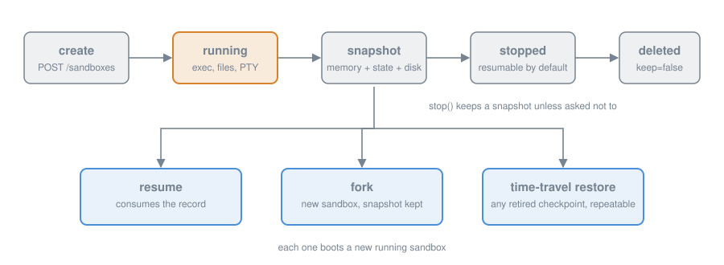

# Persistence and snapshotting

A sandbox is a persistent identity (name, config, filesystem state); a
session is one running microVM of it. Resumed daily for a week it is one
sandbox, seven sessions.

## What is built

| Feature | Behavior |
| --- | --- |
| Snapshot/resume | `POST /sandboxes/:id/snapshot`, `POST /snapshots/:id/resume`. Full memory and disk saved; resume skips boot and dependency install. `Sandbox.snapshot()`/`resume()` in both SDKs, `kiln sandbox snapshot|resume`. Works with drives attached (live-verified repeatedly). |
| Durable across daemon restart | Metadata written atomically beside the state/memory files and reconciled at startup. The held snapshot's guest IP (not a tap, which a snapshot does not hold) is reserved out of the pool before the daemon accepts creates, preventing a double-lease race; a saved tap name from an older daemon is ignored. Verified live: killed a daemon with a snapshot on disk, started a fresh instance, resumed it, data intact. Snapshot storage originally lived under `$TMPDIR`, so it is not durable across a host reboot unless `SANDKILN_STATE_DIR` is persistent (see `SELF_HOSTING.md`). |
| Persistent by default | `DELETE /sandboxes/:id` auto-snapshots (`stop_sandbox_by_id(..., keep: true)`). `?keep=false` (`kiln sandbox rm --destroy`) destroys. A jailed sandbox cannot be preserved and falls back to destroy. The idle reaper's destroy pass uses the same default. |
| Named sandboxes | `name` on create/resume/fork (1-64 chars, `[A-Za-z0-9_-]`, unique among live sandboxes). `GET /sandboxes/by-name/:name` (live only; 409 pointing at get-or-create if the name resolves to a held snapshot). `POST /sandboxes/get-or-create` returns if live, resumes if snapshotted, creates otherwise, race-safe under a per-name lock, so two concurrent callers claiming the same new name cannot both win. A name carries through snapshot/resume/fork when re-specified. SDK: `Sandbox.getOrCreate()`/`byName()` in both SDKs; CLI: `kiln sandbox get-or-create|get`, `--name` on `create`/`ls`/`resume`/`fork`. |
| Auto-suspend on idle | `SANDKILN_AUTO_SUSPEND_TIMEOUT_SECS` pauses and snapshots a quiet sandbox using the same pause-and-snapshot path as the manual route, composed into the idle reaper rather than built as a new mechanism; it frees the VM and network resources while keeping state resumable. `SANDKILN_IDLE_TIMEOUT_SECS` (plain destroy), if also set, must be strictly longer and acts as a backstop for a sandbox whose auto-suspend keeps failing, not a competing timer. `GET /snapshots?source_sandbox_id=<id>` finds what a sandbox became (`listSnapshots()`, `kiln sandbox snapshots --source`). |
| Fork (partial) | `POST /snapshots/:id/fork` boots a new sandbox without consuming the snapshot. At most one live fork per snapshot (`Snapshot::forked_into`, enforced for resume, fork, delete and snapshot; a second is 409). |
| Time-travel restore | Resume retires its checkpoint into `GET /snapshots/history` instead of deleting it. `POST /snapshots/history/:id/restore` restores it any number of times; `DELETE /snapshots/history/:id` reclaims it; `?retain_history=false` opts out. Sequential, not branching. |
| Archive tier | `SANDKILN_ARCHIVE_TIMEOUT_SECS` moves a held snapshot's `state.snap`/`mem.bin` to `SANDKILN_ARCHIVE_DIR` once unresumed that long. Applies to any held snapshot however it arose (auto-suspend or a manual snapshot), independent of whether auto-suspend or `idle_timeout` are configured. `GET /snapshots` reports `archived_at_unix`. Daemon-operator config only, no SDK or CLI surface, same as `idle_timeout`/`auto_suspend_timeout`. Live-verified: a snapshot archived after a short timeout, files confirmed moved, a daemon restart reconciling it back with `archived: true` and no false-alarm warnings, and a full resume afterward (write-file, snapshot, archive, resume, read-file round-trip) proving an archived snapshot is as usable as a hot one. |
| Retention cap | `retained_checkpoints_max` (default 8), oldest retired checkpoint evicted after each resume. |

Lineage (parent pointers) and warm pools are in
[pools and lineage](pools-and-lineage.md).

## Why fork is single-live

The reason (no verified way to give two live descendants of one snapshot
independent guest IP/MAC, both frozen into the snapshotted state) and the
mechanism are on the
[snapshot internals page](../../docs-site/internals/snapshot-resume-fork.mdx).
Not on that page: real parallel branches (see
`core/crates/daemon/src/routes_snapshot.rs`'s module doc comment) and fan-out
cloning of one snapshot into several sandboxes need either a verified per-fork
drive override plus a way to change guest identity, or a from-scratch
live-memory-clone design. Fan-out is the same unsolved problem restated, not a
separate item. The rootfs half is now solved by `rootfs_override` (finding 21
in [findings](../findings.md)); the network identity half is not (a fork now leases its own tap, but
two live forks would still present one IP/MAC). Genuinely open.

## Time-travel restore rules

- Restoring an old checkpoint does not destroy what came after it; those
  stay in history, like descendants of an old commit after a checkout.
- Restore refuses (409, naming the holder) while anything sharing that
  checkpoint's frozen guest IP is live or held (the tap is not part of the
  identity: every restore leases a free one). This generalizes the
  one-live-descendant rule across a lineage's full history.
- A restored sandbox owns everything (its IP, a tap leased at restore time, private rootfs
  clone), so unlike a fork it stays snapshottable and starts a new branch.
- Same constraint that rules out true parallel branching (two checkpoints of one lineage live at once): the guest's IP/MAC cannot be changed post hoc without in-guest cooperation the guest agent lacks. Out of scope for that reason, not by choice.
- Surface: daemon HTTP API only, no SDK or CLI yet, same as snapshot lineage. (Egress policy was once cited as the same kind of gap; both SDKs and the CLI now wrap it.)

## Bugs found while building

- **Fork shared its source's rootfs file.** Fine for simultaneous forks
  (already excluded), wrong for sequential ones: fork, mutate, stop the
  fork, resume the original, and the marker came back mutated. Fixed by
  giving every fork a private copy (`clone_rootfs`); the deeper form of the
  same bug was finding 21.
- **Unbounded retention filled a 468GB disk.** Retaining every resume's
  checkpoint by default has an unbounded cost: a full guest-memory dump plus a
  private rootfs copy, forever. Routine manual verification while building
  this filled the dev-box disk. `DELETE /snapshots/history/:id` was added in
  response (not in the original design), then the retention cap (finding 24)
  replaced the deferred expiry policy. Operator guidance: `SELF_HOSTING.md`,
  "Time-travel restore and its disk cost".

## Archive: a Firecracker constraint

The first design moved state, memory and rootfs into the archive dir.
Resume then failed with "Error manipulating the backing file: No such file
or directory": Firecracker bakes the rootfs's absolute host path into
`state.snap`, and `/snapshot/load` has no override for it (unlike
`mem_backend.backend_path`). So archiving moves only `state.snap` and
`mem.bin`; the rootfs stays put while the snapshot may be resumed. `mem.bin`
equals the guest RAM size, often as large as the rootfs, so this still
relieves hot storage.

A second bug from the same pass: `resume_snapshot_by_id` cleanup and
`delete_snapshot_by_id` derived the directory from a hardcoded hot-root
`snapshot_dir(&id)`, which would silently no-op for an archived snapshot and
leak its files. They now derive it from the snapshot's own `snapshot_path`.

Not built: a delete-after-archive tier; archiving onto remote storage mounts
(`SANDKILN_ARCHIVE_DIR` is a local path; the practical win is pointing it at
a real disk instead of the default under `$TMPDIR`, often tmpfs).
