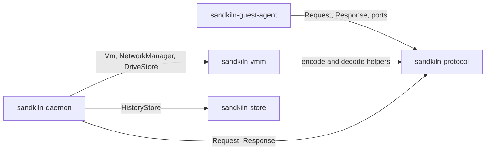
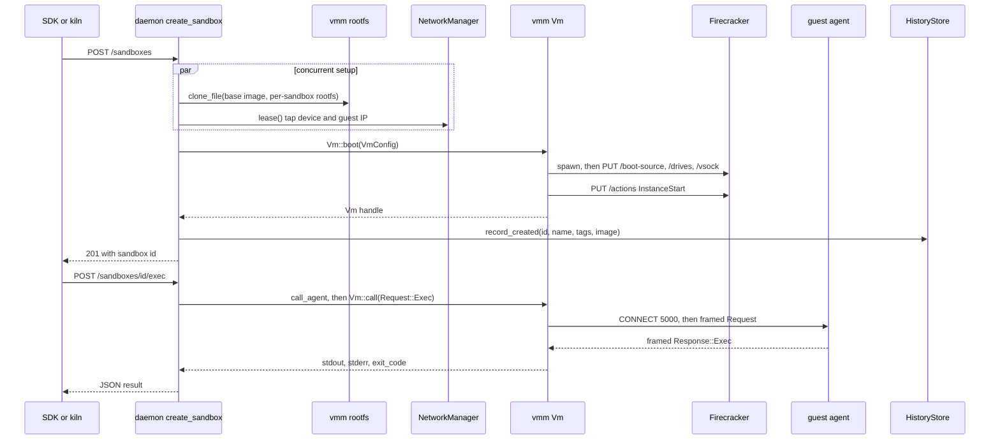

sandkiln runs untrusted or AI-generated code inside Firecracker microVMs. A caller talks HTTP to a daemon; the daemon boots a VM; a small agent inside the VM runs the commands. Almost every design decision in the codebase follows from three questions: what must run inside the guest, what must run on the host with privileges, and which crate is allowed to know about which. This post is the map. The following posts go deep on the [vsock protocol](/engineering/02-vsock-protocol-and-guest-agent) and on [driving Firecracker](/engineering/03-driving-firecracker).

## The five crates

The Rust workspace lives under `core/` and has exactly five members (`core/Cargo.toml`):

| Crate | Runs where | Owns |
| --- | --- | --- |
| `sandkiln-protocol` | both | Wire messages, length-prefixed framing, the four vsock port numbers |
| `sandkiln-guest-agent` | guest | Executing commands, file operations, PTY, streamed exec, tunnel listener |
| `sandkiln-vmm` | host | Spawning and configuring Firecracker, vsock client, tap leases, rootfs clones, jailer, drives, images, egress rules |
| `sandkiln-store` | host | Durable sandbox lifecycle history in sqlite |
| `sandkiln-daemon` | host | The HTTP API (`sandkilnd`), live-sandbox bookkeeping, pools, snapshots, background reapers |

The binary that matters most for scale is `sandkiln-guest-agent`. It is built for a static musl target and optimised for size (`opt-level = "z"` in the workspace profile, `core/Cargo.toml:24`) because it ships inside every rootfs image. Everything else is a normal host binary or library.

## Dependency direction



Every arrow in that diagram is a real `path = "../..."` entry in a crate's `Cargo.toml`. The rules they encode:

1. **`protocol` depends on nothing but serde.** Its manifest lists `serde` and `serde_json` only. It has no knowledge of vsock, HTTP or Firecracker. A need that involves networking or processes belongs in `vmm` or `guest-agent`, never here. This keeps the one piece of code both sides compile from small enough to review as a contract.
2. **`guest-agent` and `vmm` never depend on each other.** They only meet through `protocol`. That is what lets the guest binary stay tiny and statically linked: it cannot accidentally pull in host-side crates, and the host cannot reach into guest internals. The agreement is purely the wire format.
3. **`vmm` has no async runtime.** Its dependencies are `sandkiln-protocol`, `libc`, `serde`, `serde_json` and `tracing`. Every call into it is blocking. The daemon bridges that boundary once, with `spawn_blocking`, rather than each vmm module inventing its own concurrency model.
4. **`store` is independent of `vmm`.** It records "this sandbox existed and ended this way" and knows nothing about VMs. It is a sibling the daemon composes, not a layer beneath the VM code.
5. **`daemon` is the only crate that depends on everything.** It parses requests, calls `vmm`, shapes responses. Lifecycle logic that is not HTTP-shaped (boot, stop, network leases, rootfs cloning) belongs in `vmm`.

A consequence worth naming: `vmm` does not track which sandbox holds which network lease. `NetworkManager` hands out a `Lease` and takes it back, but the mapping from sandbox to lease lives in the daemon's `Sandbox` records. Ownership of "who holds what" sits in one place, the daemon's `AppState`, which is also where the drive and image holder checks live.

## What lives on the host and what lives in the guest

The split is a security boundary, not a convenience.

The **guest** contains one process of ours, the agent, running as an ordinary systemd service inside the VM. It is a deliberately dumb executor: it runs what it is told, with no path validation, because a path is only meaningful inside that one microVM's own filesystem. It listens on four vsock ports and, for the tunnel feature, dials out on one.

The **host** contains everything with authority: the Firecracker processes, the tap devices and bridge, iptables rules, the rootfs files, the history database, the API surface, and the bearer-token check. The daemon runs unprivileged with only ambient `CAP_NET_ADMIN`, raised in a plain `fn main()` before the Tokio runtime starts so worker threads inherit it. Tap devices are pre-created by a host-setup script and only leased by the daemon, because creating one needs real root and ambient `CAP_NET_ADMIN` only covers netlink operations on existing interfaces.

The control channel between them is vsock, not the guest's network interface. Firecracker exposes one virtio-vsock device per VM backed by a host Unix socket, so the control path is independent of the sandbox's IP configuration, and an egress policy that blocks all outbound traffic has no effect on it. The [vsock wire protocol page](https://sandkiln.mintlify.site/internals/vsock-wire-protocol) in the docs covers that design in prose.

## The request lifecycle at a glance

Creating a sandbox and then running a command in it exercises most of the stack. The sequence below shows the cold path (no pre-warmed pool involved).



Walking it step by step:

1. The SDK sends `POST /sandboxes`. The daemon resolves the name and image, and for a request without drives or a rate limit it first tries to claim a warm slot from a pre-warmed pool (see the [pools page](https://sandkiln.mintlify.site/internals/pre-warmed-pools)). The diagram shows the cold branch.
2. The two independent setup steps, cloning the rootfs and leasing a tap plus IP, run concurrently on two scoped threads and are joined before boot. Each is individually timed and recorded in the `create_phase_duration_ms` metric family.
3. If the jailer is enabled, a uid/gid is leased from a `JailerIdPool` as the third resource. It is the last one acquired because nothing overlaps it.
4. `Vm::boot` spawns Firecracker, configures it over its API socket and starts it. On any failure it kills the child and removes the sockets and chroot itself before returning the error.
5. The daemon registers the sandbox in its in-memory map and writes a history row. A failed boot never reaches history.
6. Each later command goes through the daemon's shared `call_agent` helper. It enters `spawn_blocking`, finds the sandbox, touches its last-activity timestamp, and calls `Vm::call`, which opens a fresh vsock connection, sends one framed request and reads one framed response.

## Ownership: who creates, who cleans up

Every resource has exactly one owner and one cleanup path.

| Resource | Created by | Released by | If the owner crashes |
| --- | --- | --- | --- |
| Per-sandbox rootfs file | `clone_file` in `vmm::rootfs`, called from the daemon's `clone_rootfs` | daemon destroy path removes the file | file stays on disk under the rootfs dir |
| Tap device and guest IP | `NetworkManager::lease` | `NetworkManager::release`, called on boot failure and on stop | pool is rebuilt at next start; snapshots re-reserve theirs via `reserve` |
| Firecracker process, sockets, jail dir | `Vm::boot` | `Vm::stop` or `Vm::force_stop`, or boot's own failure cleanup | process is orphaned; no re-adoption exists |
| Jailer uid/gid | `JailerIdPool::lease` | `JailerIdPool::release` in the destroy path | in-memory pool resets |
| Egress chain (iptables) | `vmm::egress::apply` | `vmm::egress::remove` before lease release | rules remain until removed |
| History row | `HistoryStore::record_created` | `record_ended`, or marked at next startup | row marked `OrphanedByRestart` |

The "crash" column is honest about a hard limit. A live `Sandbox` owns an OS process with no serialisable form, so a daemon restart orphans every live sandbox's Firecracker process; nothing re-adopts them. What survives a restart is what is durable by design: snapshots on disk (reconciled from the filesystem at startup, with their tap devices pulled back out of the free pool before the listener binds) and the history database. The history store exists to answer "did this exist and how did it end", which is a different problem from resuming it, and `EndReason::OrphanedByRestart` (`core/crates/store/src/lib.rs:53`) is how it records the sandboxes a previous daemon lost.

Sandbox identity is more than the VM. A sandbox's drive attachments, image, tap device and pool slot all have a "who holds this" check that spans live sandboxes and held snapshots, which is what prevents attaching one drive to two VMs or deleting an image mid-clone.

## Lifecycle states

The daemon models a sandbox's life as explicit transitions rather than flags.

```mermaid
stateDiagram-v2
    [*] --> Booting: POST /sandboxes
    Booting --> Running: Vm::boot ok, record_created
    Booting --> [*]: boot failed, lease and jail id released
    Running --> Snapshotted: snapshot_and_stop
    Running --> Destroyed: destroy, keep=false
    Running --> Orphaned: daemon restart
    Snapshotted --> Running: resume or fork
    Snapshotted --> Destroyed: snapshot deleted
    Destroyed --> [*]
    Orphaned --> [*]
```

`Running` is the only state with a live `Sandbox` in the daemon map. `Snapshotted` is a directory with three files (guest memory, device state, metadata) plus a held tap lease. `Orphaned` exists only in the history table, as an end reason. The default stop path is persistence-first: `stop_sandbox_by_id` snapshots and then stops, and degrades to destroy for the two cases where there is nothing correct to preserve (a fork does not own its rootfs or lease outright, and a jailed sandbox cannot yet be snapshotted). See the [snapshot, resume and fork page](https://sandkiln.mintlify.site/internals/snapshot-resume-fork) for the persistence model.

## Concurrency model

Three rules cover the whole daemon.

- **Live state is behind `std::sync::Mutex`, and blocking work happens inside `spawn_blocking`.** The sandbox map lock is held across blocking vmm calls, so nothing may `.await` while holding it. This trades a little contention for an absence of async-lock subtleties; the map is small and the critical sections are short relative to a network round trip.
- **Correlation survives thread hops.** `tracing`'s current span is thread-local, so a bare `spawn_blocking` drops request correlation. The daemon wraps it in a helper that re-establishes the span and dispatcher on the blocking-pool thread, which is how one request id appears in log lines emitted from deep inside `vmm`.
- **Per-name serialisation, not global.** Concurrent claims of one sandbox name serialise on a lazily created per-name mutex, so unrelated names never wait on each other.

Background work (the idle reaper, the pool replenisher) runs as unconditional Tokio tasks that are cheap no-ops when nothing is configured.

## The case for a rootfs boundary

One boundary was drawn after measurement rather than by design instinct. A cold `POST /sandboxes` averaged 187.5 ms over 20 runs when the per-sandbox rootfs was a full byte copy on ext4 (rootfs clone 127.9 ms, VM boot 14.9 ms, network lease 3.5 ms). With the rootfs directory on the same XFS reflink filesystem as the base image, the same create averaged 17.9 ms and the clone took 0.08 ms. The clone therefore got its own module, `vmm::rootfs`, which issues the `FICLONE` ioctl and falls back to a byte copy only on `EOPNOTSUPP`, `EXDEV`, `EINVAL`, `ENOTTY` or `ENOSYS`:

```rust
let rc = unsafe { libc::ioctl(dst.as_raw_fd(), FICLONE, src.as_raw_fd()) };
if rc == 0 {
    return Ok(CloneMethod::Reflink);
}
```

(`core/crates/vmm/src/rootfs.rs:56-59`.) The clone method is returned, not hidden, and surfaces as `rootfs_clone_total{method="reflink"|"copy"}` on `/metrics`. A silent fallback to a copy looks identical to a slow disk in latency numbers, so the type makes the distinction observable. Two environment variables place the data: `SANDKILN_ROOTFS_DIR` for the per-sandbox rootfs files (it must share a filesystem with the base image for a reflink to be possible) and `SANDKILN_STATE_DIR` for durable daemon state.

## Configuration

Configuration is environment variables only today, all parsed in one place by the daemon at startup. The ones that shape the architecture are `SANDKILN_BASE_ROOTFS`, `SANDKILN_KERNEL_PATH`, `SANDKILN_FIRECRACKER_BIN`, `SANDKILN_ROOTFS_DIR`, `SANDKILN_STATE_DIR`, `SANDKILN_DRIVES_DIR`, `SANDKILN_IMAGES_DIR`, `SANDKILN_HISTORY_DB_PATH`, `SANDKILN_AUTH_TOKEN`, `SANDKILN_UPLINK_IFACE`, and `SANDKILN_JAILER_ENABLED` (a daemon-operator switch, not a per-request override). A `sandkiln.toml` file layer over these variables is landing; the variable names will remain the override surface.

## Clients on top

The HTTP API is the only way in. The clients are deliberately thin.

- **`packages/sdk`** is the TypeScript client (`sandkiln` on npm). It wraps the HTTP API with no logic the daemon lacks, uses native `fetch`, and has zero runtime dependencies. For PTY and log streams it returns a native `WebSocket` rather than adding a `ws` dependency.
- **`packages/python`** mirrors the JS SDK operation for operation, with Python naming. It ships separate sync and asyncio class hierarchies on purpose, so a blocking call can never silently stall an event loop. It also has zero runtime dependencies.
- **`packages/cli`** is `kiln`, a `commander` wrapper over the JS SDK with essentially no logic of its own beyond argument parsing and output formatting.

The consequence for contributors is a rule from the repo's standard: a new daemon endpoint without an SDK method, CLI command and integration test is started, not done. Every layer a change touches is updated in the same change.

## Repository layout

```text
core/crates/protocol/    wire format shared by host and guest
core/crates/guest-agent/ static musl binary, runs inside the VM
core/crates/vmm/         drives Firecracker + networking (host side)
core/crates/store/       durable sandbox-lifecycle history (sqlite)
core/crates/daemon/      axum HTTP API (sandkilnd)
packages/sdk/            sandkiln npm package (TypeScript)
packages/python/         sandkiln PyPI package (Python)
packages/cli/            kiln CLI, wraps the JS/TS SDK
images/                  rootfs/kernel build + agent-injection scripts
scripts/                 dev-box bootstrap, daemon lifecycle, tests
website/                 marketing and engineering pages (Astro)
docs-site/               full docs (Mintlify)
examples/                runnable reference projects
```

Testing follows the same layering. `cargo test --workspace` covers pure logic with no KVM (framing, jailer argument building, egress rule generation, the retry loop). `scripts/integration-test.sh` exercises the daemon API against a real `sandkilnd`, with topic files under `scripts/integration-tests/` that compare exact id sets rather than global counts so they can run concurrently. Anything touching KVM, tap devices or iptables is verified on the remote dev box, because a local build cannot prove it.

## Reading further

- [Vsock protocol and the guest agent](/engineering/02-vsock-protocol-and-guest-agent): framing, message shapes, and the timeout and hangup rules.
- [Driving Firecracker](/engineering/03-driving-firecracker): the boot sequence, jailer, and stop paths.
- Docs-site internals: [tap and bridge networking](https://sandkiln.mintlify.site/internals/tap-bridge-networking), [the sqlite history store](https://sandkiln.mintlify.site/internals/sqlite-history-store), [the jailer privilege model](https://sandkiln.mintlify.site/internals/jailer-privilege-model).
