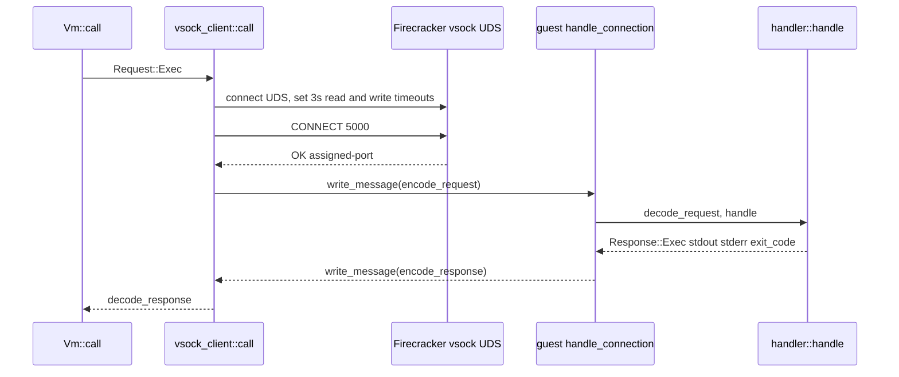
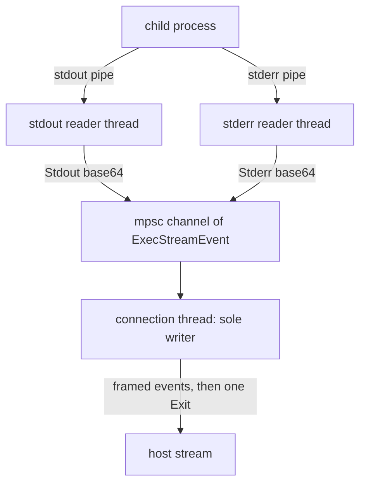
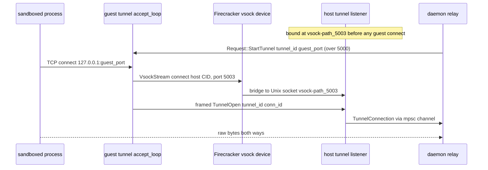

Everything the daemon does inside a sandbox, running a command, reading a file, opening a shell, goes through one channel: Firecracker's virtio-vsock device. Three pieces of code implement it. `sandkiln-protocol` defines what goes on the wire, `sandkiln-guest-agent` answers inside the VM, and `vsock_client.rs` in `sandkiln-vmm` is the host side. This post covers all three, and the rules that keep them from hanging. For the prose introduction to vsock itself, see the docs page [vsock and the host-guest wire protocol](https://sandkiln.mintlify.site/internals/vsock-wire-protocol); this post assumes you have read the [system overview](/engineering/01-system-overview).

## Crate responsibilities

| Piece | File | Responsibility |
| --- | --- | --- |
| Framing | `core/crates/protocol/src/framing.rs` | 4-byte little-endian length prefix plus payload |
| Messages | `core/crates/protocol/src/messages.rs` | `Request`, `Response`, handshakes, stream events |
| Ports and codecs | `core/crates/protocol/src/lib.rs` | The four port constants and `encode_*`/`decode_*` helpers |
| Request handlers | `core/crates/guest-agent/src/handler.rs` | One function per `Request` variant |
| Streamed exec | `core/crates/guest-agent/src/exec_stream.rs` | Framed stdout/stderr events then `Exit` |
| PTY | `core/crates/guest-agent/src/pty.rs` | `forkpty`, then raw byte passthrough |
| Tunnel listener | `core/crates/guest-agent/src/tunnel.rs` | Guest TCP listener that dials the host |
| Host client | `core/crates/vmm/src/vsock_client.rs` | `call`, `open_pty`, `open_exec_stream` |
| Tunnel acceptor | `core/crates/vmm/src/tunnel.rs` | Host listener for guest-initiated connections |

The protocol crate is the only thing the host and guest binaries share. It depends on `serde` and `serde_json` and nothing else, and it has no idea what a vsock is. That is intentional: both binaries link the same message definitions, so the two sides cannot drift, and the crate stays small enough to read as a contract.

## Framing

Every message is a 4-byte little-endian length followed by that many bytes of JSON:

```rust
const MAX_MESSAGE_LEN: u32 = 64 * 1024 * 1024;

pub fn write_message(w: &mut impl Write, payload: &[u8]) -> io::Result<()> {
    let len = payload.len() as u32;
    w.write_all(&len.to_le_bytes())?;
    w.write_all(payload)?;
    w.flush()
}
```

(`core/crates/protocol/src/framing.rs:6-25`.) `read_message` does `read_exact` for the four length bytes, rejects anything over 64 MiB as `InvalidData` before allocating, then `read_exact`s the body.

Two alternatives were rejected. Newline-delimited JSON would let command output containing newlines or arbitrary bytes be misread as a frame boundary, and process output is not guaranteed to be valid UTF-8 at all. A binary schema format would need a schema compiler and could not be read in a packet capture; JSON is boring, self-describing, and sufficient for a protocol with a handful of message shapes. The length cap exists because a corrupt or hostile prefix would otherwise cause a multi-gigabyte allocation on a 700 KB static binary. There is a test that sends `MAX_MESSAGE_LEN + 1` and expects the error, and another that round-trips a payload containing `\n`, a NUL and high bytes.

Bytes inside a JSON string need encoding, so file contents and process output cross the wire as base64 (`content_base64`, `data_base64`). That costs roughly a third more bytes.

## Messages

The request and response enums are internally tagged, with different tag names so a captured frame reveals its direction at a glance:

```rust
#[derive(Debug, Serialize, Deserialize)]
#[serde(tag = "cmd", rename_all = "snake_case")]
pub enum Request {
    Exec { command: String, #[serde(default)] args: Vec<String>, /* env */ },
    ReadFile { path: String },
    /* WriteFile, ListDir, Chmod, Chown, Mkdir, Rename, Copy,
       Symlink, Readlink, Truncate, StartTunnel, StopTunnel */
}
```

(`core/crates/protocol/src/messages.rs:4-6`, abridged.) `Response` uses `tag = "status"` (`messages.rs:160-162`) with variants `Exec`, `File`, `Dir`, `Link`, `Ok` and `Error`. The wire shape is pinned by tests that compare exact JSON, for example `{"cmd":"exec","command":"echo","args":["hi"],"env":{}}` (`messages.rs:199`). A round-trip test alone would not catch a renamed tag, since serde would happily round-trip the new shape through itself.

The environment in an `Exec` is already fully resolved by the daemon, create-time defaults merged with any per-call override. The agent adds it to the process's inherited environment and has no concept of "sandbox-level" versus "call-level". That keeps policy on the host and the agent a dumb executor.

The `PtyHandshake` (`cols`, `rows`), `ExecStreamHandshake` and `TunnelOpen` types are deliberately not `Request` variants. They open different connection shapes, described next. `ExecStreamEvent` is tagged `stream` and has `Stdout`, `Stderr` and `Exit { exit_code }` (`messages.rs:138-143`).

There is no version negotiation. The guest agent and the host crates are rebuilt and redeployed together, and the compiler catches a missing `match` arm on either side if both are rebuilt.

## Four ports, four connection shapes

The agent listens on three ports and dials out on a fourth.

```mermaid
flowchart LR
    subgraph Host["host: sandkiln-vmm"]
        call["Vm::call"]
        pty["Vm::open_pty"]
        xs["Vm::open_exec_stream"]
        tl["tunnel::listen"]
    end
    subgraph Guest["guest: sandkiln-guest-agent"]
        h["handler::handle"]
        p["pty::handle_connection"]
        e["exec_stream::handle_connection"]
        t["tunnel::relay"]
    end
    call -->|"CONNECT 5000, framed Request/Response"| h
    pty -->|"CONNECT 5001, handshake then raw bytes"| p
    xs -->|"CONNECT 5002, framed ExecStreamEvent"| e
    t -->|"guest connect 5003, TunnelOpen then raw bytes"| tl
```

| Port | Constant | Shape | Lifetime |
| --- | --- | --- | --- |
| 5000 | `AGENT_PORT` | framed request, framed response | one request per host connection |
| 5001 | `PTY_PORT` | one framed handshake, then raw bytes | the shell's life |
| 5002 | `EXEC_STREAM_PORT` | one framed handshake, then framed events | the command's life |
| 5003 | `TUNNEL_PORT` | one framed `TunnelOpen`, then raw bytes | one proxied connection |

(`core/crates/protocol/src/lib.rs:14,22,30,55`.) Separate ports instead of new `Request` variants are the central design choice. A PTY is a long-lived bidirectional byte stream and a streamed exec is a long-lived stream of structured events; neither fits request/response. Giving each shape its own port means the listener for each can use the simplest possible loop, and no connection ever has to switch protocols halfway through based on a message it must first parse.

The agent's own `main` shows the consequence. The `AGENT_PORT` loop handles each connection inline on one thread; the PTY and exec-stream listeners spawn a thread per accepted connection, because a session blocks for as long as its shell or command lives (`core/crates/guest-agent/src/main.rs:19-30,40-42,56-58`). The inline loop is why a slow `Exec` on port 5000 would delay every other port-5000 request: a command that must run for a long time belongs on the streaming port.

Concurrent-session caps live on the host, in the daemon, not in the agent. The daemon already manages each session's WebSocket lifecycle and can count sessions with no cross-connection state needed in the guest.

### Request/response on port 5000

The host opens a fresh Unix socket connection per call, performs Firecracker's `CONNECT <port>\n` handshake, writes one frame and reads one frame.



The host side is short enough to quote:

```rust
let mut stream = UnixStream::connect(uds_path)?;
stream.set_read_timeout(Some(IO_TIMEOUT))?;
stream.set_write_timeout(Some(IO_TIMEOUT))?;
connect_handshake(&mut stream, guest_port)?;

let payload = encode_request(request).map_err(to_io_err)?;
write_message(&mut stream, &payload)?;
```

(`core/crates/vmm/src/vsock_client.rs:28-34`.) `connect_handshake` writes `CONNECT {port}` and requires the reply to start with `OK ` (`vsock_client.rs:86-99`); anything else becomes `ConnectionRefused`, which matters for the retry logic below.

On the guest, `handle_connection` loops reading frames until the peer disconnects. A frame that fails to decode produces `Response::Error`; a failure to serialise a response, or a failed write, ends the connection (`guest-agent/src/main.rs:64-82`). There is no error recovery inside a connection by design: after a bad frame the stream position is unknowable, so resynchronising would be guessing.

Each handler in `handler.rs` is a thin wrapper over `std::process::Command` or `std::fs`, with one raw `libc::chown` because std has no equivalent. `Exec` uses `Command::output()`, converting stdout and stderr with `from_utf8_lossy` and mapping a signal-killed process to exit code `-1` (`handler.rs:31-40`). The handlers do no path validation. The guest agent is the wrong layer for it: a path only ever names something inside that one VM's filesystem.

## The 3-second I/O timeout

```rust
const IO_TIMEOUT: Duration = Duration::from_secs(3);
```

(`core/crates/vmm/src/vsock_client.rs:22`.) Without it, a blocking read on a vsock stream has no upper bound. The failure that motivated it was concrete: when a VM's vCPUs are paused for a snapshot, Firecracker's host Unix socket still accepts a connection, but the guest cannot reply. A `read` on that connection waits forever, and a stop that first tried to `sync` the guest hung with it. The doc comment on the constant records this ("a paused VM, vCPUs halted, is the case that surfaced this").

The important design point is where the bound has to live. `Vm::call` already retries with backoff until a deadline, but that loop only bounds the time between attempts; an attempt that never returns is invisible to it. So the timeout is set on the socket itself, on both read and write, before the handshake, which means the handshake read and the response read are each bounded.

The choice of 3 seconds is a trade between two failure costs. Too short and a healthy but momentarily busy guest, for instance one just resumed from a snapshot, fails spuriously. Too long and every failure against a dead guest is slow; the repo records that a failed post-resume health check used to pay two 5 s retry timeouts back to back (about 10.3 s) before `force_stop` was added to skip the sync (about 5.4 s). The value is a constant, not configuration, because no caller has a different correct answer.

One consequence follows directly from the code and is worth stating plainly. Because the read timeout also covers the response read, an `Exec` on port 5000 that produces no response within 3 seconds fails with a timeout on the host. Request/response `Exec` is therefore for short commands; long-running work goes through the streamed exec port, which clears the timeout after its handshake. And `Vm::call` wraps `vsock_client::call` in `retry_with_backoff` (`vm/mod.rs:140-144`, 5 s deadline, 1 ms to 20 ms backoff), which retries on any `io::Error` without distinguishing a failed connect from a failure after the request was sent. That retry exists to absorb the agent's startup race right after `InstanceStart`, and it is why the first real exec on a cold sandbox is slower than later ones.

## Long-lived sessions: PTY and streamed exec

`open_pty` and `open_exec_stream` perform the same sequence as `call`, with the timeouts applied only to the handshake, and then explicitly cleared:

```rust
write_message(&mut stream, &payload)?;

stream.set_read_timeout(None)?;
stream.set_write_timeout(None)?;
Ok(stream)
```

(`vsock_client.rs:52-57`.) A shell that sits idle between keystrokes is not a hung connection, so a session cannot reuse the request/response bound. The bound still protects the part that can hang before the session exists.

### PTY

After the framed `PtyHandshake`, the agent calls `forkpty` with the requested window size, execs `/bin/bash` (or `/bin/sh` if bash is absent, since a registered custom image may not have it), and shovels bytes between the vsock stream and the pty master on two threads (`pty.rs:38-60,76-81`). From the handshake onward there is no framing: the daemon's WebSocket handler proxies raw bytes. See the [PTY internals page](https://sandkiln.mintlify.site/internals/pty).

### Streamed exec

After the framed `ExecStreamHandshake`, the agent spawns the command with stdout and stderr piped and stdin null, and stays framed. Its structure is the interesting part:



Both pipes are drained on their own threads, because either can fill and block the child if read sequentially. Both feed one channel, and only the connection thread ever writes to the stream, so two messages' framing can never interleave and no writer lock is needed. The child is waited on only after both pipes reach EOF:

```rust
let _ = stdout_thread.join();
let _ = stderr_thread.join();

let exit_code = match child.wait() {
    Ok(status) => status.code().unwrap_or(-1),
    Err(_) => -1,
};
let _ = send_event(&mut stream, &ExecStreamEvent::Exit { exit_code });
```

(`exec_stream.rs:99-106`.) Waiting first risks a deadlock on a full pipe buffer. Exactly one `Exit` is sent, and a failed spawn is reported in-band as a `Stderr` event followed by `Exit { exit_code: -1 }` (`exec_stream.rs:49-54`) so the caller sees one uniform shape for every outcome. This module never signals the child; if the host side disconnects, the pump loop stops sending and the threads end when the child's pipes close. See [exec-stream internals](https://sandkiln.mintlify.site/internals/exec-stream) for how the daemon buffers these events.

## The shared-socket hangup rule

The PTY code carries a design rule that applies to every bidirectional relay in the agent. To pump two directions concurrently, each needs its own handle, and the code gets them with `try_clone()`. But a clone is a duplicated file descriptor on the same socket, not a second connection. Dropping one handle does not close the socket while another descriptor references it. So when one direction finishes, the thread blocked in `read()` on the other is not woken.

The rule: **when either direction ends, the finishing side must actively unblock the other; never rely on drop.** `shovel_bytes` applies it in both directions:

```rust
// pty output -> vsock: shell exited
let _ = stream_write.shutdown(Shutdown::Both);
// ... and after the vsock-input loop ends: host disconnected
let _ = kill(child, Signal::SIGHUP);
```

(`pty.rs:126,142`, two separate sites shown together.) If the shell exits first, the output thread sees EOF and calls `shutdown(Both)`, which makes the blocked input read return immediately. If the host disconnects first, the input loop sees EOF and sends `SIGHUP` to the shell, as a real terminal would, so it does not run orphaned. Before this rule was applied the effect was a roughly ten-second hang on exit, and it was only visible in a live test: types and compilation do not show it.

The tunnel relay applies the same rule from the start, with no process to signal, just two sockets: each copy loop ends with `shutdown(Shutdown::Both)` on its own write side (`guest-agent/src/tunnel.rs:105,118`). `stop()` uses a related trick for the accept loop, since std has no way to cancel a blocking `accept`: it sets a flag, then connects to its own listener so the loop wakes, sees the flag, and discards that connection (`tunnel.rs:53-61`).

## The direction rule and its one exception

Across ports 5000 to 5002 the rule is absolute: **the host always connects, and the guest only listens.** The host owns the VM's lifetime, so it is the one that knows when a connection is meaningful, and a guest that dials out on its own would be a guest process choosing when to talk to the host. It also keeps the guest agent's attack surface to "answer what is asked".

The tunnel feature is the one deliberate exception, and the reason is structural. The event that needs to cross is "something inside the guest just connected to a local port", which the host cannot have initiated. So the guest dials out:



Firecracker supports guest-initiated vsock connections, but with a different mechanism from the host-initiated one. There is no `CONNECT <port>` line. Instead Firecracker forwards the guest's `connect()` to a Unix socket at the VM's vsock path with `_<port>` appended, which the host must already have bound and be listening on:

```rust
pub fn tunnel_socket_path(vsock_socket: &Path) -> PathBuf {
    let mut s = vsock_socket.as_os_str().to_owned();
    s.push(format!("_{TUNNEL_PORT}"));
    PathBuf::from(s)
}
```

(`core/crates/vmm/src/tunnel.rs:57-61`.) `listen` removes any stale file, binds a `UnixListener` there, and accepts on a background thread for the VM's whole life: one listener per VM, shared by every tunnel that VM ever opens (`tunnel.rs:70-73`). Each accepted connection reads one `TunnelOpen`, and is dispatched by `tunnel_id` to whoever called `register()` for it, over a `std::sync::mpsc` channel. The channel is `std`, not Tokio, because the crate has no async runtime and the daemon already bridges every vmm call through `spawn_blocking`; bridging this channel the same way keeps the boundary consistent. `register` must be called before telling the guest to start listening, since a connection with no registered tunnel is dropped with a warning. `Vm::boot` and `Vm::resume` call `listen` right after the VM exists, and a failure is logged as a warning rather than failing the boot, because a missing tunnel feature on one sandbox is better than destroying a boot that otherwise succeeded. `stop` calls `cleanup`, which removes the socket file.

The handshake on the guest-initiated connection is application-level, layered over Firecracker's raw bridge. `TunnelOpen` carries a `tunnel_id` (which tunnel) and a `conn_id` (which of that tunnel's concurrent connections, since the daemon multiplexes them over one WebSocket to the caller). The [local tunnel page](https://sandkiln.mintlify.site/internals/local-tunnel) covers that multiplexing.

## What this design costs

- Every `call` opens a new connection and performs a handshake. This is simple and stateless, at the price of per-call overhead. The criterion benchmark for an exec round trip on an already-open vsock connection recorded 220 to 250 microseconds (criterion, earlier measurement, being re-verified), which says the steady-state cost of the protocol itself is small; the first exec on a cold sandbox is far slower (the vmm notes record roughly 420 to 460 ms, against 4 to 18 ms on a resumed one) because it includes waiting for the guest to come up, not because of framing.
- The single-threaded port-5000 loop serialises request/response calls into one guest. Concurrency needs go to the other ports.

Next: [driving Firecracker](/engineering/03-driving-firecracker), the host-side process that creates the VM these connections go to.
