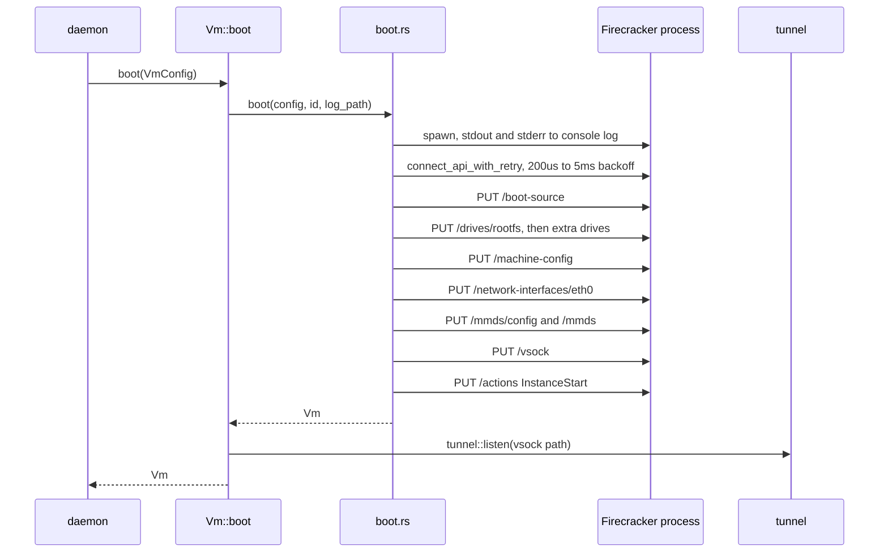
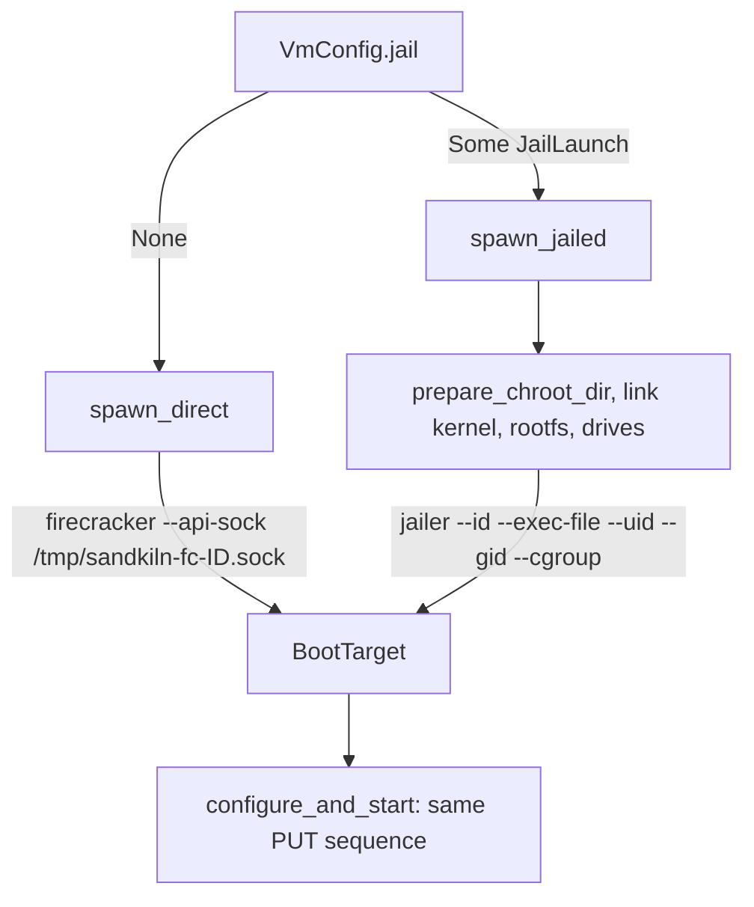
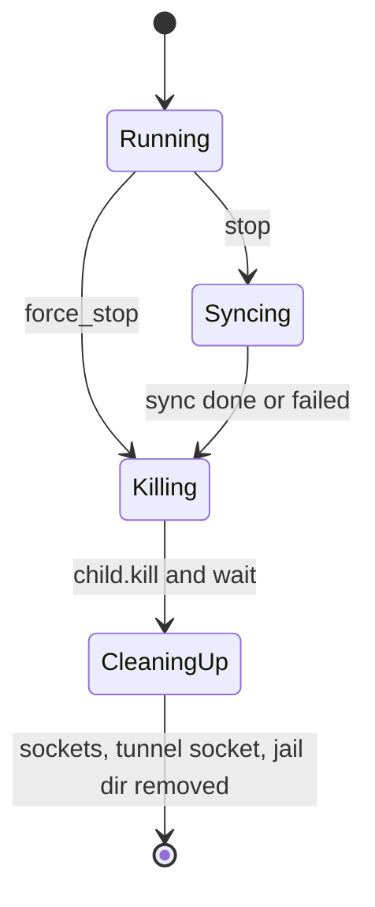

A Firecracker microVM is a process. It starts with no configuration, exposes an HTTP API on a Unix socket, and begins running a guest only when told `InstanceStart`. The host-side `sandkiln-vmm` crate turns that into a Rust type, `Vm`, with a small public surface: `boot`, `call`, `open_pty`, `open_exec_stream`, `update_metadata`, `stop` and `force_stop` (plus `pause`, `snapshot` and `resume` in a submodule). This post walks through how that works, from process spawn to teardown. It builds on the [system overview](/engineering/01-system-overview), and the connections `Vm::call` makes are described in the [vsock protocol post](/engineering/02-vsock-protocol-and-guest-agent).

## Module structure

```text
core/crates/vmm/src/
  firecracker_api.rs   hand-rolled HTTP/1.1 client over the API Unix socket
  jailer.rs            chroot, cgroup v2 and uid/gid setup for jailed launch
  vsock_client.rs      host side of the guest protocol
  vm/
    mod.rs             Vm and VmConfig: the public surface, stop, metadata
    boot.rs            spawn_direct, spawn_jailed, the configuration PUT sequence
    snapshot.rs        pause, snapshot, resume
```

`boot.rs` is a child module of `vm`, not a sibling, so it can construct `Vm` and see its private fields. The split follows the repository's rule for file size: `mod.rs` is the API surface and shared helpers; `boot.rs` is process-spawning mechanics, which should not sit next to public methods; `snapshot.rs` has its own gotchas. The crate has no async runtime. Every function here blocks, and the daemon wraps calls in `spawn_blocking`.

## The key types

`VmConfig` is plain data describing one VM: the Firecracker binary, kernel and rootfs paths, vCPU and memory sizes, an optional `NetworkConfig` (tap device, guest and gateway IP, MAC), extra drives, an optional `JailLaunch`, an optional rate limiter, and optional MMDS metadata (`core/crates/vmm/src/vm/mod.rs:75-101`). The rootfs path is one the caller owns exclusively: the module writes to it in place, and copy-on-boot is the caller's job.

`Vm` is the live handle:

```rust
pub struct Vm {
    id: u64,
    child: Child,
    api_socket: PathBuf,
    vsock_socket: PathBuf,
    jail_instance_dir: Option<PathBuf>,
}
```

(`vm/mod.rs:103-111`.) The invariants are simple. `child` is the Firecracker process (a jailed boot execs Firecracker in place, so the same `Child` becomes it). `api_socket` and `vsock_socket` are always real host paths, jailed or not. `jail_instance_dir` is `Some` only for a jailed boot and is the root of everything jailer created. `id` comes from a process-wide `AtomicU64` counter (`vm/mod.rs:28`), and the same number names the sockets, the console log and the jail, so every artifact of one VM is traceable to one integer in logs.

Ownership is by value. `stop` and `force_stop` take `self`, so a stopped VM cannot be used again. `Vm` has no `Drop` implementation, so a handle dropped without being stopped does not kill its process; teardown is always an explicit call, and the daemon's sandbox record is the one place that owns each `Vm`.

## The Firecracker API client

Firecracker's API is a few fixed-shape JSON `PUT` and `PATCH` calls over a Unix socket. A general HTTP client would be a heavy dependency for that, so `firecracker_api.rs` is about 80 lines of code: build a request string, write it, read a status line, read headers until the blank line, then `read_exact` the `Content-Length` body.

```rust
let request = format!(
    "{method} {path} HTTP/1.1\r\n\
     Host: localhost\r\n\
     Content-Type: application/json\r\n\
     Content-Length: {}\r\n\
     Connection: keep-alive\r\n\
     \r\n\
     {json_body}",
    json_body.len()
);
```

(`core/crates/vmm/src/firecracker_api.rs:36-45`.) One `ApiClient` wraps one `BufReader<UnixStream>` and is reused for every call of a boot, so the whole configuration sequence runs over one connection. New Firecracker endpoints follow the `put`/`patch` pattern. Callers check status with `put_checked`, which turns any non-2xx into an `io::Error` carrying the path, status and body (`vm/mod.rs:239-248`).

What it does not do is also deliberate. It does not parse chunked responses and it sets no socket timeouts; it relies on Firecracker answering its own local socket promptly. It is a small tool for one peer, not a general client.

## `Vm::boot` step by step



1. **Allocate an id and a log path.** `Vm::boot` takes the next id and derives `/tmp/sandkiln-fc-<id>.log` (`vm/mod.rs:117-119,253-255`).
2. **Spawn.** Either `spawn_direct` or `spawn_jailed`, covered below. Both return a `BootTarget`, a struct holding the child plus the paths the rest of the sequence needs, so the configuration step never branches on jailed versus direct. Only the paths differ.
3. **Connect to the API socket**, with retry.
4. **Issue the configuration PUTs** in order.
5. **`InstanceStart`**, timed separately because it is the one call that actually starts vCPUs; the others only record intent.
6. **Start the tunnel listener**, non-fatally.

### Connecting to a socket that is not there yet

Right after `spawn`, Firecracker has not yet created its API socket. The first version of this code slept a fixed 20 ms and then connected. That measured as a flat 20.1 ms on every boot, more than half of a roughly 34 ms boot (ROADMAP.md, Benchmarking): a quantised sleep, not real waiting. It was replaced by retrying the connect itself on an exponential backoff from 200 microseconds to 5 ms:

```rust
fn connect_api_with_retry(path: &Path, timeout: Duration) -> io::Result<ApiClient> {
    retry_with_backoff(timeout, Duration::from_micros(200), Duration::from_millis(5), || ApiClient::connect(path)).map_err(|e| {
        io::Error::new(io::ErrorKind::TimedOut, format!("{path:?} never accepted a connection within {timeout:?}: {e}"))
    })
}
```

(`vm/mod.rs:311-315`.) The tempting alternative is to poll for the socket file to exist, then connect. That has a race: a Unix socket's file appears at `bind()`, and the socket only accepts connections after `listen()`. A file-existence check can win the gap between the two and the following connect gets `ECONNREFUSED`. Polling the connect itself has no such window, because success means the peer is actually accepting. That is also what makes polling this fast safe: a refused connect is cheap and carries no side effect.

`retry_with_backoff` is shared with the vsock calls, which have the same shape of problem (is the other side listening yet). It loops: attempt; on success return; on failure past the deadline return the last error; otherwise sleep the current interval and double it, capped at the maximum (`vm/mod.rs:282-300`). Boot uses a 2 second overall timeout. Three unit tests cover it with real Unix sockets: a path nothing ever binds must fail as `TimedOut` after at least the timeout (a backoff bug that exits early would otherwise look like a clean fast failure), an already-listening socket connects, and a socket that appears 40 ms late is waited for.

### The configuration PUT sequence

`configuration_requests` builds the ordered list of `(path, body)` pairs up front and `configure_and_start` issues them in a loop. Building the list first is what makes each PUT individually timeable (a debug event, `vm boot phase breakdown`, reports each endpoint's microseconds) and keeps Firecracker's ordering constraints visible as one readable list:

| Order | Endpoint | Notes |
| --- | --- | --- |
| 1 | `/boot-source` | kernel path; boot args below |
| 2 | `/drives/rootfs` | `is_root_device: true`, writable |
| 3 | `/drives/<id>` per extra drive | appear as `/dev/vdb`, `/dev/vdc` in order |
| 4 | `/machine-config` | `vcpu_count`, `mem_size_mib` |
| 5 | `/network-interfaces/eth0` | MAC and tap device; rate limiters if set |
| 6 | `/mmds/config`, `/mmds` | only if metadata is set; must follow the interface |
| 7 | `/vsock` | `guest_cid: 3`, `uds_path` |
| 8 | `/actions` | `InstanceStart` |

(`vm/boot.rs:226-301`.) The boot arguments are `console=ttyS0 reboot=k panic=1 pci=off`, with a static `ip=` kernel parameter appended when a network is configured, so the guest has an address before any userspace runs (`boot.rs:229-232`). Rate limiting is inserted by `insert_rate_limiter` into the drive bodies as `rate_limiter` and into the interface body as `rx_rate_limiter` and `tx_rate_limiter`; Firecracker limits each direction independently, and sandkiln exposes one combined knob. Setting `metadata` without `network` is an error returned before any request is sent, since MMDS intercepts through a configured interface.

### Failure paths during boot

Every step after `spawn` can fail with a live child process and, if jailed, a populated chroot already in existence. `boot` handles all of it in one place:

```rust
Err(e) => {
    let _ = target.child.kill();
    let _ = target.child.wait();
    let _ = std::fs::remove_file(&target.api_socket);
    let _ = std::fs::remove_file(&target.vsock_socket);
    if let Some(dir) = &target.jail_instance_dir {
        let _ = std::fs::remove_dir_all(dir);
    }
    return Err(e);
}
```

(`vm/boot.rs:67-81`.) A leaked process is a resource leak and a leaked chroot is an information-disclosure surface, so neither is acceptable on the error path. `spawn_jailed` adds its own cleanup around chroot construction: if any link or the spawn itself fails, it removes the half-built instance directory (`boot.rs:137-149`). The error that propagates carries the path to the console log, added by `annotate_with_console_log`, because a kernel panic before the guest agent is reachable is otherwise invisible. One level up, the daemon releases the network lease and jail id when `Vm::boot` returns an error, so each layer cleans up exactly what it acquired.

## Direct versus jailed spawn



**Direct spawn** runs `firecracker --api-sock /tmp/sandkiln-fc-<id>.sock` as a child, with stdout and stderr both pointing at the console log. All paths in the API bodies are host paths, and the vsock socket is `/tmp/sandkiln-vsock-<id>.sock` (`boot.rs:112-131`). Stale socket files from an earlier process with the same id are removed first.

**Jailed spawn** is more involved, because after jailer calls `chroot()` Firecracker cannot see any host path outside its jail. So everything it will reference has to exist inside the jail before jailer starts, and every path in the API bodies has to be the in-jail path. `spawn_jailed_inner` (`boot.rs:151-191`) does that:

1. `prepare_chroot_dir` creates `<chroot_base>/<exec name>/<id>/root` and makes it traversable (`o+x`) so lookups by exact name work before jailer applies its own ownership.
2. `link_resource_into_jail` places the kernel (`/kernel`), rootfs (`/rootfs.ext4`) and each extra drive (`/<drive_id>.ext4`) inside the chroot and returns the in-jail path to put in the API bodies. It hard-links, falling back to a copy on `EXDEV`, and makes the file world-readable (world-writable for writable resources) instead of `chown`ing it, because a hard link shares an inode with its source and a `chown` would silently change the source's ownership (`jailer.rs:134-171`).
3. `cgroup_limits` derives `memory.max` (guest memory plus a 128 MiB overhead margin, since the ceiling bounds the whole process) and `cpu.max` (`vcpu_count` full cores) from the same numbers already used for `/machine-config`.
4. `build_jailer_args`, a pure and unit-tested function, assembles the argv, with Firecracker's own arguments after a `--` separator (`jailer.rs:213-242`). It omits `--daemonize`, so jailer execs Firecracker in the same process and the `Child` we hold becomes Firecracker; and it omits `--netns`, since taps come from a shared pool in the daemon's own namespace.
5. The vsock path given to Firecracker is `/vsock.sock` (in-jail), while the host-side path the daemon connects to is `<chroot_root>/vsock.sock`.

Why jailer at all, rather than doing the chroot in the daemon? `chroot(2)`, `setuid`, device nodes and cgroup management need privileges the daemon deliberately does not hold. The standard answer is a setuid-root `jailer` binary, a small purpose-built program, rather than loosening the daemon's own capabilities. Concurrent jailed VMs must never share a uid (one guest's escaped process could signal or read the other's files), so uid/gid pairs come from a bounded `JailerIdPool` that mirrors the tap pool rather than from hashing an id. Be aware of the current state: the repository's notes mark jailer boot as not yet proven on real hardware, and snapshotting a jailed sandbox is refused, because a snapshot would bake in in-jail paths that would need relinking into a fresh chroot. `resume` always spawns directly. See [the jailer privilege model page](https://sandkiln.mintlify.site/internals/jailer-privilege-model).

## Console log capture

Firecracker's stdout carries the guest's serial console (the kernel boots with `console=ttyS0`). `console_log_stdio` creates `/tmp/sandkiln-fc-<id>.log` and returns two `Stdio` handles from one file and its `try_clone`, so stdout and stderr interleave into the same file like `2>&1` (`vm/mod.rs:260-264`). Discarding it would hide the one piece of evidence available when a guest panics before vsock comes up. `annotate_with_console_log` appends the path to a boot or resume failure so an operator knows where to look. The file is not deleted by `stop`.

## Stopping a VM



`stop` and `force_stop` both call `stop_inner(sync_first)` (`vm/mod.rs:199-236`):

1. **Sync, only for `stop`.** A bare `SIGKILL` loses unflushed guest page-cache writes to attached drives, so `stop` first runs `sync` in the guest through `Vm::call`. Rootfs copies do not care, since they are discarded. This step is best-effort: if the guest is unreachable it logs a warning and proceeds to the kill.
2. **Kill and reap.** `child.kill()` then `child.wait()`, so no zombie is left.
3. **Remove sockets.** The API and vsock socket files, and the tunnel's `_5003` socket via `tunnel::cleanup`.
4. **Remove the jail.** `remove_dir_all` on the instance directory if jailed, which removes the whole tree jailer created, not just the chroot.

`force_stop` skips step 1, for a VM already known dead. It exists because of a measured cost: a failed post-resume health check used to pay the sync's own retry timeout on top of the health check's, around 10.3 s total against about 5.4 s after (from the vmm crate notes). The point of a separate method, rather than a boolean argument at every call site, is that the "I know this VM is dead" decision belongs to the caller that has the evidence.

Each step discards its error and continues. A stop that fails halfway and returns early would leave more state than one that does every cleanup it can.

## Metadata after a resume

`VmConfig::metadata` configures MMDS, Firecracker's built-in metadata service, answered at `169.254.169.254` by the device model with no vsock or guest agent involved. It is configured as version 2 (token-gated) because a sandbox may run untrusted code that could otherwise reach an open metadata endpoint.

`update_metadata` exists for a sandbox whose real identity is only known after it is running, for example one resumed from a pre-warmed pool snapshot:

```rust
pub fn update_metadata(&self, metadata: &serde_json::Value) -> io::Result<()> {
    let mut api = ApiClient::connect(&self.api_socket)?;
    put_checked(&mut api, "/mmds/config", &serde_json::json!({ "network_interfaces": ["eth0"], "version": "V2" }))?;
    put_checked(&mut api, "/mmds", metadata)
}
```

(`vm/mod.rs:193-197`.) It repeats the full config PUT and the content PUT instead of a bare `PATCH`, because a resumed VM's MMDS store comes back uninitialised even though it was configured before the snapshot, and `PATCH` alone fails against it. See [the MMDS page](https://sandkiln.mintlify.site/internals/mmds).

## Resume shares the same machinery

`Vm::resume` (`vm/snapshot.rs:68-131`) uses the same console log helper, `connect_api_with_retry` and cleanup-on-failure pattern, but replaces the whole PUT sequence with one `PUT /snapshot/load` carrying `resume_vm: true` and a `vsock_override` that gives the new process a fresh socket path. The devices come out of the snapshot. It also starts the tunnel listener, non-fatally. Because the tap device and rootfs path are baked into the snapshot by name and path, the caller must hand back exactly the lease and file it had.

## Timing and what is measured

The criterion benchmarks recorded a cold boot of 10.5 to 10.9 ms (criterion, earlier measurement, being re-verified), against 32 to 33 ms before the socket-wait fix. In a full cold `POST /sandboxes`, the daemon-side numbers put VM boot at 14.9 ms of a 187.5 ms mean when the rootfs was a byte copy on ext4 (clone 127.9 ms, network lease 3.5 ms), and the whole create at 17.9 ms with a reflinked rootfs. In other words, driving Firecracker is no longer where create time goes; the design effort that remains here is correctness of the failure and teardown paths.

## Testing

`cargo test --workspace` covers the pure parts without KVM: `build_jailer_args`, `cgroup_limits`, the jail-path helpers, the connect-retry timeout and late-listener cases, and console log helpers, with jailer tests using real temporary directories and hard links. What it cannot cover is real Firecracker behaviour, so boot, stop and resume are verified on the dev box against a running daemon; a local build proves nothing about them.
