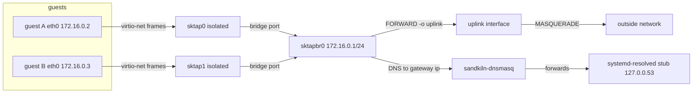
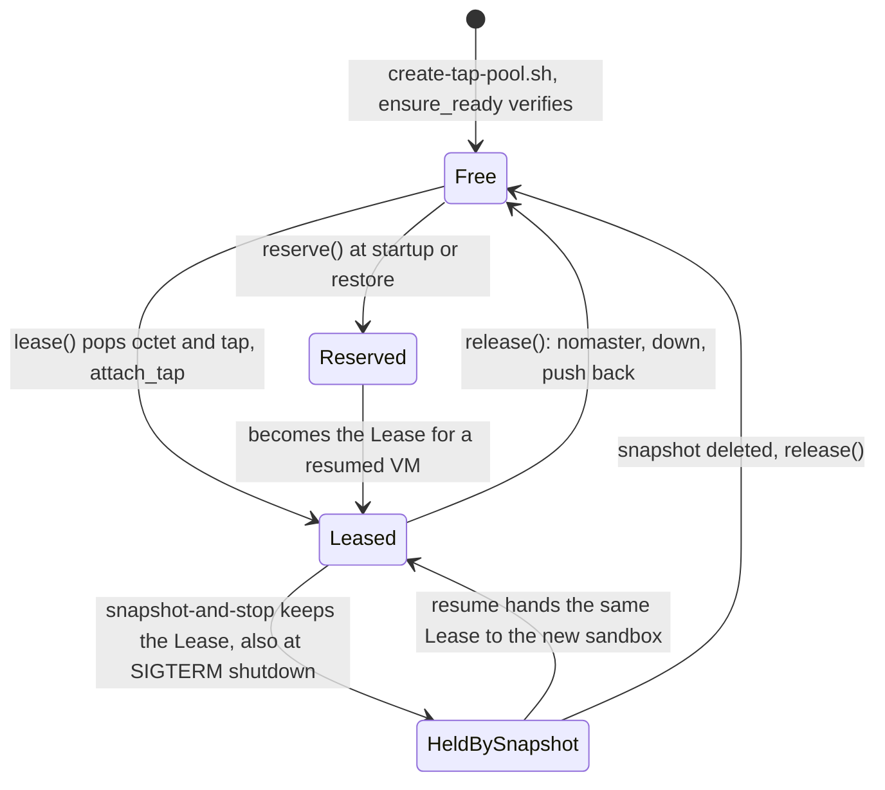
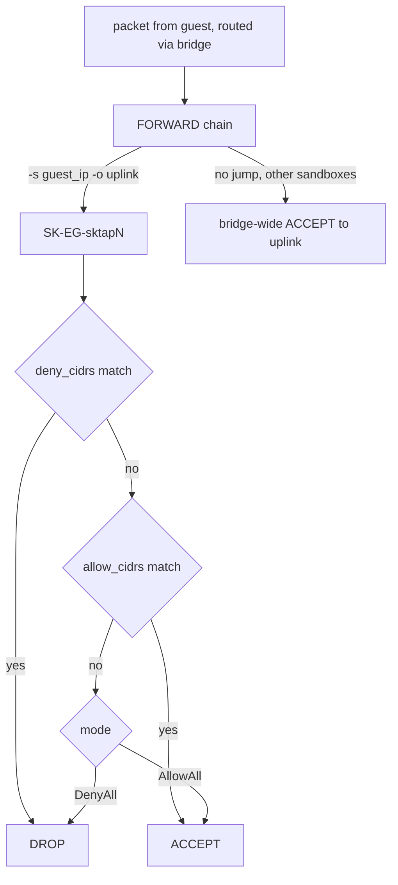

Every sandbox with a network gets a tap device, a static IPv4 address on one shared subnet, a path out through the host's uplink, and optionally an egress policy. The implementation is two modules in `sandkiln-vmm` (`core/crates/vmm/src/network.rs` and `core/crates/vmm/src/egress.rs`), a few host-setup scripts, and a capability raise in the daemon's `main.rs`. The background concepts (what a tap device is, what a chain is) are in the docs-site pages on [tap and bridge networking](https://sandkiln.mintlify.site/internals/tap-bridge-networking), [egress iptables](https://sandkiln.mintlify.site/internals/egress-iptables) and [MMDS](https://sandkiln.mintlify.site/internals/mmds). This post is about how the code is organised and why.

## The topology



One bridge, one gateway address, one NAT rule. The bridge name, gateway, tap prefix and pool size are the settings `bridge_name` (default `sktapbr0`), `bridge_gateway` (`172.16.0.1`), `tap_pool_prefix` (`sktap`) and `tap_pool_size` (`32`) in the daemon's single settings registry (`core/crates/daemon/src/config/settings.rs`). Each resolves from the environment (`SANDKILN_BRIDGE_NAME` and so on) first, then `sandkiln.toml`, then the default. The uplink is `uplink_iface` (`SANDKILN_UPLINK_IFACE`), or is detected by parsing `ip route show default` (`detect_default_iface`) when unset. `tap_pool_size` must match what `create-tap-pool.sh` created; `sandkilnd --check-config` validates the configuration before a start, and `scripts/sandkilnd-ctl.sh` and `scripts/preflight-check.sh` read the effective values through `sandkilnd --print-config` rather than keeping their own copies.

Because there is a single bridge, the NAT, DNS and firewall setup each target exactly one interface and one gateway address. The alternative of one point-to-point interface per VM (Firecracker's quickstart model, still present as `scripts/dev-tools/setup-tap-network.sh`) needs per-VM host addresses and per-VM NAT rules, which is the wildcarding the shared bridge removes.

## Why a tap pool

Creating a new tap device is a `TUNSETIFF` ioctl on `/dev/net/tun`. In practice that does not work under an ambient `CAP_NET_ADMIN`; it needs real root. Attaching an existing tap to a bridge, bringing a link up, and creating the bridge itself are netlink operations, and those do work. The daemon deliberately never runs as root, so it cannot create taps on demand. A tap is held only while a VM runs, and a snapshot keeps just its address: see [snapshots without taps](/engineering/36-snapshots-without-taps).

The resolution is to split the work by privilege. `scripts/host-setup/create-tap-pool.sh` runs once as root and creates `N` persistent taps owned by the daemon's user:

```bash
ip tuntap add "$name" mode tap user "$OWNER"
```

From then on the daemon only attaches, detaches and brings links up or down. The pool size is a hard ceiling on concurrent networked sandboxes. Growing it is a root step performed outside the daemon, by re-running the script with a larger count. That is treated as the correct shape of the constraint, not a defect.

`NetworkManager::ensure_ready` runs once at startup and is idempotent. It creates the bridge if absent, sets the gateway address with `ip addr replace`, brings the bridge up, enables `net.ipv4.ip_forward`, and installs three iptables rules only if a `-C` check says they are missing: the `MASQUERADE` rule in the `nat` table scoped to `-o <uplink>`, a `FORWARD` accept from the bridge to the uplink, and a `FORWARD` accept for `RELATED,ESTABLISHED` traffic back. It then verifies every pooled tap exists and fails with the exact script to run if any is missing (`core/crates/vmm/src/network.rs:76-109`).

## Leases: types and invariants

```rust
pub struct NetworkManager {
    bridge_name: String,
    gateway_ip: Ipv4Addr,
    prefix_len: u8,
    uplink: String,
    free_hosts: Mutex<VecDeque<u8>>,
    free_taps: Mutex<VecDeque<String>>,
}
```

That is `core/crates/vmm/src/network.rs:22-29`. The whole allocator is two `Mutex<VecDeque<_>>` free lists: host octets `2..=254` of the `/24` (octet 1 is the gateway) and the tap names. A `Lease` is a `NetworkConfig` (tap device, guest IP, gateway IP, MAC) plus the host octet it was drawn from.

Three properties make this small design safe:

- **`Lease` has no `Clone` and no `Drop`.** Ownership is by move. `release(lease)` takes it by value, so a released lease cannot be used again, and a lease cannot be duplicated, so two sandboxes cannot be handed one tap by accident. The cost of no `Drop` is that forgetting to release leaks both entries until restart; the free lists are the only record, and the doc comment on `lease()` says so.
- **Addresses are derived, not stored.** The guest IP is the gateway's `/24` base with the leased octet, and the MAC is `AA:FC:00:00:XX:XX` with the octet written in both low bytes. A given octet always yields the same IP and MAC.
- **FIFO reuse.** Both lists pop from the front and push back at the end, so a freed tap and address are reused as late as possible.

`lease()` is written so that a failure never shrinks a pool:

```rust
if let Err(e) = self.attach_tap(&tap_device) {
    self.free_hosts.lock().unwrap().push_back(host_octet);
    self.free_taps.lock().unwrap().push_back(tap_device);
    return Err(e);
}
```

The same holds for the earlier exit: if no tap is free, the already-popped octet is pushed back before the error is returned (`core/crates/vmm/src/network.rs:112-138`). The hosts lock is released before the taps lock is taken on the normal path. The only nested acquisition is the no-free-tap error path, which takes the hosts lock while holding the taps lock, and nothing acquires them in the opposite order, so there is no deadlock cycle.



The shutdown path matters for this state machine. On `SIGTERM` or `SIGINT` the daemon snapshots every live sandbox (`core/crates/daemon/src/lifecycle/shutdown.rs`), and each snapshot keeps its sandbox's address (and, when this was written, its tap as well; see the update further down), so the leases move to `HeldBySnapshot` rather than being lost; the next start `reserve`s them again from the snapshots on disk. A jailed sandbox cannot be snapshotted and is destroyed instead, which releases its lease and egress chain. A `SIGKILL` or crash skips all of it: the Firecracker processes are orphaned and keep their taps attached until an operator intervenes.

`NetworkManager` does not track which sandbox holds which lease. That mapping lives in the daemon, in the `Sandbox` and `Snapshot` records, and the daemon answers "who holds this tap" with `AppState::tap_device_holder` across live sandboxes, held snapshots and in-flight restores. Keeping the allocator ignorant of owners keeps `sandkiln-vmm` free of daemon concepts, at the cost of making the daemon responsible for never losing a `Lease`.

### Attaching a tap

```rust
run("ip", &["link", "set", tap_device, "up"])?;
run("ip", &["link", "set", tap_device, "master", &self.bridge_name])?;
run("bridge", &["link", "set", "dev", tap_device, "isolated", "on"])?;
```

Those are the three steps of `attach_tap` (`core/crates/vmm/src/network.rs:186-199`), each a `fork` and `exec`, each timed separately at debug level. The earlier measurement was about 1.4 ms each, roughly 4.3 ms total. They are not batched or moved to netlink: the privileged operations are spawned processes by design (see the capability section), and a netlink crate would change how ambient capabilities propagate. The enclosing lease is recorded as the `network_lease` phase in `/metrics`.

### Port isolation

The third command is the isolation mechanism. A bridge port marked `isolated` can exchange frames with non-isolated ports (the bridge device itself, which is how traffic reaches the gateway and the uplink) but not with other isolated ports. Every tap is isolated, so two guests on the same `/24` cannot talk to each other at layer 2, while each can still reach the gateway, DNS and the internet. This is enforced in the kernel's bridge, not in the API, so it holds regardless of what runs inside a guest. The daemon's own access to a guest, for example the preview reverse proxy to `http://<guest ip>:<port>`, goes through the bridge device and is unaffected.

### Release and reserve

`release` runs `ip link set <tap> nomaster` and `ip link set <tap> down`, ignoring individual failures, then returns the octet and the tap to the free lists. Ignoring errors there is intentional: teardown must always return resources, even if the link is already gone.

`reserve(config, host_octet)` exists for a second kind of owner. A snapshot freezes the guest's IP and MAC into its memory image through boot arguments, so a resume must reattach the exact tap and address it had. At daemon start, reconciled snapshots call `reserve` to remove their tap and octet from the free lists, so a later `lease()` cannot hand the same tap to a new sandbox. It logs a warning, rather than panicking, if the entries were already absent, which signals pool or configuration drift and is not fatal to startup. The snapshot side of this is in the [snapshots post](/engineering/06-snapshots-resume-fork).

> **Update (2026-11-24):** this changed. A snapshot now keeps only the guest address (an `IpLease`); the tap is leased when a sandbox runs and returned at snapshot time, and a resume attaches any free tap through Firecracker's `network_overrides`. Held snapshots therefore no longer count against the tap pool. See [snapshots without taps](/engineering/36-snapshots-without-taps).

## How the guest gets its address

The guest's network identity is passed at boot, and Firecracker configures the device model:

```rust
boot_args.push_str(&format!(" ip={}::{}:255.255.255.0::eth0:off", net.guest_ip, net.gateway_ip));
```

That is `core/crates/vmm/src/vm/boot.rs:231`. The kernel's `ip=` argument sets a static address, gateway and netmask on `eth0` before userspace starts, so there is no DHCP server, no lease file and no in-guest network agent to trust. The configuration requests then `PUT /network-interfaces/eth0` with the MAC and `host_dev_name` set to the tap; when a rate limit is requested it is applied to both the receive and transmit limiters of that interface.

The consequence for resume is the reason leases are held across a snapshot: the address lives in guest memory, and the host cannot change it from outside.

## Egress policy

Without a policy, a sandbox can reach anything the uplink can. A policy is `EgressPolicy { mode, allow_cidrs, deny_cidrs }`, where `mode` is `AllowAll` or `DenyAll`. CIDRs are validated at the API boundary by `validate_cidr`, a string-format check (`Ipv4Addr::from_str` plus prefix bounds) that needs no new dependency. IPv4 only.

### One chain per sandbox

`apply` builds a chain named `SK-EG-<tap_device>`. The tap name is already unique for as long as the lease is held, and the test suite asserts the name stays under iptables' length limit. The chain's contents, in order:

1. one `-d <cidr> -j DROP` per `deny_cidrs` entry,
2. one `-d <cidr> -j ACCEPT` per `allow_cidrs` entry,
3. a final `-j ACCEPT` or `-j DROP` for the mode.

iptables stops at the first match, so deny always beats allow on overlap purely because of position. There is no special-casing code and nothing to get wrong.

All of that is loaded in one `iptables-restore --noflush` call, with the chain declared at the top of the input so the call resets that chain and leaves every other chain alone. This replaced one `iptables` spawn per rule: for a six-CIDR policy the measured cost went from about 8.3 ms to about 3.1 ms per create (`apply` at `core/crates/vmm/src/egress.rs:91`, exposed as the `egress_apply` phase). `--noflush` cannot safely touch `FORWARD`, so the only two `FORWARD` operations remain individual calls: a `-C` check, then `-I FORWARD 1` only if the jump is missing.

```rust
let jump_args = ["-s", guest_ip_str.as_str(), "-o", uplink, "-j", chain.as_str()];
```

The jump matches the guest's source IP and the uplink as output interface. It matches on IP rather than on the tap because by the time `FORWARD` sees bridged-then-routed traffic, interface matching refers to the bridge, not the tap. It is inserted at position 1 so it runs before the bridge-wide accept rule.



Because every rule is scoped to `-o <uplink>`, traffic to the gateway (DNS) never enters the chain and is structurally exempt. A `DenyAll` sandbox can still resolve names. Domain-level rules and port matching are not implemented.

### Lifecycle

The policy belongs to the lease, not to the VM. It is applied when a lease goes live (cold create, resume, fork, restore) and removed with `remove(guest_ip, tap_device, uplink)` only when the lease is released: `-D` the jump, `-F` the chain, `-X` the chain, all best effort so a sandbox that never had a policy does not fail teardown. A snapshot-and-stop leaves the chain dormant but intact, like the tap. `apply` is idempotent, so resume and fork can call it unconditionally, which matters because iptables state lives in the kernel: it survives a daemon restart and is lost on a host reboot.

The failure semantics differ by call site on purpose. On a cold create, a policy that fails to apply tears the sandbox down, because a sandbox must not run unrestricted by surprise. On resume, fork and restore, the failure is logged at error level and the sandbox is kept, because the one-way operation already succeeded and destroying a live sandbox over an iptables hiccup is worse. A fork records `egress: None` on its own record because the lease and chain belong to the snapshot, and the snapshot's copy of the policy is what is re-applied.

## DNS

The guest's resolver is the bridge gateway. `images/build-universal-image.sh` writes `nameserver 172.16.0.1` (the `GUEST_NAMESERVER` default) into the image. On the host, `scripts/host-setup/start-dns-proxy.sh <gateway-ip>` installs the `sandkiln-dnsmasq` systemd unit, which runs dnsmasq with `--no-resolv --server=127.0.0.53 --listen-address=<gateway> --bind-dynamic`.

The forwarder exists because direct queries to public resolvers do not work reliably from every network while the host's `systemd-resolved` stub does. `--bind-dynamic` exists because the gateway address belongs to a bridge that `sandkiln` creates when the daemon starts. A strict bind to a not-yet-existing address would fail on start order and again after every reboot; `--bind-dynamic` binds when the address appears. Running it as a systemd unit, with `Restart=on-failure`, is what makes it survive reboots. A dnsmasq in front of the guests is also the natural place for future domain-level policy.

## MMDS metadata

Guest-visible metadata (`id`, `name`, `tags`) is served by Firecracker's own MMDS at `169.254.169.254`, answered by the device model with no vsock, no guest agent and no daemon round trip. Boot issues `PUT /mmds/config` (V2, interface `eth0`) and then `PUT /mmds` with the JSON, after `/network-interfaces`, because MMDS is only valid once that interface exists. `VmConfig::metadata` without a network is rejected with an error. A resumed VM's MMDS store comes back uninitialised, so `Vm::update_metadata` redoes the full `PUT /mmds/config` plus `PUT /mmds` rather than a bare `PATCH` (`core/crates/vmm/src/vm/mod.rs:230-234`).

## The capability model

All of the above runs from an unprivileged daemon. The binary has `cap_net_admin+eip` as a file capability, granted by `scripts/host-setup/grant-net-admin.sh`:

```bash
setcap cap_net_admin+eip "$BIN"
```

A file capability alone is not enough, because the daemon does not touch the network directly. It spawns `ip`, `bridge`, `iptables` and `iptables-restore`, and those children only inherit a capability that is in the ambient set. Raising it there requires it to already be in both the permitted and inheritable sets. Permitted comes from the file capability at exec, inheritable is empty by default, so the daemon adds it first (allowed because it is in permitted) and then raises it to ambient. This is the `raise_net_admin_ambient` function in `core/crates/daemon/src/main.rs:221`, using the `caps` crate: `caps::raise` into `Inheritable`, then into `Ambient`, each with an `expect` whose message names the grant script.

The ordering relative to Tokio is the subtle part. `main` is a plain `fn main`, not `#[tokio::main]`: it parses the command line and loads configuration, raises the capability, and only then builds the multi-thread runtime and calls `block_on`. The informational modes (`--help`, `--version`, `--config-reference`, `--print-config`, `--check-config`) return before the raise, so they run without the file capability and without touching the network. A runtime's worker and blocking threads are created with the credentials of the moment they are spawned, so threads created before the raise never see the ambient capability. The macro would start the runtime before the function body runs.

The same raise covers the shutdown path: the `ip` and `iptables` children that release leases and remove egress chains while the daemon drains inherit the ambient capability like any other.

Two consequences follow from the design. First, `setcap` does not survive a rebuild, so the grant script is re-run after every build. Second, the daemon is not root and is not given more capabilities to make jailer or tap creation work; the privileged one-time steps (taps, the DNS unit, the reflink volume, the jailer binary's setuid bit) live in scripts that a human runs with sudo, and the daemon's runtime surface stays at one capability.

Spawned processes rather than a netlink library is deliberate for the same reason. It matches the shell scripts line for line, and ambient-capability inheritance for children is a proven behaviour, whereas an in-process netlink call would depend on how the thread's own capability sets were arranged.

## Summary of ownership

| Resource | Created by | Released by |
| --- | --- | --- |
| Tap devices | `create-tap-pool.sh`, once, as root | never by the daemon; leased and returned |
| Bridge, NAT rules | `NetworkManager::ensure_ready`, idempotent at startup | persistent |
| `Lease` | `lease()`, `reserve()` | `release()`, by whoever owns the record |
| Egress chain | `egress::apply` | `egress::remove`, with the lease |
| DNS forwarder | `start-dns-proxy.sh`, as a systemd unit | systemd |
| MMDS content | boot requests, `update_metadata` on resume | dies with the VM |
