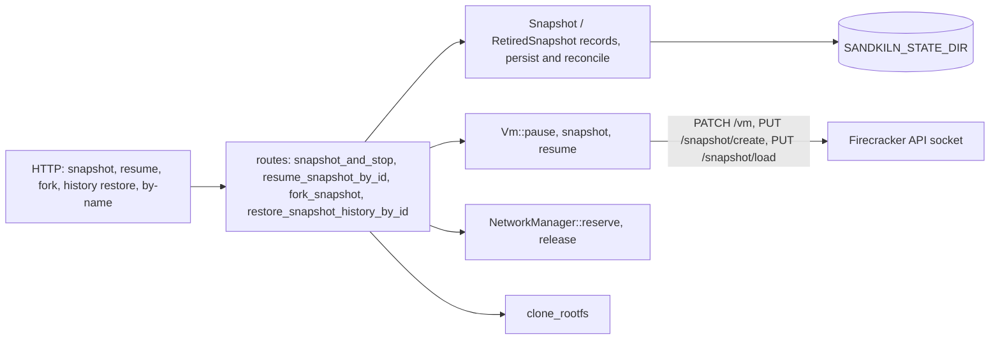
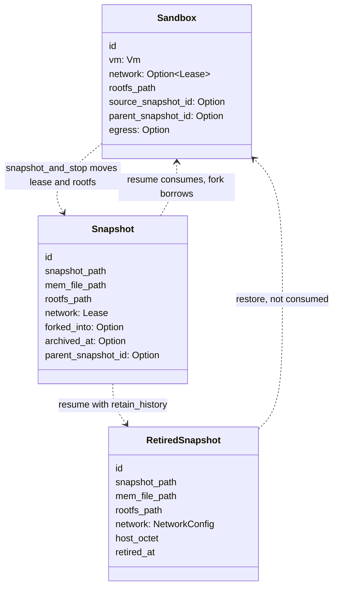
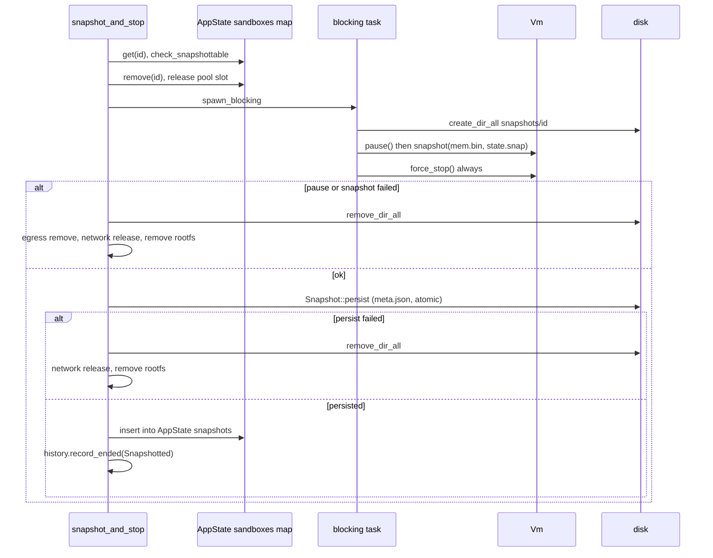
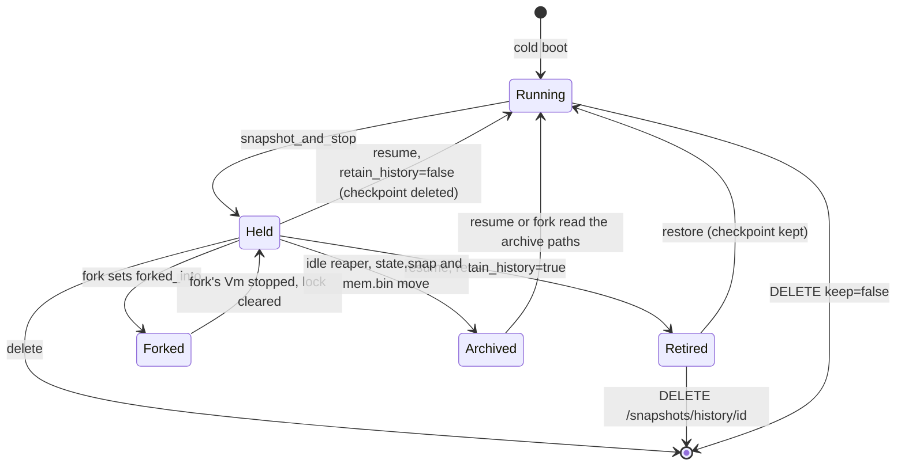

A Firecracker snapshot is two files: guest memory and serialised device state. Everything else a snapshot feature needs (which rootfs it refers to, whose network identity it carries, who may resume it, what happens to it afterwards, how it survives a daemon restart) is policy that sandkiln implements around those two files. The mechanism is in `sandkiln-vmm`; the policy is in the daemon's `snapshots/` module (`held.rs`, `retired.rs`), its snapshot routes (`http/routes/snapshot.rs`, `snapshot_history.rs`) and the named-sandbox routes (`http/routes/sandbox_name.rs`). The conceptual background is on the [snapshot, resume and fork internals page](https://sandkiln.mintlify.site/internals/snapshot-resume-fork). This post covers the implementation.

## Layers



The vmm layer is thin. `Vm::pause` is `PATCH /vm` with `{"state": "Paused"}`, `Vm::snapshot` is `PUT /snapshot/create` with a memory path and a state path, and `Vm::resume` spawns a fresh Firecracker process and issues `PUT /snapshot/load` (`core/crates/vmm/src/vm/snapshot.rs`). Resume passes `resume_vm: true`, so the guest runs as part of the same call with no separate start, and a `vsock_override` that gives the new process a fresh host-side vsock socket path, which the guest never sees. A resume skips the boot-source, drive, machine-config and network-interface requests entirely; all of that comes out of the state file.

## On-disk layout

Everything mutable lives under `SANDKILN_STATE_DIR` (default `~/sandkiln-tools/state`), laid out by `core/crates/daemon/src/storage.rs` so that snapshots survive restarts and an OS temp cleaner:

```text
$SANDKILN_STATE_DIR/
  snapshots/<snapshot id>/
    state.snap        device state, written by Vm::snapshot
    mem.bin           guest memory, written by Vm::snapshot
    meta.json         the Snapshot record (written last, atomically)
  snapshot-history/<checkpoint id>/
    state.snap  mem.bin  meta.json      same three-file shape, no live lease

$SANDKILN_ROOTFS_DIR/sandkiln-rootfs-<sandbox id>.ext4   per-sandbox rootfs (see post 4)
$SANDKILN_ARCHIVE_DIR/<snapshot id>/state.snap mem.bin meta.json   archived, default ~/sandkiln-tools/archive
```

The three filenames are fixed constants shared by `snapshots/held.rs` and `snapshots/retired.rs` (`state_path`, `mem_path`, `meta_path`), so a retired checkpoint and a held snapshot use one directory convention. History has its own root, separate from `snapshots/`, because startup reconciliation of snapshots assumes every entry holds a live lease, and lease-free checkpoints in the same tree would break that assumption.

### Durability: `meta.json` and reconcile

`state.snap` and `mem.bin` are written by Firecracker. The metadata that gives them meaning is `SnapshotMeta`: ids, the rootfs path, the whole network identity (tap, guest IP, gateway IP, MAC, host octet), attached drives, image id, tags, name, timestamps, egress policy, `parent_snapshot_id`, mounts and env. `Snapshot::persist` (`snapshots/held.rs`) writes it with `write_atomically`: write a sibling `.tmp` file, `fsync` it, `rename` over the target, then best-effort `fsync` the directory. A reader therefore sees either the old or the new complete file, never a torn one. The temp file is a sibling and not in a shared temp directory so that the rename cannot cross filesystems.

Every field added after the struct first shipped is `#[serde(default)]`, so a `meta.json` from an older version still parses.

The filesystem is the source of truth, the same convention the drive store and image store follow. `reconcile` (`snapshots/held.rs`) runs once at startup, before the HTTP listener binds and before any lease can race it. It scans both the hot root and the archive root (the archive is always scanned, even if archiving is currently off, so turning it off cannot orphan archived snapshots), and for each directory it rebuilds a `Snapshot`, calling `NetworkManager::reserve` to take the snapshot's tap and octet out of the free lists. A directory missing any of its three files, or with unparseable metadata, is skipped with a warning and left on disk for inspection. That is the designed meaning of a crash in the middle of a write, and it is never guessed at. History reconcile is the same shape but never touches `NetworkManager`, since a retired checkpoint holds no lease.

## The record types and who owns what



The key distinction is `Lease` versus `NetworkConfig`. A `Snapshot` holds a real `Lease` (the tap and octet are reserved out of the free pools while it exists). A `RetiredSnapshot` holds a bare `NetworkConfig` and a `host_octet`, so sitting in history reserves nothing. A lease is only taken at restore time. This is why history can grow without exhausting the tap pool.

`Sandbox` carries two lineage-flavoured fields that look redundant and are not:

| Field | `Some` when | Job |
| --- | --- | --- |
| `source_snapshot_id` | the sandbox is a **fork** | Marks that it does not own its lease. Refuses re-snapshotting it, steers a plain stop to destroy, and tells destroy to clear the snapshot's `forked_into` lock. |
| `parent_snapshot_id` | the sandbox was resumed, forked or restored from something | Lineage only: which snapshot it descended from. Carried into any snapshot taken from it. `None` for a cold boot, which is a lineage root. |

On resume, `source_snapshot_id` is deliberately `None` so a resumed sandbox stays snapshottable, while `parent_snapshot_id` is `Some(snapshot id)`. On fork both are set to the same value. On restore, `source_snapshot_id` is `None` and `parent_snapshot_id` is `Some(checkpoint id)`. Using one field for both jobs breaks one of them: either lineage disappears on resume, or resumed sandboxes become unsnapshottable. The parent pointer is just a pointer, and it may name a since-deleted snapshot; `GET /snapshots?parent_snapshot_id=` then ends the chain there.

## Snapshot and stop

`snapshot_and_stop(state, id)` (`http/routes/snapshot.rs`) is the one implementation behind `POST /sandboxes/:id/snapshot`, the default behaviour of `DELETE /sandboxes/:id` (preserve by default, `?keep=false` destroys), the idle reaper's auto-suspend, and the daemon's orderly shutdown (below), so they cannot drift.



The precondition is a pure function, `check_snapshottable(is_jailed, source_snapshot_id)`, pulled out so it is unit tested directly. A jailed sandbox is refused because `Vm::resume` only ever spawns directly: the snapshot would bake in in-jail paths that would be wrong on the host. A fork is refused because it does not own its lease. The check happens before the sandbox is removed from the map, so a rejected request leaves the sandbox untouched.

The sandbox is then removed from the map. From that moment the code holds the only reference, which is the ownership pattern used throughout: **claim by removal, then act, then re-insert on failure**. Nothing else can find the record while the slow I/O runs, and no lock is held across it.

Whatever happens to the snapshot, the VM is stopped (`vm.force_stop()` runs on both outcomes), because a paused VM that failed to snapshot cannot be handed back as running. It is `force_stop` and not `stop` on purpose: `stop` first sends the guest a `sync` so attached drives are flushed, and a paused guest can never answer it, so every snapshot used to pay the full control-plane timeout for nothing. Switching to `force_stop` took a snapshot-and-stop from 6.8s to 0.56s end to end, almost all of it real work. Nothing is lost by skipping the sync: the memory image already holds whatever the guest had not flushed, and the resumed guest carries on from exactly that state. If snapshotting fails, the directory is removed and the lease, the egress chain and the rootfs are released. If persisting the metadata fails after the two large files were written, the same teardown applies to the lease and rootfs. Metadata is persisted before the snapshot becomes visible in `AppState`, so a snapshot is never visible without its durability contract.

On success the lease and the rootfs move into the `Snapshot` instead of being released. The sandbox's egress chain stays installed but dormant; the policy is stored on the snapshot so it can be re-applied. History records the end as `Snapshotted` with the snapshot id.

### Why pause forced bounded vsock timeouts

A paused VM has its vCPUs halted. A vsock connection to it can still be accepted by Firecracker's host-side socket, but the guest agent can never answer. A blocking read on that stream hangs forever. The host-side retry logic in `Vm::call` bounds time between attempts (5 seconds in total) but not a single attempt that never returns.

So every blocking vsock operation has a timeout:

```rust
const IO_TIMEOUT: Duration = Duration::from_secs(3);
```

(`core/crates/vmm/src/vsock_client.rs`.) Connecting, the handshake and writing the request always use it, as do the PTY and exec-stream handshakes. The wait for the reply is a separate bound, `response_timeout`, so the two cases that need different answers can have them: a control-plane call (`Vm::call`) waits at most 3 seconds for a reply, while a user command goes through `AgentEndpoint::call_with_timeout` with the `exec_timeout_secs` setting (default 600) and returns HTTP 504 when it expires. A failed call returns a `CallError` carrying `request_sent`, and the retry loop never retries once the request frame was fully written, because the agent may already be running it. That last rule fixed a real defect: a command silent for more than 3 seconds used to error after about 6.5 seconds and also run twice. Once a PTY or exec stream is established, the timeouts are cleared (`set_read_timeout(None)`), because those streams legitimately sit idle between keystrokes or output. The stop path follows the same principle: `Vm::stop` tries a `sync` through the agent so unflushed writes to attached drives are not lost, but a failure only logs a warning and proceeds to the kill, and `force_stop` skips the sync for a VM that cannot answer it.

### Orderly shutdown

The same function is what makes a daemon restart safe. On `SIGTERM` or `SIGINT`, `lifecycle/shutdown.rs` stops the listener accepting, gives in-flight requests 30 seconds, then calls `stop_sandbox_by_id(.., keep = true)` for every live sandbox concurrently, which is `snapshot_and_stop`. A jailed sandbox cannot be snapshotted, so that one is retried with `keep = false` and destroyed. The whole drain has a 60 second deadline, after which the daemon exits anyway and logs it. Verified live on the dev box on 2026-11-24: three sandboxes snapshotted in 0.75s, the daemon exited in about a second, no Firecracker process was left, and the snapshots resumed after a restart (`scripts/restart-test.sh`). Because shutdown reuses the ordinary path, the snapshots it writes are indistinguishable from ones a client asked for, and `reconcile` picks them up on the next start. A `SIGKILL` or a crash skips all of this: the Firecracker processes are orphaned and any sandbox that was running is not snapshotted.

## Resume

`resume_snapshot_by_id(state, snapshot_id, retain_history)` (`http/routes/snapshot.rs`) is shared by `POST /snapshots/:id/resume` and `get_or_create_sandbox` (`http/routes/sandbox_name.rs`; resume-by-name always retains history).

1. **Claim.** Under the snapshots lock, check the snapshot exists and has no live fork (`check_no_live_fork`, a pure function returning a 409), then remove it from the map. A concurrent resume of the same id gets a 404 instead of racing a second VM onto the same files.
2. **Load.** `Vm::resume` on `state.snap` and `mem.bin`, wherever they currently are (hot or archive, with no code difference). If it fails, the record is re-inserted and the caller may retry. `Vm::resume` itself kills the child, waits, removes its sockets and appends the console-log path to the error before returning.
3. **Decide what happens to the checkpoint.** With `retain_history` true (the default), retire it. With false, delete the old directory and let the new sandbox reuse the rootfs file directly.
4. **Build the `Sandbox`.** It takes the snapshot's `Lease`, tags, name, drives, env and mounts. `jail_id` is `None` because resumes never jail. `source_snapshot_id` is `None` and `parent_snapshot_id` is the snapshot id.
5. **Re-apply egress.** Idempotently, as a loud warning on failure and not an error (the operation is one-way and has already succeeded).

Mounts are not re-applied: a mount is a live guest FUSE process, already captured in the memory image.

### Retiring

`retire_snapshot_files` (`http/routes/snapshot.rs`) is the history-retaining step, and it ends with a decision about files and ownership:

- It clones the snapshot's rootfs to a new per-sandbox path using the same `clone_rootfs` wrapper as a cold create (reflink where possible, see [post 4](/engineering/04-create-path-and-rootfs)), and the new `Sandbox` record gets that path.
- It moves `state.snap` and `mem.bin` into `snapshot-history/<id>/` with `move_file` (rename, falling back to copy then remove across filesystems), builds a `RetiredSnapshot` that still names the **original** rootfs file, persists its metadata, and removes the old directory last.
- Every failure is cleaned up in reverse. If the memory-file move fails after the state-file move, the half-moved directory is left rather than rolled back, because the rollback could fail for the same reason. A later reconcile sees a directory missing `mem.bin` and skips it with a warning.
- A failure to retire never fails the resume. The VM already runs, so it degrades to the destructive behaviour for that one resume, with a loud warning that no restorable checkpoint exists.

The rootfs rule behind all of this is that Firecracker records the root drive by host path, not by value. Whatever file sits at that path when a snapshot is loaded is what the guest sees. A snapshot's rootfs file must therefore stay untouched and in place for as long as the snapshot can be loaded again, and a mutating live sandbox must own a different file. The repository's internals page documents a reproduced corruption where a fork shared the snapshot's rootfs file: after the fork wrote a marker and stopped, resuming the original snapshot returned the fork's value. Fork, history-retaining resume and restore each give the new `Sandbox` record its own clone for that reason.

### Open question: which file does the resumed VM write to?

Re-reading the current code for this post, the clone's role is narrower than the paragraph above suggests, and it is worth stating exactly what the code establishes and what it does not.

- `Vm::resume` sends only `PUT /snapshot/load` with the state path, the memory path, `resume_vm` and the `vsock_override` (`core/crates/vmm/src/vm/snapshot.rs`). There is no drive override in the request, and the daemon's own module comment in `http/routes/snapshot.rs` says Firecracker has no way to redirect a resumed VM's drive to a different backing file. So the resumed guest's block device opens the path that was baked into `state.snap`, which is the original sandbox's rootfs file.
- The clone is made by the daemon around the resume, and `Sandbox::rootfs_path` is set to it. Nothing tells Firecracker about it. In `fork_snapshot` the order is resume first, then `clone_rootfs` from the source path, so the clone is taken from a file the already-running guest may be writing.
- Consequence by reading: after a history-retaining resume, a fork, or a restore, the guest most likely keeps writing the original file, while the daemon's record, and the cleanup on destroy, refer to the clone. The clone is then a copy of the disk taken at about resume time, owned and deleted by the daemon, that the VM never opens. Whether the original checkpoint's file can therefore still be changed by a resumed descendant, which is the corruption the clone was introduced to prevent, is not settled by this code.

I did not run this on the dev box for this post, so this is a statement about what the code can and cannot guarantee, not a measurement. The check that would settle it is cheap: write a marker in a sandbox, snapshot, fork, overwrite the marker in the fork, stop the fork, resume the original, and read the marker back; then repeat with the same test against the restore path. If the corruption reproduces, a clone made after the resume cannot be the fix, because the guest already holds the original path. Until that check is run, treat the clone as bookkeeping, not as proven isolation.

## Fork

`fork_snapshot` (`http/routes/snapshot.rs`) boots a new sandbox from a snapshot without consuming it, so the record and files stay in place.

```rust
snapshot.forked_into = Some(new_id.clone());
```

The id is reserved on the snapshot under the lock **before** the slow `Vm::resume`, so a second concurrent fork sees the reservation and gets a 409 immediately. The reason for a single live fork is the network identity: a snapshot's guest IP and MAC are frozen into its memory image, and Firecracker has no mechanism to give two live descendants different ones, so two forks would put two guests with the same address on the bridge. `forked_into` is that lock. It is checked by fork, resume, delete and archive, and cleared only when the fork's `Vm` has actually been killed (the destroy path clears it after `vm.stop()` returns, so a new fork cannot start while the old one might still touch the files).

The fork's `Sandbox` has `network: None` and `egress: None` because the lease and chain belong to the snapshot, and the snapshot's policy is what gets re-applied after the fork starts. Failure paths: a failed resume clears the lock and returns the error; a failed rootfs clone stops the already-running VM, clears the lock and returns the error. The clone is treated as fatal here, unlike retirement, because a record that shares the snapshot's file was found unsafe; see the open question above for what the clone does and does not guarantee. Destroying a fork must not release the snapshot's lease or rootfs, and it does not.

## Time-travel restore

Retiring on resume is what makes this possible. `POST /snapshots/history/:id/restore` calls `restore_snapshot_history_by_id` (`http/routes/snapshot_history.rs`), and unlike resume it does not consume the checkpoint: `AppState::retired_snapshots` is read with a clone (`RetiredSnapshot` is `Clone` because nothing in it is exclusively held, unlike `Snapshot`).



Restore is guarded by three checks that need no VM:

1. `tap_device_holder` must report nothing holding the checkpoint's tap: no live sandbox, held snapshot or in-flight restore. Otherwise a 409 names the holder.
2. `try_reserve_pending_tap_restore` atomically claims the tap for the duration of the call, with an RAII guard that releases it. This closes the race between two sibling checkpoints, which share a tap, both restoring at once. The first check alone cannot see an in-flight restore.
3. If the checkpoint has a name, it is re-checked under `lock_name`, because a name is inert while a checkpoint is in history and may have been claimed since.

Then it clones the rootfs from the checkpoint's file, calls `Vm::resume`, and only after the VM is running does it call `NetworkManager::reserve` to take the lease. A failed resume removes the new rootfs clone. The resulting sandbox has `source_snapshot_id: None` and `parent_snapshot_id: Some(checkpoint id)`, so it can be snapshotted again, starting a new branch of history. The model is sequential, like checking out an ancestor commit: restoring does not delete later checkpoints, it just requires that nothing sharing that network identity is live. True parallel branching is a different and harder problem that restore does not attempt.

Retiring by default has a real disk cost: a full guest-memory dump plus a rootfs clone per resume, until someone deletes it. `DELETE /snapshots/history/:id` exists for that reason. It removes the entry from the map before touching files, so a concurrent restore's lookup is atomic and never sees a half-deleted checkpoint.

## Archiving

With `SANDKILN_ARCHIVE_TIMEOUT_SECS` set, the idle reaper's archive pass (`lifecycle/idle_reaper.rs`) moves old held snapshots from the hot root to `SANDKILN_ARCHIVE_DIR`. A snapshot is eligible when it is not already archived, has no live fork, and its `created_at` is at least the timeout in the past. The comparison uses `SystemTime`, not `Instant`, because `created_at` persists as a unix timestamp, and a timestamp in the future (clock skew) reads as not due rather than panicking.

`archive_snapshot_by_id` (`http/routes/snapshot.rs`) follows the claim-by-removal pattern and **always re-inserts**, success or failure, so a failed archive can never lose track of a snapshot. It moves exactly two files, `state.snap` and `mem.bin`, via `move_snapshot_files`, which updates each path field on the record immediately after that file's move succeeds, so the record always reflects where each file really is even if the second move fails. It then sets `archived_at` and re-persists `meta.json` at the destination, and removes the old directory only on success (leaving a stale `meta.json` there would make the next restart log a false warning for a healthy snapshot).

**The rootfs backing path is never moved.** Its absolute host path is baked into `state.snap`, with no override at load time, so relocating the file breaks every future resume and fork. That was proven live when an earlier version moved it too. Only the two files that can legitimately move, move. A cross-filesystem move cannot be atomic, so a failure partway leaves a genuinely mixed set of paths, and the record is reinserted as is, to be treated like any other incomplete-directory case. There is no un-archive operation and no on-demand archive route today: resume and fork read from wherever the paths currently point.

## Named sandboxes and the by-name routes

`GET /sandboxes/by-name/:name` answers for live sandboxes only; a name held by a snapshot is a 409, never a silent resume. `POST /sandboxes/get-or-create` takes `lock_name` for the entire check-then-act sequence, then follows `resolve_name`, where a live holder wins: return it, or resume the held snapshot (always retaining history, using what was recorded at snapshot time), or create fresh. A fork and its source snapshot can carry the same name at once, which is why live wins. A concurrent call for the same brand-new name blocks on the lock until the first commits, and then finds it live.

## Failure and ownership summary

| Operation | Claimed by | On failure |
| --- | --- | --- |
| Snapshot and stop | removing the sandbox from the map | VM force-stopped, directory removed, lease, egress chain and rootfs released |
| Resume | removing the snapshot from the map | record re-inserted, retryable |
| Retire | inside resume | cleanup in reverse, falls back to destructive for this resume, warning |
| Fork | `forked_into` set before the resume | lock cleared; a failed clone also stops the VM |
| Restore | tap reservation guard plus name lock | rootfs clone removed |
| Archive | removing the snapshot from the map | always re-inserted, paths reflect reality |
| Delete | removing the snapshot from the map | refuses while a fork is live |

## Known limitation: a freshly resumed guest sometimes panics

In the full integration suite run 4-way parallel (about 320 checks), two or three checks fail per run because a freshly resumed guest kernel panics with "Attempted to kill the idle task!" about 20ms after the restore, and its Firecracker process exits. In isolated and 4-way-parallel loops, 160 of 160 resume and re-snapshot cycles were clean, so the failure needs some specific concurrent condition that has not been identified. The root cause is not found. The only mitigation in place is for pool claims, which run a health check after the resume and discard a VM that fails it (see the pools post). A plain `POST /snapshots/:id/resume` has no such check: the call returns a new sandbox id and the first call to it fails.
