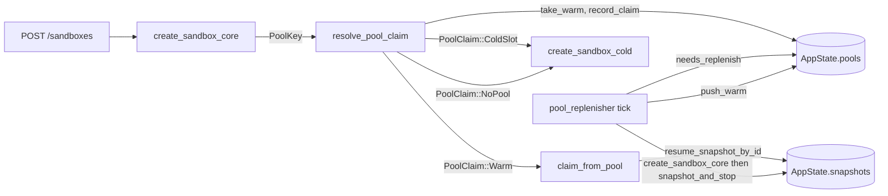
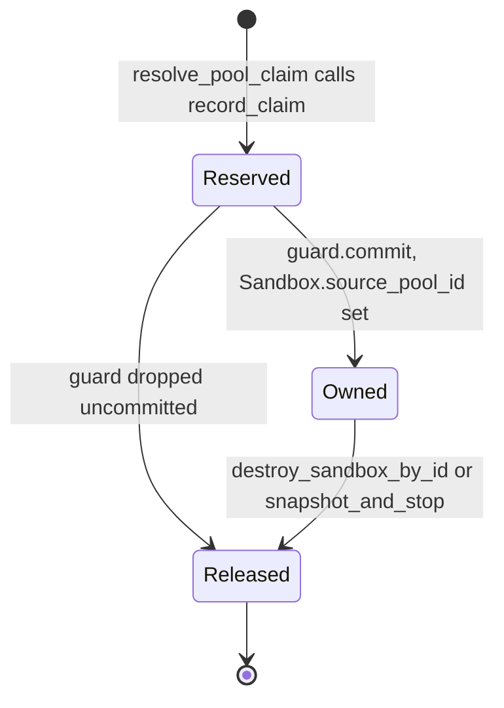
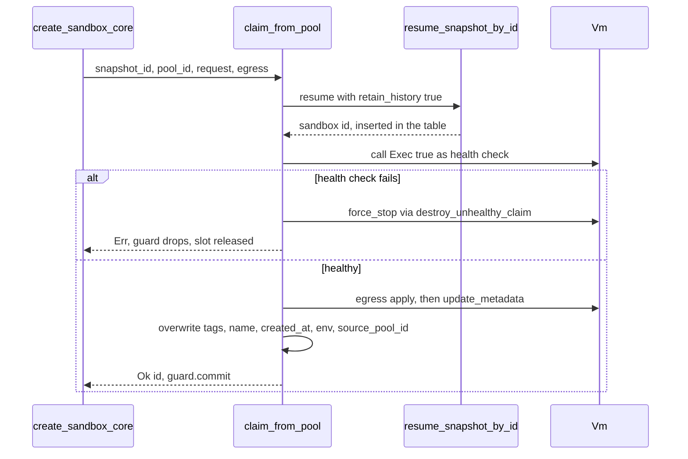

A pre-warmed pool is a bounded supply of already-booted, already-snapshotted microVMs that a plain `POST /sandboxes` can resume instead of paying a cold boot. The mechanism is small, but it sits at the intersection of the snapshot store, the sandbox table and the create path, and each has its own invariants. This post describes how the pieces fit together. The user-facing description and the latency numbers live in the docs page [Internals: pre-warmed pools](https://sandkiln.mintlify.site/internals/pre-warmed-pools); this post is about code structure.

A note on references: the daemon crate is being reorganized, so daemon code is cited by concept and item name (`Pool`, `PoolClaimGuard`, `claim_from_pool`) rather than by file path. Items in `sandkiln-vmm` carry `path:line` references.

## The four pieces

The feature is split into four daemon modules, each with one concern.

| Module | Concern | Async? |
| --- | --- | --- |
| `pool` | Pure state: `PoolConfig`, `PoolKey`, `Pool` (warm queue, claimed counter, `Notify`) | No |
| `pool_replenisher` | Background tick loop that tops pools up | Yes, a spawned task |
| `pool_claim` | `resolve_pool_claim`, `PoolClaimGuard`, `claim_from_pool` | Yes |
| `routes_pool` | HTTP create, list and delete of pool *configuration* | Yes |

`pool` has no dependency on `AppState`. That is deliberate: every transition (`push_warm`, `take_warm`, `record_claim`, `record_release`, `needs_replenish`) is a plain method on a struct, which is why the module carries a dozen unit tests that run under `cargo test --workspace` with no KVM. Everything that needs a real VM (resume, boot, snapshot) lives in the modules around it and is exercised by the `18-pool.sh` topic of the integration suite.



## The pool model

A pool is identified by a caller-chosen string id and described by `PoolConfig`:

```rust
pub struct PoolConfig {
    pub id: String,
    pub image_id: Option<String>,
    pub vcpu_count: u8,
    pub mem_size_mib: u32,
    pub warm_count: u32,
    pub max_count: Option<u32>,
}
```

(`PoolConfig`, in the daemon's `pool` module.)

Two numbers shape behavior, and they mean different things:

- `warm_count` is a *target* for how many snapshots sit ready. It is not a cap. A claim that arrives with nothing warm does not fail; it cold-creates.
- `max_count` is an optional *ceiling* on live instances of the profile: warm snapshots plus sandboxes that were claimed from, or cold-created under, the pool and are still alive. `None` means unbounded. When it is set, a claim at the ceiling queues rather than exceeding it.

The create handler rejects an explicit `max_count` of `0` (omit the field for unbounded), rejects an empty id, rejects an unknown `image_id`, and returns `409` for a duplicate pool id. `warm_count: 0` is accepted, since it is not incorrect, only pointless.

### Matching is plain equality on resolved values

A request is matched against pools by `PoolKey`, which holds `image_id`, `vcpu_count` and `mem_size_mib`. Both sides of the comparison are *resolved* values. `create_pool` runs the same `resolve_resource_override` helper the create path uses, so a pool created with no resource fields stores the daemon's configured defaults, and a request with no resource fields resolves to those same defaults. The comparison is then derived `PartialEq`, with no "is this field defaulted" logic anywhere.

The alternative, storing `Option<u8>` overrides in the pool and resolving at match time, was rejected: it would thread daemon-default lookups through every comparison and would make two pools that resolve to the same profile look different.

### What disqualifies a request

A request that carries `drives`, or any `rate_limit`, never matches a pool. Both are applied to the VM at boot time, and a warm snapshot was booted with neither, so resuming it cannot add them. The create path checks this before it even builds a `PoolKey`:

```rust
if request.drives.is_empty() && request.rate_limit.is_none() {
    let key = crate::pool::PoolKey { image_id: request.image_id.clone(), vcpu_count, mem_size_mib };
```

(From `create_sandbox_core`, in the daemon's `routes_sandbox`.)

Such a request also never *queues* on a pool. If it did, it could wait up to 30 seconds for a slot it could never legitimately use. It goes straight to a cold create.

Egress policy is different. It does not disqualify a claim, because it is host-side iptables applied after boot rather than state baked into the VM. `claim_from_pool` takes the resolved policy as an argument and applies it to the resumed sandbox's tap device after the health check. A failure to apply it is fatal for the claim (the sandbox is torn down): silently returning an unrestricted sandbox when the caller asked for restrictions would be a security gap. Per-sandbox `env` is likewise applied at claim time rather than baked into the warm instance.

## The replenisher

`pool_replenisher::run` is a fixed-interval loop, spawned unconditionally from `main`:

```rust
const CHECK_INTERVAL: Duration = Duration::from_secs(2);

pub async fn run(state: Arc<AppState>) {
    loop {
        tokio::time::sleep(CHECK_INTERVAL).await;
        replenish_once(&state).await;
    }
}
```

(From `pool_replenisher`.)

An idle tick with no pools configured is one empty lock-and-filter. The interval is a constant, not an environment variable.

Each tick, `replenish_once` takes the `AppState::pools` lock, collects clones of the `PoolConfig` of every pool whose `needs_replenish()` is true, and *releases the lock* before doing any slow work. It then processes the due pools sequentially, producing at most one warm slot per pool per tick. A large `warm_count` therefore fills in gradually instead of spiking boot load.

Producing one warm slot reuses the ordinary lifecycle operations rather than a pool-specific boot path:

1. `create_sandbox_core` with a placeholder request: no name, a single tag `sandkiln.pool=<pool id>`, the pool's resolved vCPU and memory, its image, no drives, no rate limit, no egress, no env. This is a full normal create, so it goes through the same lease, rootfs clone and boot sequence.
2. `snapshot_and_stop`, the same function that `DELETE /sandboxes/:id` and the idle reaper use. It returns a snapshot id that is now a normal entry in `AppState::snapshots`.
3. Under the `pools` lock again, `push_warm(snapshot_id)`.

There is no separate "warm" artifact type. A warm slot is just a snapshot id in the pool's `VecDeque<String>`. That keeps ownership simple: the snapshot lives in the snapshot table and on disk, and the pool holds a reference to it. The snapshot mechanics themselves are covered in the snapshots, resume and fork post (06).

`effective_warm_target` makes a bounded pool respect its own ceiling:

```rust
fn effective_warm_target(&self) -> u32 {
    match self.config.max_count {
        Some(max) => self.config.warm_count.min(max.saturating_sub(self.claimed)),
        None => self.config.warm_count,
    }
}
```

(From `Pool`, in `pool`.)

With `max_count: 3` and one claimed instance, only two slots of headroom exist, so the target is `min(warm_count, 2)`. `saturating_sub` matters: a race can leave `claimed` above `max_count`, and an unchecked subtraction there would panic in a debug build or wrap in release.

### Failure inside replenishment

Each step can fail without leaving anything behind that the system does not understand.

| Step fails | Handling |
| --- | --- |
| `create_sandbox_core` | Log a warning, retry next tick (create cleans up its own lease and rootfs) |
| `snapshot_and_stop` returns `NotFound` | Something else stopped it first: log, retry next tick |
| `snapshot_and_stop` returns `Io` | Log, retry next tick |
| Pool deleted while booting | `push_warm` finds no pool, so the replenisher calls `delete_snapshot_by_id` on the snapshot it just made |

The last row is the one that needs thought. Boot plus snapshot takes long enough for an operator to `DELETE /pools/:id` in the middle. The replenisher re-checks membership at the moment it pushes, inside the same lock acquisition, and if the pool is gone it deletes the snapshot instead of leaving it orphaned.

The loop does not back off on failure. A persistently failing boot is retried every 2 seconds and logs a warning each time. That is a simplification, not a designed behavior.

## The claim path

### Resolving: lock, decide, unlock, await

`resolve_pool_claim` is the consumer half of the queue. Its contract is stated in its doc comment: never hold the `pools` lock across an await. The structure that satisfies it is "lock, decide or clone the `Notify`, unlock, optionally await, loop with fresh state":

```rust
let notify = {
    let mut pools = state.pools.lock().unwrap();
    let Some(pool) = pools.values_mut().find(|p| p.config.key() == *key) else {
        return Ok(PoolClaim::NoPool);
    };
    if let Some(snapshot_id) = pool.take_warm() {
        pool.record_claim();
        return Ok(PoolClaim::Warm { pool_id: pool.config.id.clone(), snapshot_id });
    }
    if pool.has_room_for_new_claim() {
        pool.record_claim();
        return Ok(PoolClaim::ColdSlot { pool_id: pool.config.id.clone() });
    }
    pool.notify.clone()
};
```

(From `resolve_pool_claim`, in `pool_claim`.)

There are three outcomes:

- `Warm { pool_id, snapshot_id }`: a snapshot was popped and a slot was reserved, atomically under one lock acquisition. No other claimant can observe the pool between the two.
- `ColdSlot { pool_id }`: nothing warm, but `claimed < max_count` (or there is no `max_count`), so a slot is reserved and the caller cold-creates, attributed to this pool.
- `NoPool`: no pool matches the key.

If none of those applies, the pool is at its ceiling with nothing warm. The caller awaits the pool's `Notify` under a single deadline of `POOL_QUEUE_TIMEOUT`, 30 seconds. When the deadline passes, it returns `AppError::ServiceUnavailable`, which the error mapping turns into HTTP `503`.

### Notify as a condition variable

`Pool::notify` is a `tokio::sync::Notify` used the way a condition variable is used. `push_warm` and `record_release` call `notify_waiters()`. Every waiter wakes, loops, re-takes the lock, and re-evaluates the real condition. An extra wakeup costs one re-check. That is why `notify_waiters` is used instead of `notify_one`: a single-wakeup scheme would have to guarantee that the woken waiter is one that can proceed. Broadcast plus re-check sidesteps that.

A `notify_waiters` that races the timeout is not lost. The loop's next iteration re-reads the pool state first, so a slot that freed up in the gap is found directly.

The alternatives were polling on a short sleep (wasteful, and it adds latency to every wake) and a semaphore sized to `max_count`. A semaphore models slots well, but a claim must atomically choose between taking a warm snapshot and reserving a cold slot, and the warm target depends on `claimed`. Keeping the counters in `Pool` under the existing mutex and using `Notify` purely as a wakeup signal keeps one source of truth.

### The slot lifecycle and `PoolClaimGuard`

Reserving a slot (`record_claim`) increments `claimed` before any resume or boot begins. That stops two concurrent claimants from both seeing "one slot left" and over-committing during the window before a `Sandbox` is inserted. But a reservation that leaks is worse than none, since it permanently shrinks a bounded pool. `PoolClaimGuard` makes the release automatic:

```rust
impl Drop for PoolClaimGuard {
    fn drop(&mut self) {
        if self.committed {
            return;
        }
        if let Some(pool_id) = &self.pool_id {
            if let Some(pool) = self.state.pools.lock().unwrap().get_mut(pool_id) {
                pool.record_release();
            }
        }
    }
}
```

(From `PoolClaimGuard`, in `pool_claim`.)

The guard is created right after `resolve_pool_claim` returns a slot, and `commit()` is called only when a live `Sandbox` durably owns the slot. From then on the slot is released by the stop paths: `destroy_sandbox_by_id` and `snapshot_and_stop` both check `Sandbox::source_pool_id` and call `record_release` on the matching pool, which also wakes queued waiters.



The `Drop`-based design means every early return and every `?` in the claim and cold-create paths is correct by construction, with no per-exit cleanup code to forget. `create_sandbox_cold` builds the same guard for the `ColdSlot` case, so both kinds of reservation share one release mechanism. If the pool is deleted while a guard is outstanding, `get_mut` returns `None` and the drop does nothing.

### The claim itself

`claim_from_pool` takes the reserved snapshot id and does four things in order.



**1. Resume.** It calls `resume_snapshot_by_id(state, snapshot_id, true)`, the same function behind the snapshot resume endpoint. The `true` is `retain_history`: the consumed checkpoint is retired into the snapshot history rather than deleted. The code comment explains why: from inside the claim there is no way to tell "the pool's own warm checkpoint" from any other, so both are kept.

**2. Health check.** It runs `Request::Exec { command: "true", .. }` through `sandbox.vm.call`, inside `spawn_blocking_in_current_span` because it is blocking vsock I/O. This exists because a resumed guest kernel can panic early after restore. In isolated tests on the dev box it happened in roughly one in three to two in three resumes. The root cause is unconfirmed (drift between restored CPU or timer state and timing-sensitive kernel init, with TSC drift in particular, is a hypothesis, not a finding), but the failure is real, so a resume is untrusted until the guest agent answers.

**3. Teardown on failure.** A failed check calls `destroy_unhealthy_claim`, which removes the sandbox from the table, releases the network lease, deletes the rootfs clone, and stops the VM with `Vm::force_stop`:

```rust
/// Like `stop`, but skips the "sync before kill" call, for a VM
/// already known dead ...
pub fn force_stop(self) -> io::Result<()> {
    self.stop_inner(false)
}
```

(`sandkiln-vmm`, `core/crates/vmm/src/vm/mod.rs:207`.)

`stop` first asks the guest to `sync` so unflushed writes to attached drives are not lost, and that call has its own timeout budget (the source comment says about 5 seconds). For a VM the health check just proved is not answering, the sync cannot succeed and would only burn that budget before the kill. `force_stop` goes straight to the kill and socket cleanup. The slot guard is not committed, so the slot is released on return.

**4. Identity overwrite.** The warm snapshot carries the replenisher's placeholder identity. For a healthy guest the claim replaces it with the caller's:

- Egress is applied if requested (fatal on error, as above).
- `Vm::update_metadata` rewrites the guest-visible MMDS document with the real `id`, `name` and `tags`.
- The `Sandbox` record gets the caller's tags, name, `created_at`, `egress`, `env` and `source_pool_id` in one critical section, and then `record_created` and the created-sandbox metric fire.

The MMDS step is the subtle one. A resumed VM's MMDS store comes back uninitialized even though it was configured before the snapshot, so a bare `PATCH` fails. `update_metadata` redoes the whole sequence:

```rust
pub fn update_metadata(&self, metadata: &serde_json::Value) -> io::Result<()> {
    let mut api = ApiClient::connect(&self.api_socket)?;
    put_checked(&mut api, "/mmds/config", &serde_json::json!({ "network_interfaces": ["eth0"], "version": "V2" }))?;
    put_checked(&mut api, "/mmds", metadata)
}
```

(`sandkiln-vmm`, `core/crates/vmm/src/vm/mod.rs:193`.) What MMDS is and why the guest reads identity from it is covered in [Internals: MMDS](https://sandkiln.mintlify.site/internals/mmds).

Because `PUT /mmds/config` can be rejected just after a resume even when the resume fully succeeded, the daemon wraps the call in a bounded retry: `UPDATE_METADATA_MAX_ATTEMPTS` is 10, with `UPDATE_METADATA_RETRY_DELAY` of 300 ms between attempts, so about 3 seconds in total. The loop runs inside `spawn_blocking`, which is why it can use `std::thread::sleep` without stalling the runtime. It takes the sandbox-table lock per attempt, so the lock is never held through a sleep.

If every attempt fails, the failure is non-fatal. The guest already passed its health check, so the result is a sandbox with stale MMDS content and a warning in the log. This is the explicit asymmetry with egress: stale metadata is a degraded sandbox, while a missing egress policy is a security hole.

## Fallback and the bounded retry

When `claim_from_pool` fails (resume error, health check, egress application), `create_sandbox_core` does not return the error. It loops up to `MAX_POOL_CLAIM_ATTEMPTS` (3) times, re-running `resolve_pool_claim`. Each failed attempt has already released its slot through the guard, so the next iteration competes for capacity honestly, and a fallback cold create still counts against `max_count` if it comes back as `ColdSlot`.

If the loop exhausts its attempts, or no pool matches, the request falls through to `create_sandbox_cold` with no pool attribution. A pathological run of three consecutive bad warm snapshots therefore yields an unattributed sandbox that is not counted against the pool. The code comment calls this an accepted rare edge case, and it is the one place the `max_count` accounting is knowingly loose.

The cost of an unlucky resume is visible to the caller only as latency. The caller receives either a verified sandbox id or the error of a cold create.

## What is and is not durable

Pool *configuration* lives only in `AppState::pools`, an in-memory `Mutex<HashMap<String, Pool>>`. Pools are inserted only by the create handler, and nothing reads them back at startup. The consequences follow directly:

- After a daemon restart there are no pools. `GET /pools` is empty until an operator re-creates them.
- The warm *snapshots* are on disk like any snapshot. `snapshot::reconcile` rebuilds `AppState::snapshots` from the filesystem at startup, so they come back as ordinary snapshots, but no code re-links them to a pool. They are not lost, and they are not claimable either: they sit in the snapshot list until deleted.
- A live sandbox claimed from a pool does not survive a restart (see the daemon internals post), so the `claimed` counter would have nothing meaningful to restore.

Persisting pool config was not built: re-issuing a `POST /pools` at startup is cheap, and a persisted design would first have to say what `claimed` means once every live sandbox has been orphaned. It is a deferred feature, not an implied one.

The deletion path shows the ownership model. `delete_pool` removes the `Pool` from the map under the lock, wakes every queued waiter once so they re-check and find no matching pool (they then cold-create instead of waiting out 30 seconds), and drains `take_warm()` calling `delete_snapshot_by_id` for each snapshot. A cleanup failure for one snapshot is logged and the loop continues. A snapshot that a claimant took before the delete acquired the lock is owned by that claimant's in-flight resume, not by the pool.

## Concurrency summary

| State | Guard | Held across an await? |
| --- | --- | --- |
| `AppState::pools` (warm queue, claimed counter) | `std::sync::Mutex` | Never |
| `Pool::notify` | `Arc<Notify>`, cloned out of the lock | Awaited with the lock released |
| `AppState::sandboxes` during the MMDS retry | `std::sync::Mutex`, taken per attempt | Never (inside `spawn_blocking`) |

Three kinds of caller touch a pool: HTTP handlers (`resolve_pool_claim`, create, delete), the replenisher, and the stop paths calling `record_release`. All of them use short critical sections on one mutex, and the only cross-task signaling is the `Notify`. No code path holds the `pools` lock while acquiring another lock.

## Testing

The pure logic in `pool` has unit tests for FIFO ordering, key inequality across image and resource differences, `max_count` blocking and release, saturating release, and the effective warm target arithmetic including a `claimed` above `max_count`. Those run in the 303-test `cargo test --workspace` pass.

The integration suite (315 checks in total) covers live behavior in `18-pool.sh`: a real background replenishment, a claim from the warm pool, MMDS reflecting the claimer's name (polled on the guest side), a second claim at `max_count` queueing, and the queued claim waking promptly once a slot frees. `SANDKILN_INTEGRATION_TEST_ONLY=pool` runs just that topic. The topic polls for real replenishment rather than sleeping a fixed time, because it runs concurrently with other topics that compete for host resources.
