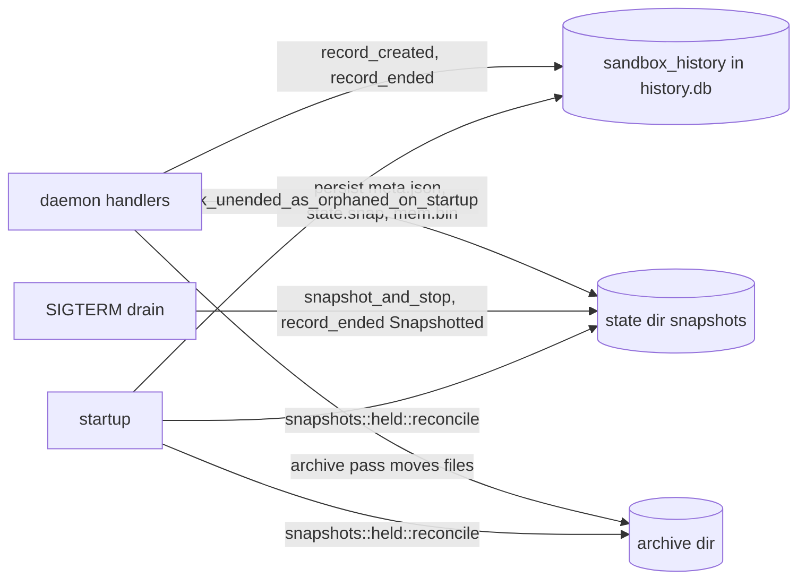
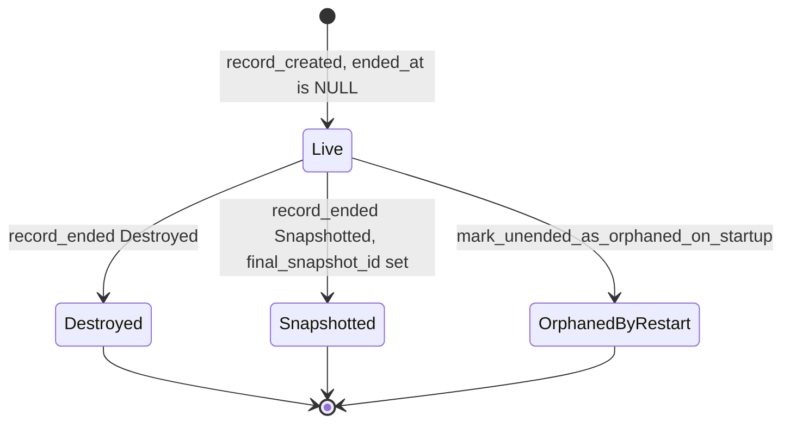

sandkiln has two separate durability mechanisms, and they answer different questions. The `sandkiln-store` crate answers "what existed, and how did it end?" with a sqlite table. The daemon's snapshot layer answers "can this sandbox come back after a restart?" with files on disk and a directory scan at startup. Neither is a general database of live state, and the reason for that is the most important design fact in this area: a live sandbox cannot be persisted.

Daemon code is cited by its path under `core/crates/daemon/src/` (the `snapshots/` directory holds the durable snapshot layer), and the `store` crate by `path:line`. The docs-site page [Internals: the SQLite history store](https://sandkiln.mintlify.site/internals/sqlite-history-store) has the user-facing walkthrough; this post covers the structure and the reasoning.

## Why a live sandbox is not durable

A live `Sandbox` owns a real OS process: a Firecracker `Child` handle, an open API socket, an open vsock connection, plus a leased tap device and a private rootfs clone. None of that has a serializable form, and the project has no re-adoption mechanism, jailer included. The module doc of the store (`core/crates/store/src/lib.rs:5`) makes the same point, though its wording predates orderly shutdown and still says a shutdown of any kind orphans every live sandbox. That is now true only of an unclean exit (a `SIGKILL`, a crash, an out-of-memory kill): on `SIGTERM` or `SIGINT` the daemon snapshots every live sandbox first (see post 08), so those sandboxes come back as held snapshots rather than being lost.

The consequence is a deliberate split of the state space:

| State | Where it lives | After a restart |
| --- | --- | --- |
| Live sandboxes | In-memory map in `AppState` | After a clean shutdown: snapshotted, so held snapshots. After a crash or `SIGKILL`: gone (processes orphaned) |
| Pool configuration | In-memory map in `AppState` | Gone |
| Held snapshots | Files under the state dir, rebuilt by `reconcile` | Restored |
| Retired checkpoints | Files under the state dir, rebuilt by a second reconcile | Restored |
| Lifecycle history | A sqlite file | Preserved |



## The store crate

`sandkiln-store` is one file with one type. `HistoryStore` wraps `Mutex<Connection>` over a `rusqlite` connection (`core/crates/store/src/lib.rs:97`). Its public surface is small:

| Method | Purpose |
| --- | --- |
| `open(path)` | Create parent directory, open the file, apply pragmas, ensure schema |
| `open_in_memory()` | Tests only; skips the pragmas |
| `record_created(id, name, tags, image_id, created_at)` | Insert a row |
| `record_ended(id, ended_at, reason, final_snapshot_id)` | Close a row |
| `mark_unended_as_orphaned_on_startup(now)` | Close every row still open |
| `get(id)` | One record or `None` |
| `list(&HistoryFilter)` | Newest-created first, optional `live_only`, bounded |

### Schema

There is one table and two indexes, created idempotently:

```sql
CREATE TABLE IF NOT EXISTS sandbox_history (
    id               TEXT PRIMARY KEY,
    name             TEXT,
    tags_json        TEXT NOT NULL,
    image_id         TEXT,
    created_at_unix  INTEGER NOT NULL,
    ended_at_unix    INTEGER,
    end_reason       TEXT,
    final_snapshot_id TEXT
);
```

(From `init_schema`, `core/crates/store/src/lib.rs:154`.)

The record has no state enum column. A row's lifecycle is encoded in whether `ended_at_unix` is `NULL`: `NULL` means "live as of the last write", a value means ended, and `end_reason` says how. There is no migrations framework. A schema change extends `init_schema` with new nullable columns under `CREATE TABLE IF NOT EXISTS`, which is enough for a single-table store that only ever grows by columns.

Tags are stored as a JSON string, and `row_to_record` parses them back with `unwrap_or_default`, so a corrupt value degrades to an empty tag map instead of failing a list call.

### The record states



`EndReason` has exactly these three variants, stored as the strings `destroyed`, `snapshotted` and `orphaned_by_restart`. The first is written when a sandbox is torn down (`?keep=false`, the idle reaper's destroy fallback, or at shutdown for a jailed sandbox or a fork), the second when it is stopped through the persistent-by-default path, which includes `DELETE` with the default `keep`, manual snapshot, auto-suspend and the snapshot-everything drain at orderly shutdown. The third is the restart marker, described next.

## Startup orphan reconciliation

The startup sequence in `core/crates/daemon/src/main.rs` opens the store and immediately calls `mark_unended_as_orphaned_on_startup(now)` before the HTTP listener binds. The statement is a single update:

```rust
self.conn.lock().unwrap().execute(
    "UPDATE sandbox_history SET ended_at_unix = ?1, end_reason = ?2 WHERE ended_at_unix IS NULL",
    params![unix_secs(now), EndReason::OrphanedByRestart.as_str()],
)
```

(`core/crates/store/src/lib.rs:212`.)

What this marks, exactly: every row with `ended_at_unix IS NULL`, with the startup time as the end time and `orphaned_by_restart` as the reason. It does not look at processes, sockets or tap devices. It does not need to, and that is the point. The store's argument is that this is unconditionally correct rather than a heuristic: when a new daemon process starts, whatever rows were open were written by a previous daemon process, and nothing in the project can hand a previous process's sandbox to a new one. The function returns the number of rows updated so the daemon can log it. A non-zero count after a clean shutdown should be zero for any sandbox that was created by this daemon (the shutdown drain ended each row as `snapshotted` or `destroyed`), so a non-zero count is a signal that the previous run ended uncleanly, or that a drain hit its 60 second deadline; it is not an error. One caveat from the call sites below: a sandbox that was resumed or forked has no row of its own, so it never contributes to the count either way.

Two things this does not do. It does not kill leftover Firecracker processes or free their tap devices. After an orderly shutdown there are none, because the drain stopped every VM. After an unclean exit the daemon cannot clean them up at startup, and the control script's best-effort orphan cleanup step (`scripts/sandkilnd-ctl.sh`, which kills leftover `firecracker --api-sock /tmp/sandkiln-fc-` processes) is the operator-level answer. And it does not touch snapshots: a sandbox that was snapshotted has a row ended with `snapshotted`, and its files are reconciled separately.

The ordering matters for the same reason snapshot reconciliation is ordered before the listener binds: a request must never see a stale view in which an old row still claims to be live.

### Rows are not created for every transition

`record_created` is called from exactly two places in the daemon: `create_sandbox_cold` (`http/routes/sandbox.rs:409`) after a boot has succeeded, and `claim_from_pool` (`lifecycle/pool_claim.rs:241`) after a claimed sandbox is healthy (a failed boot or failed health check never reaches it, so history cannot contain a sandbox that never existed). `record_ended` is called from `destroy_sandbox_by_id` (`http/routes/sandbox.rs:743`) with `Destroyed` and from `snapshot_and_stop` (`http/routes/snapshot.rs:258`) with `Snapshotted` and the new snapshot id. Orderly shutdown has no history code of its own: it calls those same two paths, so what it records is exactly one `Snapshotted` row (with the snapshot id) per snapshotted sandbox and one `Destroyed` row per sandbox it had to destroy.

A resume or fork produces a sandbox with a fresh id and does not call `record_created`. So history records each created sandbox's lifetime up to its snapshot, and a later resume appears as a new live sandbox that has no row of its own. That is a property of the current implementation. `record_ended` on an id with no row is a silent no-op, not an error (`core/crates/store/src/lib.rs:196`), which is what lets a stop path run on a resumed sandbox without failing, and also what tolerates records from a daemon build older than the store.

The HTTP surface is read-only: `GET /sandboxes/history` takes `live_only` and `limit` and maps to `HistoryStore::list`. There is no write endpoint; every write is a side effect of an existing lifecycle operation.

## Best-effort write semantics

Every history write in the daemon is wrapped so that a failure logs a warning and the request continues:

```rust
if let Err(e) = state.history.record_created(&id, request.name.as_deref(), &request.tags, request.image_id.as_deref(), created_at) {
    tracing::warn!(error = %e, sandbox_id = %id, "failed to record sandbox creation in history store");
}
```

(From `create_sandbox_cold`, `core/crates/daemon/src/http/routes/sandbox.rs:409`.)

The reasoning is about ordering of effects. By the time a history write runs, the VM has already booted. Failing the request over a bookkeeping error would waste a real running sandbox and still leave the caller with nothing usable. The store's job is to record what happened, not to gate what is allowed to happen. That decision is the basis for the pragma choice below: since the write was never allowed to affect correctness, it should not be allowed to dominate latency either.

Reads go through `spawn_blocking`, like every other synchronous call in the daemon.

### Why a mutex-guarded connection and not a pool

One `Mutex<Connection>` is deliberate for a single-process, low-volume store. A pool would bring its own complexity (busy timeouts, writer contention semantics) for a volume this daemon cannot produce. `rusqlite` (synchronous) was chosen over `sqlx` (async) because every VM-touching route already runs inside `spawn_blocking`, so a blocking call fits the existing concurrency model and adds no second one.

### Pragmas: WAL and synchronous=NORMAL

`open` applies two pragmas before touching the schema:

```rust
fn configure_for_write_latency(conn: &Connection) -> rusqlite::Result<()> {
    conn.pragma_update(None, "journal_mode", "WAL")?;
    conn.pragma_update(None, "synchronous", "NORMAL")?;
    Ok(())
}
```

(`core/crates/store/src/lib.rs:148`.)

Sqlite's defaults (`journal_mode=DELETE`, `synchronous=FULL`) fsync twice per write, once for the rollback journal and once for the database file. On a cold create's critical path that measured about 9.24 ms, around 5.5 percent of the create, according to `docs/benchmarks.md`. An isolated A/B of 20 sequential writes on the same disk recorded in the same section measured:

| Settings | Mean per write |
| --- | --- |
| Default (`DELETE`, `FULL`) | 1897.8 µs |
| `WAL`, `NORMAL` | 37.1 µs |

That is roughly a 51x reduction for the write. The tradeoff is spelled out in the function's doc comment. In WAL mode, `synchronous=NORMAL` syncs the log at checkpoints rather than on every transaction. It stays durable against an application crash. Against an OS crash or power loss it can lose the transactions in the last, not yet checkpointed part of the WAL. For a store whose writes are already best-effort, that exposure is absorbed without a design change. For a store holding data that had to be exactly durable it would not be acceptable, and that distinction is why the pragma lives in one named function rather than being a default.

`open_in_memory` skips this entirely: WAL is meaningless for `:memory:`, and nothing durable is being protected. A test, `open_sets_wal_and_synchronous_normal_for_write_latency` (`core/crates/store/src/lib.rs:395`), reads the pragmas back to prove they took effect, and another reopens a file to prove prior rows are preserved. The crate has 13 unit tests in total, including a round trip of every field, `None` for a missing id, and orphan marking that only touches still-live rows.

### Bounded listing

`HistoryFilter::list` applies `DEFAULT_LIST_LIMIT` of 100 when no limit is given (`core/crates/store/src/lib.rs:95`). The table only grows, so an unbounded default would get slower forever, and a caller that wants more pages with an explicit `limit`. This is an intentional guard rather than an oversight.

## Daemon-side snapshot persistence

Snapshots are the thing that actually survives a restart, and their durability story is separate from sqlite: the filesystem is the source of truth, and an in-memory map is rebuilt from it. The mechanics of capturing and restoring a snapshot are in post 06 (snapshots, resume and fork); this section is about how they persist.

### Layout

The daemon's storage layout (`storage.rs`) is initialized once at startup from the `state_dir` and `rootfs_dir` settings (`SANDKILN_STATE_DIR`, `SANDKILN_ROOTFS_DIR`). The defaults are a state directory of `~/sandkiln-tools/state` and a rootfs directory of `<state dir>/rootfs` unless overridden. Under the state dir there are two roots, `snapshots` and `snapshot-history`. The rootfs directory is separate on purpose so it can sit on a filesystem that supports reflinks, while snapshot state stays where it is.

Each held snapshot is a directory named by its snapshot id, containing three files: `state.snap` and `mem.bin` written by Firecracker, and `meta.json` written by the daemon. Archived snapshots live in `SANDKILN_ARCHIVE_DIR` with the same shape, moved by the idle reaper's archive pass.

### Atomic metadata

`meta.json` is a serialized mirror of the `Snapshot` struct (`SnapshotMeta`), including the network identity (tap device, guest IP, MAC, host octet), attached drives, tags, name, egress policy, lineage pointer and env. It is written by `write_atomically`: write to a sibling `.tmp` file, `fsync` it, `rename` over the target, then best-effort fsync of the directory:

```rust
let mut file = fs::File::create(&tmp_path)?;
file.write_all(contents)?;
file.sync_all()?;
...
let rename_result = fs::rename(&tmp_path, path);
```

(Abridged from `write_atomically`, `core/crates/daemon/src/snapshots/held.rs:255`.)

Putting the temp file next to the target keeps the rename within one filesystem, so a reader sees either the old or new complete file and never a torn one. Every field added after the struct first shipped is `#[serde(default)]`, so a `meta.json` from an older build still loads instead of being treated as corrupt, and a test pins this.

### Reconciliation as the recovery path

`reconcile` (`snapshots/held.rs:295`) scans the hot snapshots root and the archive root and rebuilds `AppState::snapshots`. It scans the archive root whether or not an archive timeout is currently configured, because turning archiving off must not orphan snapshots already archived. A directory missing any of its three files, or with an unparsable or id-mismatched `meta.json`, is skipped with a warning and left on disk for manual inspection rather than guessed at. This is how a crash mid-snapshot or mid-archive is tolerated: an incomplete directory is simply not part of the system.

Reconcile also pulls each snapshot's tap device out of the network manager's free pool, because a snapshot holds its lease for its whole life: guest IP and MAC are frozen into the snapshotted memory image, so a resume must reattach the exact same tap device. That is why reconcile has to run before any request can lease from the pool. Retired checkpoints, which hold only a network config and no live lease, are reconciled by a second, simpler pass that never touches the network manager.

A snapshot's rootfs path is baked into `state.snap`, so file moves for archiving never touch the rootfs. The daemon's notes record that moving it breaks every future resume.

## What is intentionally not durable, and why

- **Live sandboxes.** They own OS processes; there is nothing to serialize. A clean shutdown preserves them by snapshotting, which is a different mechanism from persisting the live table. If the daemon dies uncleanly the history row ends as `orphaned_by_restart` and the sandbox is gone.
- **Pool configuration.** It lives in `AppState::pools` and is not written anywhere. Warm snapshots survive as ordinary snapshots and are not relinked (see post 07).
- **Exec-stream log sessions, PTY sessions, tunnels, mounts' live state.** These are in-memory sessions tied to a live process or connection and are not carried across a restart or even a resume.
- **Per-name locks and in-flight reservations.** They exist only while a request is running.

The alternative to this split was to persist the live table and try to re-adopt processes. It was not built, because re-adoption needs a story for a Firecracker process whose parent has died, for the vsock and API sockets, and for a half-finished operation, and the snapshot mechanism already provides a correct, tested way to survive a restart by design. History fills the remaining gap, which is only knowledge.

## Failure and cleanup summary

| Failure | Result |
| --- | --- |
| History write fails | Warning logged, request continues |
| Crash after boot, before the row is closed | Row closed as `orphaned_by_restart` at next start |
| Crash mid snapshot-file write | Incomplete directory skipped by `reconcile`, files left for inspection |
| Torn `meta.json` | Cannot occur; the rename is atomic, and a corrupt file is skipped if it does |
| Orderly shutdown (`SIGTERM`, `SIGINT`) with live VMs | Each is snapshotted (jailed ones and forks destroyed), no processes left, history rows ended `snapshotted` or `destroyed` |
| Unclean exit (`SIGKILL`, crash) with live VMs | Processes keep running; operator cleanup required, history marks the rows orphaned at next start |

## Testing

The store has its own unit tests that run under `cargo test --workspace` without KVM (340 tests across the workspace as of 2026-11-24). The snapshot module has tests for load skipping an incomplete directory, a missing `meta.json`, and forward-compatible defaults. The end-to-end behavior, including history rows after create and destroy and snapshot reconciliation, is checked against a live daemon by the integration suite (about 320 checks across 25 topics), where `SANDKILN_INTEGRATION_TEST_ONLY=<substring>` runs one topic.
