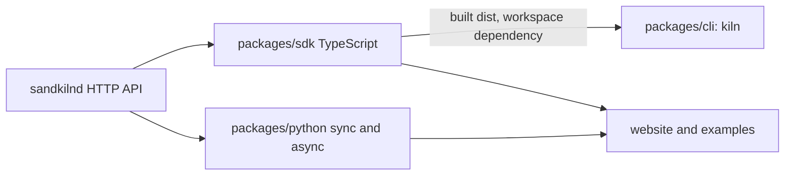
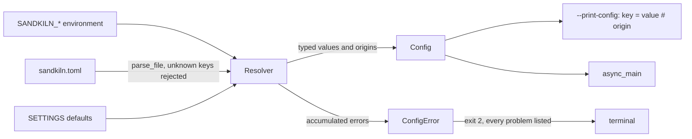
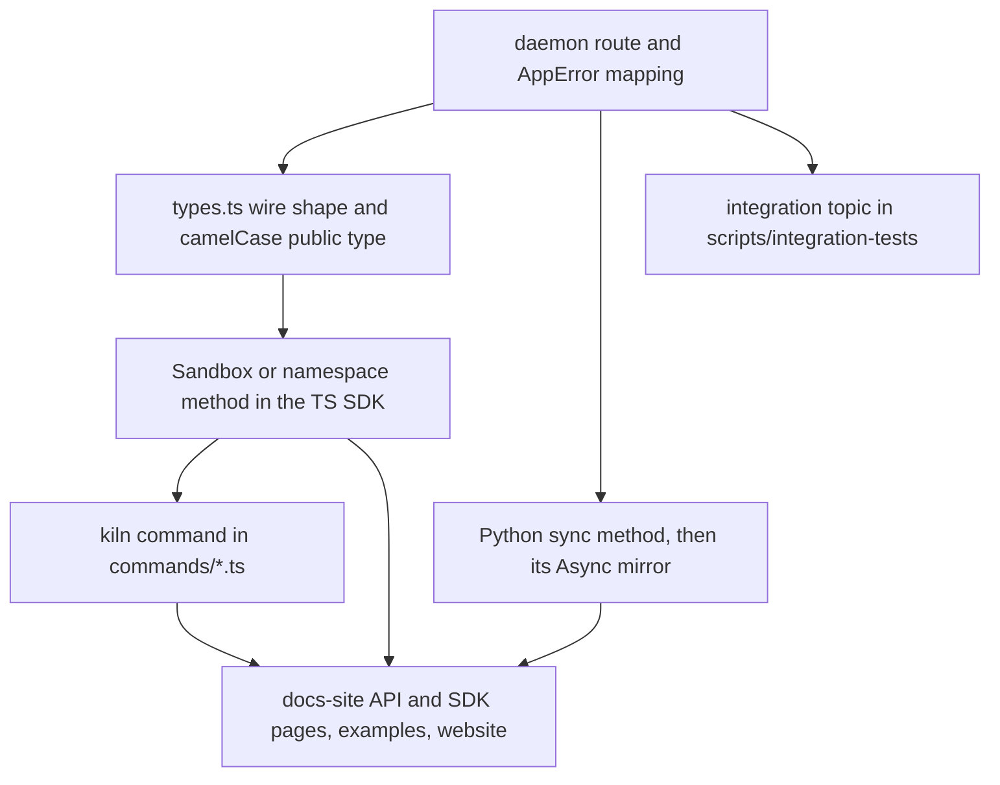

The daemon is the only place sandkiln logic lives. The three client packages (`packages/sdk` for TypeScript, `packages/python`, and `packages/cli`) are deliberately thin: they never implement behavior the daemon does not already have, and a new capability goes into the daemon first. What remains for the clients to get right is narrow but easy to get subtly wrong: configuration fallback, error shape, wire-format translation, and keeping three surfaces in step. This post describes how that is structured and how a change flows through all of it.



## Daemon configuration

The daemon's configuration is one registry, one resolver and one error type, in `core/crates/daemon/src/config/`:

| File | Role |
| --- | --- |
| `settings.rs` | `SETTINGS`: the registry. One `Setting` per key (32 of them) with its default, group, doc string and a `secret` flag |
| `source.rs` | `Resolver`: looks a key up, remembers where each value came from, accumulates errors; `parse_file` for the TOML body |
| `mod.rs` | `Config` (the typed result), `Config::load`, `Config::resolve`, `ConfigError`, `discover_file`, `render_effective` |
| `cli.rs` | The `sandkilnd` flags |

The registry is the single source of truth. A `Setting` has a config-file key such as `idle_timeout_secs`, and its environment variable is derived from it, always `SANDKILN_` plus the upper-cased key (`SANDKILN_IDLE_TIMEOUT_SECS`), so there is no second table of names to keep in step. The same table drives value lookup, unknown-key detection in the file, `--print-config`, and the generated reference (`sandkilnd --config-reference` prints a Markdown table per group), so the documented defaults cannot drift from the real ones. The groups are server, vm, storage, network, lifecycle and jailer.



### The `kernel_args` setting

`kernel_args` (group `vm`, environment variable `SANDKILN_KERNEL_ARGS`, default empty) holds extra guest kernel command-line arguments. The registry doc string reads "Extra guest kernel command-line arguments, appended after sandkiln's own. Quieting kernel boot logging (the serial console is emulated) shortens time to first command." The daemon stores it as `Config::kernel_args` (`core/crates/daemon/src/config/mod.rs:130`) and passes it to every boot as `VmConfig::extra_boot_args` (`core/crates/daemon/src/http/routes/sandbox.rs:363`).

The value is appended after sandkiln's own defaults, `quiet loop.max_loop=1`, so it wins on a conflict. Setting `kernel_args = "loglevel=7"` brings the boot logs back in the console log. See [Guest boot time](/engineering/28-opt-guest-boot-time) for what the defaults cost and save.

### Precedence and failure behavior

Each value resolves in a fixed order: environment variable, then the config file, then the registry default (`Resolver::raw`). A set-but-empty environment variable counts as unset, so `export SANDKILN_VCPU_COUNT=` falls through to the file instead of silently shadowing it. The resolver records an `Origin` (`default`, `file` or `env`) per key, which is what `--print-config` shows next to each value.

Nothing in this path panics on bad input. Every problem is pushed onto the resolver's error list, and `Config::resolve` returns them together as one `ConfigError`, so a single startup attempt reports everything that is wrong:

- a number that does not parse (`SANDKILN_VCPU_COUNT must be a number, got lots`);
- a `bridge_gateway` that is not an IPv4 address;
- `vcpu_count` above `max_vcpu_count`, or `mem_size_mib` above `max_mem_size_mib`, because the daemon's own default would then be rejected;
- `auto_suspend_timeout_secs` not strictly less than `idle_timeout_secs` when both are set;
- an `exec_timeout_secs` of 0;
- an unknown key in the file, with a nearest-key hint (`unknown key vcpu_cuont (did you mean vcpu_count?)`), using a small edit-distance match over the registry;
- a non-scalar TOML value, or a file that is not valid TOML, with the file path prefixed to each message.

Two numeric conventions are shared by every timeout: unset or `0` disables an optional timeout, and a leading `~/` in a path expands against `HOME` (an error if `HOME` is unset). A file that contains `auth_token` and is readable by group or others loads, but produces a warning telling the operator to run `chmod 600`; the warning goes to the log and to `--check-config`. The token is redacted in `--print-config` output.

### Where the file is found, and the flags

`sandkilnd` looks for its file in this order: `--config <file>`, then `$SANDKILN_CONFIG`, then `./sandkiln.toml`, then `$XDG_CONFIG_HOME/sandkiln/sandkiln.toml` (default `~/.config/sandkiln/sandkiln.toml`). The first one found is used and nothing is merged across files; an explicit path that cannot be read is an error, not a silent fall-through. The flags, hand-parsed in `config/cli.rs` because there are six and a dependency would cost more than it saves:

| Flag | Effect |
| --- | --- |
| `--config <file>` | Use this file |
| `--check-config` | Validate and exit 0, or 2 with every error; prints warnings |
| `--print-config` | Print every effective setting with its origin, secrets redacted |
| `--config-reference` | Print the settings reference as Markdown |
| `--help`, `--version` | As named |

`main.rs` handles all of these before it raises capabilities or builds the runtime, so they work for an unprivileged user and never start a daemon (see post 08).

`sandkiln.example.toml` at the repository root lists every setting with its default and its doc line, commented out. A unit test (`example_file_covers_every_setting_and_is_valid_when_fully_uncommented` in `config/mod.rs`) includes the file at compile time, asserts that every registry key appears in it, uncomments it, and requires the result to resolve into a valid `Config`. Adding a setting to the registry without documenting it in the example fails the build's tests, and so does an example value the loader would reject.

### Scripts read the daemon's answer, not their own copy

Shell scripts used to carry their own copies of the defaults. They now ask the daemon. `scripts/lib/daemon-config.sh` runs `sandkilnd --print-config`, parses the `key = value  # origin` lines into an associative array (`load_daemon_config`), and offers `cfg <key> [fallback]` and `find_config_file` (`$SANDKILN_CONFIG`, else `sandkiln.toml` at the repository root). `scripts/sandkilnd-ctl.sh` uses it to find the health URL from the effective `listen_addr`, passes the discovered file to the daemon with `--config`, and runs `--check-config` before starting, so an invalid configuration fails on the terminal with the real error and not as a daemon that dies with a log line. `scripts/preflight-check.sh` uses it for the effective paths and token presence, falling back to its literals only when no binary has been built yet. `scripts/setup.sh` writes a `sandkiln.toml` (only when none exists, with mode 600 through `umask 077`, so a hand-edited file is never clobbered) containing the paths it discovered; a legacy `.env.sandkiln-setup` is set aside as `.migrated`.

Two design points are visible from the outside. First, the jailer switch is an operator decision made at daemon start, not a per-request override: a client cannot ask for less isolation. Second, the clients use a *different* small set of variables, listed next, because they describe how to reach the daemon, not how to run it. The one variable both sides read is `SANDKILN_AUTH_TOKEN`.

## The shared client contract

All three clients implement the same minimal contract.

**Two settings.** A base URL and an optional bearer token. Resolution order is the same in both SDKs: an explicit option, then an environment variable, then (for the URL) a default.

| Setting | Explicit option | Environment fallback | Default |
| --- | --- | --- | --- |
| Base URL | `baseUrl` / `base_url` | `SANDKILN_DAEMON_URL` | `http://127.0.0.1:7777` |
| Auth token | `authToken` / `auth_token` | `SANDKILN_AUTH_TOKEN` | none |

The TypeScript implementation also guards against runtimes where `process` does not exist, so the SDK can load in a browser bundle:

```ts
export function resolveBaseUrl(baseUrl?: string): string {
  const chosen = baseUrl ?? readEnv("SANDKILN_DAEMON_URL") ?? DEFAULT_BASE_URL;
  return chosen.endsWith("/") ? chosen.slice(0, -1) : chosen;
}
```

(`packages/sdk/src/config.ts:3`.)

The Python version is the same logic (`packages/python/src/sandkiln/_config.py:8`), with one visible difference: it uses `or` rather than `??`, so an empty string falls through to the next source in Python but is kept in TypeScript. Both strip a trailing slash so path concatenation is uniform. The CLI forwards its own `--base-url` and `--token` flags into the SDK, and when they are unset it falls through to the SDK's environment resolution rather than reading the environment itself.

**One error type.** The daemon returns `{"error": "<message>"}` with a status code for every failure. Each client turns a non-2xx response into a `SandkilnApiError` carrying the status and message, with a fallback to the HTTP status text when the body is not JSON, which happens when a proxy sits in front of the daemon:

```ts
if (!response.ok) {
  throw new SandkilnApiError(response.status, await extractErrorMessage(response));
}

if (response.status === 204) {
  return undefined as T;
}
```

(`packages/sdk/src/http.ts:28`.)

An empty body, including a 204, resolves to `undefined` (`None` in Python). The Python transport also maps a network failure to `SandkilnApiError(0, "could not reach ...")` (`packages/python/src/sandkiln/_http.py:33`), so a caller handles both kinds of failure through one exception type. The TypeScript client lets a failed `fetch` propagate as the runtime's own error.

**One call site per transport.** The TypeScript SDK has exactly one `fetch` call (`http.ts`), and the Python SDK has one `urllib.request` call (`_http.py`) plus one `asyncio.open_connection` call (`_http_async.py`). Everything else builds a request body, calls it, and reshapes the response. That makes auth header handling, content-type, and error mapping impossible to forget on a new method.

### Wire format and public shapes

The daemon speaks `snake_case` JSON. `types.ts` in the TypeScript SDK holds the wire shapes exactly as the daemon sends them, and the public types (`ExecResult`, `SandboxInfo`, `ImageInfo`) translate to `camelCase`. The Python SDK uses Python-idiomatic names (`run_command`) with dataclasses. Translation lives at the edge so the daemon never has to adapt to a client's naming convention.

## The TypeScript SDK

The package is a set of small modules:

| Module | Role |
| --- | --- |
| `sandbox.ts` | The `Sandbox` class, the large surface |
| `image.ts`, `drive.ts`, `pool.ts` | Static-only namespaces with no instance state |
| `client.ts` | `ClientContext` and `resolveClient`, shared base URL and token resolution |
| `http.ts` | The single `fetch` call site |
| `config.ts`, `base64.ts` | Environment fallback and base64, each guarding for missing runtime globals |
| `errors.ts` | `SandkilnApiError` |
| `tunnel.ts` | Node-only local tunnel, loads `node:net` dynamically |

`Sandbox` has a private constructor holding an id and a `ClientContext`. Creation goes through static factories (`create`, `attach`, `list`, `resume`, `fork`, `byName`, `getOrCreate`) so that a `Sandbox` value always means "an id plus where to reach the daemon":

```ts
static attach(id: string, options: SandboxOptions = {}): Sandbox {
  return new Sandbox(id, resolveClient(options));
}
```

(`packages/sdk/src/sandbox.ts:86`.)

`attach` makes zero network calls by design. It exists for a fresh process that only has an id, which is the CLI's situation on every invocation, so adding validation that required a round trip would break that use. A bad id fails on the first real call with a 404.

Operations that act on an existing sandbox (`runCommand`, `stop`, filesystem calls) are instance methods. Operations that do not (`resume`, `fork`, `byName`) are static, since there is no live handle to call them on. `stop()` returns `{ kept, snapshotId }` because the daemon preserves a stopped sandbox by default, and `{ keep: false }` selects destroy. `previewUrl` is pure and network-free: it builds a URL and appends the token as `?token=`, because a browser tab cannot set a header.

`pty` and `attachLogs` return a native `WebSocket` rather than awaiting a result, since they are live streams. They throw a clear error if no `WebSocket` exists rather than adding a `ws` dependency, which keeps the package at zero runtime dependencies.

Pools show the "thin client" rule in a clean form. There is a `Pool.create`, `list` and `delete`, and no "claim" method, because the daemon claims transparently when a plain create matches a configured pool (see the pre-warmed pools post). A client method for something the daemon does not expose as an endpoint would be a fake surface, and the project rules forbid it.

## The Python SDK

The Python package declares `dependencies = []` and `requires-python = ">=3.9"` (`packages/python/pyproject.toml`). It uses only the standard library: `urllib` for the synchronous transport and `asyncio` streams for the asynchronous one. This mirrors the TypeScript choice of native `fetch`.

### Two hierarchies, not one

The package ships `Sandbox`, `Drive`, `Image` and `Pool` for synchronous use, and `AsyncSandbox`, `AsyncDrive`, `AsyncImage` and `AsyncPool` for `asyncio`. They are separate class hierarchies rather than sync and async methods on one class. The stated reason in the package's notes is that a synchronous call inside an async function blocks the event loop silently, with no exception, which is worse than an `AttributeError` from importing the wrong class. The async classes re-export the pure data and body-building helpers from the sync modules (`DriveAttachment`, the rate-limit and egress builders) instead of duplicating them, since those have nothing synchronous in them.

The rule between the two is a mirror rule: change a sync method, change its async twin the same way.

### Hand-rolled HTTP and WebSocket

`_http_async.py` hand-rolls a minimal HTTP/1.1 client over `asyncio.open_connection`, with one connection per request and no keep-alive, since the SDK's calls are occasional rather than high-throughput. It is the same shape `sandkiln-vmm` hand-rolls in Rust for Firecracker's API socket.

The tunnel feature needs a WebSocket, and the standard library has no client. `tunnel.py` implements the RFC 6455 handshake and framing directly:

```python
def _expected_accept(key: str) -> str:
    return base64.b64encode(hashlib.sha1((key + _WS_GUID).encode("ascii")).digest()).decode("ascii")
```

(`packages/python/src/sandkiln/tunnel.py:33`.)

That function computes the `Sec-WebSocket-Accept` value, and the handshake compares it against the server's reply. Client frames are always masked, as the RFC requires, and never fragmented. The reader is intentionally not fragmentation-aware: every payload either side sends in this protocol is small (at most an 8 KiB chunk), so a minimal reader is correct for this specific protocol. The handshake was checked against the RFC's own published test vector (key `dGhlIHNhbXBsZSBub25jZQ==` gives accept `s3pPLMBiTxaQ9kYGzzhZRbK+xOo=`), as recorded in the docs-site tunnel page and the package notes. I could not find that vector as a committed automated test, so it is a documented review check rather than a regression test, and the only unit test in the package directory today covers the preview URL.

The async tunnel, `atunnel.py`, imports every pure encode, decode and handshake helper from `tunnel.py` and only reimplements the I/O (a blocking socket on a background thread versus an `asyncio` task). The pattern is the same as everywhere else in the package: share what is pure, duplicate only what is transport.

The binary multiplexing frame that rides on top of the WebSocket (an `op` byte, a connection id length, the connection id, then a payload; operations `open`, `data` and `close`) is shared by three implementations: the daemon's tunnel route, `tunnel.ts` and `tunnel.py`/`atunnel.py`. The package notes are explicit that changing the format means changing all three.

### A real compatibility constraint

Every Python file starts with `from __future__ import annotations`. The reason is a bug that already happened: a method named `list` on `Sandbox` shadowed the builtin used in another method's `list[str]` annotation, which crashed at import time on Python versions that evaluate annotations eagerly, and did not reproduce on a version that defers them. The import is required for 3.9 compatibility and is the thing that CI on an older interpreter catches.

## The kiln CLI

`kiln` is a `commander` program that wraps the TypeScript SDK and has essentially no logic of its own. It is published to npm as `sandkiln-cli` (the name `kiln` is taken by an unrelated package) and installs a `kiln` binary through the `bin` field of its `package.json`.

Structure:

- `index.ts` builds the program with the global `--base-url` and `--token` options, calls `registerSandboxCommands`, `registerImageCommands`, `registerDriveCommands` and `registerPoolCommands`, and runs `parseAsync` with a catch-all so an escaped error prints a clean message rather than a stack trace.
- `commands/shared.ts` holds `clientOptions` (resolving global flags via `optsWithGlobals`), `fail`, and `handleApiError`, which prints `error: <message> (status N)` for a `SandkilnApiError` and exits 1.
- `commands/sandbox.ts` is the large group. Each subcommand is a thin call into a `Sandbox` static or into `Sandbox.attach(id)`, using a local `attachSandbox` helper.
- `format.ts` is the logic pulled out for testing without loading `commander`'s argv parsing: tag parsing and list formatting. It is built as its own banner-less bundle entry so tests can import it.

The CLI depends on the SDK's built `dist/`, not its source, so a public SDK change breaks the CLI build until the SDK is rebuilt. That is an expected property of a workspace dependency, not a CLI bug.

### The `--` gotcha

`kiln sandbox exec` passes its command and arguments through `commander`'s own option parser, so an argument that starts with `-` is parsed as a `kiln` flag. The user-facing fix is to put `--` before the command:

```bash
kiln sandbox exec <id> python3 -c "print(1)"
# error: unknown option '-c'

kiln sandbox exec <id> -- python3 -c "print(1)"
```

(From the CLI guide in the docs site.) This is a property of how `commander` handles variadic arguments, so the CLI documents it instead of papering over it. A related behavior: a failed guest command does not make `kiln` fail. `exec` reports the command's real exit code as a normal result.

Other CLI notes worth knowing: `pty` puts the terminal in raw mode so Ctrl+C reaches the remote shell, `tunnel` stays in the foreground until Ctrl+C or SIGTERM and closes the handle on exit, and `exec-stream` and `logs` derive an exit code from the daemon's bracketed exit notice in the output.

## The change chain

The project's rule is that a new capability is not done until every layer it touches is updated:

```text
protocol -> guest agent -> VMM -> daemon -> HTTP API -> JS SDK -> Python SDK
  -> CLI -> website -> examples -> tests -> documentation
```



Concretely, adding a hypothetical `POST /sandboxes/:id/foo` means:

1. The daemon gets a handler in its own file under `http/routes/`, a route registered in `http/mod.rs` under the right auth layer, a setting in the registry if it needs one (with an entry in `sandkiln.example.toml`), a validated request body, and an `AppError` for each failure.
2. The TypeScript SDK gets a wire type, a public type if the shape differs, and a method that calls `request()` with the right path.
3. The Python SDK gets the same method, then the same method on the async mirror, with the same names, arguments and return values.
4. The CLI gets a command that calls the SDK method and prints the result.
5. An integration topic exercises the real endpoint.
6. Documentation, the website feature grid and any example are updated in the same change, with any feature that is deliberately deferred marked planned instead of implied done.

Skipping a layer leaves the feature "started" rather than "done", and the cost is silent drift: the Python package's notes say the two SDKs should never differ in capability.

## The integration suite

`scripts/integration-test.sh` is the runner. Each topic is a numbered file in `scripts/integration-tests/` (`00-health.sh` through `25-long-running-commands.sh`), and each runs in its own subshell, concurrently with the others. The default parallelism is 4, adjustable with `SANDKILN_INTEGRATION_TEST_PARALLELISM`, and `SANDKILN_INTEGRATION_TEST_ONLY=<substring>[,<substring>...]` runs only the topic files whose names contain one of the substrings. The suite totals about 320 checks across 25 topics. Shared helpers in `scripts/lib/integration-test-helpers.sh` provide the vocabulary: `req` issues a request, `assert_status`, `assert_eq`, `assert_contains` and `assert_not_contains` check results, and `section` titles a topic.

```bash
status="$(req GET /metrics)"
assert_status "GET /metrics (unauthenticated, even with auth on)" 200 "$status"
metrics_body="$(cat "$WORKDIR/resp.json")"
assert_contains "metrics include sandboxes_active" "$metrics_body" "sandboxes_active"
```

(`scripts/integration-tests/00-health.sh`.)

Concurrency drives two rules for writing a topic. A topic must not depend on another topic's leftover state, since order is not guaranteed. And a topic must compare exact id sets for the resources it created rather than a global count, because concurrent topics make any global count flaky; the pool topic is the reference for this. Each topic tracks what it creates and the runner tears everything down on exit, pass or fail.

The topic files map onto features rather than layers: lifecycle, resource overrides, rate limiting, request id, error cases, drives, images, snapshots, preview, jailer, fork, named sandboxes, auth, filesystem operations, guest metadata, sandbox history, PTY, pool, egress, snapshot lineage, time-travel restore, mounts, exec-stream logs, env vars and long-running commands (a command silent past the control-plane bound running exactly once, the sandbox lock not held across a call, and snapshot latency). A new HTTP-facing feature adds a topic, or extends the matching one.

Unit tests for pure client logic sit next to the packages: `test/previewUrl.test.js` for the TypeScript SDK, `test/format.test.js` for the CLI, and `tests/test_preview_url.py` for Python, all with no added dependency beyond `node:test` or `unittest`. Everything else in a client needs a live daemon, and the notes say typechecking and building are necessary but not sufficient: this SDK's real bugs have typechecked cleanly and shown up only against a running `sandkilnd`.

The daemon's own `cargo test --workspace` suite (340 tests as of 2026-11-24, 222 of them in the daemon, including the config tests) covers pure logic with no KVM, and the integration suite covers the whole wired system. The two are complementary, and neither replaces running a real daemon.
