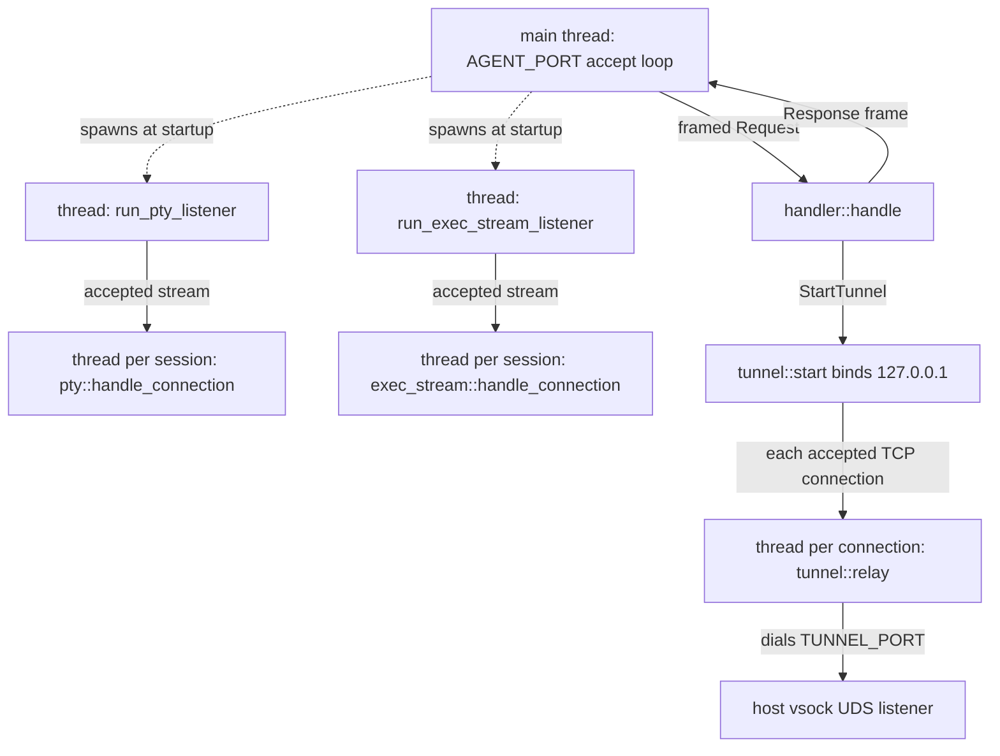
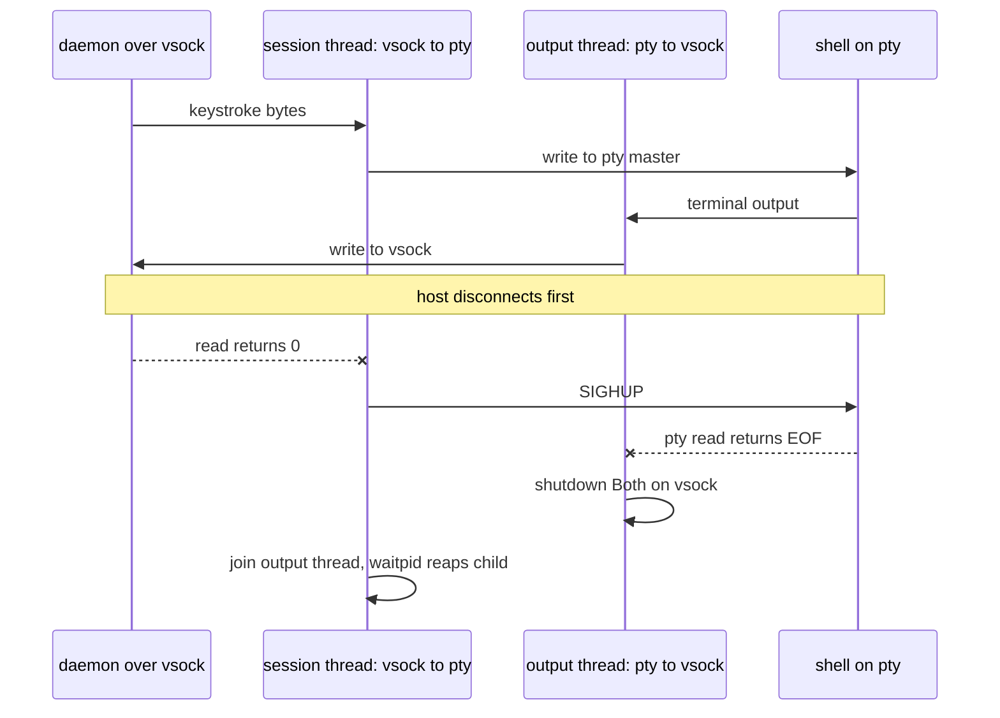
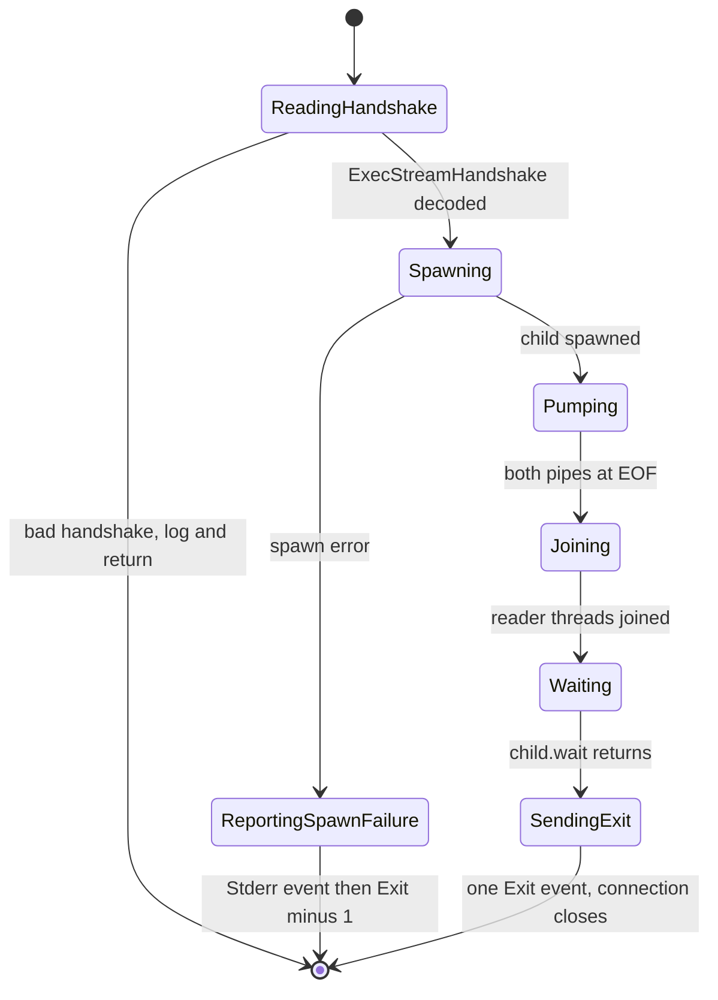

Every other crate in the workspace runs on the host. `sandkiln-guest-agent` is the exception: it is compiled to a static `x86_64-unknown-linux-musl` binary named `sandkiln-agent`, baked into the rootfs image, and started by systemd when the guest boots. From the moment the kernel finishes booting, this binary is the only way the daemon can run a command, read a file, open a shell, or stream logs.

That position shapes everything about the crate. It must be small, because it ships inside every rootfs and its size counts against image size and boot time. It must be boring, because a crash inside the guest is invisible until a vsock call times out. And it is deliberately a dumb executor: it does what a request says, scoped to whatever that resolves to inside one microVM, and leaves every policy decision to the host.

This post is the crate tour. The [vsock protocol and guest agent](/engineering/02-vsock-protocol-and-guest-agent) post covers the protocol view of the same code; the docs-site internals pages on [pty](https://sandkiln.mintlify.site/internals/pty), [exec-stream](https://sandkiln.mintlify.site/internals/exec-stream) and [local-tunnel](https://sandkiln.mintlify.site/internals/local-tunnel) cover the features built on it. Read the [system overview](/engineering/01-system-overview) first if the host-guest split is new to you.

## Public API surface

There is none, in the library sense. The crate has a single `[[bin]]` target and no `lib.rs`:

```toml
[[bin]]
name = "sandkiln-agent"
path = "src/main.rs"
```

(`core/crates/guest-agent/Cargo.toml:8-11`.) Its real interface is the set of vsock ports it listens on and the protocol it speaks on each. That surface is defined in `sandkiln-protocol`, not here:

| Port | Constant | This crate's role | Handler |
| --- | --- | --- | --- |
| 5000 | `AGENT_PORT` | Listens; framed request/response loop | `handler::handle` |
| 5001 | `PTY_PORT` | Listens; one framed handshake then raw bytes | `pty::handle_connection` |
| 5002 | `EXEC_STREAM_PORT` | Listens; one framed handshake then framed events | `exec_stream::handle_connection` |
| 5003 | `TUNNEL_PORT` | **Dials out** to the host, per accepted local connection | `tunnel::relay` |

The fourth row is the one inversion in the whole protocol. The agent does not listen on `TUNNEL_PORT`; it connects to the host (`VMADDR_CID_HOST`) each time something inside the guest connects to a tunnel's local TCP listener.

Dependencies are minimal and each is justified in `Cargo.toml`: `sandkiln-protocol` for the wire types, `vsock` 0.5 for the sockets, `base64` for file content, `libc` for exactly one syscall (`chown`), and `nix` for the pty work. The comments on `libc` and `nix` record the reasoning: `libc` is enough for one trivial call, while `forkpty`, `setsid` and the controlling-terminal dance are "multi-step, easy-to-get-subtly-wrong process-lifecycle code" that `nix` exists to get right. `nix` was already compiled in transitively through `vsock`, so naming it directly added nothing new.

The release profile is tuned for size. The workspace `Cargo.toml` enables `lto` and `strip` for release builds, and a per-package override sets `opt-level = "z"` for this crate alone, since host-side tooling should be optimised for speed and this binary for bytes.

## Module tour

Five source files, 637 lines in total.

| File | Lines | Responsibility |
| --- | --- | --- |
| `main.rs` | 83 | Three listeners, the framed request loop |
| `handler.rs` | 164 | One function per `Request` variant |
| `pty.rs` | 145 | `forkpty` shell session, byte shovelling, hangup handling |
| `exec_stream.rs` | 123 | Streamed background exec, framed output events |
| `tunnel.rs` | 122 | Guest-side TCP listener that relays to the host |

### main.rs: the thread topology

`main` starts the PTY and exec-stream listeners on their own threads, then runs the request/response accept loop on the main thread:

```rust
std::thread::spawn(run_pty_listener);
std::thread::spawn(run_exec_stream_listener);

let listener = VsockListener::bind_with_cid_port(VMADDR_CID_ANY, AGENT_PORT).expect("bind vsock listener");

for conn in listener.incoming() {
    match conn {
        Ok(stream) => handle_connection(stream),
        Err(e) => eprintln!("accept error: {e}"),
    }
}
```

(`core/crates/guest-agent/src/main.rs:19-29`.) Note what is not here: the `AGENT_PORT` loop calls `handle_connection` inline, with no thread per connection. One agent connection is served to completion before the next is accepted. That is a deliberate simplicity trade for the short exec and file-op calls it carries, and it is exactly why long-running or interactive work has its own ports where each session gets its own thread.



The listener loops bind with `.expect(...)`. If a bind fails the process panics and systemd restarts it (the injected unit file uses `Restart=always`, verified in `images/inject-agent.sh`). That is the right failure mode for a service whose only job is to be reachable.

The `AGENT_PORT` loop itself is five lines of logic:

```rust
fn handle_connection(mut stream: impl Read + Write) {
    while let Ok(raw) = read_message(&mut stream) {
        let response = match decode_request(&raw) {
            Ok(req) => handler::handle(req),
            Err(e) => Response::Error { message: format!("bad request: {e}") },
        };
        // encode + write_message, break on failure
    }
}
```

(`core/crates/guest-agent/src/main.rs:64-72`, with the encode and write tail elided.) It is generic over `Read + Write`, not tied to `VsockStream`, which is what makes it testable in principle. A frame that fails to decode becomes an in-band `Response::Error` and the loop continues. The loop only ends when `read_message` fails (the host disconnected), when serialising a response fails, or when the write fails.

### handler.rs: thin wrappers

`handler::handle` is a single `match` with one arm per `Request` variant, each delegating to a small function over `std::process::Command` or `std::fs`. The match is exhaustive, so a new `Request` variant in the protocol crate is a compile error here until it is implemented.

```rust
fn exec(command: &str, args: &[String], env: &std::collections::HashMap<String, String>) -> Response {
    match Command::new(command).args(args).envs(env).output() {
        Ok(out) => Response::Exec {
            stdout: String::from_utf8_lossy(&out.stdout).into_owned(),
            stderr: String::from_utf8_lossy(&out.stderr).into_owned(),
            exit_code: out.status.code().unwrap_or(-1),
        },
        Err(e) => Response::Error { message: e.to_string() },
    }
}
```

(`core/crates/guest-agent/src/handler.rs:31-40`.) Three details matter. `.envs(env)` adds to the inherited environment rather than replacing it. Output is decoded with `from_utf8_lossy`, so invalid UTF-8 is replaced rather than failing the call; callers who need exact bytes use `read_file` or the streamed path, which base64-encodes. And `exit_code` is `-1` when the process was killed by a signal and so has no code.

A failure to even spawn the command (no such binary) is `Response::Error`, not an `Exec` with a nonzero code. The two outcomes are distinguishable on the wire.

The one non-`std` call is `chown`, which goes through `libc::chown` behind a `CString` conversion; the `unsafe` block carries a `SAFETY` comment and the error path returns `std::io::Error::last_os_error()`. `list_dir` masks file-type bits off `st_mode` with `mode & 0o7777` so the reported `mode` round-trips into `Chmod`. A directory entry that vanishes between `readdir` and `stat` is reported with zeroed metadata rather than dropped, so the caller still sees the name.

There is no path validation in this file, on purpose. A path means whatever it resolves to inside this one microVM's own filesystem, and the microVM is the isolation boundary. Validating here would imply the guest is a trust boundary, which it is not. Server-boundary validation lives in the daemon, as the root `AGENTS.md` requires for things the host owns.

### pty.rs: sessions and the hangup rule

A PTY connection reads one `PtyHandshake`, calls `forkpty` sized to it, and then shovels bytes between the vsock stream and the pty master until either side ends. The child branch does nothing before `exec` except choose a shell:

```rust
fn exec_shell() -> ! {
    let shell = if std::path::Path::new("/bin/bash").exists() { "/bin/bash" } else { "/bin/sh" };
    let err = Command::new(shell).exec();
    eprintln!("pty: exec {shell} failed: {err}");
    std::process::exit(1);
}
```

(`core/crates/guest-agent/src/pty.rs:76-81`.) Bash is preferred but never assumed, because a registered custom image might not ship it. The `forkpty` call is `unsafe`, and the comment states the contract being relied on: the child does no risky allocation before `exec`, the same pragmatic pattern terminal emulators use around `forkpty`'s stricter-than-enforced async-signal-safety rules.

The interesting part is `shovel_bytes`. It `try_clone`s both the stream and the pty fd so one thread can copy each direction. The trap is that the clones are handles to the same socket, so dropping one when a thread exits does not close the connection: the kernel keeps it open while any fd references it, leaving the other thread blocked in `read()` forever. The fix is to unblock explicitly in both cases:

- **Shell exits first** (pty read returns EOF): the output thread calls `shutdown(Shutdown::Both)` on the vsock socket (`pty.rs:126`), which makes the blocked input read return.
- **Host disconnects first** (vsock read returns EOF): the main session thread sends `SIGHUP` to the shell (`pty.rs:142`), as a real terminal hangup would, so it terminates instead of running orphaned.



After the shovel returns, `handle_connection` calls `waitpid(child, None)` so no zombie is left behind. No concurrent-session cap exists in this file; the module comment records that the cap is a daemon concern, since the daemon already manages each session's WebSocket lifecycle.

### exec_stream.rs: one writer, wait last

A streamed exec connection reads an `ExecStreamHandshake`, spawns the command with stdin null and stdout/stderr piped (no controlling terminal, unlike a pty), then emits `ExecStreamEvent`s. Two ordering rules are encoded in `pump_and_wait`:

```rust
let (tx, rx) = mpsc::channel::<ExecStreamEvent>();

let stdout_tx = tx.clone();
let stdout_thread = thread::spawn(move || pump_reader(stdout, stdout_tx, true));
let stderr_thread = thread::spawn(move || pump_reader(stderr, tx, false));

for event in rx {
    if send_event(&mut stream, &event).is_err() {
        break;
    }
}
```

(`core/crates/guest-agent/src/exec_stream.rs:87-97`.) Each pipe is read on its own thread, because either can fill and block if read sequentially. Both threads send into one channel, and only the connection thread ever writes to the stream, so two events' framing can never interleave and no writer lock is needed. The second rule is in what comes after: both reader threads are joined first, and only then is `child.wait()` called. Waiting first risks a deadlock when the child is blocked writing to a pipe nobody is draining yet.



A spawn failure still honours the contract that a stream ends with exactly one `Exit`: the agent sends a `Stderr` event naming the failed command, then `Exit { exit_code: -1 }`.

### tunnel.rs: the registry and the self-connect

`tunnel::start` binds a `TcpListener` on `127.0.0.1:guest_port` and returns once the bind succeeds, so a port-in-use error reaches the caller synchronously as an `Err` that becomes `Response::Error`. Accepting happens on a background thread. A process-wide registry (`OnceLock<Mutex<HashMap<...>>>`) tracks active tunnels by id.

`stop` has a quirk forced by `std`: there is no non-blocking cancel for `TcpListener::accept`.

```rust
pub fn stop(tunnel_id: &str) {
    let Some(handle) = registry().lock().unwrap().remove(tunnel_id) else { return };
    handle.stop.store(true, Ordering::SeqCst);
    let _ = TcpStream::connect(("127.0.0.1", handle.port));
}
```

(`core/crates/guest-agent/src/tunnel.rs:53-61`, comment trimmed.) Setting a flag and then connecting to its own listener unblocks the `accept`; the loop sees the flag and discards the connection. Stopping an already-gone tunnel is a no-op returning `Response::Ok`, since the daemon may call it during cleanup without knowing whether the guest already tore it down. Each relayed connection reuses `pty.rs`'s lesson: both copy loops end with `shutdown(Shutdown::Both)` to unblock their sibling.

## Key invariants

**One writer per stream.** In `exec_stream.rs` a single thread writes. In `pty.rs` and `tunnel.rs` each direction has exactly one thread. No code path has two threads writing the same stream.

**Every long-lived session ends cleanly in both directions.** The `shutdown(Shutdown::Both)` and `SIGHUP` rules above exist because the failure mode of getting it wrong is a leaked thread and a leaked process, invisible from the host.

**Streams end with exactly one `Exit`.** Including the spawn-failure path.

**No state crosses connections** except the tunnel registry. The agent has no cap, no session table, and no cache. The host owns counts and policy.

## Error model

The agent does not return Rust errors to anyone; it translates them. A failed operation becomes `Response::Error { message }` carrying the OS error text. A failed decode becomes `Response::Error { message: "bad request: ..." }`. A session-level failure (handshake unreadable, `forkpty` failing, clone failing) is logged to stderr with an `eprintln!` prefix (`pty:`, `exec-stream:`, `tunnel:`) and the thread returns, which closes the connection. The host sees that as an I/O error and its own retry and timeout logic decides what happens next.

The `eprintln!` lines are the guest-side diagnostics; this post does not verify where the systemd unit routes them, so treat their destination as unconfirmed rather than assuming they reach the host-captured console log.

## Test strategy

This crate has no `#[cfg(test)]` modules and `cargo test --workspace` reports zero tests for it. That is a real gap worth stating plainly, not a rounding error. What exists instead:

- **Protocol coverage lives upstream.** Every message the agent decodes or encodes is pinned by the 39 tests in `sandkiln-protocol`, so a wire-shape regression is caught there.
- **Manual end-to-end examples.** `core/crates/vmm/examples/exec_test.rs` and `file_test.rs` connect to a booted agent's vsock socket and run one command or file operation.
- **Integration topics against a real daemon.** `scripts/integration-tests/` includes `14-filesystem-ops.sh` (the file-operation requests), `17-pty.sh` (the pty path), `23-exec-stream-logs.sh` (streamed exec), `24-env-vars.sh` (the resolved `env` map), and `22-mounts.sh` (mounts, built from `WriteFile`, `Mkdir`, `Chmod` and `Exec`). There is no topic file dedicated to the local tunnel.

The repository's testing standard says to pull pure logic out of framework plumbing so it can be unit-tested. The agent's logic is almost all plumbing over syscalls, which is why coverage falls to live tests, but a few pieces are pure enough to test cheaply: `permission_bits`, the `handle_connection` loop (generic over `Read + Write`), and the in-band error translation. Those are the obvious next additions.

A change here also needs more than a build. The binary has to be built for the musl target and injected into a rootfs image (`scripts/dev.sh inject-agent`), because a rebuilt agent that is not in the image changes nothing.

## How neighbours consume it

The agent has exactly one consumer: the host. `sandkiln-vmm`'s `vsock_client` opens a fresh Unix-socket connection per `call`, sends `CONNECT <port>`, and speaks the framed protocol; `Vm::open_pty` and `Vm::open_exec_stream` open the long-lived shapes. The daemon builds `Request` values and never talks to the guest directly.

Two host behaviours directly affect how this crate must behave. The host bounds every blocking read and write on request/response calls with a 3 second timeout, so an `exec` that produces no response within that window fails on the host side even though the guest keeps running it (read from the code, as the docs-site page [the vsock timeout that could hang a stop](https://sandkiln.mintlify.site/architecture/bug-hunt-vsock-timeout) also notes). And the host retries connections with backoff for up to five seconds, because the agent is not guaranteed to be listening the instant the VM starts.

## Design alternatives rejected

**A shared `AGENT_PORT` for everything.** Interactive and streamed sessions would block the single-connection request loop for as long as they live, so they get their own ports and a thread each.

**A session cap in the guest.** Rejected in the module comments of both `pty.rs` and `exec_stream.rs`: the daemon already tracks each session and can enforce a per-sandbox limit with no cross-connection state here.

**Path validation in the guest.** Rejected as described above: the microVM is the boundary, and pretending otherwise would add code without adding safety.

**`nix` for `chown`.** Rejected in favour of one `libc` call. `nix` is used where the lifecycle logic is genuinely subtle, which is the pty.

**Handling `AGENT_PORT` connections concurrently** (not done, and not rejected on record). The inline loop is simpler and sufficient for short calls, at the cost that one slow request delays the next.
