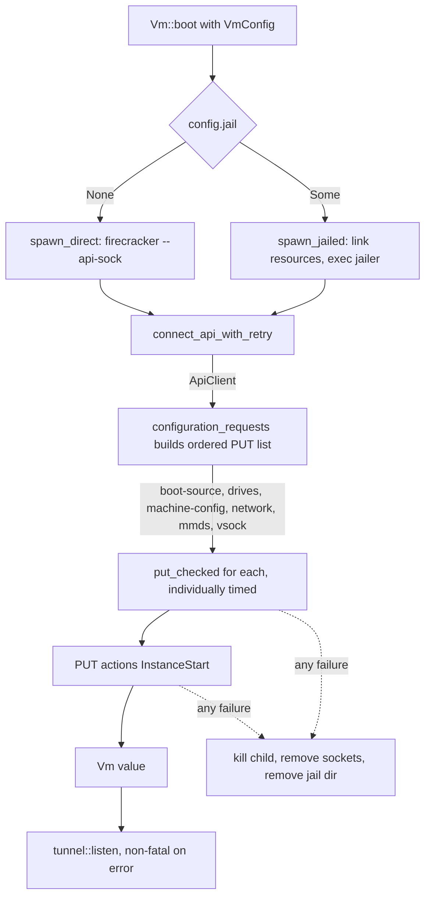
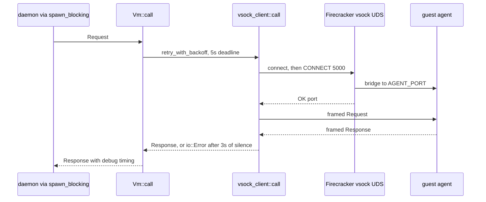
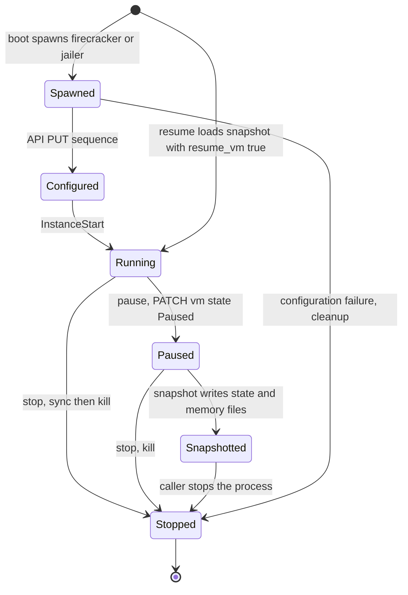

`sandkiln-vmm` is where sandkiln's host-side behaviour lives. The daemon is a thin HTTP wrapper over it: parse a request, call into this crate, shape a response. The crate's own `AGENTS.md` states the placement rule plainly. New VM-lifecycle behaviour belongs here, not in the daemon.

It is also deliberately synchronous. There is no async runtime dependency, every blocking call is plain `std`, and the daemon bridges into it with `spawn_blocking`. That one decision explains several others in this tour: why the Firecracker API client is hand-rolled, why the tunnel acceptor uses `std::sync::mpsc`, and why retries are simple sleep loops.

This post is the crate-level tour. [Driving Firecracker](/engineering/03-driving-firecracker) covers the boot sequence in depth, [the create path and rootfs](/engineering/04-create-path-and-rootfs) covers the clone, and [networking](/engineering/05-networking) covers the bridge. Here the focus is how the modules fit together, what each owns, and how they fail. Read the [system overview](/engineering/01-system-overview) first.

## Public API surface

`core/crates/vmm/src/lib.rs` is twelve lines: nine public modules and one private one.

```rust
pub mod drive;
pub mod egress;
mod firecracker_api;
pub mod image;
pub mod jailer;
pub mod network;
pub mod rootfs;
pub mod tunnel;
pub mod vm;
pub mod vsock_client;
```

(`core/crates/vmm/src/lib.rs:3-12`.) The one private module, `firecracker_api`, is an implementation detail of `vm`: a caller never talks to Firecracker's API directly, only through `Vm` methods. Everything else is public, and the daemon uses most of it.

| Module | Main public items | What it owns |
| --- | --- | --- |
| `vm` | `Vm`, `VmConfig`, `NetworkConfig`, `DriveConfig`, `RateLimiter`, `TokenBucket`, `ResumeConfig` | One microVM's process and lifecycle |
| `vsock_client` | `call`, `open_pty`, `open_exec_stream` | Host-side vsock connections to the guest agent |
| `network` | `NetworkManager`, `Lease`, `detect_default_iface` | Tap, bridge and IP leasing |
| `egress` | `EgressPolicy`, `EgressMode`, `apply`, `remove`, `validate_cidr` | Per-sandbox outbound firewall |
| `jailer` | `JailLaunch`, `JailerIdPool`, `build_jailer_args`, `link_resource_into_jail` | Chroot, cgroup and uid isolation |
| `rootfs` | `clone_file`, `CloneMethod` | Per-sandbox rootfs cloning |
| `drive` | `DriveStore`, `DriveInfo` | Persistent ext4 block devices |
| `image` | `ImageStore`, `ImageInfo` | Registered base rootfs images |
| `tunnel` | `register`, `unregister`, `listen`, `TunnelConnection` | Host acceptor for guest-initiated tunnel connections |

`Vm`'s public methods are the verbs the daemon uses: `boot`, `resume`, `is_jailed`, `call`, `open_pty`, `open_exec_stream`, `update_metadata`, `pause`, `snapshot`, `stop`, and `force_stop`. The type has no public fields. Its private fields are an id, the Firecracker `Child` handle, the API socket path, the vsock socket path, and an optional jail instance directory.

## Module tour

The crate is about 3,000 lines across 13 source files. The split follows the root `AGENTS.md` rule: files separate when they mix independently workable concerns.

`vm/boot.rs` and `vm/snapshot.rs` are submodules, not siblings, of `vm`. That is a visibility decision: they need to see `Vm`'s private fields, and keeping them in-tree lets those fields stay private while the public surface stays a short file.

### The boot path

`Vm::boot` allocates an id from a process-wide `AtomicU64`, derives a console log path from it, runs the boot, and annotates any failure with that log path. The mechanics live in `boot.rs`, where the direct and jailed paths converge early. Both produce a `BootTarget` holding the child process and the paths Firecracker must be told about, so the configuration sequence never branches on jail versus direct.



The ordered list is built up front by `configuration_requests` and then issued in a loop. That structure is what makes each PUT individually timeable (the debug event `vm boot phase breakdown` reports them) and keeps ordering constraints readable in one place. One of those constraints is called out at the call site: MMDS configuration must come after the network interface exists.

```rust
requests.push(("/mmds/config".to_string(), json!({ "network_interfaces": ["eth0"], "version": "V2" })));
requests.push(("/mmds".to_string(), metadata.clone()));
```

(`core/crates/vmm/src/vm/boot.rs:287-288`.) MMDS is configured as V2, the token-gated version, because a sandbox may run untrusted code that could otherwise reach an open metadata endpoint. Setting `VmConfig::metadata` without `VmConfig::network` is an error raised while building the list, after the process has spawned, so the failure path above kills it.

Cleanup on failure is explicit. If configuration or `InstanceStart` fails, `boot` kills and waits on the child, removes both sockets, and removes the jail instance directory:

```rust
let _ = target.child.kill();
let _ = target.child.wait();
let _ = std::fs::remove_file(&target.api_socket);
let _ = std::fs::remove_file(&target.vsock_socket);
if let Some(dir) = &target.jail_instance_dir {
    let _ = std::fs::remove_dir_all(dir);
}
return Err(e);
```

(`core/crates/vmm/src/vm/boot.rs:73-80`.) The comment above it names the stakes: a live orphaned process is a resource leak, and a half-built chroot with hard-linked kernel and rootfs copies is an information-disclosure surface. The same discipline applies in `spawn_jailed`, which removes the instance directory if linking or spawning fails partway.

### Retry and the "is it listening yet" race

Two races exist at every boot: the API socket is not accepting the instant the process spawns, and the guest agent is not listening the instant `InstanceStart` returns. Both use one helper:

```rust
fn retry_with_backoff<T>(
    timeout: Duration,
    initial_interval: Duration,
    max_interval: Duration,
    mut attempt: impl FnMut() -> io::Result<T>,
) -> io::Result<T> {
    let deadline = Instant::now() + timeout;
    let mut interval = initial_interval;
    loop {
        match attempt() {
            Ok(v) => return Ok(v),
            Err(e) if Instant::now() >= deadline => return Err(e),
            Err(_) => {
                std::thread::sleep(interval);
                interval = (interval * 2).min(max_interval);
            }
        }
    }
}
```

(`core/crates/vmm/src/vm/mod.rs:282-300`.) The API socket retry starts at 200 microseconds and caps at 5 ms; the vsock retry starts at 1 ms and caps at 20 ms, with a 5 second overall deadline. The doc comment records the history: before this helper there were two separate fixed-sleep loops, and the API-socket one measured a flat ~20.1 ms on every boot, more than half of a ~34 ms boot, because it was a quantized sleep rather than real waiting. `connect_api_with_retry` also retries the *connect*, not the existence of the socket file. The file appears at `bind()`, a moment before `listen()`, so an existence poll can win that race and then get `ECONNREFUSED`.

### Talking to the guest

`vsock_client` holds the host side of the protocol. Firecracker bridges guest vsock to a Unix domain socket: connect to the UDS, send `CONNECT <port>\n`, read `OK <port>\n`, and the rest of the connection is bridged to that guest port.

```rust
pub fn call(uds_path: &Path, guest_port: u32, request: &Request) -> io::Result<Response> {
    let mut stream = UnixStream::connect(uds_path)?;
    stream.set_read_timeout(Some(IO_TIMEOUT))?;
    stream.set_write_timeout(Some(IO_TIMEOUT))?;
    connect_handshake(&mut stream, guest_port)?;

    let payload = encode_request(request).map_err(to_io_err)?;
    write_message(&mut stream, &payload)?;

    let raw = read_message(&mut stream)?;
    decode_response(&raw).map_err(to_io_err)
}
```

(`core/crates/vmm/src/vsock_client.rs:27-38`.) Each call opens a fresh connection. `IO_TIMEOUT` is three seconds on both directions, applied at the transport, because a paused VM has halted vCPUs and a guest that never answers would otherwise hang a blocking read forever; the retry deadline only bounds the gap between attempts, not one that never returns. The `open_pty` and `open_exec_stream` variants apply the timeout only to the handshake and then clear it, since an idle terminal is not a hung connection. See [the vsock timeout that could hang a stop](https://sandkiln.mintlify.site/architecture/bug-hunt-vsock-timeout) for the story.



### Stop, force stop and teardown ownership

`stop` and `force_stop` both route through one private function that takes a boolean:

```rust
fn stop_inner(mut self, sync_first: bool) -> io::Result<()> {
    if sync_first {
        if let Err(e) = self.call(&Request::Exec { command: "sync".to_string(), args: vec![], env: HashMap::new() }) {
            tracing::warn!(vm_id = self.id, error = %e, "sync before stop failed, proceeding anyway");
        }
    }
    let _ = self.child.kill();
    let _ = self.child.wait();
    // remove sockets, tunnel socket, jail dir
```

(`core/crates/vmm/src/vm/mod.rs:211-221`, tail elided.) A bare `SIGKILL` loses unflushed page-cache writes to attached drives, so `stop` asks the guest to `sync` first, best-effort. `force_stop` skips that for a VM already known dead. Without it, a failed post-resume health check paid two 5 second timeouts back to back (about 10.3 s) instead of one (about 5.4 s), per the crate's `AGENTS.md`. Both consume `self`, so a stopped `Vm` cannot be reused: ownership makes "use after stop" a compile error.

`Vm` has no explicit state field. Its lifecycle is carried by which methods are valid and by Firecracker's own state:



The daemon, not this crate, decides that a snapshot is followed by `stop`. `Vm::resume` is an associated function that builds a brand-new `Vm` from a snapshot, which is why the diagram has a second entry point. It always spawns Firecracker directly: the jailer covers `Vm::boot` only, because a jailed snapshot bakes in in-jail paths that would need relinking. The daemon refuses to snapshot a jailed sandbox rather than half-support it, and `Vm::is_jailed` is how it knows.

### Network, egress and the jailer

`NetworkManager` hands out two things per VM: a tap device from a pre-created pool and a host octet from `2..=254` of a /24. The pool exists because creating a new tap device is a `TUNSETIFF` ioctl that needs real root, while the daemon runs with only ambient `CAP_NET_ADMIN`, which covers netlink operations on existing interfaces. `lease` is written to leave pools consistent on every failure path:

```rust
if let Err(e) = self.attach_tap(&tap_device) {
    self.free_hosts.lock().unwrap().push_back(host_octet);
    self.free_taps.lock().unwrap().push_back(tap_device);
    return Err(e);
}
```

(`core/crates/vmm/src/network.rs:128-132`.) If there is no free tap, the host octet already popped is pushed back; if attaching fails, both go back. `attach_tap` brings the link up, sets the bridge as master, and turns on bridge port isolation, which blocks sandbox-to-sandbox frames at layer 2. All three are `fork`+`exec` of `ip` or `bridge`, individually timed. `reserve` exists for the opposite problem: reconstructing a `Lease` for a tap held by a snapshot reconciled from disk at startup, so a later `lease` cannot hand the same tap to a second sandbox. `NetworkManager` deliberately does not track which sandbox holds which lease; the daemon owns that mapping.

`egress::apply` builds one iptables chain per sandbox and loads it with a single `iptables-restore --noflush` call. Rule order is deny, then allow, then the mode default, so first-match-wins makes deny beat allow on overlap with no special casing:

```rust
for cidr in &policy.deny_cidrs {
    restore_input.push_str(&format!("-A {chain} -d {cidr} -j DROP\n"));
}
for cidr in &policy.allow_cidrs {
    restore_input.push_str(&format!("-A {chain} -d {cidr} -j ACCEPT\n"));
}
```

(`core/crates/vmm/src/egress.rs:95-100`.) The crate's `AGENTS.md` records that batching took a six-CIDR policy from about 8.3 ms to about 3.1 ms. Rules match only `-o <uplink>` traffic, so gateway-bound DNS is structurally exempt. See [iptables and per-sandbox egress policy](https://sandkiln.mintlify.site/internals/egress-iptables).

The `jailer` module is mostly pure functions: path derivation, cgroup arithmetic, argument building, and one filesystem helper. `JailerIdPool` leases a distinct uid/gid per concurrent jailed VM from a fixed range, and its doc comment explains why collisions are a security bug rather than a bookkeeping one: two jailed VMs sharing a uid would let one guest's escaped process read the other's files. `link_resource_into_jail` hard-links a host file into the chroot (falling back to a copy across filesystems on `EXDEV`) and makes it world-readable rather than `chown`ing it, because a hard link shares an inode with its source and a `chown` would silently change the source's ownership too. Jailer boot is not yet proven on real hardware (see the [jailer privilege model](https://sandkiln.mintlify.site/internals/jailer-privilege-model)).

### Rootfs, drives and images

`rootfs::clone_file` tries a `FICLONE` ioctl and falls back to a byte copy, and it returns which one happened:

```rust
let rc = unsafe { libc::ioctl(dst.as_raw_fd(), FICLONE, src.as_raw_fd()) };
if rc == 0 {
    return Ok(CloneMethod::Reflink);
}
let err = io::Error::last_os_error();
match err.raw_os_error() {
    Some(libc::EOPNOTSUPP) | Some(libc::EXDEV) | Some(libc::EINVAL) | Some(libc::ENOTTY) | Some(libc::ENOSYS) => {
        io::copy(src, dst)?;
        Ok(CloneMethod::Copy)
    }
    _ => Err(err),
}
```

(`core/crates/vmm/src/rootfs.rs:56-70`.) The method is returned, never hidden, because a silent fallback is indistinguishable from "slow disk" in latency numbers, which is how an earlier benchmark was misread. The daemon records the method in a metric. The repository's `ROADMAP.md` records the measured effect on an XFS reflink volume: cold create 187 ms to 17.9 ms, with the rootfs clone itself going from 127.9 ms to 0.08 ms. No partial destination file is left on error, and an existing destination is refused.

`DriveStore` and `ImageStore` follow the same pattern: one `<id>.ext4` file per resource in a directory, the filesystem as the source of truth, no index to fall out of sync. Both validate ids as 1 to 64 characters of ASCII alphanumerics, hyphen and underscore, because an id becomes a filename (and for drives a Firecracker `drive_id`). `ImageStore::register` checks the ext4 superblock magic at byte 1080, copies through `rootfs::clone_file`, and verifies the copied size matches the source, since a near-full disk can truncate a copy silently. It cannot verify the guest agent is baked in (that needs a loop mount and root). See [managed images](https://sandkiln.mintlify.site/internals/images) and [persistent drives](https://sandkiln.mintlify.site/internals/drives).

## Error model

The crate returns `std::io::Error` everywhere. There is no crate-specific error enum, and that is deliberate: every failure here originates in I/O (a socket, a process, a file, an iptables spawn), and the daemon maps `io::Error` into its own `AppError::Internal` at the boundary. Where the kind carries meaning, it is chosen deliberately: `InvalidInput` for a bad id or size, `AlreadyExists` for a duplicate drive or image, `TimedOut` for an API socket that never accepted, `WriteZero` for a truncated image copy, `ConnectionRefused` for a failed vsock `CONNECT`.

Context is attached rather than lost. Firecracker API failures carry method, path, status and body (`firecracker API PUT /drives/rootfs -> 400: ...`). Boot and resume failures are annotated with the guest console log path, because a kernel panic before vsock comes up is otherwise invisible; the console output goes to `/tmp/sandkiln-fc-<id>.log` rather than being discarded.

Teardown is best-effort (`let _ =` on kills and removals) so a failed cleanup step cannot mask the original error or abort the rest. A tunnel listener that cannot bind logs a warning and boot still succeeds.

## Test strategy

66 tests run under `cargo test -p sandkiln-vmm`, none needing KVM or root:

| Module | Tests | What they cover |
| --- | --- | --- |
| `jailer` | 16 | Path conventions, id pool bounds and round trips, hard-link permission bits, cgroup arithmetic, jailer argv shape |
| `image` | 15 | Id validation, ext4 magic detection, register, list, delete and refusal cases |
| `drive` | 8 | Id validation, size minimum, create/exists/delete cycle against real `mkfs.ext4` |
| `vm/mod` | 7 | API connect retry (times out, connects, waits for a late listener), console log helpers |
| `network` | 7 | Pool shape, failed lease returning both resources, `reserve` semantics |
| `rootfs` | 5 | Content, independence after clone, no overwrite, no partial file, permissions |
| `egress` | 5 | CIDR validation, chain naming stays short |
| `firecracker_api` | 3 | Status line parsing |

Pure logic is extracted so it can be tested without a VM (`build_jailer_args`, `cgroup_limits`, `validate_cidr`, `looks_like_ext4`, `chain_name`, `parse_status_code`), and tests that need files use real temp directories, real `mkfs.ext4` and real hard links rather than mocks. The timeout test for `connect_api_with_retry` asserts both the `TimedOut` kind and that elapsed time is at least the timeout, because a backoff bug that exits early would otherwise look like a clean fast failure.

What the unit tests cannot cover is stated in the crate's `AGENTS.md`: nothing here proves a VM boots. The `examples/` directory (`exec_test.rs`, `file_test.rs`) and the criterion bench `benches/vm_lifecycle.rs` run against real Firecracker, and the full daemon integration suite is the real bar.

## How neighbours consume it

The daemon is the only production consumer. It calls `Vm::boot` from its cold-create path and `Vm::resume` from its resume and fork paths, `Vm::call`, `open_pty` and `open_exec_stream` from its exec, file, PTY and log routes, `update_metadata` after claiming a pre-warmed pool snapshot, and `force_stop` when a post-resume health check fails. It builds `VmConfig` and `ResumeConfig` itself, holds `NetworkManager`, `DriveStore`, `ImageStore` and `JailerIdPool` in its application state, and calls `rootfs::clone_file` and `egress::apply` around boot. Resource ownership follows from that: this crate creates and tears down the Firecracker process and chroot, the network manager owns the free pools, and the daemon owns the mapping from sandbox to lease and drive.

Downward, the crate depends on `sandkiln-protocol` for message types and framing, plus `libc`, `serde`, `serde_json` and `tracing`.

## Design alternatives rejected

**A full HTTP client for the Firecracker API.** Rejected in `firecracker_api.rs` and `AGENTS.md`: the surface is a handful of fixed-shape JSON PUT and PATCH calls over a Unix socket, not worth `hyper` and an async runtime.

**On-demand tap device creation.** Rejected because `TUNSETIFF` needs root and the daemon runs with ambient `CAP_NET_ADMIN` only. A pre-created pool turns a privileged operation into an unprivileged lease.

**A netlink library for `ip`, `bridge` and `iptables`.** Rejected: privileged operations run via `std::process::Command` to match the shell scripts exactly, and the `AGENTS.md` warns not to switch without understanding why ambient capabilities propagate to spawned processes but may not to a library call. The per-call cost (about 1.4 ms each, 4.3 ms for the three attach calls) was measured and left alone.

**An async runtime in this crate.** Rejected: the daemon already bridges every call through `spawn_blocking`.

**Jailed snapshot and resume.** Not supported: the jailer covers boot only, and the daemon refuses the combination rather than half-supporting it.
