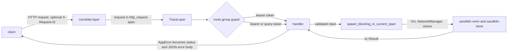
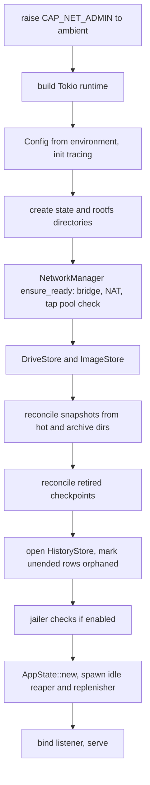
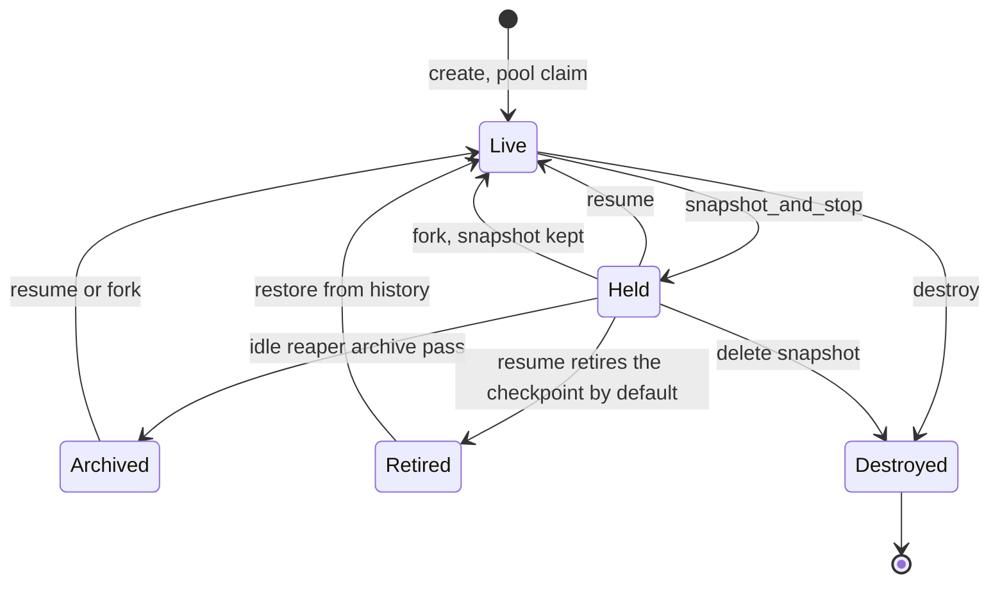
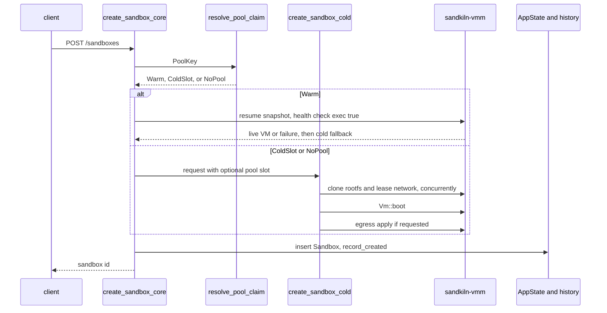

`sandkiln-daemon` builds the `sandkilnd` binary: the process that SDKs, the CLI and curl actually talk to. Its own `AGENTS.md` states the division of labour in a sentence: keep business logic, meaning VM lifecycle and networking, in `sandkiln-vmm`, and let this crate parse requests, call `vmm`, and shape responses.

That sentence undersells what is left for the daemon to do. It owns every piece of shared mutable state in the system: which sandboxes are live, which snapshots are held, which drives and images and network identities are claimed, which pools are warm. `sandkiln-vmm` is a library of mechanisms. The daemon is where those mechanisms get ownership, ordering and cleanup.

This is the crate-level tour. The source tree for this crate is being reorganised, so this post names modules by concept and items by name (`AppState`, `create_sandbox_cold`) rather than by file path. The earlier [daemon internals](/engineering/08-daemon-internals) post takes a request-flow view; this one is organised by the same headings as the other crate tours. Read the [system overview](/engineering/01-system-overview) first.

## Public API surface

This is a binary crate with no library target, so there is no Rust API to export. The public surface is the HTTP API, assembled from several routers in `main`. Auth is attached per router group, not globally:

| Group | Routes | Guard |
| --- | --- | --- |
| Open | `GET /healthz`, `GET /metrics` | none: operational data, not sandbox data |
| Sandboxes | `POST/GET /sandboxes`, `GET /sandboxes/history`, `POST /sandboxes/get-or-create`, `GET /sandboxes/by-name/:name`, `DELETE /sandboxes/:id` | bearer token |
| Guest operations | `exec`, `read-file`, `write-file`, `chmod`, `chown`, `mkdir`, `rename`, `copy`, `symlink`, `readlink`, `truncate`, `list-dir`, `exec-stream`, mounts, tunnel create/delete, all under `/sandboxes/:id/` | bearer token |
| Drives | `POST/GET /drives`, `DELETE /drives/:id` | bearer token |
| Images | `POST/GET /images`, `DELETE /images/:id` | bearer token |
| Pools | `POST/GET /pools`, `DELETE /pools/:id` | bearer token |
| Snapshots | `POST /sandboxes/:id/snapshot`, `GET /snapshots`, `POST /snapshots/:id/resume`, `POST /snapshots/:id/fork`, `DELETE /snapshots/:id`, `GET /snapshots/history`, `POST /snapshots/history/:id/restore`, `DELETE /snapshots/history/:id` | bearer token |
| Preview | `ANY /sandboxes/:id/preview/:port` and subpaths | bearer header or `?token=` |
| WebSocket | `GET /sandboxes/:id/pty`, `.../exec-stream/:session_id/logs`, `.../tunnel/:tunnel_id/ws` | bearer header or `?token=` |

The second guard exists because a browser tab, an `<iframe>`, and every runtime's native `WebSocket` constructor cannot set an `Authorization` header. A preview URL is therefore a bearer credential in URL form, an accepted and documented tradeoff. When `SANDKILN_AUTH_TOKEN` is unset, both guards are no-ops and `main` logs a warning that the API is unauthenticated.

The pure part of the bearer check is separated from the axum plumbing so it can be tested without constructing an `AppState`:

```rust
fn token_matches(header_value: Option<&str>, expected: &str) -> bool {
    header_value.and_then(|value| value.strip_prefix("Bearer ")) == Some(expected)
}
```

(`token_matches`, in the auth middleware.) A matching function for the preview guard accepts the header or the query parameter.

Layering order matters. The request-correlation layer is outermost, wrapping the tracing layer, so the request id is already the active span before any per-request log line, including the tracing layer's own request-complete line.



## Module tour, by concept

| Concept | Items |
| --- | --- |
| Startup and wiring | `main`, `raise_net_admin_ambient` |
| Configuration | `Config`, `LogFormat`, `JailerHostConfig` |
| Shared state | `AppState`, `Sandbox`, `Snapshot`, `RetiredSnapshot`, `Pool` |
| Lifecycle operations | `create_sandbox_core`, `create_sandbox_cold`, `stop_sandbox_by_id`, `snapshot_and_stop`, `resume_snapshot_by_id`, `fork_snapshot`, each defined once and reused by routes and background tasks |
| Pools | `resolve_pool_claim`, `PoolClaimGuard`, `claim_from_pool`, the replenisher |
| Background tasks | the idle reaper, the pool replenisher |
| Guest operations | `call_agent`, `resolve_env` |
| Long-lived sessions | `LogSession`, the PTY and tunnel proxies |
| Cross-cutting | `AppError`, `Metrics`, `correlate`, `spawn_blocking_in_current_span` |

### Startup

`main` is a plain `fn main()`, not `#[tokio::main]`. It raises `CAP_NET_ADMIN` into the ambient set first, then builds the Tokio runtime by hand. The ordering is load-bearing: the runtime's worker and blocking threads clone credentials at spawn time, so a raise that happens after the runtime starts is never seen by them. Ambient raise needs the capability in both the permitted and inheritable sets, and only the file capability sets permitted, so `main` adds inheritable itself before raising ambient. The child processes (`ip`, `iptables`, `bridge`) inherit it.



Reconciliation runs before the listener binds, and snapshot reconciliation runs before `AppState` takes ownership of the `NetworkManager`. A reconciled snapshot's tap device has to leave the free pool, via `NetworkManager::reserve`, before any live create can race it for the same tap. The history orphan sweep follows the same logic, as covered in the [store tour](/engineering/14-crate-store).

## Key types and invariants

### AppState: the ownership maps

`AppState` is shared as `Arc<AppState>`. Its fields group into three kinds.

**Resource managers**, built once at startup: `NetworkManager`, `DriveStore`, `ImageStore`, an optional `JailerIdPool` (present exactly when jailing is enabled), and the `HistoryStore`.

**Ownership maps**, each behind a `std::sync::Mutex<HashMap<..>>`: `sandboxes` (live), `snapshots` (held, restorable), `retired_snapshots` (checkpoints kept for time-travel restore), `pools`, `tunnels`, and per-name `name_locks`.

**Reservation sets**, covering the gap between "decided" and "visible in a map": `pending_image_boots` (refcounted, so a concurrent image delete cannot remove a file an in-flight clone is reading) and `pending_tap_restores`.

The invariant this structure serves is the one the root `AGENTS.md` names in section 8: for every resource, one place answers "who holds this". That is `drive_holders`, `image_holder` and `tap_device_holder`. They walk live sandboxes, held snapshots and retired checkpoints, so a drive attached read-write to a snapshot cannot be re-attached read-write elsewhere, and an image cannot be deleted from under a checkpoint that would later be restored. `image_holder` and `tap_device_holder` share one small generic walk (`first_match`). `drive_holders` stays separate because it returns every matching holder, since several read-only holders are legitimate.

Names get the same treatment. `name_holder` and `resolve_name` check live sandboxes before held snapshots, and `lock_name` returns a guard serialising concurrent claims of one name, so two simultaneous creates of a brand-new name cannot both see it as free, without blocking unrelated names.

### Sandbox and Snapshot: where identity lives

A `Sandbox` owns a `Vm`, a network `Lease`, and a private rootfs file. A `Snapshot` takes those over when a sandbox is stopped with its state kept: it holds the exact `Lease`, because guest IP and MAC are frozen into the saved memory image, and it keeps the rootfs path, because Firecracker's snapshot records only the file's host path. Several fields exist to protect these invariants:

- **`forked_into`** on a snapshot is a lock ruling out two live descendants sharing one rootfs file or one tap device. It is set while a fork runs and cleared only after that descendant's `Vm` has actually been killed.
- **`source_snapshot_id` and `parent_snapshot_id` are separate on purpose.** The first is `Some` only for a fork, and is what refuses re-snapshotting one. The second is lineage and must be `Some` on both resume and fork. Conflating them was a real bug, caught live, as the field's own doc comment records.
- **`network` and `egress` are `None` for a fork.** The snapshot owns the lease and the iptables chain tied to it.
- **A `RetiredSnapshot` holds a bare `NetworkConfig`, not a live `Lease`.** Nothing is reserved from the free pool just by sitting in history; a lease is taken only at restore time, gated by `tap_device_holder`.



The diagram is conceptual: `Live`, `Held` and `Retired` are different records in different maps, not one record with a status field. That is a deliberate modelling choice, set out in the field comment on `retired_snapshots`: a retired checkpoint holds no live `Lease`, which is structurally unlike every `snapshots` entry, so it gets its own map rather than a flag. `check_snapshottable` encodes the two ways a live sandbox cannot move to `Held`:

```rust
fn check_snapshottable(is_jailed: bool, source_snapshot_id: Option<&str>) -> Result<(), SnapshotBlocked> {
    if is_jailed {
        return Err(SnapshotBlocked::Jailed);
    }
    if let Some(source) = source_snapshot_id {
        return Err(SnapshotBlocked::ForkedFrom(source.to_string()));
    }
    Ok(())
}
```

(`check_snapshottable`, in the snapshot routes.) A jailed sandbox bakes in-jail paths into its snapshot and `Vm::resume` only spawns directly, and a fork does not own its rootfs outright. Callers react to the two reasons differently: an explicit snapshot request turns both into errors, while the default stop path treats a fork as a harmless fall-through to destroy and only a jailed sandbox as a real conflict.

## Create path and failure handling

`create_sandbox_core` is the shared boot logic, used by plain create and by get-or-create (both resolve name uniqueness first, under the same `lock_name` guard). It validates drives (they must exist, and `drive_holders` plus `can_attach_read_only` decide whether they can attach), resolves vCPU and memory overrides, the rate limit and the egress policy, and then tries a warm pool claim when the request has no `drives` and no `rate_limit`. Both are baked into a VM at boot, so a warm snapshot cannot satisfy them. Egress policy does not disqualify a claim, since it is host-side iptables applied after boot. A claim that fails its post-resume health check is retried against the pool a bounded number of times (`MAX_POOL_CLAIM_ATTEMPTS`) before falling back to a cold create. `create_sandbox_cold` itself reserves the pending image boot and picks the rootfs source.



Every arrow into `sandkiln-vmm` is inside a `spawn_blocking_in_current_span`. Within the cold path, the rootfs clone and the network lease run on separate scoped threads and are timed individually, with a `setup` phase recording the join. Failure handling follows root `AGENTS.md` section 7 literally: each resource is released on the specific failure it would otherwise leak on.

```rust
Err(e) => {
    let _ = state.network.release(lease);
    if let (Some(id), Some(pool)) = (jail_id, &state.jailer_ids) {
        pool.release(id);
    }
    Err(e)
}
```

(The `Vm::boot` failure arm in `create_sandbox_cold`.) A failed boot releases the lease and the jailer id. A failed egress apply tears down the VM, releases the lease, and releases the jailer id, because handing back a sandbox the caller asked to restrict, but which is unrestricted, would be a security gap. A failed jailer id lease releases the lease already taken.

Two RAII guards cover the exits no `match` arm can see. The image-boot guard releases its pending reference on every path, including early returns. `PoolClaimGuard` releases a reserved pool slot on drop unless `commit()` ran first:

```rust
impl Drop for PoolClaimGuard {
    fn drop(&mut self) {
        if self.committed {
            return;
        }
        if let Some(pool_id) = &self.pool_id {
            if let Some(pool) = self.state.pools.lock().unwrap().get_mut(pool_id) {
                pool.record_release();
            }
        }
    }
}
```

(`PoolClaimGuard`'s `Drop`.) The slot is reserved before the slow resume or boot so a concurrent claim cannot over-commit past `max_count`, and it is committed only once a real `Sandbox` durably owns it. See [pre-warmed pools](/engineering/07-pre-warmed-pools) and the docs-site page [pre-warmed pools](https://sandkiln.mintlify.site/internals/pre-warmed-pools) for the queueing design.

### Locking and async discipline

The sandbox map lock is a `std::sync::Mutex`, held across blocking calls inside `spawn_blocking` and never across an `.await`. `resolve_pool_claim` shows the pattern: lock, decide or clone the pool's `Notify`, unlock, optionally await with a bounded timeout (30 seconds, ending in a real `503`), loop with fresh state.

`tracing`'s current span is thread-local, so a bare `spawn_blocking` silently drops request correlation. The helper that every VM-touching route uses captures both the span and the default dispatcher and re-establishes them on the blocking-pool thread:

```rust
let span = tracing::Span::current();
let dispatch = tracing::dispatcher::get_default(tracing::Dispatch::clone);
tokio::task::spawn_blocking(move || tracing::dispatcher::with_default(&dispatch, || span.in_scope(f)))
    .await
    .expect(panic_message)
```

(`spawn_blocking_in_current_span`.) That is how an event deep inside `sandkiln-vmm`'s `Vm::boot` carries the request id the outermost layer assigned. The `correlate` layer accepts a caller's `X-Request-Id` only if it is well-formed (non-empty, at most 200 ASCII-graphic characters), because the value is written verbatim into every log line.

## Error model

Every handler returns `AppError`, one enum with a status code per variant, rendered as `{"error": "<message>"}`:

| Variant | Status |
| --- | --- |
| `NotFound`, `DriveNotFound`, `ImageNotFound` | 404 |
| `BadRequest` | 400 |
| `Conflict` | 409 |
| `BadGateway`, `GatewayTimeout` | 502, 504 (preview proxy only) |
| `ServiceUnavailable` | 503 (pool queue timed out) |
| `Internal(io::Error)` | 500, via `From<io::Error>` |

One function, `status_and_message`, produces both the response and the `Display` text, so log lines and HTTP bodies cannot drift. Domain-specific error types sit below it where a non-HTTP caller needs to branch: `StopError` and `SnapshotStopError` are separate from `AppError` so the idle reaper can react to "cannot preserve" by falling back to a full destroy without an HTTP-shaped type.

Validation happens at the server boundary even when clients already validate: a bad egress CIDR is a `400` naming it, and resource overrides above the configured maximum are rejected rather than clamped. Non-fatal side effects degrade loudly: a history write failure logs a warning, and an egress re-apply failure on resume or fork warns rather than destroying a sandbox that already resumed.

## Background tasks

Two tasks spawn unconditionally from `main`, since a tick with nothing configured is a cheap no-op scan. The pool replenisher tops each pool up by one warm slot per two-second tick (`CHECK_INTERVAL`), gradual rather than a load spike. The idle reaper computes its interval from the shortest configured timeout (`SANDKILN_IDLE_TIMEOUT_SECS`, `SANDKILN_AUTO_SUSPEND_TIMEOUT_SECS`, `SANDKILN_ARCHIVE_TIMEOUT_SECS`), halved and clamped between one and thirty seconds. Each tick runs auto-suspend, then destroy, then an independent archive pass over held snapshots. Ordering is the design: a successfully suspended sandbox leaves the live map, so the destroy pass never sees it, and with the enforced invariant that the suspend timeout is below the destroy timeout, destroy is a backstop rather than a race. The decision itself is the pure function `is_idle`, a saturating subtraction compared against the timeout. Every exec, read and write updates a sandbox's `last_activity` through the shared agent-call helper.

## Test strategy

`cargo test -p sandkiln-daemon` runs 194 tests, all without KVM. The approach is to pull decisions out of framework plumbing and construction-heavy types (a real `Sandbox` or `Snapshot` needs a VM) and test them as pure functions: `token_matches`, `is_idle`, `find_named`, `first_match`, `check_snapshottable`, `resolve_egress_policy`, request-id validation. Counts are approximate and by concept:

| Concept | Tests | What they cover |
| --- | --- | --- |
| `AppState` | about 29 | Holder lookups, name resolution, drive attach rules, reservation sets |
| Sandbox routes | about 18 | Resource override resolution, egress policy validation, query parsing |
| Snapshot persistence | about 16 | Atomic metadata write, round trip, defaults for metadata from older builds, skipping directories missing files or with corrupt metadata, reserving the snapshot's tap on reconcile, moving files without touching the rootfs |
| Preview proxy | about 15 | Target URI building, token query extraction and stripping, hop-by-hop and `Authorization` header stripping |
| Idle reaper | 13 | Idle and archive-due predicates, check-interval clamping |
| Pools | 11 | Warm queue, claim and release accounting, `max_count` headroom |
| Config, request id, auth, error, metrics | 12, 12, 10, 9, 8 | Parsing, validation, status mapping, rendering |
| Everything else | about 42 | Snapshot routes, retired checkpoints, mounts, name routes, log sessions, the tracing helper, storage layout |

The span-propagation test emits an event through `spawn_blocking_in_current_span` on a real blocking-pool thread with no dispatcher of its own and asserts the logged JSON carries the request id, which proves both the span and the dispatcher capture are necessary. The error tests pin the exact `{"error": ...}` body per variant, since every client depends on it.

The honest limit, stated in the crate's `AGENTS.md`: `cargo build` catches compile errors only, and every route needs live verification against a real daemon. A DELETE status-code bug compiled and passed clippy but was still wrong. That is what the numbered topic files under `scripts/integration-tests/` are for, which run against a real `sandkilnd` and compare exact id sets rather than global counts so concurrent topics do not make them flaky.

## How neighbours consume it

Downward, the daemon depends on `sandkiln-vmm` for every VM, network, drive and image operation, on `sandkiln-store` for history, and on `sandkiln-protocol` for the `Request` and `Response` values it builds. Upward, the JavaScript SDK, the Python SDK and the `kiln` CLI are all clients of the HTTP surface above. A new endpoint with no SDK method, CLI command or integration topic is, per the root `AGENTS.md`, "started" rather than "done", which is worth keeping in mind for the history endpoint noted in the store tour, since it has no SDK or CLI surface today.

## Design alternatives rejected

**A metrics crate.** Metrics are hand-rolled Prometheus text: four metric families behind atomics and a histogram are not enough surface to justify the dependency.

**A status flag on `Snapshot` for retired checkpoints.** Rejected for a separate map, since a retired checkpoint structurally has no `Lease`.

**Relying on `tap_device_holder` alone for restore.** Insufficient: two restores of checkpoints in one lineage share a tap identity, so both could pass a liveness check before either reserved it. The reservation set `pending_tap_restores` closes that race.

**Rebuilding live sandboxes after a restart.** Not attempted: a live `Sandbox` owns a process with no serialisable form. The daemon instead reconciles snapshots from disk and marks history rows orphaned.
