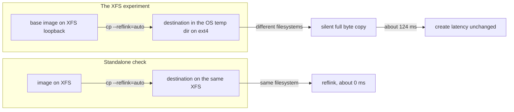

Every sandbox gets its own writable rootfs. The base image is around 300 MiB, so the obvious implementation, copy the file, costs real time on every create. This post follows that one cost from a wrong conclusion, through a profile that overturned it, to a fix measured at roughly a tenth of the original create latency. It is also a story about how a correct measurement can sit next to a wrong explanation for months.

Dates matter here, so they are stated: the profile is from 2026-09-14, the fix and its measurements are from 2026-11-23.

## Problem and how it was found

The first sign was a gap. A cold boot measured 30 to 34 ms with criterion, and a full `POST /sandboxes` measured 160 to 200 ms. Something between "request arrives" and "VM boots" was costing around 130 ms. The suspects were the network lease (three `ip`/`bridge` subprocess calls) and the rootfs copy.

An earlier attempt had already tried to settle this. It made the copy run concurrently with the network lease and changed the copy to `cp --reflink=auto`, which can be an instant copy-on-write clone on a filesystem that supports it. Then it set up a real XFS loopback filesystem on the dev box and pointed `SANDKILN_BASE_ROOTFS` at it. The measurements from that experiment were:

| Observation | Value |
| --- | --- |
| standalone `cp --reflink=auto` of the image, ext4 | about 110 ms |
| the same `cp` inside the XFS mount | about 0 ms |
| extra disk used by four clones of a 300 MiB image on XFS (`df`) | about 4 MiB total, not about 1.2 GiB |
| `POST /sandboxes` latency, five creates on each filesystem | about 160 to 170 ms either way |

The first three rows are correct and reproducible: the reflink really does work and really does save space. The fourth row is also correct, and it led to a wrong conclusion. The recorded explanation was that the copy already ran concurrently with the network lease, so making it faster "just means the join now waits on the lease side instead". That framing concluded the copy was never the bottleneck.

It was left unchecked until a per-phase profile was added. Every sub-step of `create_sandbox_cold` and `Vm::boot` was instrumented, and 20 sequential creates were run on an idle box, each sandbox destroyed before the next. The tool is described in the [performance model post](/engineering/16-performance-model-and-measurement):

```bash
RUST_LOG=sandkilnd=debug,sandkiln_vmm=debug scripts/sandkilnd-ctl.sh restart
scripts/dev-tools/profile-cold-create.sh 20
```

The means over those 20 creates (ext4, 300 MiB base image, no jailer, 2 vCPU, 512 MiB, empty request body) came to a total of **167.65 ms**:

| Phase | Mean | Share |
| --- | --- | --- |
| rootfs clone (`cp --reflink=auto`) | 124.09 ms | 74.0% |
| `Vm::boot` total | 34.00 ms | 20.3% |
| history sqlite write | 9.24 ms | 5.5% |
| network lease (concurrent with the clone) | 4.36 ms | about 0.1% of the critical path |

These add to 167.33 of 167.65 ms, with 0.32 ms unaccounted, so the breakdown is complete. The lease was about 4 ms, not the roughly 130 ms it had been suspected of. That single number killed the "hidden behind the lease" explanation: a 4 ms lease cannot hide a 124 ms copy.

## Root cause

The copy was never able to reflink. The daemon's clone wrote into the OS temporary directory:

```rust
let rootfs_path = std::env::temp_dir().join(format!("sandkiln-rootfs-{id}.ext4"));
```

and `cp --reflink=auto` silently falls back to a full byte copy when source and destination are on different filesystems. The XFS experiment had moved only the source (the base image) onto XFS. The destination stayed on `/tmp`, which on this box is ext4. A standalone `cp` inside the XFS mount reflinked, because both ends were on XFS. The daemon's actual clone crossed filesystems every time, so it copied every time. That fits all four rows of the experiment: the clone was real, the daemon never used it, and latency never moved.



This was written down as an unverified hypothesis at the time, because the XFS loopback no longer existed and mounting one needs root. It was only confirmed when the fix below could be measured on a real reflink volume.

There was a second, quieter cause underneath the first. Nothing reported which method a clone had used. A slow clone and a silently degraded clone looked identical in `create_phase_duration_ms{phase="rootfs_clone"}`. That is the reason the error survived: the signal that would have exposed it did not exist.

## The change

The fix has four parts.

**A native clone primitive.** `core/crates/vmm/src/rootfs.rs` replaces the `cp` subprocess with a direct `FICLONE` ioctl. The constant is defined at `core/crates/vmm/src/rootfs.rs:16`, and the clone itself at `core/crates/vmm/src/rootfs.rs:53`:

```rust
fn clone_into(src: &mut File, dst: &mut File) -> io::Result<CloneMethod> {
    let rc = unsafe { libc::ioctl(dst.as_raw_fd(), FICLONE, src.as_raw_fd()) };
    if rc == 0 {
        return Ok(CloneMethod::Reflink);
    }
    let err = io::Error::last_os_error();
    match err.raw_os_error() {
        Some(libc::EOPNOTSUPP) | Some(libc::EXDEV) | Some(libc::EINVAL) | Some(libc::ENOTTY) | Some(libc::ENOSYS) => {
            io::copy(src, dst)?;
            Ok(CloneMethod::Copy)
        }
        _ => Err(err),
    }
}
```

The fallback list is deliberate. An unsupported filesystem, a cross-device clone and a non-reflinkable file all mean "copy instead". Anything else, such as a full disk or a permission error, is a real failure and is returned, not hidden behind a copy attempt that would fail the same way. `clone_file` (`core/crates/vmm/src/rootfs.rs:38`) wraps it: it opens the destination with `create_new`, so it refuses to overwrite an existing file, copies the source permissions afterwards, and removes the destination if anything failed, so no partial file is left behind.

```mermaid
stateDiagram-v2
    [*] --> OpenFiles
    OpenFiles --> TryFiclone: destination created with create_new
    TryFiclone --> Reflinked: ioctl returns 0
    TryFiclone --> ByteCopy: EOPNOTSUPP, EXDEV, EINVAL, ENOTTY or ENOSYS
    TryFiclone --> Failed: any other errno
    ByteCopy --> Copied: io::copy ok
    ByteCopy --> Failed: io::copy error
    Reflinked --> SetPermissions
    Copied --> SetPermissions
    SetPermissions --> Done: mode copied from source
    SetPermissions --> Failed: chmod error
    Failed --> RemoveDestination
    RemoveDestination --> [*]
    Done --> [*]
```

**The method is returned and counted.** `clone_file` returns a `CloneMethod` (`Reflink` or `Copy`) rather than a bare success. The daemon's `clone_rootfs` wrapper records it and logs a debug `rootfs cloned` event. `/metrics` gains a counter, `rootfs_clone_total{method="reflink"|"copy"}`. The same wrapper serves cold creates, the history-retaining resume and snapshot history restore, because handing a shared rootfs to a new mutating sandbox would corrupt whatever else depends on that file. A host that has silently never reflinked now shows a nonzero `copy` counter and a zero `reflink` counter.

**A configurable destination.** The clone's destination is no longer the OS temp directory. The daemon reads two settings from the registry in `core/crates/daemon/src/config/settings.rs`, resolved environment variable first, then `sandkiln.toml` (`state_dir`, `rootfs_dir`), then the default:

| Environment variable | Default | Purpose |
| --- | --- | --- |
| `SANDKILN_STATE_DIR` | `~/sandkiln-tools/state` | durable daemon state: held snapshots and retired checkpoints |
| `SANDKILN_ROOTFS_DIR` | `$SANDKILN_STATE_DIR/rootfs` | each sandbox's private writable rootfs |

Putting `SANDKILN_ROOTFS_DIR` on the same reflink-capable filesystem as `SANDKILN_BASE_ROOTFS` is what makes the clone instant. Separating the state directory from the OS temp directory is a correctness fix that came along with it: a temp cleaner or reboot could previously destroy "durable" snapshots. Snapshots left in the old temp location by earlier versions are not migrated. `scripts/preflight-check.sh` now checks this alignment for you: it reports whether the base image and `rootfs_dir` share a reflink-capable filesystem and warns, with the fix, when a reflink cannot cross filesystems (`scripts/preflight-check.sh:189` and `:191`). The daemon also reads the effective values through `sandkilnd --print-config`, so the check follows whatever the running configuration says.

**A way to get a reflink filesystem on an ext4 host.** `scripts/host-setup/create-reflink-volume.sh` builds an XFS loopback volume with `reflink=1`, mounts it, and creates a `rootfs` directory owned by the daemon's user. Its header comment says it also copies the base image in, but the script body does not do that, so the base image has to be copied onto the volume by hand (the reproduction steps below do so). The usage in its header ties it together:

```bash
sudo scripts/host-setup/create-reflink-volume.sh <owner-user> 20
SANDKILN_BASE_ROOTFS=/mnt/sandkiln-xfs/<image>.ext4 \
SANDKILN_ROOTFS_DIR=/mnt/sandkiln-xfs/rootfs \
  scripts/sandkilnd-ctl.sh restart
```

The unit tests in `core/crates/vmm/src/rootfs.rs` cover the clone contract: contents are preserved and a method is reported, the clone is independent of the source after mutation, an existing destination is not overwritten, a missing source leaves no destination, and permissions are preserved. Those tests pass on either filesystem because they assert `Reflink | Copy`, so they prove the contract and not the speedup. The speedup needs a real daemon on a real reflink volume.

## Result

The measurement was run on the dev box on 2026-11-23: 20 cold `POST /sandboxes` creates in each configuration, mean latency.

| Metric | ext4, full byte copy | XFS reflink, same filesystem as the base image |
| --- | --- | --- |
| rootfs clone | 127.9 ms | 0.08 ms |
| `Vm::boot` | 14.9 ms | not recorded in the run |
| network lease | 3.5 ms | not recorded in the run |
| **cold create, mean of 20** | **187.5 ms** | **17.9 ms** |
| clone method counts after the run | not applicable | 31 reflinks, 0 copies |

That is about a 10.5 times reduction, and `rootfs_clone_total` confirmed that every clone in the reflink run really was a reflink, which is the check the earlier experiment lacked.

Two reading notes keep this honest.

The 187.5 ms ext4 figure is not the 167.65 ms from the September profile. They are different days, different box states, and different code: boot had been shortened in between by the [socket-wait fix](/engineering/18-opt-boot-socket-wait), yet the total came out higher. Treat the two ext4 numbers as the drift of a shared box, and compare the two columns above only with each other.

The total fell by about 169.6 ms while the clone phase fell by about 127.8 ms. The remaining roughly 42 ms of improvement was not itemized in this run. A plausible reading is that a 300 MiB byte copy also slows the rest of the path through disk contention and dirty-page writeback. That is a hypothesis, not something this run measured. A follow-up run that records every phase for both configurations would settle it.

On the reflink volume the clone is no longer the slower branch of the concurrent pair, so the critical path becomes the lease plus the boot. Together with the unitemized figures, that is consistent with a create in the high teens of milliseconds, and the profile in the [performance model post](/engineering/16-performance-model-and-measurement) is the way to check it.

A later re-measurement (2026-11-23, kernel 6.8, 20 creates with a reflink rootfs) did record every phase: clone 0.084 ms, lease 3.1 ms, boot 13.4 ms, mean total 18.4 ms. That is consistent with the inference above, since lease plus boot is about 16.5 ms of the 18.4 ms. It is also 0.5 ms above the 17.9 ms recorded here; both are directional readings from one shared box and the gap is inside its noise.

## What it cost or risks

- **It only works on one filesystem.** The base image and `SANDKILN_ROOTFS_DIR` must be on the same reflink-capable filesystem: XFS with `reflink=1`, or Btrfs. On ext4, or across filesystems, the clone is the same full byte copy as before, now reported honestly as `copy`. The change does not make ext4 faster.
- **The helper volume is a loopback mount.** `create-reflink-volume.sh` states it plainly: loop mounts are not persistent across reboots, so the volume must be re-mounted after a reboot. The script is safe to re-run. It is a development convenience, not a production storage design.
- **Jailer setups need alignment too.** With the jailer enabled, rootfs files are hard-linked into each VM's chroot, so the chroot base directory has to be on the same filesystem as `SANDKILN_ROOTFS_DIR` or every boot falls back to a real copy.
- **State directory migration.** Moving snapshots and retired checkpoints out of the temp directory is the right default and it is a behavior change. Old snapshots are not migrated.
- **The unit tests are weaker than the claim.** As noted above, they assert the contract and not the speedup. The performance claim rests on the live daemon run and on `rootfs_clone_total`.
- **Still open: making reflink the default.** Today reflink is something an operator arranges by choosing storage. Whether the daemon should prefer or require a reflink filesystem for production setups is a decision that has not been made. `scripts/preflight-check.sh` still reports whether rootfs storage is on a copy-on-write filesystem, but its wording predates the native clone and refers to `cp --reflink=auto`.

## How to reproduce

This needs the remote dev box, since it uses KVM and a real daemon. First measure the ext4 baseline with the daemon on its default directories, then repeat on a reflink volume.

```bash
# 1. Baseline: default directories, ext4 host.
scripts/remote.sh run scripts/bench-report.sh 20
curl -s http://127.0.0.1:7777/metrics | grep rootfs_clone_total

# 2. Build the reflink volume and point the daemon at it (needs sudo once).
sudo scripts/host-setup/create-reflink-volume.sh <owner-user> 20
cp <base-image>.ext4 /mnt/sandkiln-xfs/
SANDKILN_BASE_ROOTFS=/mnt/sandkiln-xfs/<base-image>.ext4 \
SANDKILN_ROOTFS_DIR=/mnt/sandkiln-xfs/rootfs \
  scripts/sandkilnd-ctl.sh restart

# 3. Measure again and verify the method counter, not just the latency.
scripts/bench-report.sh 20
curl -s http://127.0.0.1:7777/metrics | grep -E 'rootfs_clone_total|rootfs_clone'
```

Read three things from the result. The `rootfs_clone_total{method="reflink"}` count must rise by the number of creates, and `method="copy"` must not move. The `create_phase_duration_ms{phase="rootfs_clone"}` mean should be well under a millisecond. And only then compare `total`. If `copy` is the counter that moved, you measured a byte copy regardless of what the mount says, which is exactly the trap this change was built to expose.
