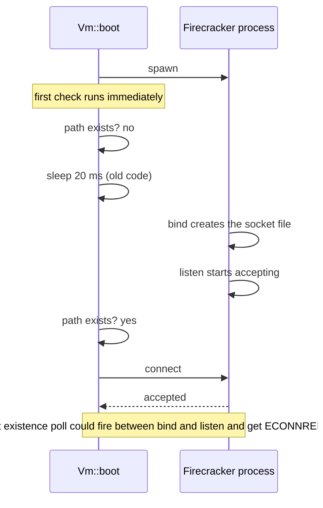
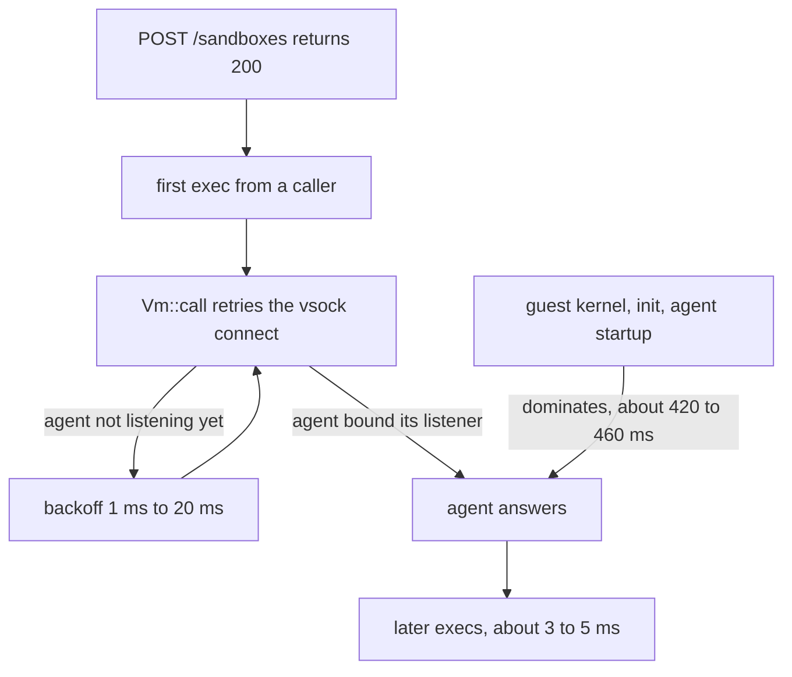

Most performance bugs hide in work. This one hid in a sleep. A loop that waited for Firecracker's API socket slept a fixed 20 ms between checks, and because the socket is ready in well under a millisecond, the first check failed and the second check was always 20 ms later. Every boot paid exactly one sleep, no more and no less. This post covers how that was identified, the change, the sibling bug found by auditing for the same pattern, and why the sibling's fix produced no measurable change.

The measurements here come from the profiling pass of 2026-09-14 and the sibling audit the same day. They are earlier runs, on an earlier kernel and box state than the November numbers in the [performance model post](/engineering/16-performance-model-and-measurement), and they should be compared with each other and not with those.

## Problem and how it was found

The question was where about 130 ms of a roughly 167 ms `POST /sandboxes` went, given that a cold boot benchmarked at around 34 ms. The per-phase profile (instrumenting every step of `create_sandbox_cold` and `Vm::boot`, then 20 sequential creates with each sandbox destroyed before the next) is described in the [rootfs reflink post](/engineering/17-opt-rootfs-reflink-clone). It was driven with:

```bash
RUST_LOG=sandkilnd=debug,sandkiln_vmm=debug scripts/sandkilnd-ctl.sh restart
scripts/dev-tools/profile-cold-create.sh 20
```

The `vm boot phase breakdown` debug event splits `Vm::boot` into its steps. Over the 20 creates, the mean `Vm::boot` was 34.00 ms and divided as follows:

| Boot step | Mean | Share of boot |
| --- | --- | --- |
| process spawn | 0.34 ms | 1% |
| wait for the API socket | 20.11 ms | 59% |
| the 7 configuration PUTs | 1.61 ms | 5% |
| `InstanceStart` | 11.87 ms | 35% |

The socket wait stood out for a reason beyond its size. Across all 20 boots it measured 20.11 ms with a minimum of 20.04 ms and a maximum of 20.18 ms. Real waiting has spread. A spread of 140 microseconds around a round 20 ms is the signature of one quantized sleep: the code checked, failed once, slept 20 ms, and then succeeded on the second check every single time.

## Root cause

`wait_for_socket` polled for Firecracker's API socket file with a fixed sleep:

```rust
fn wait_for_socket(path: &Path, timeout: Duration) -> io::Result<()> {
    let deadline = Instant::now() + timeout;
    while !path.exists() {
        if Instant::now() >= deadline {
            return Err(io::Error::new(io::ErrorKind::TimedOut, format!("{path:?} never appeared")));
        }
        std::thread::sleep(Duration::from_millis(20));
    }
    Ok(())
}
```

Firecracker creates the socket within well under a millisecond of being spawned. The first `exists()` check ran immediately after `spawn`, usually before the socket file existed, so the loop slept 20 ms, and the second check always found it. The overshoot, roughly 19.4 ms per boot, was dead time. A fixed poll interval is the wrong tool for a race whose duration is far shorter than the interval.

There was a trap in the obvious fix. Making the existence poll faster would have been wrong, for a reason about how Unix sockets work. The socket file appears when Firecracker calls `bind()`, and it only accepts connections after `listen()`. Between those two calls the file exists but a `connect()` fails with `ECONNREFUSED`. A fast existence poll can win that race and hand the caller a socket that is not ready yet.



## The change

The fix retries the connect itself, not the existence of the file. If the thing you need is a successful `connect()`, polling for `connect()` has no window in which the check passes and the next step fails. The helper is `retry_with_backoff` at `core/crates/vmm/src/vm/mod.rs:282`:

```rust
fn retry_with_backoff<T>(
    timeout: Duration,
    initial_interval: Duration,
    max_interval: Duration,
    mut attempt: impl FnMut() -> io::Result<T>,
) -> io::Result<T> {
    let deadline = Instant::now() + timeout;
    let mut interval = initial_interval;
    loop {
        match attempt() {
            Ok(v) => return Ok(v),
            Err(e) if Instant::now() >= deadline => return Err(e),
            Err(_) => {
                std::thread::sleep(interval);
                interval = (interval * 2).min(max_interval);
            }
        }
    }
}
```

and the API-socket user of it, `connect_api_with_retry` at `core/crates/vmm/src/vm/mod.rs:311`:

```rust
fn connect_api_with_retry(path: &Path, timeout: Duration) -> io::Result<ApiClient> {
    retry_with_backoff(timeout, Duration::from_micros(200), Duration::from_millis(5), || ApiClient::connect(path)).map_err(|e| {
        io::Error::new(io::ErrorKind::TimedOut, format!("{path:?} never accepted a connection within {timeout:?}: {e}"))
    })
}
```

The backoff starts at 200 microseconds and doubles up to a 5 ms cap, so the sequence of sleeps is 200, 400, 800 microseconds, then 1.6, 3.2 and 5 ms. The first retry lands well inside the time Firecracker needs, and a slow start still polls only a few hundred times a second at worst. The caller in `Vm::boot` is `core/crates/vmm/src/vm/boot.rs:200`, with a 2 second timeout, and snapshot resume reaches the same helper from `core/crates/vmm/src/vm/snapshot.rs:85`, so resume gained the same saving.

Three unit tests in `core/crates/vmm/src/vm/mod.rs` pin the behavior:

| Test | What it pins |
| --- | --- |
| `connect_api_with_retry_times_out_on_a_socket_nothing_ever_binds` | the error kind is `TimedOut` and the call takes at least the timeout, so a backoff bug that exits early cannot masquerade as a clean fast failure |
| `connect_api_with_retry_connects_to_an_already_listening_socket` | the fast path succeeds on the first attempt |
| `connect_api_with_retry_waits_for_a_socket_that_appears_late` | a listener that binds 40 ms in is found, which is the real case the helper exists for |

### The sibling bug

After the fix, the codebase was audited for the same pattern. `Vm::call`, `Vm::open_pty` and `Vm::open_exec_stream` each retried a failed vsock connection on a flat `sleep(100ms)` for up to five seconds. That is five times the per-retry cost of the socket bug. The three near-identical loops were replaced with the same helper:

```rust
let result = retry_with_backoff(Duration::from_secs(5), Duration::from_millis(1), Duration::from_millis(20), || {
    vsock_client::call(&self.vsock_socket, AGENT_PORT, request)
});
```

The vsock case starts at 1 ms and caps at 20 ms, which is slower and wider than the API-socket case. The reason is that "is the guest agent listening yet" is a slower and more variable race than "did Firecracker bind yet": it includes the guest kernel finishing boot and the agent starting. Extracting one helper in place of three hand-rolled loops is also the structural fix, since the next retry loop has a correct building block to reuse.

## Result

The API-socket fix was measured with the same method as the baseline, in two sets of 20 creates:

| Metric | Before | After |
| --- | --- | --- |
| socket wait | 20.11 ms | 0.67 ms and 0.69 ms |
| `boot_duration_ms` (the whole `Vm::boot`) | 34.00 ms | 11.22 ms and 11.44 ms (about 11.3 ms) |
| end-to-end cold create | 167.65 ms | 144.59 ms and 143.56 ms (about 144 ms) |

That is about 19.4 ms off every boot and about 23 ms, or 14%, off every cold create, with the rest of the improvement beyond the socket wait itself unexplained (see below). Snapshot resume got the same saving, since it shares the helper. The socket really is ready in under a millisecond; a boot is now bounded by actual work, mostly `InstanceStart`.

Two numbers moved that are not attributed to the change. `InstanceStart` read lower afterwards (11.87 ms before, 8.75 and 9.13 ms after). It was not the target and is not confidently attributed to this change. And the boot dropped by about 22.7 ms while the socket wait dropped by about 19.4 ms, so about 3 ms of the boot improvement came from elsewhere in that run.

The load test (`scripts/load-test.sh`, 4 workers, 5 cycles each) saw the `create` mean move too, from a 369 ms mean to 211 ms at 4 concurrent workers, though throughput stayed flat because a cycle also contains exec and delete. See the [performance model post](/engineering/16-performance-model-and-measurement) for why a cheaper phase does not always make a cycle faster.

### The sibling fix showed no end-to-end change

The `Vm::call` fix was A/B tested old against new. The test timed a fresh sandbox's first real `exec`, end to end, by revert-and-remeasure. Both versions measured about 420 to 460 ms. They were indistinguishable within noise.

| Metric | Old flat sleep(100 ms) | New 1 ms to 20 ms backoff |
| --- | --- | --- |
| first real `exec` on a fresh sandbox | about 420 to 460 ms | about 420 to 460 ms |
| worst-case overshoot wasted per retry | up to about 100 ms | up to about 20 ms |
| every later `exec` on the same sandbox | about 3 to 5 ms | about 3 to 5 ms |

The fix is real and correct, because the worst-case overshoot per retry dropped from roughly 100 ms to roughly 20 ms. It does not show up end to end because that 420 to 460 ms is dominated by something else entirely: the guest's own startup. The kernel finishes booting, init runs, and the guest agent starts and binds its vsock listener. Until that happens the host's retries fail no matter how fast they are, so shaving the retry overshoot only changes how soon after the agent starts the host notices. With the old 100 ms sleep the host noticed within 100 ms of the agent coming up, and with the new backoff within 20 ms, and a few tens of milliseconds disappear into a measurement of several hundred.

This turned the real finding around. Every exec after the first took 3 to 5 ms, which proved the 420 to 460 ms was a one-time "is the guest agent listening yet" cost paid silently by whichever caller made the first request, and mislabeled as "exec is slow". `POST /sandboxes` returning 200 means Firecracker's `InstanceStart` succeeded, and nothing before this measurement had counted through to the agent answering. A sandbox forked from an already-warmed snapshot paid about 4 to 18 ms for its first exec, so the gap pre-warmed pools close is far larger than a create-latency comparison suggests. `scripts/bench-report.sh` now tracks `first_exec_client` and `first_exec_resumed` so that is visible permanently.



## What it cost or risks

- **More wakeups in the worst case.** A tight early backoff polls more often than a 20 ms sleep. The cap bounds this: the API-socket loop settles at 5 ms intervals and the vsock loop at 20 ms, against a 2 second and 5 second budget. The extra work is a handful of failed `connect()` calls, each cheap.
- **A different failure shape.** The old code could only fail with "never appeared". The new one fails with "never accepted a connection within" the timeout, plus the underlying error, which is more informative, and the `TimedOut` kind is asserted by a test.
- **No change to the guest agent wait.** The fix removes dead sleep. It does not make the guest agent start faster. The 420 to 460 ms first-exec cost is still there and is the larger number. Whether `create()` should block until the agent has answered once, so that 200 means "ready", is an API question that has not been decided.
- **A caveat on attribution.** The unexplained roughly 3 ms in the boot improvement and the lower `InstanceStart` reading are reported as observed. They are not claimed as consequences of this change.
- **Boot numbers have since shifted.** Criterion on 2026-11-24 (kernel 6.8, same box) read cold boot at 12.6 to 14.0 ms, against 10.5 to 10.9 ms in the earlier published run. Both are real readings under different kernel and load conditions, and neither is authoritative.

## How to reproduce

Needs the remote dev box with real Firecracker. To see the socket wait itself, read the debug event:

```bash
scripts/remote.sh run "RUST_LOG=sandkilnd=debug,sandkiln_vmm=debug scripts/sandkilnd-ctl.sh restart"
scripts/remote.sh run scripts/dev-tools/profile-cold-create.sh 20
scripts/remote.sh run scripts/sandkilnd-ctl.sh logs | grep "vm boot phase breakdown"
```

Look at `socket_wait_us` across the 20 events. On the old code it sat between 20,040 and 20,180 microseconds; on the current code it should be well under a millisecond (0.67 and 0.69 ms means in the measured runs). To reproduce the sibling measurement, run `scripts/bench-report.sh 20` and read `first_exec_client` and `first_exec_resumed`. To compare old and new `Vm::call` yourself, check out the commit before the helper was introduced, rebuild, re-run the same report, and expect the first-exec number not to move.
