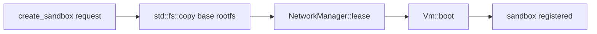
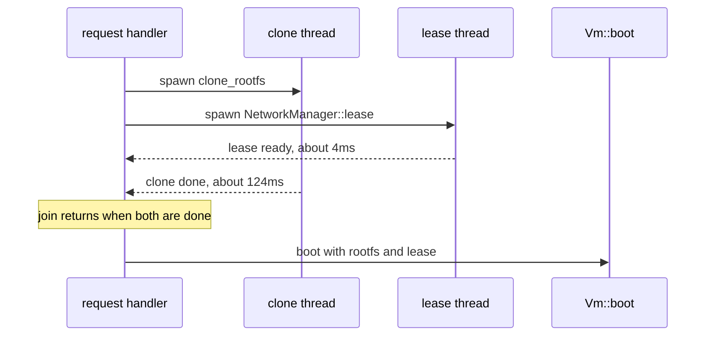
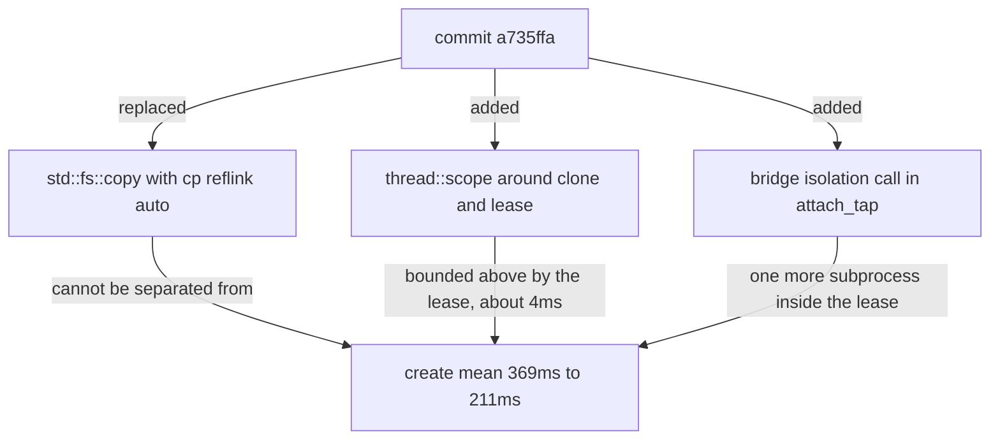

This is a case study of an optimization that was implemented correctly, measured once, recorded as a large win, and later shown to be unable to account for that win. The change itself is still in the code and still harmless. The interesting part is the gap between what the change did and what the number attributed to it said, because that gap is how a project ends up optimizing the wrong thing.

The code in question is the cold-create path: `create_sandbox_cold` at `core/crates/daemon/src/http/routes/sandbox.rs:230`. Code in both the daemon and `sandkiln-vmm` is cited with `path:line` references, verified against the current tree.

## Problem and how it was found

On 2026-08-26 the load test showed that a sandbox create was far slower than a Firecracker boot. The tool was `scripts/load-test.sh`, which runs N workers each doing create, exec, delete cycles against the HTTP API and reports min, max, mean and p95 per phase:

```bash
scripts/load-test.sh 4 5 http://127.0.0.1:7777
```

With 4 workers and 5 cycles each, 0 errors, `create` averaged 369ms (p95 588ms) at 5.59 cycles per second. At the same time, the criterion cold-boot benchmark read about 33ms. The roadmap entry of that day framed the gap as a ~300MB rootfs file copy, done by `std::fs::copy` synchronously per sandbox, before the network lease was taken.

That hypothesis was reasonable. Boot was 33ms, create was 369ms, and the only large, obviously expensive operation in the create function was copying a 300MB file. What was missing was a per-phase breakdown. Nothing in the daemon yet recorded how long the copy, the lease or the boot took individually, so the attribution rested on subtraction and on the size of the file.

The sequence at the time, as it appears in the diff of commit `a735ffa`, was:

```text
std::fs::copy(base_rootfs_path, rootfs_path)   // blocking, ~300MB
state.network.lease()                          // taps, IP, bridge attach
Vm::boot(...)
```

The copy and the lease do not depend on each other. The lease reserves a tap device and an IP and attaches the tap to the bridge. The copy produces a file path that `Vm::boot` needs later. Neither reads anything the other writes.



## Root cause

There were two separate facts, and they are easy to conflate.

The first is about structure. The create path did independent work serially, so its latency was the sum of two costs when it could have been the larger of them. That is a real, if small-looking, inefficiency, and removing it is a correct change regardless of the numbers.

The second is about magnitude, and it was unknown at the time. The saving from overlapping two operations is bounded by the cheaper of the two. If the lease is cheap, overlapping it with a long copy saves approximately the lease's duration and nothing more. The change was justified, in the code comment that shipped with it, by the copy being "the (currently dominant) cost". That phrase is the tell: the copy dominating is exactly the condition under which overlapping it with something else buys little.

The lease was not measured until a later profiling pass. When it was, it came to about 4.36ms, made of three subprocess calls (`ip link set up`, `ip link set master`, `bridge link set isolated on`) that read 1.39ms, 1.46ms and 1.46ms. So the upper bound on what concurrency could ever have saved was about 4ms, against a create of about 167ms.

## The change

Commit `a735ffa` ("Isolate sandboxes from each other on the shared bridge, parallelize rootfs clone with network lease") made three changes in one commit, two of which matter here:

1. Replaced `std::fs::copy` with a subprocess, `cp --reflink=auto`, so that on a copy-on-write filesystem (XFS, Btrfs) the clone could become an instant reflink.
2. Ran the clone and the lease concurrently in `std::thread::scope`, joining both before continuing.
3. Added bridge port isolation to the tap attach step, which is the commit's headline change and unrelated to latency.

The concurrent form, as it exists in the current `create_sandbox_cold` (`sandbox.rs:294`, trimmed to the load-bearing lines, instrumentation kept):

```rust
let ((copy_result, copy_elapsed), (lease_result, lease_elapsed)) = std::thread::scope(|scope| {
    let copy_handle = scope.spawn(|| span.in_scope(|| timed(|| clone_rootfs(&base_rootfs_source, &rootfs_path, &state.metrics))));
    let lease_handle = scope.spawn(|| span.in_scope(|| timed(|| state.network.lease())));
    (copy_handle.join().expect("rootfs copy thread panicked"), lease_handle.join().expect("lease thread panicked"))
});
copy_result?;
let lease = lease_result?;
```

Three details are worth noting because they are what makes this safe rather than merely fast.

`std::thread::scope` guarantees both threads finish before the closure returns, so neither borrows data that outlives it and neither can be left running after a failure. The two results are only inspected after both have joined, so a failure in one never leaves the other's resource orphaned without being observed.

The failure handling is where the concurrent form differs from the serial one. `Lease` has no `Drop` implementation, so a lease must be handed back through `NetworkManager::release` (`core/crates/vmm/src/network.rs:140`). In the concurrent form both results are collected before either is checked, so there is a window the serial code did not have: one half can succeed while the other fails. When this post was first written, the code returned early with `copy_result?` and a successful lease was dropped without `release`, leaking a tap device and an IP for the daemon's lifetime; the mirror case left the cloned rootfs on disk. That was found by reading the code, not by fault injection, and it has since been fixed (commit `cc5573f`).

The current form matches on both results together (`sandbox.rs:312`). If either half failed, it removes the clone when the clone succeeded, releases the lease when the lease succeeded, and returns whichever error occurred. A second guard covers the rest of the path. Right after the join, the clone is wrapped in `storage::OwnedFile` (`core/crates/daemon/src/storage.rs:79`), a scope guard that deletes the file on drop unless `keep()` is called. The create path calls `rootfs_guard.keep()` (`sandbox.rs:389`) only once the VM has booted, so a jailer-id failure, a boot failure or an egress failure each return early and the guard removes the multi-hundred-MiB clone without per-site cleanup code. The guard has two unit tests, one that a dropped file is deleted unless kept, and one that dropping an already-missing file is harmless. There is no unit test that forces the clone-fails-after-lease combination, because it needs a failing clone and a real lease; the unwinding is covered by reading the match arms.

Each branch is wrapped in `span.in_scope` so the tracing span of the originating request follows the work onto the worker threads. That is bookkeeping for the request-id correlation described elsewhere, not part of the optimization.

The clone itself has since changed. `clone_rootfs` no longer spawns `cp`: it calls `clone_file` in `core/crates/vmm/src/rootfs.rs:38`, which issues a native `FICLONE` ioctl and falls back to a byte copy only on a specific set of errnos (`core/crates/vmm/src/rootfs.rs:56` is the ioctl), returning which method it used. That change is the subject of other posts. It matters here only because it is what finally made the clone cheap.

The lease path that the concurrency was hiding is the tap attach in `core/crates/vmm/src/network.rs:186`, which shells out three times and, since the same commit, includes the isolation call at `core/crates/vmm/src/network.rs:199`:

```rust
run("bridge", &["link", "set", "dev", tap_device, "isolated", "on"])?;
```

That call is one of the three subprocesses behind the 4.36ms. It was added by the same commit that introduced the concurrency, so it is also part of what the concurrency was absorbing.



## Result

Two sets of numbers exist, and they answer different questions.

What was recorded when the change landed, from `docs/benchmarks.md`. Load test, 4 workers by 5 cycles, 0 errors, shared dev box:

| Metric | Before (`std::fs::copy`, serial) | After (`cp --reflink=auto`, concurrent) |
| --- | --- | --- |
| `create` mean | 369ms | 211ms |
| `create` p95 | 588ms | 577ms |
| throughput | 5.59 cycles/sec | 5.38 cycles/sec |
| `exec` mean | 202ms | 366ms |
| `delete` mean | 107ms | 131ms |

The `exec` and `delete` means moved the wrong way in the same pair of runs. The roadmap itself noted that overall throughput was flat and that both runs were small samples on a shared box. It called the `create` improvement "real and repeatable". The commit message for the roadmap update said "re-measured, not assumed".

What was measured later, with per-phase instrumentation, on 20 sequential creates, one at a time with nothing else running (ext4, 300MiB base rootfs, no jailer, 2 vCPU and 512MiB):

| Phase | Mean | Share of 167.65ms |
| --- | --- | --- |
| rootfs clone | 124.09ms | 74.0% |
| `Vm::boot` | 34.00ms | 20.3% |
| history store write | 9.24ms | 5.5% |
| network lease (concurrent) | 4.36ms | about 0.1% of the critical path |

The setup join measured 124.26ms against the clone's own 124.09ms, so the lease added about 0.17ms to the critical path. In other words, the join waited on the clone, almost exactly.

Then the reflink fix landed. With `SANDKILN_ROOTFS_DIR` on the same XFS reflink volume as the base image, the clone fell from 127.9ms to 0.08ms and the cold create from 187ms to 17.9ms (2026-11-23, 20 sequential creates, 31 reflinks and 0 copies). A re-measurement on 2026-11-23 (criterion on kernel 6.8, then 20 sequential creates with a reflink rootfs) read a create mean of 18.4ms: clone 0.084ms, lease 3.1ms, boot 13.4ms. Both figures are directional, from one shared box. With the clone at 0.084ms the lease is the longer arm of the pair, so the overlap now hides about 0.08ms. The concurrency was not what mattered. The reflink was.

The recorded 369ms to 211ms pair crosses a commit that changed several things at once, which is why the movement cannot be assigned to any one of them:



A clean reading of the two sets together:

| Claim | Supported by |
| --- | --- |
| Overlapping clone and lease was correct and costs nothing | Code, tests, the integration suite |
| It saved about 158ms of create mean | Not supported. The recorded delta is one noisy load-test pair |
| It can have saved at most about the lease duration, about 4ms | The 4.36ms lease measurement and arithmetic: overlap saves at most the cheaper operation |
| The reflink clone is what removed the clone cost | 127.9ms to 0.08ms, 187ms to 17.9ms |

The arithmetic bound is an inference, not a measurement, and it assumes the lease cost was similar in August. The lease then lacked the extra `bridge` call only before `a735ffa`. Given that three subprocess calls total 4.36ms now, a pre-isolation lease cannot have been large enough to explain a 158ms drop.

So what did explain the 369ms to 211ms movement? The honest answer is that it is not established. Candidates include the change from an in-process `std::fs::copy` to a `cp` subprocess, page-cache state of the base image between the runs, background load on a shared desktop-class dev box, and plain run-to-run variance in a sample of 20 creates (4 workers by 5 cycles). The p95 hardly moved (588ms to 577ms), which fits variance in the mean more than a uniform improvement. No A/B run isolated concurrency from the copy-method change. The commit changed both at once, together with the isolation call, and was measured once.

## What it cost or risks

The direct cost is small: two threads spawned per cold create via `std::thread::scope`, inside a `spawn_blocking` task that already owns a blocking thread. The roadmap's own comment in the code says the concurrency "mostly hides nothing today", and keeps it because it is free and pays off when the clone becomes cheap.

That last claim deserves scrutiny now that the clone is cheap. With a reflink clone at 0.08ms, the join waits on the lease, not the clone, so the concurrency saves about 0.08ms (the clone's duration) and the lease at 3 to 4ms becomes the longer arm. The concurrency still gives the right ordering, but the time it saves is now about 0.08ms. The earlier roadmap explanation for the XFS null result ("the join now waits on the lease side instead") was wrong for the then-current state, because the clone was not actually reflinking, and it became right only after the destination bug was fixed.

Risks that remain:

- The failure-path gap described in "The change" is closed: whichever arm succeeded is unwound before the other's error is returned, and `OwnedFile` removes the clone on every later early return. What remains is test coverage: the `OwnedFile` guard is unit tested, but the clone-fails-after-lease combination has no test that forces it.
- Thread-per-phase concurrency is a pattern that invites more of itself. Each additional independent step is a candidate for a third arm, and each arm adds another success-but-sibling-failed combination to unwind. The match that unwinds two arms is already the kind of code that gets harder to read with a third. The jailer id lease in the same function is deliberately left serial, with a comment that there is nothing to overlap it with.
- The larger risk is epistemic. A recorded win with no controlled comparison became part of the project's story, and it directly supported a later wrong conclusion that a CoW filesystem would not help. The roadmap kept the wrong entry in place with a correction attached, on the reasoning that the measurements were right and only the explanation was guesswork. That is the practice worth keeping.

## How to reproduce

Re-measure the phases the concurrency actually acts on, one create at a time:

```bash
# daemon running; per-phase histograms are on /metrics
scripts/bench-report.sh 20 http://127.0.0.1:7777
```

That reads `create_phase_duration_ms{phase="rootfs_clone"|"network_lease"|"setup"|"total"}` from the daemon, diffs against the previous run, and shows `setup` (the join) against `rootfs_clone` and `network_lease`. The join is approximately the maximum of the other two. For a finer per-step profile:

```bash
RUST_LOG=sandkilnd=debug scripts/dev-tools/profile-cold-create.sh
```

The filter is the binary name, `sandkilnd`, not `sandkiln_daemon`; the latter silently matches nothing. The debug line `cold create setup phases` prints `rootfs_clone_us`, `network_lease_us` and `setup_join_us` for each create.

To see the effect of the concurrency itself, one would need an A/B with the scope removed and the two calls made serial, with the clone method held constant. That experiment has not been run. Until it is, the defensible statement is: the change is correct, it is bounded above by the lease time, and the recorded 369ms to 211ms movement should not be attributed to it.

For the load-test numbers specifically, the original harness is:

```bash
scripts/load-test.sh 4 5 http://127.0.0.1:7777
```

with the caveat the roadmap itself attaches: a shared, variable-load box and a sample of 20 creates.
