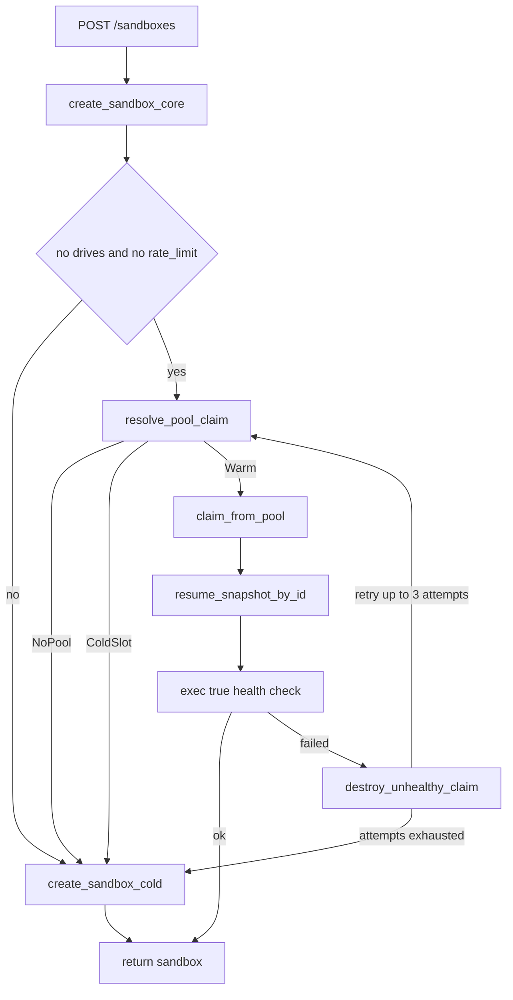
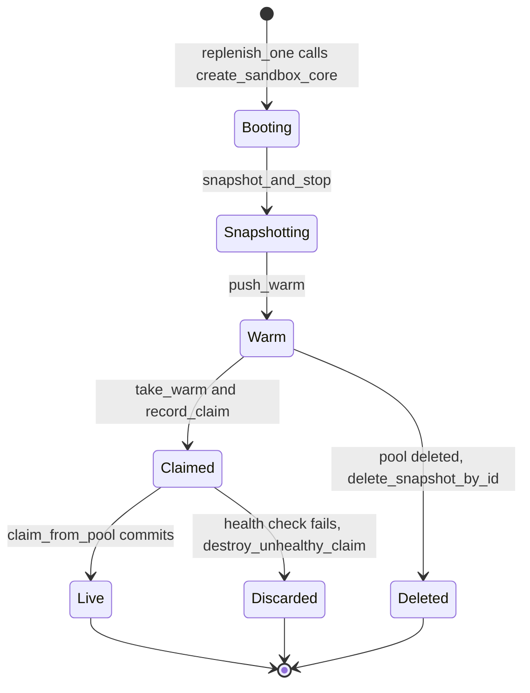
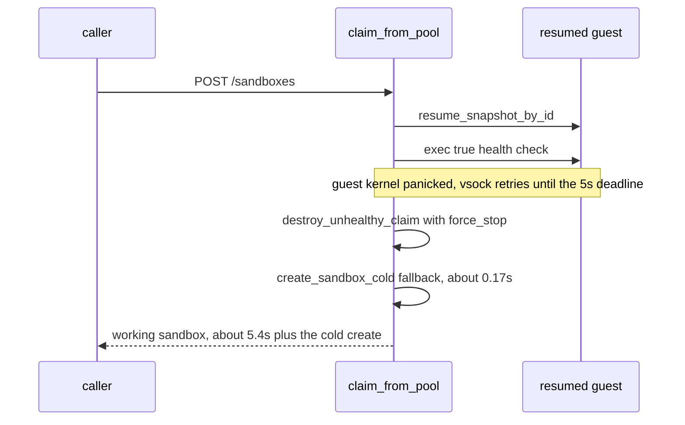

A pre-warmed pool trades idle capacity for startup latency: the daemon boots, snapshots and stops a few sandboxes ahead of time, and a plain `POST /sandboxes` resumes one instead of cold-booting. The mechanism is described in another post in this series. This one is about the evidence: what was measured, what that measurement does and does not support, and where the honest answer is "we do not know".

Code is cited with `path:line` references, verified against the current tree: the claim logic lives in `core/crates/daemon/src/lifecycle/pool_claim.rs`, the background filler in `core/crates/daemon/src/lifecycle/pool_replenisher.rs`, and the pool state in `core/crates/daemon/src/lifecycle/pool.rs`. Every number below comes from `docs/benchmarks.md`, `CHANGELOG.md`, the docs-site startup-latency page, or a commit message, and each is labelled with how it was obtained.

## Problem and how it was found

By September 2026 the project had a boot benchmark that looked excellent (cold boot about 32ms at the time) and a full create that did not (about 160 to 210ms). The roadmap's reading, before any profiling, was that the gap sat in per-create setup and that "a pre-warmed pool's real value is pre-doing that setup ahead of a request". A pool was built on that reasoning, and then measured.

Two separate measurements matter, and they were taken on different dates with different tools.

The first is the claim latency, taken with the example program `examples/pool-warm-start/index.js`, which configures a pool, waits for the replenisher to prepare a warm snapshot, and times a plain `Sandbox.create()` five times in a row, classifying each attempt as a clean claim or a fallback:

```bash
cd examples/pool-warm-start
npm install
node index.js
```

On the first run recorded in the feature commit, a claim took 71ms against 163ms for a cold create on the same run. Across repeated runs the roadmap records a clean claim at roughly 70 to 200ms against a cold create of roughly 160 to 200ms, comparing the moment `create()` returns. The roadmap calls this "a real but modest win at this sample size" on a shared, variable-load dev box.

The second is the time until the sandbox can actually run something. `create()` returning only means Firecracker's `InstanceStart` succeeded; the guest agent may not be listening yet. `scripts/bench-report.sh` measures this client-side as `first_exec_client` for a cold sandbox and `first_exec_resumed` for one resumed from a snapshot of an already-warmed sandbox:

```bash
scripts/bench-report.sh 20 http://127.0.0.1:7777
```

A cold sandbox's first real `exec` measured about 420 to 460ms. Every later `exec` on the same sandbox measured about 3 to 5ms. The first `exec` after a resume measured about 4 to 18ms. The ratio is roughly 25 to 100 times, "confirmed repeatedly, not a one-off", in the roadmap's words.

Third, the resume has a failure mode, described under "Known limitation" below. A resumed guest kernel can panic early after restore and the Firecracker process then exits. In the first recording the serial console showed a divide-by-zero in the console driver's init path. Across several clean, isolated, sequential single-claim runs, the failure rate ranged from roughly 1 in 3 to 2 in 3 resumes. This surfaced only because a pool resumes far more often than the single resume in the integration suite's snapshot topic, which therefore passes every run.

## Root cause

There is no single root cause here, because a pool is not fixing a bug. It is removing work from the request path. What the measurements show is which work it removes and which it cannot.

A cold create does three things before it can answer a request: clone a rootfs, lease a network, boot a kernel and start a guest agent. The last of these is the one the 420 to 460ms figure is mostly made of. Per the roadmap, that time is the guest kernel finishing boot, init starting, and the agent binding its vsock listener, and it is paid by whichever caller makes the first real call. A snapshot taken after the agent is already listening freezes that readiness into guest memory, so a resume skips it. That is the mechanism behind 4 to 18ms.

That also explains why the `create()` comparison undersells the pool. The 70 to 200ms against 160 to 200ms figure compares two operations that both return before the guest is usable. The cold one then charges the remaining 420 to 460ms to its first `exec`; the resumed one charges almost nothing. The roadmap says plainly that the 25 to 100 times figure is the more real description of what the feature closes.

The resume failure rate has a candidate cause, recorded as unconfirmed: restored CPU and timer state interacting badly with timing-sensitive init code, plausibly clock-source drift between snapshot time and restore time. The roadmap labels this "an informed guess, not a confirmed root cause", and adds that it is open whether it is specific to this dev box's kernel, KVM and CPU combination, to the project's own guest kernel build, or to Firecracker snapshot restore in general. Nothing in the repository settles that.



## The change

The change is the feature itself, introduced in commit `6718ae9` ("daemon+vmm+sdk+cli: pre-warmed snapshot pools for faster sandbox creates") and refined by `f6c74d1` and the `max_count` commit. In the daemon, four items carry it: `resolve_pool_claim` (`pool_claim.rs:53`) decides what a request gets, `PoolClaimGuard` (`pool_claim.rs:91`) releases a reserved slot on drop unless committed, `claim_from_pool` (`pool_claim.rs:140`) resumes and verifies, and the background `replenish_one` (`pool_replenisher.rs:44`) keeps pools topped up on a 2 second tick. The vmm side adds `Vm::force_stop` (`core/crates/vmm/src/vm/mod.rs:244`) and `Vm::update_metadata`.

The health check is the part that matters for latency honesty. Every warm claim runs a real `exec true` against the resumed sandbox before returning it:

```rust
sandbox.vm.call(&sandkiln_protocol::Request::Exec {
    command: "true".to_string(),
    args: vec![],
    env: std::collections::HashMap::new(),
})
```

If it fails (`pool_claim.rs:167`), the sandbox is torn down by `destroy_unhealthy_claim` (`pool_claim.rs:252`) and the request falls through to a cold create, so a caller never receives a dead sandbox id. The teardown uses `Vm::force_stop` rather than `Vm::stop`, which skips the pre-kill `sync` (`core/crates/vmm/src/vm/mod.rs:236` and `:244`). The reason is in the doc comment on `force_stop`: a VM already known dead cannot answer `sync`, so waiting would spend a second timeout for nothing. That is the same reasoning that later made `snapshot_and_stop` use `force_stop` too ([Snapshot stop: 6.8s to 0.56s](/engineering/25-opt-snapshot-stop-force-stop)). Here it matters because it is a 10.3 second versus 5.4 second difference on the path a pool takes one resume in three or more of the time.

The replenisher builds each warm entry from the same machinery as a user request. It runs `create_sandbox_core` (`core/crates/daemon/src/http/routes/sandbox.rs:154`) for a placeholder sandbox, then `snapshot_and_stop` (`http/routes/snapshot.rs`), then `push_warm` (`pool.rs:99`) on the pool. Each tick fills at most one slot per due pool, so a large `warm_count` fills gradually instead of spiking boot load.



Two scoping decisions are part of the change and affect what the numbers apply to. A request with `drives` or a custom `rate_limit` never matches a pool, because both are baked into a VM at boot and a warm snapshot has neither. And pool configuration is held in memory only: a daemon restart forgets it, and a snapshot already warm at that moment can be orphaned with no pool left to claim or clean it up. The roadmap lists this as a known, unsolved edge.

`max_count` caps warm plus claimed instances. A request that matches a pool at its ceiling with nothing warm queues on a per-pool `tokio::sync::Notify`, woken on every replenish and every instance stop, for up to 30 seconds, then returns `503`. `resolve_pool_claim` never holds the pools lock across an await: it locks, decides or clones the `Notify`, unlocks, optionally waits, and loops with fresh state. Before a bounded retry (`MAX_POOL_CLAIM_ATTEMPTS`, 3, at `pool_claim.rs:26`) was added, a failed warm claim fell through to an unattributed cold create, so a `max_count` pool could run more live instances than its ceiling.

## Result

What was measured, with its source and the caveat that applies:

| Measurement | Value | Source and caveat |
| --- | --- | --- |
| Clean pool claim, `create()` returning | about 70 to 200ms (71ms on the first run) | Example program and repeated runs, small sample, shared dev box |
| Cold create, `create()` returning | about 160 to 200ms | Same box, same period |
| Cold sandbox, first `exec` | about 420 to 460ms | A/B run for the retry-backoff change, `first_exec_client` |
| Same sandbox, later `exec` | about 3 to 5ms | Same run |
| Resumed sandbox, first `exec` | about 4 to 18ms | `first_exec_resumed`, resumed from an already-warm sandbox |
| Resume guest-kernel panic rate | about 1 in 3 to 2 in 3 | Isolated sequential single-claim runs, root cause unconfirmed |
| Failed claim, fallback latency, before `force_stop` | about 10.3s | Observed live, two back-to-back 5 second retry budgets |
| Failed claim, fallback latency, after `force_stop` | about 5.4s | Same, after the change |
| `max_count` queue wait before `503` | 30s | Constant in the code, live-verified |

The two first-`exec` figures are the strongest result. The `create()` figures are the weakest, and the roadmap says so.

Here is the part that is arithmetic rather than measurement, and it should be read as such. Take a clean claim at roughly 100ms and a failed claim at about 5.4s for the failed attempt plus roughly 0.17s for the cold create it falls back to. If the failure rate is one in three, a single-attempt mean `create()` latency is about (2/3 x 0.1) + (1/3 x 5.6), or 1.9 seconds. At two in three it is about (1/3 x 0.1) + (2/3 x 5.6), or 3.8 seconds. Both are far above a plain cold create's roughly 0.17 seconds. The code retries a failed warm claim up to three times, which I did not model, but each failed attempt still costs about 5.4 seconds. So at the failure rates the roadmap recorded, the pool's mean `create()` latency on this box was likely worse than not having a pool. The pool wins only in the clean case, and even there only by 0 to 90ms on `create()`.

The early 1 in 3 to 2 in 3 figure has not been reproduced since. The re-measurement described under "Known limitation" below found a much lower rate, and a different panic message, which is why the figure above should be read as a recording from one earlier state of the box and the guest kernel, not as a current rate.

The cost of an unlucky claim, as the code orders it and using the durations recorded above, is a sequence of waits rather than one:



## What it cost or risks

Measured costs:

- A failed claim costs about 5.4 seconds before the cold fallback begins. That is the price of never returning a dead sandbox, and it is a deliberate choice: correctness first, latency second.

Costs that follow from the structure but were not benchmarked:

- Each warm entry is a full sandbox that was cold-booted and then snapshotted. Snapshot-take alone was recorded at 485 to 727ms on 2026-11-23 (criterion, this box, kernel 6.8), against 310 to 335ms in earlier runs on an earlier kernel and load state; both sets are directional and neither is authoritative, and the analysis is in [another post](/engineering/23-opt-snapshot-cost-analysis). That figure excludes the stop. Through the HTTP path the same step used to take 6.8 seconds because the stop waited on a guest `sync` a paused VM cannot answer; it now takes 0.56 seconds. The replenisher pays that, plus the cold create, once per warm slot, in the background.
- A held snapshot keeps a `mem.bin` file the size of the guest's configured RAM, the snapshot's own rootfs file, and the tap device and IP from the original lease (the resume has to reuse the exact lease it was snapshotted with). With the dev box's 8-tap pool, that is a hard ceiling on how many warm entries plus live sandboxes can coexist.
- A resumed VM's MMDS store comes back uninitialized, so `Vm::update_metadata` redoes the full `PUT /mmds/config` plus `PUT /mmds` sequence, retried up to 10 times at 300ms intervals (`UPDATE_METADATA_MAX_ATTEMPTS`, about 3 seconds). The retry exists because a metadata call right after a resume can spuriously fail under load.

Risks that are explicit in the code:

- In-memory configuration. A restart loses every pool, and `Pool.create` has to be called again.
- The unattributed edge. Three consecutive bad resumes in one request still fall through to an unattributed cold create, which can exceed `max_count`. The roadmap calls this "an accepted, rare residual edge case".
- A sandbox with `drives` or `rate_limit` gets no benefit.
- The post-resume health check still runs while holding the daemon's `sandboxes` mutex (`pool_claim.rs:153` to `:159`): it takes the lock, then calls `Vm::call` inside it, bounded at about 3 seconds per attempt and about 5 seconds in total. Ordinary exec no longer does this (see [Long-running exec](/engineering/26-correctness-long-running-exec)), but a failing claim can still stall other sandbox operations for that long. I read this in the code and did not time it.

## Known limitation

A freshly resumed guest can still die, and the cause is not found. In the full integration suite run four topics at a time (about 320 checks), 2 to 3 checks fail per run because a resumed guest kernel panics with `Attempted to kill the idle task!` about 20ms after restore and its Firecracker process exits. In isolation it does not reproduce: 160 of 160 resume and re-snapshot cycles were clean, in isolated loops and in four-way parallel loops, so it needs a specific concurrent condition that has not been identified. It was observed on 2026-11-24; I have no evidence it shares a cause with the earlier divide-by-zero panic.

What protects callers is the post-resume health check above. A pool claim that lands on a dead guest fails the `exec true`, is torn down with `force_stop`, and falls back, so no caller receives a dead sandbox id. What it does not protect is a plain `POST /snapshots/{id}/resume` or a fork, which has no such check. I have not determined which paths the failing integration checks took. The cost to a pool user is the fallback latency in the table above whenever it triggers.

## How to reproduce

The claim-versus-fallback behaviour, with the output split into clean claims and fallbacks:

```bash
cd examples/pool-warm-start && npm install && node index.js
```

The time-to-first-command numbers, cold and resumed:

```bash
scripts/bench-report.sh 20 http://127.0.0.1:7777
```

It prints `first_exec_client` and `first_exec_resumed` alongside the daemon's own `create_phase_duration_ms` breakdown, and diffs against the previous run saved under `scripts/bench-results/`. Add `--with-criterion` to fold in `cold_boot`, `exec_roundtrip`, `resume_from_snapshot` and `snapshot_take`.

The correctness behaviour, including `max_count` queueing and exact-id-set pool cleanup, is covered by the integration topic `scripts/integration-tests/18-pool.sh`, run with the filter described in `scripts/integration-test.sh`:

```bash
SANDKILN_INTEGRATION_TEST_ONLY=18-pool scripts/integration-test.sh
```

To measure the failure rate yourself, run the example repeatedly and count the fallbacks. The daemon log line `pool-claimed sandbox failed its post-resume health check` appears once per failed claim. Treat any rate you get as a measurement of your own host's kernel, KVM and CPU combination, not a general property of Firecracker.

What this case study does not establish: the memory and disk cost of a pool at scale, and whether the 25 to 100 times figure holds for guests heavier than the default image.
