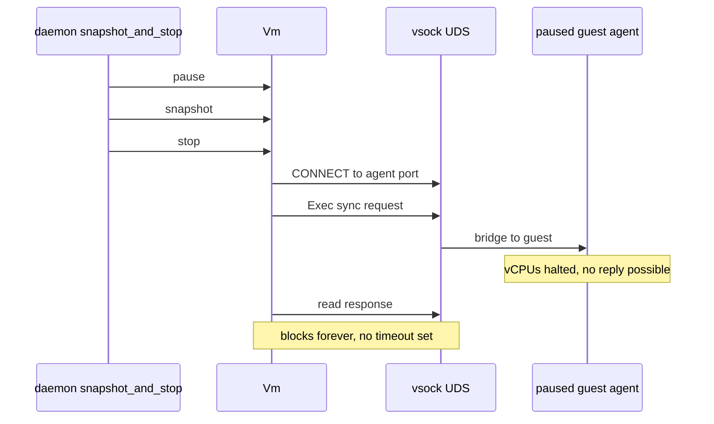
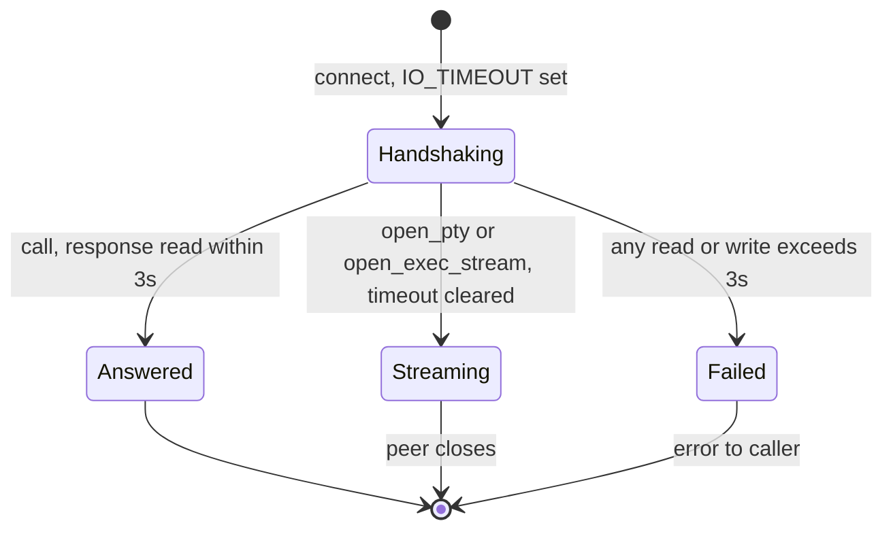
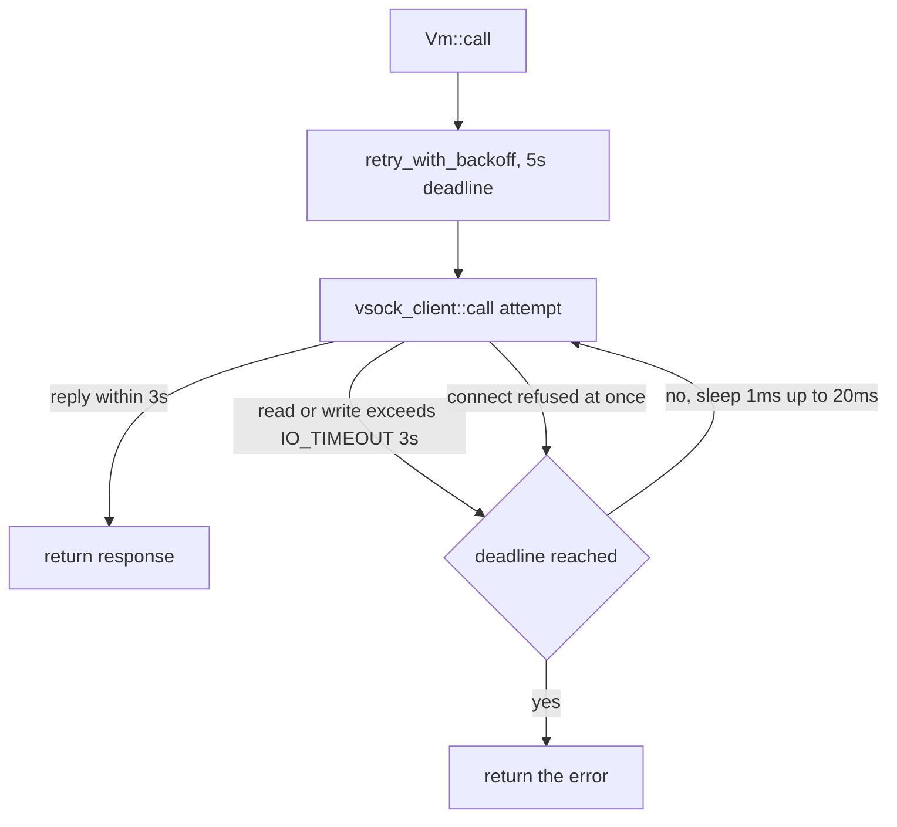

Most latency work lowers a typical number. This case study is about the other kind: changing a worst case from unbounded to bounded. Before the fix, a particular and entirely ordinary sequence of operations (pause a VM, then stop it) never returned. After it, the same sequence returns in a few seconds. That is a change from infinity to a finite number, and it is worth treating as an optimization because the failure it removed was a stuck daemon thread, not a slow request.

Items in `sandkiln-vmm` are cited with `path:line` references, verified against the current tree. The daemon is cited by item name only.

## Problem and how it was found

Snapshots were new. Firecracker requires a VM to be paused before it will take a snapshot, and the daemon's `snapshot_and_stop` does exactly that: pause, snapshot, then stop the VM. Commit `abb8286` (2026-08-29) records how the hang was found: live-testing the snapshot and resume cycle, the run paused a VM, asked it to stop, and never got a reply. It happened every time, not intermittently, so it was seen on the first full cycle.

The test was nothing more than the cycle itself against a real daemon and a real microVM:

```bash
# create, snapshot (pause + snapshot + stop), resume, read back a marker
scripts/integration-test.sh   # topic 08-snapshots.sh exercises this cycle
```

The commit message states what was observed afterwards: the full snapshot-then-resume cycle "now completes in ~7s (bounded, not hung)", the resume itself took 39ms, and the resumed VM's marker file and responsiveness both checked out. The 7 seconds is the number to keep in mind; it is bounded, but it is not small, and the reason is further down.

There is no "before" latency number, because the before state has no latency: the call never returned. That is the entire point of the finding.

## Root cause

`Vm::stop` does not simply kill the Firecracker process. A bare `SIGKILL` loses unflushed guest page-cache writes to attached drives, so `stop` first sends an `exec sync` request to the guest agent over vsock, best-effort, and then kills the process (`core/crates/vmm/src/vm/mod.rs:211` is `stop_inner`, with the `sync` call at `:215` to `:216`).

A paused VM has its vCPUs halted. The guest agent runs inside the guest, so a paused guest cannot answer anything, including `sync`. The request goes out over a Unix domain socket that Firecracker bridges to the guest, and then nothing comes back.

The vsock client at that time set no timeouts on the stream. A blocking `read` on a stream with no read timeout waits forever. The 5 second deadline in `Vm::call`'s retry loop did not help, and this is the subtle part: that deadline is checked between attempts, after an attempt has returned. It bounds the gap between connection attempts, not an attempt already in progress. An attempt that never returns never reaches the deadline check.

Put in layers:

| Layer | What it bounded | Why it did not help |
| --- | --- | --- |
| Retry deadline in `Vm::call` (5s) | Time spent retrying failed attempts | Only consulted after an attempt returns |
| `connect` to the vsock UDS | Whether Firecracker's socket exists | The socket was fine; the guest was paused |
| Blocking `read` on the stream | Nothing | No timeout set |

The bug class is "a bound at the wrong layer". The retry loop guarded against the guest not being ready yet, which is a race that resolves itself. It did not guard against the guest never answering, which does not.



## The change

The fix is eleven added lines in `core/crates/vmm/src/vsock_client.rs`: a constant and two `set_*_timeout` calls on every stream the module opens.

```rust
/// Bounds every blocking read/write on the vsock stream. Without this, a
/// guest that connects but never answers (a paused VM, vCPUs halted, is
/// the case that surfaced this) hangs forever.
const IO_TIMEOUT: Duration = Duration::from_secs(3);
```

That constant is at `core/crates/vmm/src/vsock_client.rs:22`. Its use in the request and response path is at `:29` and `:30`:

```rust
let mut stream = UnixStream::connect(uds_path)?;
stream.set_read_timeout(Some(IO_TIMEOUT))?;
stream.set_write_timeout(Some(IO_TIMEOUT))?;
connect_handshake(&mut stream, guest_port)?;
```

The design decision worth defending is where it was put. The fix is in the transport, applied unconditionally to every stream the module opens, rather than special-cased in `Vm::stop` or in the snapshot path. The commit message gives the reason: any unresponsive guest, whether crashed, paused or kernel-panicked, would have hit the same indefinite hang, not just this one snapshot code path. A fix at `stop` would have left every other caller exposed and would have needed to be repeated at each new one.

The timeout is set before the `CONNECT` handshake, so the handshake read is bounded too. A guest that accepts the connection but never completes the handshake is covered by the same constant.

Two later additions to the module change what the timeout means for long-lived streams. When interactive PTY sessions and streamed exec sessions were added, they needed the opposite behaviour after the handshake: a real session can sit quiet for a long time with nothing typed, and that is not a hung connection. Both `open_pty` and `open_exec_stream` therefore set the timeout for the handshake and then clear it on the stream they hand back:

```rust
stream.set_read_timeout(None)?;
stream.set_write_timeout(None)?;
Ok(stream)
```

Those clears are at `core/crates/vmm/src/vsock_client.rs:55` to `:56` for the PTY and `:81` to `:82` for the exec stream. The comments there say the timeout "applies only to the handshake below, not the returned stream". So the rule is: one 3 second bound everywhere a request must be answered, no bound on a stream whose whole purpose is to stay open.



The two bounds stack, and which one applies depends on the failure. A guest that is paused or hung hits the 3 second stream timeout on each attempt. A guest whose process is gone fails the connect immediately and runs the retry loop to its deadline:



The second change that belongs to this story is `Vm::force_stop` (`core/crates/vmm/src/vm/mod.rs:207`), added in commit `f6c74d1`. It exists because bounding the hang made the cost of a doomed call visible rather than eliminating it. A VM already known to be dead (for example one that failed a pool claim's post-resume health check) cannot answer `sync` either, and `stop` would spend a second full timeout budget finding that out. `force_stop` calls the same `stop_inner` with `sync_first` set to false, so it kills the process without the pre-kill `sync` call. The doc comment on it states the reason: "nothing to flush, and the sync would just pay its own ~5s timeout for nothing".

## Result

Everything here was observed live and recorded in a commit message or in `ROADMAP.md`. Nothing is from a fresh run on 2026-11-24.

| Scenario | Before the timeout | After |
| --- | --- | --- |
| `stop` of a paused VM, worst case | never returns | bounded |
| Full snapshot then resume cycle | hung, every time | about 7s (commit `abb8286`) |
| Resume step of that cycle | not reached | 39ms |
| Pool fallback after a failed health check, two doomed calls | about 10.3s (`stop` after the health check) | about 5.4s with `force_stop` (commit `f6c74d1`) |

Per call, the bound is 3 seconds for any single read or write. Per `Vm::call`, the observable bound is larger, and this is derived from the code rather than measured. `Vm::call` wraps `vsock_client::call` in `retry_with_backoff` with a 5 second deadline (`core/crates/vmm/src/vm/mod.rs:142`, and the helper at `:282`). A first attempt that times out after 3 seconds has not yet reached the deadline, so the loop sleeps briefly and tries a second attempt, which also times out after 3 seconds. The deadline check then fails and the error returns. That is about 6 seconds from first connect to returned error, which agrees with the roughly 7 seconds recorded for the whole snapshot cycle once the pause, the snapshot write and the resume are added.

The 10.3s to 5.4s figure has a different shape, and I am careful here because the code does not show the arithmetic directly. A pool claim's health check calls `Vm::call` against a guest whose Firecracker process has already exited. Connecting to a dead process's socket fails immediately rather than blocking, so the retry loop spins until its 5 second deadline. That is the first roughly 5 seconds. The old fallback then called `stop`, which issued another `Vm::call` for `sync` and spent a second roughly 5 second budget. Together about 10.3 seconds. With `force_stop`, only the first budget is paid, about 5.4 seconds. This is why `force_stop` halves the figure: it removes one of two sequential, independent waits. I derived the mechanism from the code and the recorded numbers; the roadmap records the numbers and not this decomposition.

So the summary of the worst case is: a single read or write is bounded at 3 seconds, a `Vm::call` at about 6 seconds, and a `Vm::stop` of an unresponsive VM at about 6 seconds plus the kill.

There is one more thing the code shows, and it is not a claim about the past. `snapshot_and_stop` still ends with `vm.stop()` after `pause()` and `snapshot()`, so that `stop` still issues its `sync` call against a VM that is, by then, paused. By the reasoning above, that call can never succeed and should cost about the 6 second bound every time a sandbox is snapshotted through that path. That path is shared by the explicit snapshot endpoint, the idle reaper's auto-suspend, and the pool replenisher. I did not measure this on a live daemon for this post, and the criterion benchmark `snapshot_take` times only the `pause` and `snapshot` pair, so it would not show it. If it holds, using `force_stop` there is an unimplemented change that would remove most of the roughly 7 second figure. Nothing was changed or measured; I am flagging it as a reading of the code that a live timing of the snapshot endpoint would confirm or refute.

## What it cost or risks

The timeout is a blanket one, which gives it the costs of a blanket rule.

- A legitimately slow request/response `exec` is bounded too. Request/response `exec` goes through `Vm::call`, whose response read has the same 3 second bound, and `Vm::call` retries on any I/O error for up to 5 seconds. The docs-site page for this fix states, from reading the code and without testing against a live VM, that a plain `exec` producing no response within 3 seconds fails on the host side. It also implies a worse property that I want to call out explicitly: because the retry loop retries on any error, a command that outlives the 3 second read could be sent again, running it a second time. I have not verified that. It is a consequence of two documented behaviours, and for anything long-running the docs recommend streamed exec, which clears the timeout after its handshake.
- Whether that behaviour is acceptable is a design question that this change did not decide. It accepted it implicitly. The 3 second constant is not configurable.
- There is no unit test for the timeout. I looked for one in `vsock_client.rs` and found none. The behaviour was verified live (the snapshot cycle completing) but nothing in `cargo test --workspace` fails if the constant or the `set_read_timeout` calls disappear. Section 6 of the project's standard asks for real tests of pure logic, and this is a place a loopback Unix-socket server that accepts and never answers would make a cheap, KVM-free regression test. It is not written.
- The fix hides a design smell rather than removing it. The sync-before-kill sequence runs against VMs that are known not to be able to answer. Bounding the wait makes that survivable; it does not make it correct, as the `snapshot_and_stop` observation above shows.
- Treating "the guest may be paused or dead" as a normal state is the lesson the docs-site page draws. The cost of learning it was a hung thread found by chance during a first end-to-end cycle, because no test before it paused a VM and stopped it.

## How to reproduce

To see the bound in the logs, run the snapshot cycle against a real daemon and watch for the best-effort sync warning, which is what a bounded failure looks like:

```bash
scripts/remote.sh run scripts/integration-test.sh
RUST_LOG=sandkilnd=debug,sandkiln_vmm=debug scripts/sandkilnd-ctl.sh logs
```

The line to find is `sync before stop failed, proceeding anyway` (`core/crates/vmm/src/vm/mod.rs:217`), together with the `vsock call failed` warning from `Vm::call`. Their timestamps show the elapsed time of the bounded wait. The snapshot endpoint's latency, measured client-side, shows the roughly 7 second figure:

```bash
time curl -s -X POST http://127.0.0.1:7777/sandboxes/<id>/snapshot
```

To reproduce the pool-fallback comparison, run the example in `examples/pool-warm-start` and time the attempts the example classifies as fallbacks; those are the ones that pay the single remaining 5 second budget. Remember that the failure rate that produces them is itself the roadmap's measured 1 in 3 to 2 in 3, on one box.

To prove the original failure, one would revert the two `set_*_timeout` calls at `core/crates/vmm/src/vsock_client.rs:29` and `:30`, pause a VM and call `Vm::stop`. It would hang. That check was done once, live, in August; it has not been automated.
