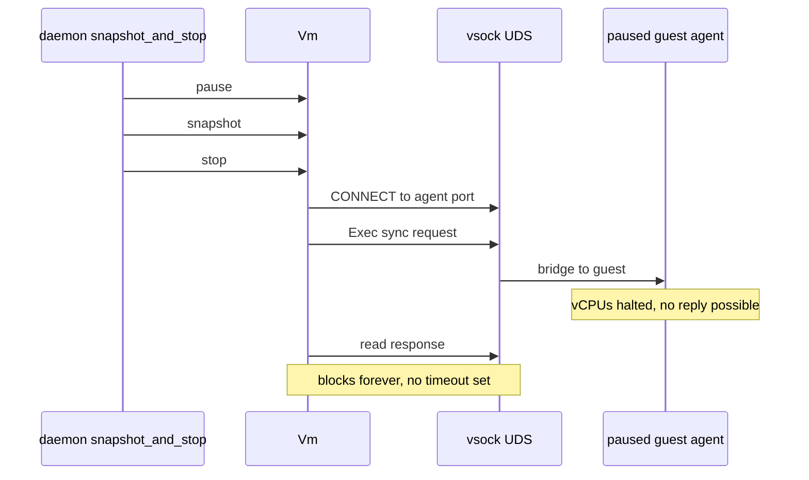
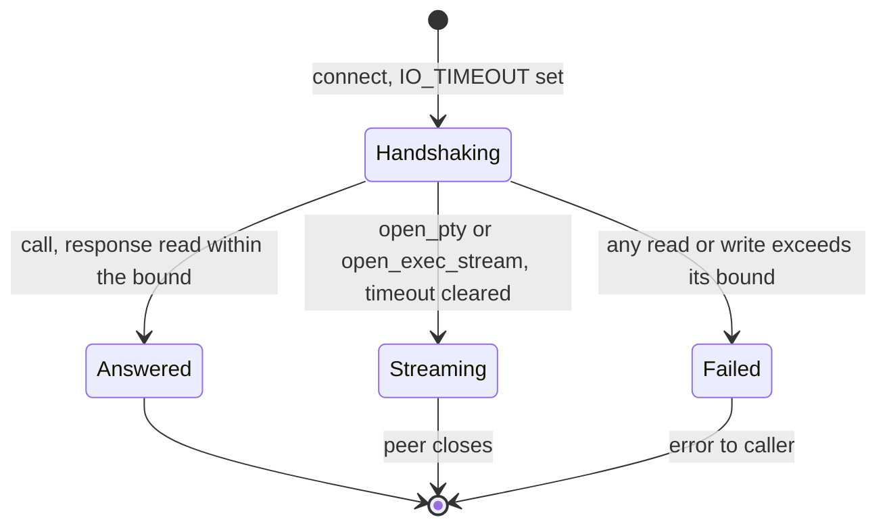
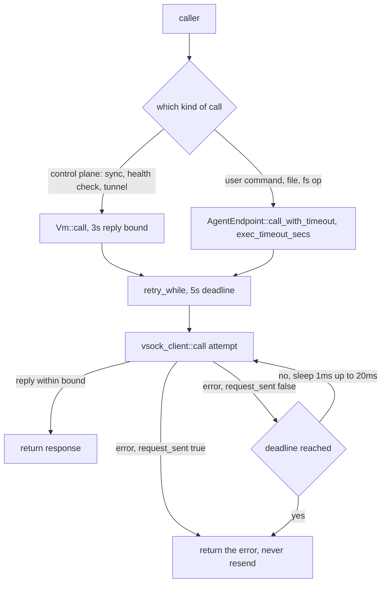

Most latency work lowers a typical number. This case study is about the other kind: changing a worst case from unbounded to bounded. Before the fix, a particular and entirely ordinary sequence of operations (pause a VM, then stop it) never returned. After it, the same sequence returned in a few seconds. That is a change from infinity to a finite number, and it is worth treating as an optimization because the failure it removed was a stuck daemon thread, not a slow request.

The story has two acts. The first is the bound itself. The second, months later in the commit history, is the discovery that a blanket bound is wrong for user commands, which led to the finer design this post ends on. Items are cited with `path:line` references, verified against the current tree.

## Problem and how it was found

Snapshots were new. Firecracker requires a VM to be paused before it will take a snapshot, and the daemon's `snapshot_and_stop` (`core/crates/daemon/src/http/routes/snapshot.rs:147`) does exactly that: pause, snapshot, then stop the VM. Commit `abb8286` (2026-08-29) records how the hang was found: live-testing the snapshot and resume cycle, the run paused a VM, asked it to stop, and never got a reply. It happened every time, not intermittently, so it was seen on the first full cycle.

The test was nothing more than the cycle itself against a real daemon and a real microVM:

```bash
# create, snapshot (pause + snapshot + stop), resume, read back a marker
scripts/integration-test.sh   # topic 08-snapshots.sh exercises this cycle
```

The commit message states what was observed afterwards: the full snapshot-then-resume cycle "now completes in ~7s (bounded, not hung)", the resume itself took 39ms, and the resumed VM's marker file and responsiveness both checked out. The 7 seconds is the number to keep in mind. It is bounded, but it is not small, and the reason turned out to be a second bug sitting behind the first one, covered in [Snapshot stop: 6.8s to 0.56s](/engineering/25-opt-snapshot-stop-force-stop).

There is no "before" latency number for the hang itself, because the before state has no latency: the call never returned.

## Root cause

`Vm::stop` does not simply kill the Firecracker process. A bare `SIGKILL` loses unflushed guest page-cache writes to attached drives, so `stop` first sends an `exec sync` request to the guest agent over vsock, best-effort, and then kills the process (`core/crates/vmm/src/vm/mod.rs:248` is `stop_inner`, with the `sync` call at `:253` to `:256`).

A paused VM has its vCPUs halted. The guest agent runs inside the guest, so a paused guest cannot answer anything, including `sync`. The request goes out over a Unix domain socket that Firecracker bridges to the guest, and then nothing comes back.

The vsock client at that time set no timeouts on the stream. A blocking `read` on a stream with no read timeout waits forever. The 5 second deadline in `Vm::call`'s retry loop did not help, and this is the subtle part: that deadline is checked between attempts, after an attempt has returned. It bounds the gap between connection attempts, not an attempt already in progress. An attempt that never returns never reaches the deadline check.

| Layer | What it bounded | Why it did not help |
| --- | --- | --- |
| Retry deadline in `Vm::call` (5s) | Time spent retrying failed attempts | Only consulted after an attempt returns |
| `connect` to the vsock UDS | Whether Firecracker's socket exists | The socket was fine; the guest was paused |
| Blocking `read` on the stream | Nothing | No timeout set |

The bug class is "a bound at the wrong layer". The retry loop guarded against the guest not being ready yet, which is a race that resolves itself. It did not guard against the guest never answering, which does not.



## The change

### The transport bound

The first fix was eleven added lines in `core/crates/vmm/src/vsock_client.rs`: a constant and two `set_*_timeout` calls on every stream the module opens.

```rust
/// Bounds every blocking read/write on the vsock stream. ...
const IO_TIMEOUT: Duration = Duration::from_secs(3);
```

That constant is at `vsock_client.rs:22`, and it is applied before the `CONNECT` handshake (`:54` and `:55`), so a guest that accepts the connection but never completes the handshake is covered by the same bound.

The design decision worth defending is where it was put. The fix is in the transport, applied unconditionally to every stream the module opens, rather than special-cased in `Vm::stop` or in the snapshot path. Any unresponsive guest, whether crashed, paused or kernel-panicked, would have hit the same indefinite hang, and a fix at `stop` would have left every other caller exposed.

Interactive PTY sessions and streamed exec sessions needed the opposite behaviour after the handshake: a real session can sit quiet for a long time with nothing typed, and that is not a hung connection. Both `open_pty` (`vsock_client.rs:74`) and `open_exec_stream` (`:93`) therefore bound only the handshake and then clear the timeouts on the stream they hand back (`:84` to `:85` and `:110` to `:111`).



### The refinement: a bound that depends on who is asking

The blanket 3 second read bound was right for the control plane and wrong for user commands, and the commit that corrected it is `cc5573f` (2026-11-24). A command that stays silent for 4 seconds is not a hung guest, and the old code treated it as one, then retried it. The whole finding is in [Long-running exec](/engineering/26-correctness-long-running-exec). What matters for this post is the design that came out of it, which has three parts.

First, `vsock_client::call` takes a `response_timeout` and returns a structured error (`vsock_client.rs:51`):

```rust
pub struct CallError {
    pub error: io::Error,
    /// The full request frame was written to the guest. Do not retry.
    pub request_sent: bool,
}
```

Connecting and writing still use `IO_TIMEOUT`. Only the wait for the reply uses the caller's `response_timeout` (`None` waits indefinitely), set after the request is written (`:64`). Any failure before the request frame is fully written is marked `request_sent: false`, including a write that fails part-way, because the agent discards an incomplete frame without executing it. Any failure after is `request_sent: true`.

Second, retrying is decided by that flag. `retry_while` (`core/crates/vmm/src/vm/mod.rs:321`) has the same backoff as `retry_with_backoff` but returns immediately on an error whose `request_sent` is true. A refused connect, a failed handshake or an unwritten request is safe to repeat. A request the guest may have started is not.

Third, the bound is chosen at the call site. `Vm::call` is the control-plane entry point and uses `CONTROL_PLANE_RESPONSE_TIMEOUT`, 3 seconds (`vm/mod.rs:105` and `:170`). `Vm::call_with_timeout` (`:178`) takes the bound as an argument. A user command goes through `AgentEndpoint::call_with_timeout` with the daemon's `exec_timeout_secs` setting, default 600 seconds. `AgentEndpoint` (`vm/mod.rs:122`) is an owned, cloneable handle to the vsock socket path, so a caller can copy it out of a shared map, drop the map's lock and make a long call without holding it.



The `Vm::force_stop` method (`vm/mod.rs:244`), added in `f6c74d1`, is the third piece. It calls the same `stop_inner` with `sync_first` false, so it kills the process without the pre-kill `sync`. It was introduced for a VM known to be dead, such as one that fails a pool claim's health check, where a doomed `sync` would pay a second full wait. It later turned out to be the right call for the snapshot path as well.

## Result

Everything here was observed live and recorded in a commit message, in `ROADMAP.md`, or in the `cc5573f` regression test. The numbers are directional, from one shared dev box.

| Scenario | Before the timeout | After |
| --- | --- | --- |
| `stop` of a paused VM, worst case | never returns | bounded |
| Full snapshot then resume cycle | hung, every time | about 7s (commit `abb8286`) |
| Resume step of that cycle | not reached | 39ms |
| Snapshot request, stop waiting on a doomed `sync` | about 6.8s (found later) | 0.56s with `force_stop` (commit `cc5573f`) |
| Pool fallback after a failed health check | about 10.3s with `stop` | about 5.4s with `force_stop` (commit `f6c74d1`) |
| A command silent for 4s | errored after about 6.5s and ran twice | succeeds once (commit `cc5573f`) |

Per call, the bound is 3 seconds for any single connect, write or control-plane read. Per `Vm::call`, the observable bound is larger and is derived from the code. `retry_while` has a 5 second deadline checked after an attempt returns. Under the original blanket rule a timed-out read took 3 seconds, was retried, and timed out again at about 6 seconds, which matches the roughly 7 seconds recorded for the cycle. Under the current rule a timed-out read has `request_sent` true, so it is not retried: a `Vm::call` against a paused guest now returns in about 3 seconds, not 6. That is my reading of the code. I did not time a bare `Vm::call` against a paused guest after the change.

The 10.3 to 5.4 second figure has a different shape. A health check against a guest whose Firecracker process has already exited fails to connect immediately, so the retry loop spins to its 5 second deadline, about 5 seconds. The old fallback then called `stop`, which issued a second `Vm::call` for `sync` and spent another budget, about 10.3 seconds together. With `force_stop` only the first budget is paid. The roadmap records the numbers, and the decomposition is mine, derived from the code.

The snapshot stop had a caveat in an earlier version of this post: `snapshot_and_stop` called `vm.stop()` on a paused VM and so should have paid the doomed `sync` on every snapshot. That was a reading of the code, and it was right. It was then measured at 6.8 seconds end to end, fixed by calling `force_stop` (`snapshot.rs:188`), and measured again at 0.56 seconds.

## What it cost or risks

- **The 3 second bound is a constant.** `IO_TIMEOUT` and `CONTROL_PLANE_RESPONSE_TIMEOUT` are not configurable. A control-plane call that legitimately needs more than 3 seconds, such as a `sync` of a large dirty page cache, would fail on the host side. Only the user-command bound, `exec_timeout_secs`, is a setting.
- **A reply that never comes is still ambiguous.** When a user command exceeds its bound the daemon returns an error, but the process may still be running in the guest. The bound limits how long the daemon waits, not how long the guest works. The HTTP contract for it is a 504, described in the exec post.
- **No retry after send means an at-most-once guarantee, not exactly-once.** A request that was sent and then lost to a transport error is reported as failed even if the guest executed it. That is the correct trade for commands with side effects, and callers that need exactly-once have to deal with it above this layer.
- **Control-plane calls still hold a lock in two places.** The post-resume pool health check (`core/crates/daemon/src/lifecycle/pool_claim.rs:158`) and the tunnel start and stop calls (`core/crates/daemon/src/http/routes/tunnel.rs:94`, `:124`) still call `Vm::call` while holding the daemon's `sandboxes` mutex. They are bounded at about 3 seconds per attempt, so a stuck guest stalls other sandbox operations for that long. User exec and file calls no longer do this. I read it in the code and did not measure the stall.
- **There is no unit test for the transport timeouts.** `vsock_client.rs` has no tests, and the `retry_while` helper has none either. The behaviour is covered by live checks: the snapshot cycle completing, and `scripts/integration-tests/25-long-running-commands.sh` for the long command, the no-rerun property and the snapshot latency. A loopback Unix-socket server that accepts and never answers would be a cheap, KVM-free regression test for the hang. It is not written, and nothing in `cargo test --workspace` fails if the `set_read_timeout` calls disappear.
- **The learning was expensive.** A hung thread found by chance during a first end-to-end cycle, then a second bug found only by timing the real HTTP request. Treating "the guest may be paused or dead" as a normal state, not an exceptional one, is the lesson both finds share.

## How to reproduce

To see the bound in the logs, run the snapshot cycle against a real daemon and watch for the warnings a bounded failure produces:

```bash
scripts/remote.sh run scripts/integration-test.sh
RUST_LOG=sandkilnd=debug,sandkiln_vmm=debug scripts/sandkilnd-ctl.sh logs
```

The `vsock call failed` warning (`vm/mod.rs:135`) carries `request_sent`, which tells you whether the failure was eligible for a retry. The older `sync before stop failed, proceeding anyway` line (`vm/mod.rs:254`) now appears only when a plain `stop` runs against an unreachable guest.

To prove the retry rule, run a command that stays silent past the control-plane bound and check the marker file:

```bash
curl -s -X POST http://127.0.0.1:7777/sandboxes/<id>/exec \
  -d '{"command":"sh","args":["-c","echo run >> /tmp/m; sleep 4"]}'
```

It should return 200 once and leave a single `run` line. To prove the original hang, one would revert the two `set_*_timeout` calls at `vsock_client.rs:54` and `:55`, pause a VM and call `Vm::stop`. It would hang. That check was done once, live, in August; it has not been automated.
