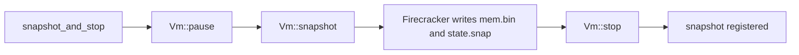
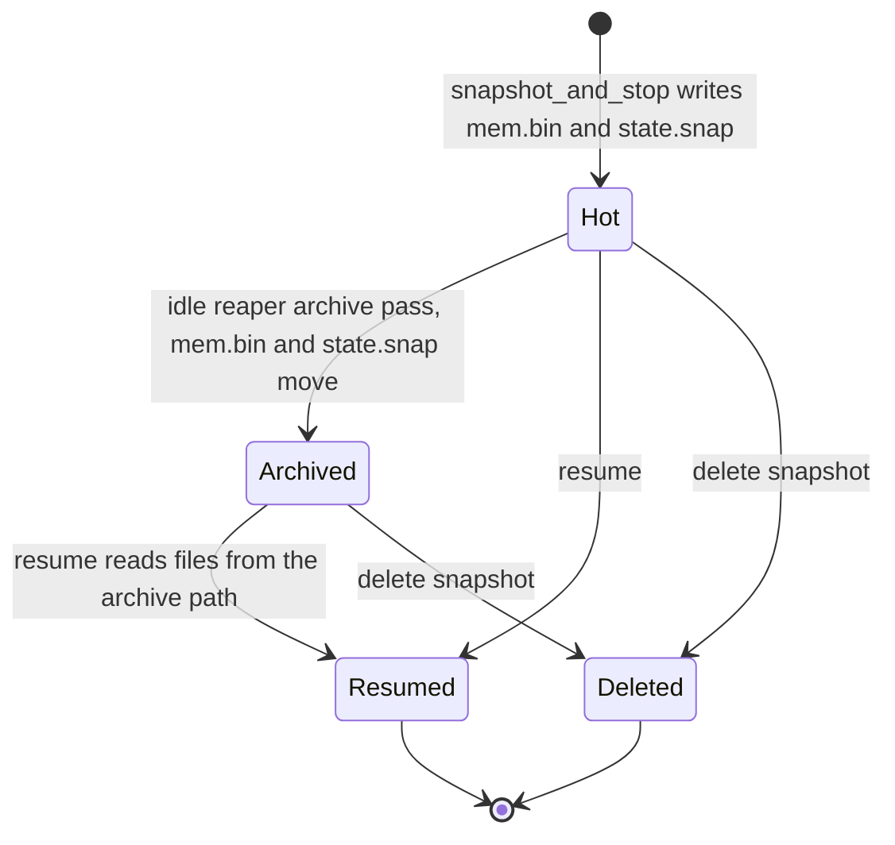
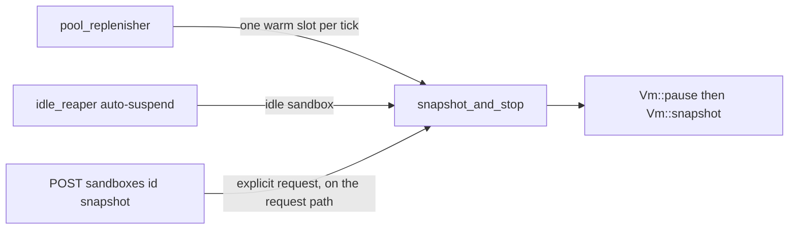

This post is different from the others in the series. No snapshot-take optimization has shipped. There is no before and after. What exists is a set of measurements of the cost, a partial explanation of where it comes from, and a short list of candidate techniques that are recorded in `ROADMAP.md` as planned or "worth doing eventually". The value of writing it down is to keep the baseline honest, so that a future change can be judged against something real, and to separate what is measured from what is hypothesized.

Items in `sandkiln-vmm` carry `path:line` references verified against the current tree. The daemon is cited by item name only.

## Problem and how it was found

Snapshot-take is the operation that suspends a running sandbox: pause the vCPUs, write the guest's memory and device state to disk. It is the cost behind explicit snapshots, behind auto-suspend of idle sandboxes, and behind every warm entry a pre-warmed pool prepares. It was benchmarked when the snapshot and resume benchmarks were added in commit `3b0deef`, whose title records the surprise: "real numbers say resume isn't the latency win we assumed".

The benchmark is `bench_snapshot_take` in `core/crates/vmm/benches/vm_lifecycle.rs`. It boots a fresh VM outside the timed region, then times only the pair that the daemon's `snapshot_and_stop` performs:

```rust
let started = Instant::now();
vm.pause().expect("Vm::pause failed during benchmark");
vm.snapshot(&mem_path, &snapshot_path).expect("Vm::snapshot failed during benchmark");
total += started.elapsed();
```

Run it as:

```bash
SANDKILN_BENCH_FIRECRACKER_BIN=<path> SANDKILN_BENCH_KERNEL_PATH=<path> \
SANDKILN_BENCH_ROOTFS_PATH=<path> cargo bench -p sandkiln-vmm --bench vm_lifecycle -- snapshot_take
```

The guest is the benchmark default of 2 vCPUs and 512MiB of RAM (`SANDKILN_BENCH_VCPU_COUNT`, `SANDKILN_BENCH_MEM_SIZE_MIB`, defaults at `core/crates/vmm/benches/vm_lifecycle.rs:32` and `:35`). What the benchmark does not time matters as much as what it does: it excludes `Vm::stop` and everything the daemon does around the snapshot (the HTTP layer, the bookkeeping, the lease handling).

The recorded readings, in date order, with their conditions:

| Date | Reading | Conditions | Source |
| --- | --- | --- | --- |
| Early (before 2026-09-14) | 309.6 to 335.0ms, mean about 322ms | Criterion, quiet moment on a shared desktop-class dev box | `ROADMAP.md` Benchmarking |
| 2026-09-14 | 552.7ms | `scripts/bench-report.sh --with-criterion`, 20 iterations, box in active use | commit `119f008` |
| 2026-09-14 | 560 to 915ms | Isolated `cargo bench -- snapshot_take`, criterion reports no change from prior run (p=0.14) | commit `119f008` |
| 2026-11-24 | 485 to 727ms | Criterion, this box, kernel 6.8, re-measured by the project lead | lead's re-measurement for this series |

The same project-wide figure appears in the roadmap's findings table as "310-990ms". I could not find a recorded 990ms measurement anywhere in the repository history: the highest individual reading I can locate is 915ms. The 990 appears first in a roadmap commit (`b75bb4a`) that carries no run to back it. I have therefore not used it in the table above and I am flagging it as a figure I could not substantiate.

Two things stand out in the table. First, the figure moved by more than 2x across readings with no code change to the snapshot path. The roadmap's own explanation, recorded on 2026-09-14, is that the dev box is an actively used desktop and that a synchronous full-memory write is far more exposed to that than the other benchmarks. Second, the lead's note for 2026-11-24 that the earlier 310 to 335ms figures came from "an earlier kernel/load state" is consistent with that: neither the earlier nor the later set is authoritative, and I present both with their dates rather than picking one.

For contrast, resume is cheap. `resume_from_snapshot` was recorded at about 25.8ms (25.5 to 26.2ms) when first measured, a mere 19 percent below that day's cold boot of about 31.9ms. After the fixed 20ms socket-wait sleep was replaced it read 6.5 to 7.7ms, and a bench-report run on 2026-09-14 read 7.95ms. The asymmetry between take (hundreds of milliseconds) and resume (single digits) is the reason a pool makes sense at all: take is paid ahead of time, in the background; resume is paid on the request path.



The criterion benchmark times the span from `Vm::pause` through `Vm::snapshot` only. `Vm::stop` and the registration that follows are outside it.

## Root cause

The honest statement is that the cost is explained but not profiled. Four facts are established.

1. `Vm::snapshot` is thin. It is a single `PUT /snapshot/create` against Firecracker's API (`core/crates/vmm/src/vm/snapshot.rs:40`, request at `:42`), and `Vm::pause` is a single `PATCH /vm` (`core/crates/vmm/src/vm/snapshot.rs:29`, request at `:31`). Sandkiln's own code adds no copying, no compression and no encryption on this path. So the time is, as far as the code shows, Firecracker's time.
2. Firecracker writes the guest's memory to the `mem.bin` file itself, in the `File` backend mode that `Vm::resume` uses for loading (`backend_type: File`). The roadmap's encryption section states the consequence: Firecracker opens and writes `mem.bin` and `state.snap` directly, so sandkiln never holds the plaintext bytes. That is a relevant constraint for any future optimization that wants to touch the bytes, such as compressing them.
3. `mem.bin` is sized to the guest's configured RAM. The roadmap says it is "exactly the guest's configured RAM size". The default guest has 512MiB (`SANDKILN_MEM_SIZE_MIB`, default `512`), so each snapshot is a half-gigabyte file written to disk.
4. Firecracker's own documentation, as summarized in the roadmap, describes the asymmetry as structural: taking a full snapshot writes every dirty memory page to disk synchronously, while resume loads memory lazily through copy-on-write. That reframes the question from "find the bug" to "measure how much sandkiln's wrapping adds on top of an operation that is inherently this expensive". The roadmap marks that wrapping overhead as still unmeasured.

A sanity check on the order of magnitude, which is arithmetic and not a measurement of the disk: writing 512MiB in each recorded time implies the following apparent throughput.

| Reading | Apparent write rate for 512MiB |
| --- | --- |
| 322ms | about 1.6 GiB/s |
| 485ms | about 1.0 GiB/s |
| 727ms | about 0.7 GiB/s |
| 915ms | about 0.55 GiB/s |

These are plausible rates for a single synchronous write on a desktop-class machine, and the spread across them is large, which fits a disk-and-cache-bound operation rather than a CPU-bound one. They do not prove it. Nobody has profiled the snapshot write with a tool that separates the pause, the page walk, the write syscalls and the flush, and nobody has measured disk throughput on this box during the benchmark. I am therefore describing the dominant cost as "writing the full guest memory", which is the roadmap's attribution, supported by the file size and the code path, but not by a profile. If someone wants to check it, that is the first measurement to take.

What is not established at all: how the cost scales with guest RAM (only 512MiB has been benchmarked), how much of the time is the pause itself, and how much a guest that has touched more memory costs than an idle one (the benchmark guest is freshly booted and mostly idle).

One more correction to the record, because it affects how the cost is described. The roadmap's findings table says snapshot-take is "full memory and disk each time". At take time, the code does not write the disk. `Vm::snapshot` records the rootfs drive's host path, not its contents (`core/crates/vmm/src/vm/snapshot.rs:37` to `:39`, in the doc comment), and the rootfs file stays where it is. The write at take time is the memory file plus a small device-state file. The disk enters the picture later, at resume or fork, when the daemon clones a fresh rootfs. So the "and disk" in that phrase does not describe what the timed operation does.

## The change

Nothing was implemented. No snapshot-take optimization has shipped, and there is no before and after to report. What follows is the state of the candidate ideas, taken from the roadmap, with each one's status stated as the roadmap states it.

| Candidate | Status | What the roadmap says |
| --- | --- | --- |
| Firecracker's native Diff snapshot type | Planned, not implemented | Captures only the pages dirtied since the last snapshot. "Would need its own measurement on this project's workload shape ... before claiming a real win." |
| Dirty-tracked, explicit rootfs provisioning | Idea, larger scope | A new crate, a new on-disk format, a migration story. Explicitly "not a quick win". |
| Memory compression during take | Filed as "much further out", not planned | One academic result reports up to 4.5x smaller snapshots and 55 percent faster restoration. Sandkiln has not tried it. |
| Measure sandkiln's own overhead on top of Firecracker's | Open, first step | Listed as the reframed open question, still unmeasured. |
| Archive tier moving `mem.bin` off hot storage | Shipped, but a storage change, not a latency change | See below. |

Diff snapshots deserve the most precision because they are the obvious idea. Firecracker's Diff snapshot type captures only memory pages dirtied since the previous snapshot rather than a full dump. The roadmap records that at least one other small Firecracker-based project chains roughly ten incremental diffs before collapsing back to a full snapshot. It then says the idea would need its own measurement on this project's workload before any claim of a win, "not assumed to transfer automatically from someone else's numbers". Nothing in the repository implements it. A diff snapshot would also interact with the existing model in ways that are not worked out: a resume would need the base plus a chain of diffs, which changes what "a snapshot is two files" means across `resume`, `fork`, time-travel restore and the archive tier.

The archive tier is the closest shipped relative, and it is easy to mistake for an optimization of this cost. It is not. `SANDKILN_ARCHIVE_TIMEOUT_SECS` moves a held snapshot's `state.snap` and `mem.bin` from the hot snapshot directory onto a separate `SANDKILN_ARCHIVE_DIR` once the snapshot has sat unresumed that long (`archive_snapshot_by_id` in the daemon, driven by the idle reaper). It affects where the bytes live afterwards, not how long it takes to write them. It also never moves the rootfs. That is a real Firecracker constraint found while building it: `state.snap` bakes in the rootfs backing file's absolute host path and `/snapshot/load` has no override for it, unlike `mem_backend.backend_path`, which is a genuine load-time parameter. A first version that moved all three files failed on resume with a "No such file or directory" error for the rootfs path. So archiving moves only the memory and state files, which the roadmap calls "a real, if partial, win" because `mem.bin` is often comparable to or larger than the rootfs copy.



Where the take cost actually lands matters for deciding whether any of this is worth doing. In a pool, take is paid once per warm slot, off the request path, by the background replenisher. For auto-suspend, it is paid when a sandbox goes idle, also off the request path. It is on the request path only for an explicit `POST /sandboxes/:id/snapshot`. So the cost is real but mostly hidden, which is a reason the roadmap leaves it open rather than urgent.

There is one more observation, from reading rather than measuring, that is related but separate. `snapshot_and_stop` ends by calling `vm.stop()` on a VM that has just been paused. `stop` begins with a best-effort `sync` call over vsock, which a paused guest cannot answer, so by the reasoning in the bounded-vsock post in this series it should wait out the vsock timeout bound (roughly 6 seconds) every time. The criterion benchmark does not include `stop`, so none of the numbers in this post would show it. I have not measured the snapshot endpoint's end-to-end latency for this post, and the only recorded end-to-end figure is the roughly 7 second snapshot-and-resume cycle in commit `abb8286`. If that reading is right, the time a caller waits for an explicit snapshot is dominated by a doomed `sync` and not by the memory write. That is a hypothesis to test with a client-side timing of the snapshot endpoint, not a result.

Where the take cost is actually paid depends on the caller, which is why most of it is off the request path:



## Result

Measured baseline only. These are the numbers a future change would have to beat, with the caveat that the same benchmark has read 310 to 915ms on the same hardware depending on date and load.

| Operation | Measured | Date and conditions |
| --- | --- | --- |
| `snapshot_take` (pause plus snapshot, 512MiB guest) | 309.6 to 335.0ms | Early, quiet moment |
| `snapshot_take` | 552.7ms | 2026-09-14, bench-report, 20 iterations |
| `snapshot_take` | 560 to 915ms | 2026-09-14, isolated criterion |
| `snapshot_take` | 485 to 727ms | 2026-11-24, criterion, kernel 6.8 |
| `resume_from_snapshot` | about 25.8ms | Early, before the socket-wait fix |
| `resume_from_snapshot` | 6.5 to 7.7ms | After the socket-wait fix |
| `resume_from_snapshot` | 7.95ms | 2026-09-14, bench-report |
| Full snapshot then resume, end to end | about 7s | Commit `abb8286`, includes a bounded wait |

Nothing here has changed because of an optimization. Differences between rows are load, kernel and date, not code.

## What it cost or risks

Nothing was changed, so no change has a cost. The risks are in leaving it alone and in the candidates.

- Leaving it alone: for the roadmap's own reasons the cost is mostly off the request path, so the user-visible harm is bounded. The exposure is a pool or auto-suspend on a loaded box, where a 485 to 915ms take competes with foreground work for the same disk.
- The numbers are untrustworthy at the margin. A single run can read anywhere in a 3x range on this box. Any future claim of a win smaller than that range needs many runs, an isolated box, or both. The project's own standard is to treat one shared dev box as directional only.
- Diff snapshots would change the on-disk model and the lineage semantics, and would need the memory-file chain to survive archiving, deletion of intermediate snapshots, and time-travel restore. The roadmap already notes that lineage is a parent pointer and not a durable ancestry record, so deleting an intermediate snapshot would break a diff chain in a way it does not break a full snapshot.
- Compression would sit awkwardly with the fact that Firecracker writes `mem.bin` directly. Sandkiln would have to post-process the file, adding a second pass and extra latency in exchange for smaller files, which is the opposite trade to what a latency optimization wants.

## How to reproduce

The baseline, in isolation:

```bash
SANDKILN_BENCH_FIRECRACKER_BIN=<path> SANDKILN_BENCH_KERNEL_PATH=<path> \
SANDKILN_BENCH_ROOTFS_PATH=<path> cargo bench -p sandkiln-vmm --bench vm_lifecycle -- snapshot_take
```

The same number folded into a report that diffs against the last run:

```bash
scripts/bench-report.sh 20 http://127.0.0.1:7777 --with-criterion
```

To go beyond the baseline, the two measurements the roadmap leaves open are the ones worth taking first. Time the explicit endpoint end to end from a client, which includes the `stop` the benchmark leaves out:

```bash
time curl -s -X POST http://127.0.0.1:7777/sandboxes/<id>/snapshot
```

And repeat the criterion run at a second guest size (set `SANDKILN_BENCH_MEM_SIZE_MIB` to `256` and `1024`) to see whether the cost scales with RAM, which is the central assumption behind "it is the memory write". Run both on a quiet box, several times, and report the spread and not a single value.
