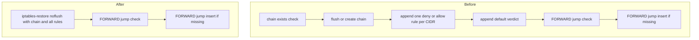
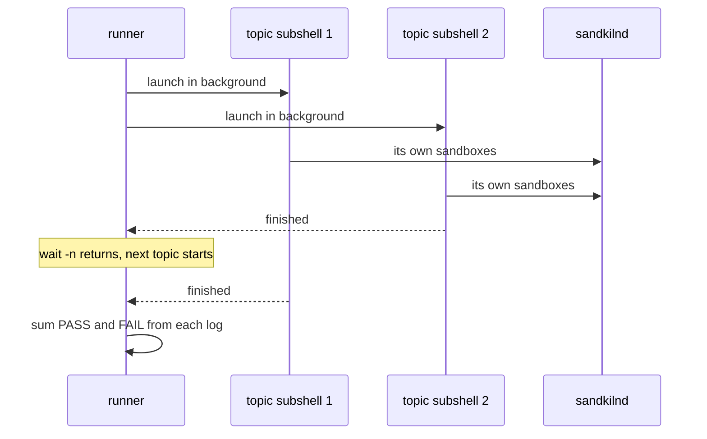
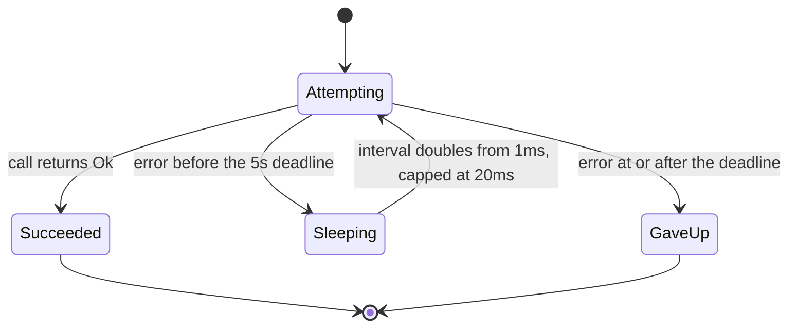

The other posts in this series each take one large optimization. This one is the survey that checks nothing was missed. The method was mechanical: list every commit (`git log --oneline`, 341 at the time of writing), search subjects for performance vocabulary (`git log --oneline -i --grep=perf --grep=latency --grep=faster`, plus the terms batch, parallel, bench and profile), read `CHANGELOG.md` for any entry that quotes a before and after number, and read the Benchmarking section of `ROADMAP.md`. Anything already covered by a sibling post was dropped: the rootfs reflink clone, the API-socket wait, the history-store WAL change, the clone and lease overlap, pool prewarming, the vsock I/O timeout and the snapshot-take analysis.

What is left falls into two groups. Three changes were implemented and have a recorded measurement, and each gets a short case study below under the same six headings. A longer list of candidates was examined and does not qualify, either because nothing was implemented or because the measurement does not support a claim. The rejected list comes first so that its reasons are visible.

| Candidate | Verdict | Why |
| --- | --- | --- |
| Replace `ip` and `bridge` subprocess calls in the network lease with netlink | Rejected on measurement | The three calls cost 1.39, 1.46 and 1.46ms. Batching or replacing them buys "at most a couple of milliseconds off a 167ms create". The roadmap says a netlink crate "is not worth adding for this, and isn't planned" |
| A device-mapper or CoW-filesystem layer for rootfs storage | Dropped | Planned while the clone was assumed to be unfixable on ext4. A reflink on a shared XFS volume removed the cost, and the changelog says the layer "is no longer planned" |
| Further guest boot-time work | Deprioritized | Cold boot is about 10 to 14ms. The roadmap leaves it alone because nothing suggests a gain is there |
| Make `create()` wait until the guest agent answers once | Undecided, not an optimization | It would change what a 200 means, and it would make `create` report the 420 to 460ms the first command pays today. The roadmap calls it an API-semantics decision, not a fix |
| Diff snapshots, memory compression | Not implemented | Planned or "much further out". See the snapshot-cost post |
| Raising load-test concurrency to find the ceiling | Planned, not started | `scripts/load-test.sh` takes one fixed concurrency; the ramp does not exist |
| Reading the load-test throughput as a win | Rejected | Throughput stayed flat at 5.59 and 5.38 cycles per second across the recorded pair; only the `create` mean moved |

None of the rejected rows has a before and after to report. Every case study below does, with the caveat attached to each.

## Problem and how it was found

### A. Egress policy application spawned one process per rule

A sandbox can be created with an egress policy, a list of allow and deny CIDRs plus a default verdict. Applying it meant building a per-sandbox iptables chain. The roadmap records that an audit, the same one that found the retry-loop issue in case C, flagged this as a real but unmeasured cost. Measuring it showed that a 6-CIDR policy spawned 9 `iptables` subprocesses and cost about 8.3ms per create. Each spawn pays a full fork and exec regardless of how little the command does.

The cost only applies to creates that request a policy, so it never showed in the aggregate create phases. There was no metric for it. A new `egress_apply` create phase was added to `/metrics`, recorded only when a policy is requested, so that the cost became visible rather than hiding inside the `setup` phase.

### B. The integration suite ran its topics one after another

`scripts/integration-test.sh` runs the full daemon API against a real `sandkilnd`, with one file per topic under `scripts/integration-tests/`. Run sequentially, the suite took about 4 minutes 10 seconds. That is a developer-loop cost rather than a product latency, but this project's standard says every feature is verified on a real daemon, so the suite's wall time sets how often it is run.

### C. A fixed 100ms sleep between vsock retries

An audit for siblings of the fixed 20ms API-socket sleep found that `Vm::call`, `open_pty` and `open_exec_stream` each retried a failed vsock call after a flat `sleep(100ms)`. That is five times the per-retry waste of the sleep that had just been fixed. The hypothesis was that this contributed to the roughly 420 to 460ms a cold sandbox's first `exec` takes.

## Root cause

### A. Process spawn dominates tiny commands

An `iptables` rule append does almost no work. Almost all of its time is process creation, so cost scales with the number of rules, not their content. The old shape of `apply` (visible in the history of `core/crates/vmm/src/egress.rs`, before commit `7e8dc74`) checked whether the chain existed, flushed or created it, appended one rule per CIDR, appended the default verdict, and then did the `FORWARD` jump check and insert. Each was its own subprocess.



### B. Topics were sourced into one shared shell

The runner `source`d each topic file into a single shell, so topics shared counters, a working directory and tracked-resource arrays. That made concurrency impossible without collisions. Running them concurrently needs each topic isolated first.

### C. A retry loop that waits blindly

A fixed sleep between retries wastes up to its whole length every time the callee is nearly ready. Unlike the API-socket case, which paid its 20ms on every boot, the vsock sleep is only paid when a call actually races the agent's startup, which is why it went unnoticed longer. The roadmap states the conditional nature plainly.

## The change

### A. One `iptables-restore` call for the chain

The chain's rules are now rendered into one text block and loaded with `iptables-restore --noflush`, which leaves every other chain alone. Only the two rules that touch the shared `FORWARD` chain stay as individual `iptables` calls. The function is `apply` at `core/crates/vmm/src/egress.rs:91`, and the stdin feeder is `run_restore` at `core/crates/vmm/src/egress.rs:123`:

```rust
let mut restore_input = format!("*filter\n:{chain} - [0:0]\n");
for cidr in &policy.deny_cidrs {
    restore_input.push_str(&format!("-A {chain} -d {cidr} -j DROP\n"));
}
// ... allow rules, then the default verdict, then:
restore_input.push_str(&format!("-A {chain} -j {default_verdict}\nCOMMIT\n"));
run_restore(&restore_input)?;
```

The metric lives in the daemon as the `EgressApply` variant of `CreatePhase` and is reported as `create_phase_duration_ms{phase="egress_apply"}`.

### B. Each topic in its own subshell, bounded with `wait -n`

Commit `ad1f941` runs each topic in its own subshell with private `WORKDIR`, pass and fail counters and created-resource arrays, and launches up to `SANDKILN_INTEGRATION_TEST_PARALLELISM` of them at once (default 4). The loop uses bash job control and `wait -n` to start the next topic as soon as one finishes.

```bash
run_topic "$topic" &
running=$((running + 1))
if [ "$running" -ge "$PARALLELISM" ]; then
  wait -n
  running=$((running - 1))
fi
```

Two supporting changes were needed. The sweep for untracked checkpoints in the history store moved to run once after every topic finishes, because several topics resuming and forking snapshots at once made per-topic sweeps race. And the pool topic `18-pool.sh` stopped comparing a before and after total snapshot count, which a concurrent topic's own snapshot churn could make flaky, and now compares exact snapshot id sets. That is the pattern the project standard now requires of every topic.



### C. One shared backoff helper

The three hand-rolled loops were replaced by `retry_with_backoff` (`core/crates/vmm/src/vm/mod.rs:282`), a doubling backoff from 1ms to a 20ms cap, called with a 5 second deadline from `Vm::call` (`core/crates/vmm/src/vm/mod.rs:140` to `:142`), `open_pty` and `open_exec_stream`. The same helper now also serves the API-socket connect. The worst-case wasted overshoot per retry drops from about 100ms to about 20ms.



## Result

### A. Egress apply, about 63 percent less per policy create

Measured the same way before and after: a 6-CIDR policy, the `egress_apply` phase's mean over 17 fresh creates for the after figure.

| Metric | Before | After |
| --- | --- | --- |
| Subprocess spawns for the policy | 9 | about 3 |
| `egress_apply` mean per create | about 8.3ms | about 3.1ms |

The roadmap reports 300 of 300 integration checks passing, including the allow, deny, deny-wins-on-overlap and survives-snapshot-resume-fork checks. The saving is about 5ms on a create that already takes 18 to 190ms, and only for creates that request a policy, so this is a small absolute win and a correct one.

### B. Integration suite, about 3x faster

| Metric | Before | After |
| --- | --- | --- |
| Full suite wall time | about 4m10s (parallelism 1) | about 70 to 90s (parallelism 4) |
| Speedup | | about 2.8 to 3.5x |

The runner's own header records an honest cost: with concurrency, the pool topic's timing-sensitive assertions were measurably more flaky. Three full runs at parallelism 4 landed 300 of 300, 299 of 300 and 295 of 300, every failure isolated to that one topic and none reproducing on a re-run. The topic's wait windows were widened once, from 30 seconds and 8 tries to 60 seconds and 15 tries. That is a fix of the symptom's window, not its cause.

### C. Retry backoff, no measurable end-to-end win

A/B testing the old and new code, timing a fresh sandbox's first real `exec` end to end:

| Metric | Old fixed 100ms sleep | New 1 to 20ms backoff |
| --- | --- | --- |
| First `exec` on a cold sandbox | about 420 to 460ms | about 420 to 460ms |
| Worst-case overshoot per retry | about 100ms | about 20ms |

The two end-to-end figures were indistinguishable within noise. The change is still correct, since the per-retry overshoot bound really did drop, but the hypothesis that motivated it was wrong: the guest agent's own startup so thoroughly dominates the 420 to 460ms that retry overshoot does not show. The recorded value of the experiment was the discovery that `POST /sandboxes` returning 200 does not mean the guest agent is listening, and that every later `exec` on the same sandbox costs about 3 to 5ms. That finding led to `first_exec_client` in `scripts/bench-report.sh`. So the optimization produced no number of its own, and I am counting it here as a measured null result with a useful side effect, not as a win.

## What it cost or risks

### A. Egress apply

- The whole chain is now one text block built by string formatting. CIDRs are interpolated into it. I did not find in the repository a statement that CIDR strings are validated before reaching this function, so I am not claiming they are; a malformed or hostile value could alter the restore input, and that is worth checking against the daemon's request validation, which I did not trace.
- The first stage reports a cleaner error than the old loop, since `run_restore` returns stderr and the input on failure. That is a small gain for diagnosis.
- A possible benefit nobody recorded, and which I did not test: the old shape flushed a live chain and re-added rules one at a time on re-apply, leaving a window where the chain was partial; a single restore transaction is atomic for the chain. If that holds it is a security-relevant improvement, but it is a hypothesis from reading the two shapes.

### B. Parallel suite

- More flakiness under load in timing-sensitive topics, as measured above, and a widened wait window that makes a genuine slow-path regression harder to see in that topic.
- Interleaved logs. The runner captures each topic to its own log and prints them in order at the end, so a developer debugging one topic can set `SANDKILN_INTEGRATION_TEST_PARALLELISM=1`.
- The suite draws from one pool of tap devices (32 by default), so parallelism is bounded by that pool as well as by the default of 4.
- Topics must now never assert on global counts. This is a standing constraint, and it is now in the project standard.

### C. Retry backoff

- More attempts in the same window. A 1ms start doubling to 20ms makes many more connection attempts than a 100ms sleep during a slow agent startup. Each is cheap, and the overall 5 second deadline is unchanged, but I did not measure the added load.
- It does nothing for the guest-never-answers case, which is a different layer, handled by the transport timeout described in the vsock I/O post.

## How to reproduce

### A. Egress apply

```bash
scripts/bench-report.sh 20 http://127.0.0.1:7777
```

`bench-report.sh` reports the phases from `/metrics` but only drives plain creates. To see `egress_apply`, create sandboxes with an `egress` policy against a running daemon and read the mean from the metric:

```bash
curl -s http://127.0.0.1:7777/metrics | grep 'create_phase_duration_ms.*egress_apply'
```

The correctness check is `scripts/integration-tests/19-egress.sh`.

### B. Integration suite

```bash
SANDKILN_INTEGRATION_TEST_PARALLELISM=1 time scripts/integration-test.sh   # sequential
time scripts/integration-test.sh                                            # default, 4 at once
```

`SANDKILN_INTEGRATION_TEST_ONLY=18-pool` runs just that topic. The suite has since grown past the 24 topic files the project standard still cites, so a fresh sequential run will be longer than 4m10s; the ratio, not the absolute, is what carries over.

### C. Retry backoff

```bash
scripts/bench-report.sh 20 http://127.0.0.1:7777
```

Read `first_exec_client`. To reproduce the null result, run it once on a build with the previous fixed 100ms sleep and once on a build with `retry_with_backoff`, and compare the means; the recorded finding is that they overlap. To see the retry itself, enable `RUST_LOG=sandkiln_vmm=debug` and read the `vsock call ok` line's `elapsed_ms` for a sandbox's first call.

Nothing else in the history met the bar of a recorded measurement with a before and after. Where a commit message or roadmap entry quoted a number I could not tie to a run, or only a hypothesis, I left it out.
