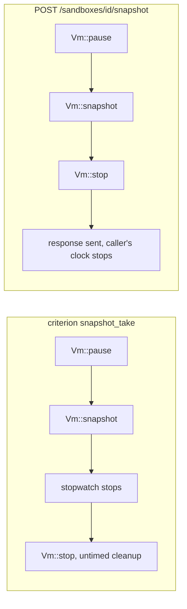
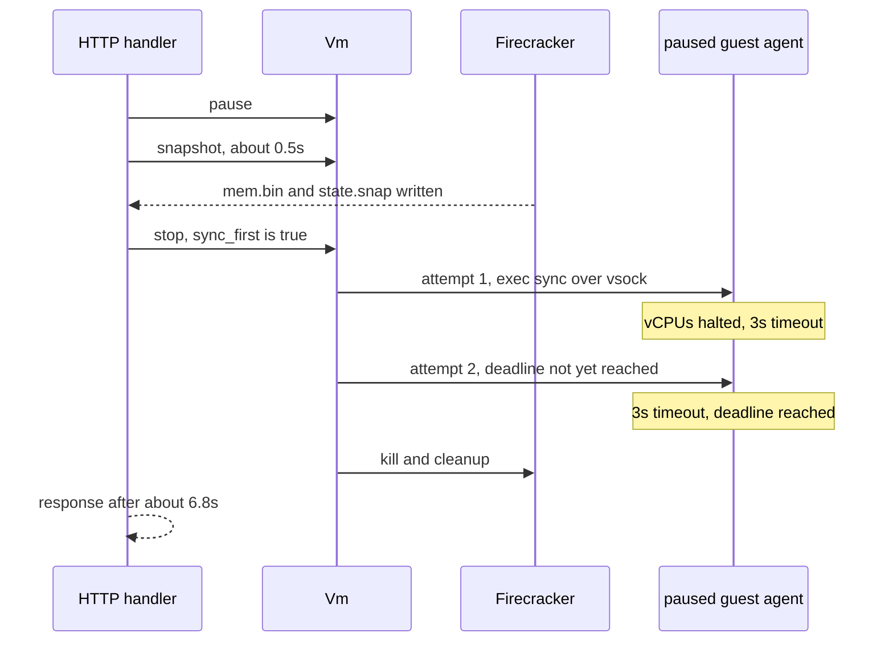

Every snapshot the daemon took waited about six seconds for nothing. The snapshot itself, pausing the VM and writing its memory, took about half a second. The rest was `Vm::stop` asking a frozen guest to flush its disk and waiting for an answer that could not arrive. The fix was to call a different method. The interesting part is how a six second wait stayed invisible, because the project had a snapshot benchmark and the benchmark said everything was fine.

Items are cited with `path:line` references, verified against the current tree. All timings are from one shared dev box and are directional.

## Problem and how it was found

The suspicion came from [the vsock timeout post](/engineering/22-opt-bounded-vsock-io). That fix turned a hang into a bounded wait, and the commit that recorded it (`abb8286`, 2026-08-29) said the full snapshot-then-resume cycle "now completes in ~7s (bounded, not hung)". The 7 seconds sat in the record for months as an acceptable outcome of a bound. It was read as "slow but safe", and nobody asked what the 7 seconds consisted of.

On 2026-11-24, while auditing the exec path, the HTTP request that takes a snapshot was timed from the client, the way a caller experiences it:

```bash
time curl -s -X POST http://127.0.0.1:7777/sandboxes/<id>/snapshot
```

It read 6.8 seconds. The criterion benchmark for the same operation, `snapshot_take`, read 485 to 727 milliseconds on the same box in the same week (2026-11-23, kernel 6.8). Two tools disagreed about one operation by a factor of ten, and the disagreement had to be explained before either number could be trusted.

The explanation is in what each tool times. `bench_snapshot_take` (`core/crates/vmm/benches/vm_lifecycle.rs:176`) boots a VM outside the timed region, then times only these two calls:

```rust
let started = Instant::now();
vm.pause().expect("Vm::pause failed during benchmark");
vm.snapshot(&mem_path, &snapshot_path).expect("Vm::snapshot failed during benchmark");
total += started.elapsed();

vm.stop().expect("Vm::stop failed during benchmark cleanup");
```

The `vm.stop()` that follows is cleanup, outside the stopwatch. The daemon's `snapshot_and_stop` (`core/crates/daemon/src/http/routes/snapshot.rs:147`) performs the same pause and snapshot and then stops the VM as part of the request, so the stop is on the clock for the caller and off the clock for the benchmark. The benchmark's comment says it mirrors the daemon's sequence; it mirrored the first two steps and put the third behind the timer.



## Root cause

Before the fix, `snapshot_and_stop` ended its blocking task with `let _ = vm.stop();`. That method is documented in the previous post: `Vm::stop` does not simply kill the Firecracker process, because a bare `SIGKILL` loses unflushed guest page-cache writes. So `stop_inner` (`core/crates/vmm/src/vm/mod.rs:248`) first sends an `exec sync` request to the guest agent over vsock, best effort, then kills the process.

For a running VM that is a good idea. For a VM that has just been paused for a snapshot it is a request to a guest whose vCPUs are halted. The guest agent cannot run, so it cannot answer. What happens next is read from the code, not traced on a live paused VM, so here is the derivation and where it is uncertain.

`Vm::call` wraps `vsock_client::call` in a retry loop with a 5 second deadline checked after each attempt returns. At the time, `vsock_client` applied a 3 second `IO_TIMEOUT` to every read and write on the stream, and the loop retried on any error. The first attempt therefore blocked until its 3 second timeout fired and failed. The deadline had not passed, because 3 seconds is under 5, so the loop slept a millisecond and tried again. The second attempt also blocked 3 seconds and failed, and this time the deadline check ended the loop. Two sequential timeouts, about 6 seconds, then the error was logged as `sync before stop failed, proceeding anyway`, and only then was the process killed.

I did not capture which read blocked in each attempt. It may have been the `CONNECT` handshake reply or the response read; the same 3 second bound covers both, so the arithmetic is unchanged. The total also fits: about 0.56 seconds of pause and snapshot plus about 6.2 seconds of waiting is the 6.8 seconds measured.



The sync is also pointless on its merits, not only slow. Its purpose is to push dirty guest page-cache pages to the attached drives before the process disappears. But the snapshot has just captured the guest's memory, dirty page cache included, in `mem.bin`. When the snapshot is resumed, the guest comes back with those pages still dirty and writes them out itself. Nothing is lost by skipping the flush, and nothing could be gained by attempting it, because the vCPU that would run `sync` is stopped.

## The change

The change is in commit `cc5573f` (2026-11-24), in `snapshot_and_stop`:

```rust
let outcome = vm.pause().and_then(|_| vm.snapshot(&mem_file_path, &snapshot_path));
// Either way this VM is done ...
let _ = vm.force_stop();
outcome
```

`Vm::force_stop` (`core/crates/vmm/src/vm/mod.rs:244`) already existed. Commit `f6c74d1` (2026-09-08) added it for the pool's failed-health-check path, where the VM was already known dead and a `sync` would pay a second timeout for nothing. It calls the same `stop_inner` with `sync_first` set to false, so the process is killed and its sockets and jail directory are removed exactly as before, minus the doomed vsock call. The reuse is the design point: the cleanup sequence has one implementation, and the only difference is whether to ask the guest to flush first. Making that a boolean on a shared private function, rather than two copies of the kill-and-cleanup code, is what kept this a one-line change.

The branch that runs when pause or snapshot fails is deliberately unchanged. A paused VM whose snapshot failed cannot be handed back as still running, so the VM is stopped either way and the original error is returned. With `force_stop` that failure path is also fast, where before a failed snapshot still paid the six second wait.

```mermaid
stateDiagram-v2
  [*] --> Running
  Running --> Paused: Vm::pause
  Paused --> Snapshotted: Vm::snapshot, about 0.5s
  Paused --> Killed: snapshot failed, force_stop
  Snapshotted --> Killed: force_stop, no guest sync
  Killed --> [*]: sockets and jail directory removed
```

Because `snapshot_and_stop` is shared, the fix lands everywhere it is used: the explicit snapshot endpoint, `stop_sandbox_by_id` in its preserve-by-default mode, the idle reaper's auto-suspend, and the pool replenisher. The orderly shutdown (`core/crates/daemon/src/lifecycle/shutdown.rs:32`), which snapshots every live sandbox concurrently when the daemon receives a termination signal, goes through the same path.

## Result

Measured live on the dev box, client-side, on 2026-11-24:

| Measurement | Before | After |
| --- | --- | --- |
| `POST /sandboxes/:id/snapshot`, end to end | about 6.8s | 0.56s |
| criterion `snapshot_take` (pause plus snapshot, no stop) | 485 to 727ms | unchanged by this fix |
| Three sandboxes snapshotted by orderly shutdown | not measured | 0.75s, daemon exited in about 1s |

The after figure of 0.56 seconds sits inside the criterion range, which is the consistency check that matters. It says the request is now essentially the snapshot and nothing else. The remaining cost is the memory write, analysed in [What a snapshot costs](/engineering/23-opt-snapshot-cost-analysis). No claim here changes that analysis: the take cost is the same, and the wait that surrounded it is gone.

The regression test is `scripts/integration-tests/25-long-running-commands.sh`. It creates a sandbox, times the snapshot request, and fails if it takes 3 seconds or more:

```bash
if [ "$elapsed_ms" -lt 3000 ]; then
  pass "snapshot request took ${elapsed_ms}ms (was ~6800ms when it waited on a doomed guest sync)"
else
  fail "snapshot request took ${elapsed_ms}ms: stopping the paused VM is waiting on a guest sync again"
fi
```

The 3 second threshold is chosen to sit well above the half-second real work and well below the 6 second signature of the old behaviour, so that a loaded box does not flake it and a regression cannot hide under it. It is a latency assertion in a suite that was otherwise correctness-only, which is the gap that let the bug live.

## What it cost or risks

- **Dirty pages are not on disk when the VM is killed.** Skipping `sync` means the host-side rootfs file lags the guest's view until the snapshot is resumed. That is safe for the resume path, because the memory image carries the dirty pages. It would not be safe for any consumer that read a held snapshot's rootfs file without resuming it. I did not find one, but I did not audit every reader, so this is an invariant to keep rather than one that is tested.
- **A test of timing, not of cause.** The regression test asserts the request is fast. It would also pass if the wait were removed some other way, and it would not tell you which layer regressed. That is acceptable for a latency guard, but the root-cause reasoning above is a reading of the code, not an assertion anyone can run.
- **No unit test for the choice of stop method.** `snapshot_and_stop` needs a real VM, so nothing in `cargo test --workspace` pins `force_stop` over `stop`. If someone changes it back, only the integration topic against a real daemon catches it.
- **The benchmark still mirrors only part of the path.** `bench_snapshot_take` still times pause plus snapshot and still excludes stop. That is now less misleading, since stop is cheap and `force_stop` is the daemon's call, but the bench still calls `Vm::stop`, not `Vm::force_stop`, in its untimed cleanup, so it does not exercise the sequence the daemon runs. The honest framing is that criterion measures the VMM operation and the integration suite owns the caller-visible latency.
- **The lesson generalises.** A bounded wait is not a small wait. The 7 seconds recorded in August was exactly this, written down as success. Any figure recorded next to the words "bounded, not hung" deserves the question of what the bound is being spent on.

## How to reproduce

Time the endpoint from a client on a running daemon:

```bash
id=$(curl -s -X POST http://127.0.0.1:7777/sandboxes | sed 's/.*"id":"\([^"]*\)".*/\1/')
time curl -s -X POST "http://127.0.0.1:7777/sandboxes/$id/snapshot"
```

Run the regression topic alone:

```bash
scripts/remote.sh run env SANDKILN_INTEGRATION_TEST_ONLY=25-long-running-commands scripts/integration-test.sh
```

To see the old behaviour, change `vm.force_stop()` back to `vm.stop()` at `core/crates/daemon/src/http/routes/snapshot.rs:188`, rebuild, re-grant the network capability, and time the same request. Expect about 6.8 seconds and, with `RUST_LOG=sandkiln_vmm=debug`, a `sync before stop failed, proceeding anyway` warning (`core/crates/vmm/src/vm/mod.rs:254`) on every snapshot. To compare against the benchmark, run `cargo bench -p sandkiln-vmm --bench vm_lifecycle -- snapshot_take` and note that it never prints that warning, because it never times the stop.
