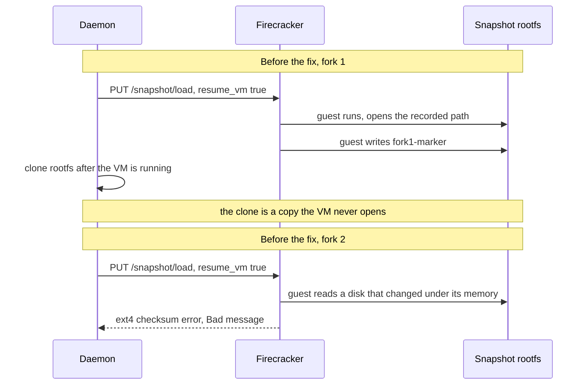
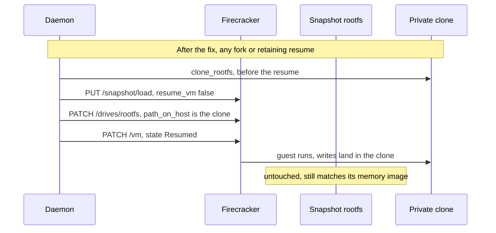
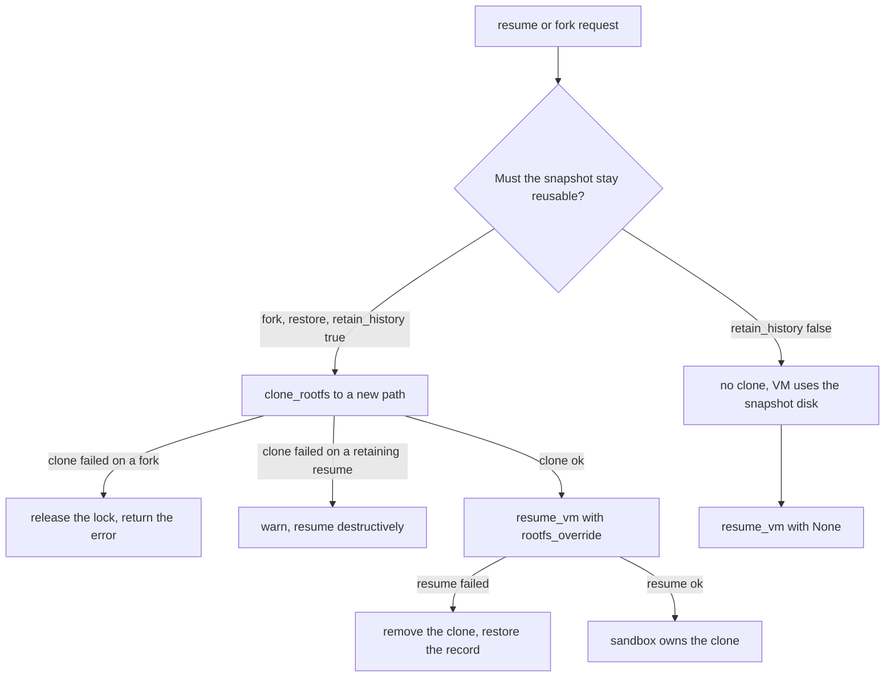

This is a data-corruption bug in the snapshot feature, found in the 2026-11 audit. It is worth a post because the system had a fix on record, a test that passed, and documentation that said the problem was solved. All three were wrong in the same way, and the way they were wrong is the useful part.

Items are cited with `path:line` references, verified against the current tree. The failure was reproduced live on the dev box, and the fix was verified there with the regression test described at the end. Timings do not matter here, so there are none.

## Problem and how it was found

The symptom, from the first reproduction: fork a snapshot, write a file in the fork, stop the fork, fork the same snapshot again, and read the file in the second fork.

```text
cat: /root/fork1-marker: Bad message
```

Two things are wrong with that line. The second fork should not know the file exists at all, because it was forked from a snapshot taken before the file was written, and "Bad message" is what ext4 returns (`EBADMSG`) when a metadata checksum does not match. The guest was reading a filesystem that disagreed with its own memory.

The snapshot's own disk gave the direct evidence. After the first fork wrote `/root/fork1-marker` and stopped, the file was visible on the snapshot's rootfs, read from the host without any VM running:

```bash
debugfs -R "stat /root/fork1-marker" <snapshot rootfs>
```

`debugfs` found the inode. The marker was on the snapshot's disk, not on the fork's. The fork had no disk of its own.

The earlier history matters. An earlier version of the daemon had a related bug where a fork shared its source's rootfs file, and the fix recorded in the docs and in the previous revision of post 6 was that fork, retain-history resume and restore each clone the rootfs. That fix existed in the sense that a clone was made. It did not stop the guest from writing the original file.

### Why the first test said everything was fine

The first test of isolation was the obvious one: write a marker in fork 1, stop it, fork again, check that fork 2 does not see the marker. It passed. Fork 2 did not see the marker.

That result was a false "isolated". The second guest resumed from the snapshot's memory image, and that image includes the guest's page cache and dentry cache as they were when the snapshot was taken. Its cached view of `/root` contained no marker, so `cat /root/fork1-marker` answered from cache with "No such file" and never read the disk that fork 1 had already changed. The damage was on the disk. The cache covered it.

The test checked what the guest believed, and the guest believed its own stale memory. Dropping the guest's caches before reading forces it to read the disk:

```bash
echo 3 > /proc/sys/vm/drop_caches; cat /root/fork1-marker
```

With the caches dropped, the second fork read the real, changed metadata, the checksum no longer matched, and the read failed with "Bad message". That was the moment the "isolated" result was shown to be wrong. A test of isolation has to defeat the observer's cache, or it measures the cache.

## Root cause

A Firecracker snapshot is two files, guest memory and device state, and the device state records the root drive by host path, not by contents. `Vm::snapshot` documents this (`core/crates/vmm/src/vm/snapshot.rs:45-48`), and post 6 explains why the path must stay put. The consequence for resume is that `PUT /snapshot/load` reopens whatever file sits at the recorded path.

Before the fix, `Vm::resume` sent a load with `resume_vm: true` and nothing else. The guest started running immediately, on the snapshot's original disk file. There was no field in `ResumeConfig` to say otherwise.



The daemon did make a clone. It made it after the resume, from the source path, in the fork path, and it recorded the clone's path on the `Sandbox`. That looked like isolation in every place a human or a test would look: the record had its own path, the destroy path deleted that path, the metrics counted a clone. Nothing told Firecracker about the clone. The live VM kept the original file open, and the clone was a copy of a disk that no process ever opened. The daemon's bookkeeping and the guest's reality had diverged, and the bookkeeping was the thing everyone read.

### The inverse flaw in retain-history resume and restore

The same root cause had a second shape, in the time-travel path. A resume with `retain_history` true (the default) is supposed to leave the checkpoint pristine so it can be restored later.

- `retire_snapshot_files` cloned the rootfs after the resume and gave the clone to the new sandbox record. The live VM, resumed on the recorded path, wrote the checkpoint's original disk. The checkpoint was the part that got corrupted, while the sandbox record held an unused copy.
- Restore cloned the checkpoint's disk, then resumed, and never passed the clone to anything. The restored VM wrote the checkpoint's original disk, so restoring the same checkpoint a second time read a disk the first restore had changed.

This is the inverse of the fork case in an exact sense. In the fork case the clone existed and was never opened. In the retaining resume the clone was the record, and the original was the disk. In both, the VM and the daemon disagreed about which file was the disk.

## The change

The fix has two halves: give the resume a way to name a different disk, and make every caller that must keep the snapshot reusable use it.

### Firecracker mechanism

`ResumeConfig` gained `rootfs_override: Option<PathBuf>` (`core/crates/vmm/src/vm/snapshot.rs:31`). `Vm::resume` now branches on it (`snapshot.rs:96-116`):

1. `PUT /snapshot/load` with `resume_vm` set to `rootfs_override.is_none()`. With an override the VM loads paused, so the guest does not run a single instruction before its drive is repointed.
2. `PATCH /drives/rootfs` with `{"drive_id": "rootfs", "path_on_host": <clone>}`. This is the call that makes Firecracker open the clone instead of the recorded path.
3. `PATCH /vm` with `{"state": "Resumed"}`. The guest runs for the first time, on the clone.

Any failure in the chain kills the child, removes the sockets and returns the error with the console log path attached, the same cleanup as before. The load-paused-then-patch order is the point: patching after the guest has already started running would let it issue writes to the wrong file first.



### Daemon call sites

`resume_vm` in the daemon takes the override (`core/crates/daemon/src/http/routes/snapshot.rs:767`), and its doc comment states the rule: pass a private clone for anything that must leave the snapshot reusable, and `None` only when the snapshot is being consumed. The three call sites:

- **Fork** (`fork_snapshot`, `snapshot.rs:649`). The disk is cloned first (`:679`), wrapped in `storage::OwnedFile`, and passed to `resume_vm` (`:688`). The guard deletes the clone on any failure before `keep()`. A clone failure is fatal, because a fork on the snapshot's own disk is silently unsafe, not degraded, and the fork lock is released.
- **Retaining resume** (`resume_snapshot_by_id`, `snapshot.rs:455`). With `retain_history` true the clone is made first (`:481-498`) and passed to `resume_vm` (`:502`). If the clone fails the resume degrades to the consuming mode with a warning, because failing the caller's resume would be worse than losing a restorable checkpoint for one call. If the resume fails, the clone is removed and the snapshot record is put back.
- **Restore** (`restore_snapshot_history_by_id`, `snapshot_history.rs:149-171`). The clone is made from the retired checkpoint's disk and passed as the override. A failed resume removes the clone. The checkpoint is never opened by the restored VM, so it can be restored any number of times.

`retire_snapshot_files` (`snapshot.rs:381`) no longer clones. It only moves `state.snap` and `mem.bin` into the retired directory, because the clone already exists by the time it runs.

A non-retaining resume (`?retain_history=false`) still resumes with `None` and uses the disk in place. That is correct, not a leftover: the snapshot is being consumed, nothing will resume from it again, and a clone would be pure overhead.



## Result

After the change, the regression test `scripts/integration-tests/26-snapshot-disk-isolation.sh` passes against a real daemon and a real microVM. It has 13 checks across three scenarios:

- **Fork against fork.** Fork a snapshot, write `/root/fork1-marker`, stop the fork, fork again, drop caches, read. The second fork must not see `from-fork1`, must not print "Bad message", and must still see the snapshot's own `base-marker`.
- **Retaining resume, then restore twice.** Resume with history, write `/root/resumed-marker`, stop. Restore the checkpoint, drop caches, check that the post-checkpoint write is absent, write `/root/restore1-marker`, stop. Restore again, drop caches, check that the first restore's write is absent and that there is no "Bad message".
- **Status checks** on every create, snapshot, fork, resume and restore call, so a failing step cannot read as an isolation pass.

The `drop_caches` step is in the test for the reason the first test failed. The script's header comment says so in one sentence. A restore or a fork now reads a disk that matches the memory it was captured with, in all the orderings the test exercises.

The snapshot's disk is the thing being protected, so the host-side check is the same `debugfs` command from the first section: on the fixed build the marker is expected to be absent from the snapshot's rootfs. The script does not run `debugfs`; it checks through the guest, with caches dropped.

## What it cost or risks

- **One more disk copy per resume that keeps history.** The default resume and every pool claim now clone the rootfs before resuming (pool claims go through `resume_snapshot_by_id` with `retain_history` true, `core/crates/daemon/src/lifecycle/pool_claim.rs:150`). On a reflink filesystem that is metadata only, and the clone phase was measured at about 0.08 ms in the create path (post 17). On a filesystem without reflink support it is a full copy, so the placement advice in post 4 now applies to resume latency as well as create. I did not re-measure resume latency with the clone in front of it, so I do not claim a number here.
- **Resume is now two extra API calls.** The `PATCH /drives/rootfs` and `PATCH /vm` calls are local socket requests to a process that is already up. I have not isolated their cost from the surrounding resume time.
- **A degraded mode remains, on purpose.** If the clone fails for a retaining resume, the daemon resumes in the consuming mode and logs a warning. That keeps the caller's sandbox alive, and it means that for that one resume no restorable checkpoint exists. It is the same trade the retire step already made.
- **Snapshots taken by an earlier build may already be damaged.** Nothing in this fix repairs a snapshot whose disk was written by a resumed fork. A snapshot disk that disagrees with its memory image cannot be told apart from a healthy one by the daemon. Anyone who ran the old build and forked or restored snapshots they care about should treat those snapshots as suspect.
- **The override relies on Firecracker accepting a drive patch on a paused, freshly loaded VM.** That is true of the Firecracker version on the dev box, and the regression test would catch a version that refuses it, because the resume would fail. It is a dependency on a Firecracker behaviour, not on a local invariant.
- **The comments in the daemon are not all current.** Some doc comments in `http/routes/snapshot.rs` and `http/routes/sandbox.rs` still describe the pre-fix design (for example, that Firecracker has no way to redirect a resumed VM's drive, and that a fork does not own its rootfs). They are outside this change's documentation scope and should be corrected with the code.

The test-design lesson is the main cost. A passing isolation test that reads through the observer's cache is a false negative generator, and it stayed in place long enough for a docs page to describe the bug as fixed. Any new test of "does X leak into Y" in this repository should read from a source the observer cannot have cached.

## How to reproduce

Everything below runs on the dev box, since it needs KVM. Use `scripts/remote.sh ssh` or `scripts/remote.sh run` as described in the repository's `AGENTS.md`.

To see the bug, build the parent of the fix and run the regression script against it:

```bash
git checkout 12779d6~1
scripts/sandkilnd-ctl.sh restart
scripts/integration-test.sh
```

Topic 26 fails on the checks named for the second fork and the second restore. To watch it by hand against the old build:

```bash
B=http://127.0.0.1:7777
ID=$(curl -s -X POST $B/sandboxes -H 'content-type: application/json' -d '{}' | jq -r .id)
curl -s -X POST $B/sandboxes/$ID/exec -H 'content-type: application/json' \
  -d '{"command":"sh","args":["-c","echo base > /root/base-marker; sync"]}'
SNAP=$(curl -s -X POST $B/sandboxes/$ID/snapshot | jq -r .snapshot_id)

F1=$(curl -s -X POST $B/snapshots/$SNAP/fork | jq -r .id)
curl -s -X POST $B/sandboxes/$F1/exec -H 'content-type: application/json' \
  -d '{"command":"sh","args":["-c","echo from-fork1 > /root/fork1-marker; sync; sync"]}'
curl -s -X DELETE "$B/sandboxes/$F1?keep=false"

debugfs -R "stat /root/fork1-marker" "$ROOTFS_DIR/sandkiln-rootfs-$ID.ext4"
```

`ROOTFS_DIR` is the daemon's `rootfs_dir` setting. The snapshot's disk is the source sandbox's file, named by `storage::rootfs_path` (`core/crates/daemon/src/storage.rs:62`). On the old build `debugfs` prints the inode. On the fixed build the marker lands in the fork's clone, so it should report the file as not found; the script does not assert this host-side check. If an auth token is configured, add the `Authorization` header to each call.

Then show why the naive check lies, and how to defeat it:

```bash
F2=$(curl -s -X POST $B/snapshots/$SNAP/fork | jq -r .id)
# naive read, answered from the guest's stale cache: looks clean
curl -s -X POST $B/sandboxes/$F2/exec -H 'content-type: application/json' \
  -d '{"command":"sh","args":["-c","cat /root/fork1-marker 2>&1"]}'
# read through the disk: exposes the damage on the old build
curl -s -X POST $B/sandboxes/$F2/exec -H 'content-type: application/json' \
  -d '{"command":"sh","args":["-c","echo 3 > /proc/sys/vm/drop_caches; cat /root/fork1-marker 2>&1"]}'
```

On the old build the first read looks clean and the second prints `cat: /root/fork1-marker: Bad message`. On the fixed build both are clean. To verify the fix, check out the current tree, restart the daemon, re-run `scripts/integration-test.sh`, and confirm topic 26 passes all 13 checks. The unit tests do not cover this path, because the resume needs a real Firecracker. Only the integration topic does.
