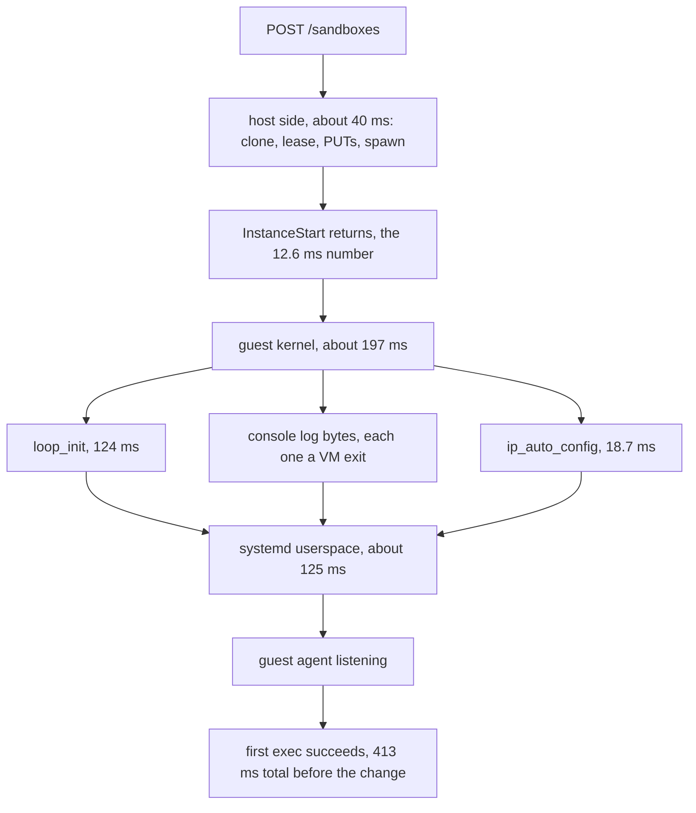
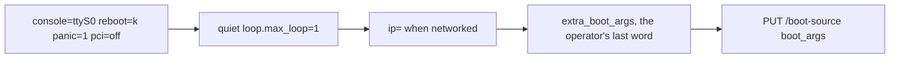
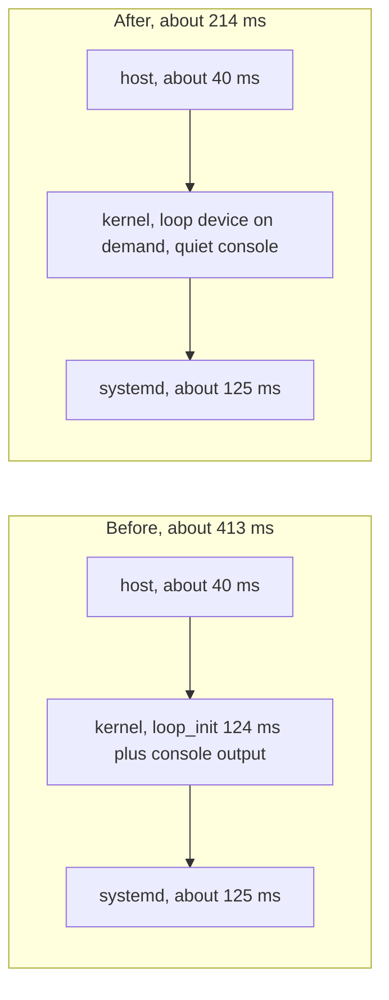

For a long time the headline latency in this project was "cold boot, 12.6 ms". That number is real and it is not what anybody waits for. It is the time from spawning Firecracker to `InstanceStart` returning, which is the host starting vCPUs. The guest kernel has not finished booting at that point, systemd has not run, and the guest agent is not listening. What a caller experiences is the time from `POST /sandboxes` until the first command succeeds. That was 413 ms in the `bench-report.sh` run before this change, and it is 214.5 ms after it. Almost all of the gap was inside the guest.

All numbers here were measured on 2026-11-24 on the one shared development box with a real Firecracker. They are directional, not a promise.

## Problem and how it was found

The earlier [socket wait post](/engineering/18-opt-boot-socket-wait) already showed that a fresh sandbox's first exec absorbed 420 to 460 ms while every later exec took 3 to 5 ms. That post could only say the time was "the guest's own startup". This round asked where inside the guest.

The first clue came from the guest's serial console log, `/tmp/sandkiln-fc-<id>.log`. Reading the timestamps showed a 138 ms gap right after the serial driver initialised, with nothing logged during it. The serial console is an emulated 16550 UART, so every byte the kernel writes there is a VM exit back to Firecracker. That suggested two separate costs: the logging itself, and something slow that did not log.

The second tool was the kernel's own initcall timing. Booting with `initcall_debug ignore_loglevel` makes the kernel print one line per initcall, `initcall X returned 0 after N usecs`. Sorting those by N gives a ranked list of where the kernel spent its time.

| Initcall | Time | Share of guest kernel boot |
| --- | --- | --- |
| `loop_init` | 124,207 us | about 60% |
| `ip_auto_config` | 18.7 ms | about 9% |
| every other initcall | each under 4 ms | the remainder |

The third was `systemd-analyze` inside the guest. It showed 197 ms of kernel time and 125 ms of userspace (systemd's own measure of its work after the kernel, unrelated to Firecracker's 125 ms bound on reaching `/sbin/init`), with the guest uptime at the first successful exec at 0.29 s. Those figures come from separate boots and do not sum exactly, which is why the diagram below reports them as measured and does not pretend to be an exact partition. The host side of the wait, clone, lease, configuration and the vsock connect, was only about 40 ms.



## Root cause

Two independent causes, both in the guest kernel, neither in sandkiln's own code.

**The loop driver pre-creates devices.** By default the loop driver creates a fixed set of `/dev/loopN` devices while it initialises, before any userspace exists. In a microVM that never uses most of them, that is 124 ms of pure setup, about 60% of kernel boot. The driver can also create devices on demand through `/dev/loop-control`, so the pre-created set is only a convenience for old userspace.

**Boot logging goes through an emulated device.** With a normal log level the kernel prints many lines during boot. On real hardware that is cheap. Here each byte is a trapped write to an emulated UART, so the log is paid for in VM exits. Dropping the log level to warnings saved about 90 ms.

The `ip_auto_config` initcall at 18.7 ms is the kernel configuring the guest's static address from the `ip=` argument. That is deliberate, it means the guest has an address before userspace runs, and it was not touched.

## The change

`core/crates/vmm/src/vm/boot.rs` now builds the kernel command line in one function, `kernel_command_line()` (`boot.rs:243`), from a constant, `DEFAULT_KERNEL_ARGS = "quiet loop.max_loop=1"` (`boot.rs:238`).

The ordering is deliberate. The line is assembled as the fixed base `console=ttyS0 reboot=k panic=1 pci=off`, then `DEFAULT_KERNEL_ARGS`, then `ip=` when the sandbox has a network, then the operator's extra arguments last. The kernel parses the command line in order, so a later argument can override an earlier one. That is why an operator can write `loglevel=7` and get boot logs back even though `quiet` is in the defaults.



The operator's part is a new daemon setting, `kernel_args`, registered in `core/crates/daemon/src/config/settings.rs`. It maps to `VmConfig::extra_boot_args`, is read from `SANDKILN_KERNEL_ARGS` or `kernel_args` in `sandkiln.toml`, and defaults to empty. The route passes it through at `core/crates/daemon/src/http/routes/sandbox.rs:363`.

Two unit tests in `boot.rs` (module `kernel_args_tests`) pin the contract. One asserts the fixed base comes first, both defaults are present and there is no `ip=` without a network. The other asserts that a networked line contains the static `ip=` parameter and that extra arguments, even with stray whitespace, come last.

## Result

The experiment matrix below was run before choosing the defaults. Each row is the mean create-to-first-exec over 15 cold sandboxes.

| Kernel arguments added to the baseline | Mean create to first exec |
| --- | --- |
| none, the baseline | 441 ms |
| `quiet` | 353 ms |
| `quiet 8250.nr_uarts=1` | 348 ms |
| the previous row plus `i8042` tuning, `tsc=reliable`, `random.trust_cpu` | 334 ms |
| the previous row plus `systemd.show_status=0 systemd.log_level=err` | 339 ms, no gain |
| the previous row plus `systemd.unit=multi-user.target` | 351 ms, no gain |
| `quiet loop.max_loop=1` | 237 ms |
| `quiet loop.max_loop=1` plus the uart and i8042 arguments | 237 ms |
| the previous row plus silent systemd | 236 ms |

Reading it: `loop.max_loop=1` alone is worth about 113 ms and `quiet` about 90 ms. Everything else is inside the noise of one shared box, and several of the extra arguments came out slightly worse. That is why only those two shipped.

End to end with the real daemon, `scripts/bench-report.sh 20` read:

| Metric | Before | After |
| --- | --- | --- |
| `first_exec_client` | 413.25 ms | 214.5 ms, a 48% reduction |
| `first_exec_resumed` | 18 ms | 8.4 ms |
| create total | 18.4 ms | 16.4 ms |

The 441 and 237 ms figures in the matrix are the mean over 15 sandboxes in a dedicated experiment, and 413 and 214.5 ms are from the 20 iteration `bench-report.sh` run. They are different sample sets on different runs, so compare within each pair and not across them. The create total barely moved because the change is entirely after `InstanceStart`.



This is a sketch of where the saving came from, not a measured partition. The userspace bar is the one that did not change, and it is now the largest remaining share.

The resumed number improved too, from 18 to 8.4 ms, even though a resume does not boot a kernel. The sample is a forked sandbox from a snapshot of a warmed one, so the exact mechanism was not isolated, and this post does not claim one.

## What it cost or risks

- **Boot logs are hidden by default.** With `quiet`, the info-level lines the kernel prints during boot are gone from the console log. Warnings, errors and panics still print, so a kernel panic before vsock comes up is still diagnosable from `/tmp/sandkiln-fc-<id>.log`. To get the full log back, set `kernel_args = "loglevel=7"`. That is the first thing to try when a guest fails to boot and the log looks too short.
- **Only one loop device exists at boot.** Loop devices are created on demand through `/dev/loop-control`, and this was verified by mounting three ext4 images with `mount -o loop` in a single guest, all of which succeeded. A guest tool that opens a hard-coded `/dev/loop5` without going through `losetup` or `mount -o loop` could fail. None is known in the shipped images, but this is a real change in guest behaviour, so it is listed.
- **The defaults apply to every sandbox.** Both arguments live in the code and not in a registry. An operator can override them by appending later arguments, but cannot delete one.
- **The comparison is one box.** Fifteen and twenty sample means on a shared machine. The ranking of the two effective arguments is solid because the gaps are 90 and 113 ms. The ordering of the small ones is not.

## Rejected options and why

| Option | Measured effect | Why it was rejected |
| --- | --- | --- |
| `tsc=reliable` | about 14 ms together with `random.trust_cpu` and the i8042 arguments (348 to 334 ms) | changes the guest's timekeeping assumptions: the kernel stops validating the clocksource |
| `random.trust_cpu` | part of the same 14 ms step | changes how the guest seeds its random number generator: trusts the CPU's RNG instruction |
| `8250.nr_uarts=1` | about 5 ms | inside the noise on its own, no gain once the loop argument was set |
| i8042 tuning | none measurable | inside the noise |
| `systemd.show_status=0 systemd.log_level=err` | none, 339 ms against 334 ms | no gain once `quiet` was set |
| `systemd.unit=multi-user.target` | none, 351 ms | no gain |

The first two were the only ones with a possible effect, measured only bundled with the i8042 arguments, and they trade a documented guest assumption for about 10 ms or so. That is not a good trade for a sandbox runtime that exists to run untrusted code, so they stay out.

## The honest remaining floor

About 125 ms of the remaining time is systemd userspace. That is time spent after `/sbin/init` starts, so it is a different quantity from Firecracker's published 125 ms bound, which ends when init starts ([what a start-latency number means](/engineering/29-what-a-start-latency-number-means)). `systemd-analyze` blames `dev-vda.device` at 107 ms and `fcnet.service` at 45 ms. That is generic init work done for a guest that only needs to start one agent and configure one interface.

A purpose-built init that mounts what the agent needs, brings up the interface and execs the guest agent directly would likely remove most of that. It has NOT been done. It is a possible next step with its own correctness work, since systemd currently provides mounts, device handling and service supervision that an init of our own would have to take over, and it should be justified by a fresh measurement before anyone starts. It has since been built as an opt-in image: see [the agent as PID 1](/engineering/35-the-agent-as-pid-1).

## How to reproduce

The guest-side measurement is the same tool as every other latency number in this project. Run the full path with the daemon configured:

```bash
scripts/sandkilnd-ctl.sh restart
scripts/bench-report.sh 20
```

Read two rows: `first_exec_client`, the first real exec on a freshly created sandbox, and `first_exec_resumed`, the same against a sandbox forked from a warmed snapshot. The script also diffs against the previous run, so a regression shows up directly.

To rank the guest kernel's initcalls yourself, run with the debug arguments set and read the console log of one sandbox:

```bash
SANDKILN_KERNEL_ARGS="initcall_debug ignore_loglevel" scripts/sandkilnd-ctl.sh restart
# create one sandbox, then:
grep -o 'initcall .* returned 0 after [0-9]* usecs' /tmp/sandkiln-fc-*.log \
  | sort -t' ' -k6 -n | tail
```

Remove the setting afterwards. `ignore_loglevel` overrides `quiet` on purpose, and a debug-heavy console log is itself a cost on every boot. The criterion bench takes the same arguments through `SANDKILN_BENCH_KERNEL_ARGS` (`core/crates/vmm/benches/vm_lifecycle.rs:48`).

To compare against the old behaviour from a current build, append later arguments such as `loglevel=7` and a larger `loop.max_loop=`. The matrix above was measured by varying the full command line, and this append-to-override form was not separately re-measured, so treat it as an approximation of the baseline.

The initcall list shown in the table above is only the top of the sorted output. Only the three rows it names were recorded in this write-up, and the long tail of sub-4 ms initcalls was not itemised.
