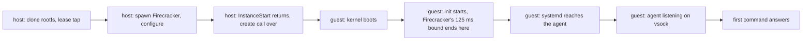
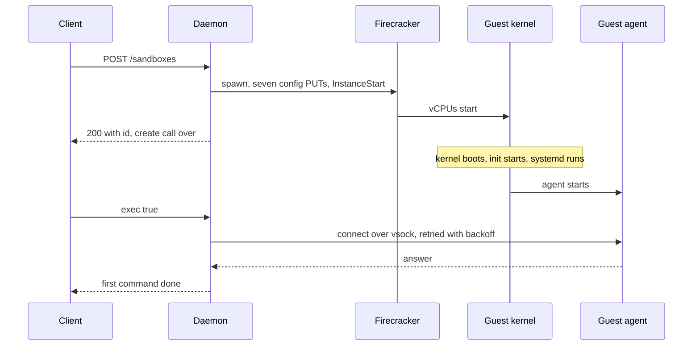

A question that sounds simple: Firecracker publishes "125 ms boot time". Is that a cold-path figure, is it an average, and does sandkiln test it? The honest answer is three separate answers, and getting them wrong is how a project ends up comparing its 214 ms to someone else's 125 ms as if both stopped the clock in the same place. They do not.

This post defines the interval behind each number, walks the stages of our own path, and says what kind of statistic each of our figures is. Sources for the external claims are in `docs/design-notes/latency-floor.md`, which carries the URLs and marks anything not confirmed from a primary source as unverified. Our numbers come from `docs/benchmarks.md` and the committed run in `examples/benchmark-suite/results/`. All of them were measured on one shared development box, so they are directional.

## What Firecracker's 125 ms is

Three facts about the published figure, each from Firecracker's own documents.

- **It is a bound, not an average.** The project's `SPECIFICATION.md` states boot time as `<= 125 ms`. That is a ceiling the project asserts, and it checks it in CI on bare-metal instances. A ceiling says nothing about the typical value. A typical value could be well under it.
- **It is one interval of a cold boot.** The clock starts when the VMM receives `InstanceStart` and stops when the guest's `/sbin/init` starts. The conditions are part of the claim: serial console disabled, a minimal kernel, a minimal root filesystem. It does not include the time for an application to answer.
- **It is not about restore.** It covers a cold boot only. Firecracker's snapshot documentation gives no latency figure for restoring a microVM. The only figure it offers is "very fast snapshot loading", with snapshot take noted as slower because it writes memory synchronously.

The NSDI 2020 paper behind the figure describes the method: time from the VMM process fork to the guest init, one vCPU, 256 MB, a minimal init that writes to an IO port, 500 serial samples. It also reports what moves the number. Disabling serial console logging saves "up to 70 ms". A statically configured network interface adds "around 20 ms". A stock distribution kernel added "an additional 900 ms", mostly from probing devices and drivers a microVM does not have.

So the 125 ms answers "how long until the guest's first process starts, if you build everything for speed". It does not answer "how long until my code runs".

## The stages of our path

Our cold path has more stages than the bound covers, and some conditions differ: our guest keeps the serial console but with a quiet log level, uses a general CI-built 5.10.223 kernel, a systemd rootfs, and a static `ip=` interface. The diagram shows the stages in order, with the interval each published figure covers.



The create call returns while the guest is still booting. Everything from the guest kernel onward happens after `POST /sandboxes` has already answered 200, which is the reason a fast create call is not the same thing as a ready sandbox. The create call is a statement that Firecracker started. It is not a statement that anything inside the guest is listening, and the daemon does not wait for the agent before returning.

The same stages as a timeline of who is doing the work:



### The stage table

| Stage | Duration | Statistic and source |
| --- | --- | --- |
| Host: spawn, API socket, seven configuration PUTs | 0.34 ms, 0.67 ms, 1.61 ms | means from the per-phase profile in `docs/benchmarks.md` |
| Host: `InstanceStart` | about 13 ms (12.6 to 14.0) | criterion, VMM level |
| The whole create call | 16 to 18 ms in the daemon; median 21.2 ms through the SDK (min 18.5, max 25.4) | `/metrics` mean; suite median of 20 |
| Guest kernel to `/sbin/init` | systemd's first log line at about 0.107 s of guest time | one guest `dmesg` observation, not a committed benchmark |
| systemd to the agent answering | the guest's uptime at the first command is 0.18 to 0.22 s on the systemd image | guest uptime readings recorded in `docs/benchmarks.md` |
| First command after the create call returned | median 213.1 ms (min 195.2, p95 229.2, max 239.1, n=20); mean 214.5 ms in `bench-report.sh` | suite median; `bench-report.sh` mean |
| Create call plus first command | median 235.4 ms | suite median of 20 |

Two cautions on that table, both about arithmetic. The durations do not sum to the total, because they come from separate boots and separate tools, and the guest's clock starts when the guest kernel starts, not when the host called `InstanceStart`. Adding the roughly 13 ms `InstanceStart` to the 0.107 s guest time gives about 120 ms, which is consistent with Firecracker's bound. That sum mixes two clocks and one-off observations, so it is a plausibility check and not a measurement.

The second caution is the 0.107 s itself. It came from reading the guest's `dmesg` on one boot. It is not in a committed result file. Treat it as a reading that agrees with the bound, not as a recorded figure, until a benchmark captures it on every run.

### Are we testing the 125 ms?

No. Nothing in this repository asserts Firecracker's bound. We do not run their CI test, and none of our benchmarks stops its clock at "init started". What we measure is the later interval, to a command answering. If the bound matters to you, the quick check is the guest's own log: a guest that boots in about 107 ms of its own time to the first `systemd[1]` line is inside the bound's spirit even though the conditions (serial, kernel config) differ from the spec's. The earlier [guest boot post](/engineering/28-opt-guest-boot-time) shows how the kernel arguments `quiet loop.max_loop=1` moved the kernel stage, and why the loop driver was the single largest kernel cost.

## Our own mix-up: two different 125 ms

Our documentation said "about 125 ms" for systemd userspace in our guest. That is a real figure: `systemd-analyze` blames `dev-vda.device` at 107 ms and `fcnet.service` at 45 ms, and systemd's userspace total read about 125 ms. It is also a different quantity from Firecracker's 125 ms, and the shared number invited the reading "our boot is exactly at the published bound".

| Name | Starts | Ends | What it is |
| --- | --- | --- | --- |
| Firecracker's 125 ms | `InstanceStart` received | guest `/sbin/init` starts | Design bound for a minimal cold boot, serial off |
| Our "about 125 ms" | the kernel hands over to systemd | systemd finishes its work | Time inside our guest's init, after the bound's interval ended |

They are adjacent intervals, not the same one. The wording has been changed everywhere it appeared to say "systemd userspace, about 125 ms of our boot, not to be confused with Firecracker's 125 ms init bound". The facts did not change. Only the reading did.

The init-mode image is a useful cross-check on that reading. With the agent as PID 1 instead of systemd, the median time from create to first command dropped from 232 ms to 147 ms (30 sequential creates per run, pooled), which removed the systemd interval and left the kernel one. Its goal of 110 ms was not met, and what remains is mostly the kernel reaching userspace. That result is recorded in `docs/benchmarks.md`.

## The warm path

A restore skips the kernel and init entirely, so none of the stages above apply. What it costs is mapping the memory file and the guest's first page faults.

| Figure | Value | Layer |
| --- | --- | --- |
| Resume, `PUT /snapshot/load` and resume | 3.7 to 4.0 ms | VMM, criterion |
| `Sandbox.resume()` through HTTP | median 13.1 ms | SDK, including the daemon's resume work and the entropy and clock fixup |
| First command after a resume | median 6.3 ms in the suite; mean 8.4 ms in `bench-report.sh` | client side |

The 4 ms and the 13.1 ms are both true and both resume. The first is the VMM call. The second is what a caller waits for, and it includes the HTTP hop and everything the daemon does after the VM runs again, among them the [per-clone fixup](/engineering/31-correctness-clone-entropy-and-clock). A comparison that mixes them is a regression report that is not one.

## Median, p95, min, max, and why medians

The suite reports five statistics per metric, from the sorted samples.

- **Median**: the middle sample. Half the runs were faster and half slower.
- **p95**: the value 19 of 20 samples were at or below. With n=20 it falls between the second largest and the largest sample, so it is close to the maximum and says little. Do not read it as a tail estimate.
- **Min** and **max**: the fastest and slowest sample.

We report medians because one slow sample (a disk flush, another process on a shared desktop) moves a mean by a lot and a median by almost nothing. The cost is that a median hides a bad tail. With n=20 and one shared box, the median and the minimum are the stable figures, and the p99 and max are single events.

One caution about our own numbers: the `bench-report.sh` figures (214.5 ms, 8.4 ms) are means over its iterations, and the suite figures (213.1 ms, 6.3 ms) are medians of n=20. They agree here, which is reassuring, but they are different statistics and the table above labels each. The published ceiling and our measurements are also different kinds of thing: a bound the vendor asserts, against samples from one machine on one day.

## "Create returned" is not "ready"

`POST /sandboxes` returning 200 means the VM was started. Whether the guest agent is listening yet depends on how far through boot the guest is. The first command absorbs that gap, which is why every benchmark here counts to a real command answering. An earlier set of project figures stopped at `create()` returning, and the headline of "12.6 ms cold boot" was real and was not what anyone waited for ([post 28](/engineering/28-opt-guest-boot-time) tells that story). Making `create` block until the agent answers is an open item, not a shipped behaviour.

## What each number measures

| Number | What it measures | What it excludes | Where it comes from |
| --- | --- | --- | --- |
| 125 ms (Firecracker) | `InstanceStart` received to guest `/sbin/init` starting, serial off, minimal kernel | Application readiness, snapshot restore, our kernel and rootfs | `SPECIFICATION.md`, a CI-asserted ceiling |
| 12.6 to 14.0 ms | Spawn to `InstanceStart` returning, the host starting vCPUs | The entire guest boot | criterion, our VMM |
| 16 to 21 ms | The whole `POST /sandboxes` call | Guest boot, agent readiness | `/metrics` mean, suite median |
| 213 to 214 ms | Create returned to the first command answering | The create call itself | suite median, `bench-report.sh` mean |
| 235.4 ms | Create call plus first command | Nothing before the call | suite median of 20 |
| 3.7 to 4.0 ms | The resume call at the VMM | HTTP, daemon work, first command | criterion |
| 13.1 ms | `Sandbox.resume()` through HTTP | The first command | suite median |
| 6 to 8 ms | First command after a resume | The resume | suite median, `bench-report.sh` mean |

## How to reproduce

The client-side numbers come from the benchmark suite, which times through the SDK against any daemon. It needs an idle daemon and refuses to start otherwise. See [A benchmark you can rerun](/engineering/32-a-benchmark-you-can-rerun) for how it is built.

```bash
scripts/remote.sh run scripts/dev.sh bench-suite --iterations 20 --only create
```

Read `first_command_after_create` for the interval after create returned and `create_to_first_command` for the call plus the command. The mean-based cross-check is `scripts/bench-report.sh 20`, which reports `first_exec_client`.

To see the guest's own timing on one boot, create a sandbox and read its kernel log from inside:

```bash
kiln sandbox exec <id> -- dmesg
```

Find the first line that starts with `systemd[1]:` and read its bracketed timestamp, which is seconds of guest time. That is the reading this post cites as about 0.107 s. It is one boot on one box, so repeat it a few times before relying on it. To compare against the bound properly, you would also match its conditions: serial console off, a minimal kernel configuration, and a minimal init. That is a different image from the one we run, and building it has not been done. Two later changes act on the gap this post describes: [the default warm pool](/engineering/34-making-a-create-a-resume) makes a create a resume, and [the agent as PID 1](/engineering/35-the-agent-as-pid-1) shortens the cold path.
