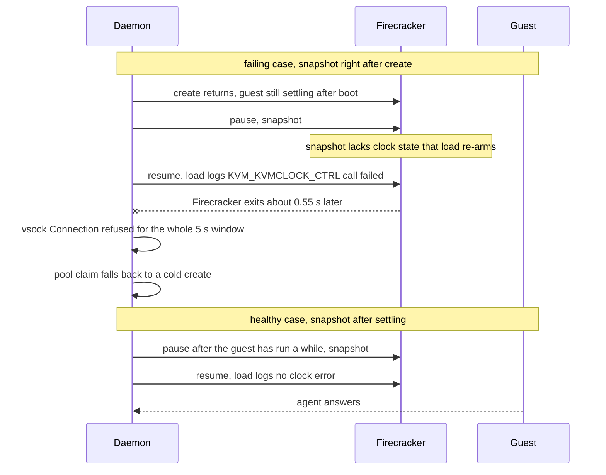

This is a debugging story with an unusual ending. The bug was a race, the fix is a wait, and the exact guest-side state that makes the race fatal was never found. The value of the post is the evidence trail: what was seen, what each experiment ruled in or out, and which earlier explanations were wrong and why. The finding is number 20 in `docs/findings.md`, and the two siblings are 25 and 26.

All counts below are quoted from that finding and from the comment on `MIN_GUEST_AGE_BEFORE_PAUSE` in `core/crates/vmm/src/vm/mod.rs`. The runs were made on the one shared development box with a real Firecracker. Where a source gives a count and a different source gives it in other words, the post says so.

## Problem and how it was found

The first sign was not a crash. It was a test that sometimes failed. The pool integration topic (`18-pool`) passed four of four times in isolation and failed once under the full suite running concurrently, with the check "deleting the pool cleaned up its own warm snapshot". The daemon's logs from the failing run showed pool-claim health checks reporting `vsock ... Connection refused`.

A pool claim resumes a pre-warmed snapshot and then runs a health check against the guest agent. "Connection refused" on vsock means nothing is listening on the guest's side, which for a freshly resumed VM means either the agent has not started or the VM is gone. The claim path retries for its whole window, about 5 seconds, and then falls back to a cold create. So the user saw a slower create and a flaky test, not an error. Finding 10 recorded it as a probable resume-readiness race.

Reproducing it directly needed a loop that exercised exactly that path: create a sandbox, snapshot it, resume the snapshot, run a command. Running one at a time showed nothing. Running six in parallel did.

### The first real clue

Every resume that failed had died. Firecracker itself had exited, about 0.55 seconds after the resume. It was not hung and not slow. The vsock calls were refused for the whole retry window because the process that owned the socket no longer existed.

The second clue came from Firecracker's log, which the daemon keeps per VM. Every failing resume logged one line at snapshot load:

```text
KVM_KVMCLOCK_CTRL call failed
```

No healthy resume logged it. That line is the correlation the whole investigation hangs on, because it turned "sometimes a resume dies" into "the resumes that die are exactly the ones that print this", which is a property of the snapshot, not of the resume.

## The experiments

With six snapshot-then-resume loops in parallel, the failure rate depended on one thing: how soon after `POST /sandboxes` returned the snapshot was taken.

| Delay between create returning and the snapshot | Resumes that died |
| --- | --- |
| none, snapshot the instant create returned | 25 of 55, about 45 to 53 percent across runs |
| 0.1 s | 0 of 60 per round |
| 0.2 s, 0.3 s, 0.4 s | 0 of 60 per round |
| 0.7 s, 1 s | 0 of 60 per round |

That sweep is the evidence that this is a timing race and not a problem with snapshots in general. A snapshot of the same sandbox type, taken the same way, resumed under the same parallel load, never failed once any settling time was added, and failed about half the time without it. A bad code path in the resume would not care how old the guest was.

The timeline of one failing and one healthy case:



### Why the exact state was never found

The finding states plainly what is known and what is not. The guest was paused while it was still settling right after its first command. The snapshot taken then lacks the guest clock state that Firecracker re-arms when it loads a snapshot, which is the thing the `KVM_KVMCLOCK_CTRL` call is for. When that call fails, the resumed VM dies shortly after.

What is not known is the guest-side state itself: which piece of the kvmclock handshake is incomplete at the instant of the pause. The finding records the next step if the crash ever recurs: capture a failing `state.snap` and compare it against a healthy one. Nothing in the evidence could be argued further than that, so nothing further is claimed.

## What was wrong in the earlier theories

Two explanations were written down before the sweep and both were wrong.

- **"Kernel panic."** The first attribution was a guest kernel panic after resume. There was no panic text anywhere. A guest panic prints to the console log, which is captured per VM, and the log held no panic text. The VMM process simply exited, so there was nothing to support the attribution.
- **"A TSC problem."** The clock line led to a guess about the timestamp counter. The finding records it as wrong about the mechanism. One reason it fits badly, by our reading, is the sweep: a mismatch between the host and the snapshot would not be expected to vanish after only 100 ms of extra guest runtime, and the failure rate tracked the guest's age, not the host.

The lesson from both is the same as in the [snapshot disk corruption post](/engineering/27-correctness-snapshot-disk-corruption): an explanation that fits the symptom is not evidence. The experiment that separated the theories was the cheap one, varying a single input and counting.

## Root cause

A guest that has not been running for long is not in a state Firecracker can reliably snapshot for clock re-arming. The daemon asked it to pause the instant after create returned. At that point the guest is still initialising its clock source, and the snapshot taken there lacks state the load path depends on.

The daemon created the situation itself. `create` returns as soon as Firecracker starts, and a snapshot request can arrive at any moment after that. Snapshotting a fresh sandbox is a legitimate thing to do, and nothing in the path knew the guest was not ready to be paused.

## The change

`Vm` now records when it started running guest code, `started_at`, set at boot and again at resume. `Vm::pause` waits until the guest has been running for `MIN_GUEST_AGE_BEFORE_PAUSE`, which is 500 ms (`core/crates/vmm/src/vm/snapshot.rs`, `pause`).

```rust
let age = self.started_at.elapsed();
if age < super::MIN_GUEST_AGE_BEFORE_PAUSE {
    std::thread::sleep(super::MIN_GUEST_AGE_BEFORE_PAUSE - age);
}
```

This is a wait in a path where waiting is cheap, and it is deliberately narrow. A snapshot of a guest that has been running for more than 500 ms does not wait at all. Only a snapshot taken soon after create waits. The finding puts the wait at a few hundred milliseconds at most, and a snapshot requested later, for example after a first command that took about 213 ms, waits for the remainder only.

The number 500 is a choice with a margin, not a measured threshold. The sweep shows zero failures at 0.1 s and above, and the comment records zero of 60 at 0.1 s and zero of 180 at 0.2 s or more. The repository holds no experiment that picked 500 over a smaller value, so the constant should be read as "comfortably above the smallest delay that worked".

It is a fixed sleep and not a readiness check, which AGENTS.md prefers when one exists. There is no readiness signal to poll here: the missing state is inside the guest and not observable from the host, which is the same reason the root cause is still unknown. The sleep is short, justified in the code, and bounded.

## Result

Three rounds of the same parallel loop against the fixed build, with no delay between create and snapshot (the case that used to fail half the time), killed none of 180 resumes. The full integration suite went from 343 of 346 checks to 345 of 346, and the one remaining miss was finding 25, covered next. The finding does not claim the `18-pool` flake is gone for good, only that the resume crash behind it is.

## What it cost or risks

- **A snapshot right after create is up to a few hundred milliseconds slower.** Every other snapshot is unaffected. The pool's warm-up pays it once per slot, off the user's path.
- **The cause is not fully understood.** If a different workload leaves a guest in the bad state for longer than 500 ms, the failure would come back, and it would look the same: a resumed VM dying shortly after load with the clock line in its log. The finding says what to capture if it does.
- **It fixed the resume, not every pool flake.** Finding 27, an open one, is a bookkeeping race in pool slot accounting that showed up once in two full runs after this fix. It points at claim and release counters racing a fallback path, not at resume health.

## Two sibling bugs found on the way

Looking at the pool path this closely turned up two more problems that were not the crash but would have made the story harder to read. Each is small enough for a short section.

### Finding 25: an MMDS call that could never work

When a pool snapshot is claimed, the sandbox needs its real id, name and tags in its metadata, which Firecracker serves from MMDS. `Vm::update_metadata` did this by re-applying `PUT /mmds/config` and then `PUT /mmds`, after every claim.

Firecracker rejects `PUT /mmds/config` once a VM has started, with "not supported after starting the microVM". So the first call failed on every claim, the data was never written, and claimed sandboxes kept the pool's placeholder metadata. It went unnoticed for two reasons: an old comment in the code blamed a load-related race for the failure, and a retry loop around the call hid it by trying again.

The fix is in `core/crates/vmm/src/vm/mod.rs`. The normal path writes only `PUT /mmds`, which a running VM accepts and which keeps the MMDS configuration restored from the snapshot. The configuration call remains only as a fallback if that write is refused. `18-pool` passed three of three runs after it.

The root cause is a wrong assumption written down as a comment. A retry loop is only a fix for a transient failure, and this one was permanent. A retry that always fails and is then attributed to load is a bug with a good disguise.

### Finding 26: the tunnel listener that leaked a thread and a descriptor

Each VM gets a tunnel listener, a Unix socket with an accept loop on its own thread. The loop never ended, and `tunnel::cleanup` only deleted the socket file, so each stopped VM left one thread blocked in `accept` and one open file descriptor behind.

After a few hundred VMs the daemon reached its 1024-descriptor soft limit and creates began failing with "Too many open files", while the daemon reported zero live sandboxes. A leak that reports nothing live is easy to mistake for a limit problem.

The fix has two parts. First, `cleanup` now sets a stop flag for that listener and connects to its socket once to wake the blocked `accept`, so the thread sees the flag, exits and drops its listener (`core/crates/vmm/src/tunnel.rs`). A unit test proves the thread exits and the socket path is gone, using a counter of live listener threads. Second, the daemon raises its open-file soft limit to the hard limit at startup, before the async runtime starts (`core/crates/daemon/src/rlimit.rs`), because each live sandbox legitimately holds several descriptors and 1024 caps a busy host well below what it can serve.

Both are ownership bugs in the sense of the project's rule that every resource needs a clear owner and a defined cleanup. The listener had a creator and no one to end it.

## How to reproduce

The crash needs a real Firecracker. This loop recreates the failing case; run it against a build from before the change, or lower `MIN_GUEST_AGE_BEFORE_PAUSE` temporarily on the box, since the current build waits.

```bash
B=http://127.0.0.1:7777
one() {
  ID=$(curl -s -X POST $B/sandboxes -H 'content-type: application/json' -d '{}' | jq -r .id)
  SNAP=$(curl -s -X POST $B/sandboxes/$ID/snapshot | jq -r .snapshot_id)
  R=$(curl -s -X POST "$B/snapshots/$SNAP/resume?retain_history=false" | jq -r .id)
  curl -s -m 8 -X POST $B/sandboxes/$R/exec -H 'content-type: application/json' \
    -d '{"command":"true"}' >/dev/null && echo ok || echo died
  curl -s -X DELETE "$B/sandboxes/$R?keep=false" >/dev/null
}
for i in $(seq 6); do for j in $(seq 10); do one; done & done; wait
```

On a build without the wait, a large share of the lines read `died`. Add `sleep 0.2` after the create to see the count drop to zero. The signature in each failing VM's Firecracker log is the `KVM_KVMCLOCK_CTRL call failed` line. If an auth token is configured, add the `Authorization` header to each call.
