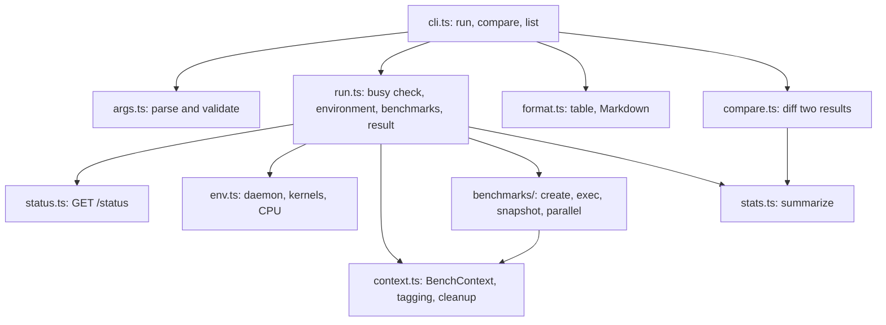

Earlier benchmarks in this project were a mix of a criterion bench, shell scripts that read the daemon's own metrics, and one-off runs on a box. They were good at finding bottlenecks and poor at one thing: letting someone else check the number. A figure with no recorded method, no environment and no raw samples is a claim. `examples/benchmark-suite` exists to make the figure a thing you can rerun, on your own daemon, and compare.

It is a TypeScript program on the published `sandkiln` npm package, so it measures what an SDK caller feels. That is a different layer from the VMM-level numbers, and the difference is the subject of the last section.

## What it is for

Three jobs, in order of importance.

1. **Run the same measurement against any daemon you can reach over HTTP**, not only the one on the development box.
2. **Write a result file with the environment recorded**, so a number carries its date, daemon version, guest kernel, host kernel and CPU.
3. **Compare two result files and say whether something regressed**, with an exit code a script can gate on.

It is deliberately not a profiler. It says how long a thing took from the outside. Why it took that long is the job of the tools in [the performance model post](/engineering/16-performance-model-and-measurement).

## Structure



The split follows one rule: anything that does not need a daemon is a pure module and is unit tested without one. `stats.ts` (percentiles and the summary), `format.ts`, `compare.ts` and `args.ts` take values and return values. The five test files under `test/` cover them and run with `npm test` and no daemon. The parts that need a daemon, `context.ts`, `run.ts`, `env.ts`, `status.ts` and the benchmarks, are thin on logic and are exercised by running the suite itself.

A benchmark is a small object with a `name`, a one-line `description` and a `run(ctx)`. Adding one is a new file under `src/benchmarks/` and one line in `index.ts`. The registration order is the run order.

### The context

Every benchmark receives a `BenchContext`. It owns three things.

- **A metric sink**: `ctx.record(name, value)` appends one sample. The unit defaults to milliseconds, and throughput metrics pass `ops/s` and a flag saying that higher is better, which `compare` needs to know which way is a regression.
- **Creation**: `ctx.create()` is the only way to make a sandbox, and it stamps every one with the tag `benchmark_run=<unique id>`. The id is a base-36 timestamp plus six random hex characters, so two runs never share one.
- **Cleanup**: `ctx.cleanup()` finds exactly what carries this run's tag and removes it.

### Cleanup of tagged resources

A benchmark that leaves sandboxes, snapshots and checkpoints behind distorts the next run and fills a disk. `cleanup` deletes three kinds of thing, each matched by this run's tag and nothing else:

1. live sandboxes, stopped with `keep: false`;
2. held snapshots, by id;
3. retired checkpoints in snapshot history, because `resume` retains the checkpoint by default and each one is a full memory dump plus a rootfs copy.

It runs after each benchmark, at the end in a `finally`, and on `SIGINT` or `SIGTERM`, where the process exits with code 130 after it finishes. It never throws, so it is safe inside a `finally` block, and each deletion is settled independently: one failure does not stop the rest. If the sweep itself fails, it says so and names the tag to look for. Because the match is on the tag, it never touches anyone else's sandboxes, which is what lets the suite run next to real work without destroying it.

### Refusing a busy daemon

Before anything runs, `run.ts` asks `GET /status`. If the daemon reports live sandboxes, the suite stops with an error that says how many and how to proceed, unless `--allow-busy` is passed. Other sandboxes compete for the same CPU, disk and tap devices, and every number would be skewed in a way nothing in the output reveals. The check happens only at the start, so something that begins creating sandboxes mid-run is still noise. The README says so.

The refusal also paid for itself. When the init-mode image was measured, another job held a live sandbox and the suite refused to run the parallel benchmark. Running it with `--allow-busy` would have produced a number that looked fine. That result is recorded in `docs/benchmarks.md` as not measured, which is the correct state for it.

## What it measures

| Metric | What the timer covers |
| --- | --- |
| `create_call` | `Sandbox.create()` returning |
| `first_command_after_create` | the first `runCommand("true")` after create returned |
| `create_to_first_command` | the two summed, which is what a caller waits for |
| `exec_roundtrip` | one `runCommand("true")` on an open, warmed sandbox, after 10 warmup calls, repeated `--exec-samples` times |
| `snapshot_take` | `sandbox.snapshot()` on a warmed sandbox |
| `fork_call`, `fork_first_command` | `Sandbox.fork()`, then the first command on the fork |
| `resume_call`, `resume_first_command` | `Sandbox.resume()`, then the first command on the resumed sandbox |
| `parallel_create_to_first_command_cN` | per-sandbox create to first command with `N` creates in flight |
| `parallel_round_wall_cN`, `parallel_throughput_cN` | wall time of a round of `N` and sandboxes ready per second |

Two design decisions are worth stating, because they are why the numbers mean something.

**It counts to a real command.** `create()` returning only means the VM started. The create benchmark records the call, the first command and their sum separately, so you can see that the call is about 21 ms while the wait for the agent is about 213 ms. [What a start-latency number means](/engineering/29-what-a-start-latency-number-means) explains the gap.

**The snapshot benchmark warms the sandbox first.** It runs a command before snapshotting, so the guest agent is known to be live. Then the fork's and the resume's first command measure restore cost and not agent startup. The fork is stopped before the resume because only one live fork per snapshot is allowed.

## Statistics, and how to read the output

Each metric is summarized from its sorted samples: count `n`, min, max, mean, median, p95 and p99. Percentiles use linear interpolation, the same definition as numpy and most spreadsheets, and `summarize` throws on an empty sample set rather than inventing a value.

With `--iterations 20` the p95 and p99 sit between the second largest and the largest sample. They are nearly the max and say little. Treat the median and the min as the stable figures, and read p95 as "the slow end seen in this run".

The environment block comes first in the output. It records the daemon version from `GET /status`, the guest kernel from running `uname -r` inside a throwaway sandbox, the count of rootfs clones by method, and the live-sandbox count at start. It records the host kernel and CPU only when the daemon is on loopback, because only then does the machine running the suite know about the host. For a remote daemon, `--hardware` takes a label. The clone counts matter: a result where the `copy` count rose during the run was timing byte copies of a rootfs and not reflinks, which is what [the rootfs clone post](/engineering/17-opt-rootfs-reflink-clone) taught.

### Compare mode

```bash
npm run compare -- results/before.json results/after.json --threshold 20 --min-delta-ms 0.5
```

`compare` reads two result files, checks that each is a result file of schema 1, and compares **medians**. A latency is a regression when it is worse by more than `--threshold` percent and by more than `--min-delta-ms`, so a 40 microsecond wobble on a 245 microsecond metric is not reported as a 16 percent regression. A throughput metric regresses when it drops. A metric present in only one file is listed as such, and the command exits 1 when anything regressed, so it can gate a script. Usage errors exit 2.

## Sample results

The committed run is `examples/benchmark-suite/results/2026-11-24-i9-13900K.md`: an i9-13900K with 32 threads, host kernel 6.8, guest kernel 5.10.223, Firecracker v1.16.1, reflink rootfs on XFS, 20 iterations (200 for exec), an idle daemon at the start.

| Metric | Median | p95 | Min | Max | n |
| --- | ---: | ---: | ---: | ---: | ---: |
| `create_call` | 21.19 ms | 25.18 ms | 18.47 ms | 25.35 ms | 20 |
| `first_command_after_create` | 213.1 ms | 229.2 ms | 195.2 ms | 239.1 ms | 20 |
| `create_to_first_command` | 235.4 ms | 254.2 ms | 218.7 ms | 261.8 ms | 20 |
| `exec_roundtrip` | 1.76 ms | 1.98 ms | 537 us | 3.30 ms | 200 |
| `snapshot_take` | 1208.0 ms | 2090.9 ms | 1000.6 ms | 2614.6 ms | 20 |
| `fork_call` | 8.77 ms | 9.44 ms | 7.46 ms | 9.74 ms | 20 |
| `fork_first_command` | 7.46 ms | 8.72 ms | 5.11 ms | 8.89 ms | 20 |
| `resume_call` | 13.12 ms | 14.91 ms | 8.94 ms | 15.10 ms | 20 |
| `resume_first_command` | 6.27 ms | 8.34 ms | 4.75 ms | 8.35 ms | 20 |
| `parallel_create_to_first_command_c8` | 356.9 ms | 403.3 ms | 269.8 ms | 417.4 ms | 160 |
| `parallel_throughput_c8` | 20.1/s | 21.3/s | 19.1/s | 21.4/s | 20 |

A second identical run agreed to within a few percent except for snapshot take, per `docs/benchmarks.md`. The parallel row has n of 160 because eight creates per round over 20 rounds each contribute a sample.

## What it found

The suite was run against the published figures to see whether the two sets agree. Where they measure the same thing, they do: create to first command (214.5 ms mean published, 213.1 ms median measured after create returned) and resumed first exec (8.4 ms against 6.3 ms). Two disagreements are the real findings.

### Layer differences that are not regressions

| Metric | Published | Suite median | Why they differ |
| --- | --- | --- | --- |
| Resume | 3.7 to 4.0 ms | 13.1 ms | Published is the VMM call. The suite includes the HTTP hop and all of the daemon's resume work, among it the [entropy and clock fixup](/engineering/31-correctness-clone-entropy-and-clock) |
| Exec round trip | about 245 us | 1.76 ms, min 537 us | Published reuses an open vsock connection. The suite makes one HTTP request per command |
| `POST /sandboxes` | 16 to 18 ms | 21.2 ms | The suite times the whole SDK call |

Neither is a regression and neither is wrong. They are different intervals with similar names, which is the whole argument of the previous post. The published VMM rows remain the right figures for the cost of the VMM itself. The suite is the better figure for what an SDK caller experiences, because it has a stated method, a recorded environment and the raw samples.

### Snapshot take: unexplained

This one is not explained by the layer difference, and the repository says so.

| Source | Snapshot take |
| --- | --- |
| Published, VMM level | 485 to 727 ms (309.6 to 335.0 ms on a quieter day, up to 990 ms under load) |
| Suite, whole `snapshot()` call | median 1208 ms (min 1001, max 2615) |

The suite times the full `snapshot()` call and the published figure is VMM-level, so some gap is expected. The size of the gap, roughly 1.7 to 2.5 times the published range, is more than a layer would obviously explain, and snapshot take is the most load-sensitive figure the project has, since it synchronously writes all of guest memory to a disk shared with a desktop. `docs/benchmarks.md` marks it open until a VMM-level rerun on a quiet box reads the same. The honest summary is that two measurements disagree and the cause is not known, and nothing on this page should be quoted as the snapshot cost without that caveat.

## Using it for A/B comparisons

The `--image` option boots every sandbox from a registered image, and the id is recorded in the result. That is how the init-mode image was compared with the systemd image: alternating runs back to back on an idle daemon, 30 sequential creates each. Median create to first command was 225.5 to 234.6 ms on the systemd image across four runs and 144.6 to 149.7 ms on init mode across two valid runs. Two further init runs were discarded after the result showed `create_call` at 98 ms instead of 22 ms, a sign that every create had copied a 300 MB image because the image directory was on a filesystem that cannot reflink. The clone counts in the environment block are how that would be caught.

## What it cost or risks

- **Small samples on a shared machine.** A sample result is a data point and not a guarantee. Rerun before concluding anything.
- **The suite pins the published 0.12.0 SDK.** It calls `GET /status` directly because the SDK's own `getStatus` is newer than that. A future SDK bump removes that duplication.
- **Cleanup depends on the tag.** A sandbox created outside `ctx.create()` is not tracked. A `SIGKILL` of the suite cannot run cleanup, and the tag in the log line is how leftovers are found.

## How to reproduce

From the repository root, on a machine with the daemon running:

```bash
scripts/dev.sh bench-suite --iterations 20 --json examples/benchmark-suite/results/mine.json --markdown examples/benchmark-suite/results/mine.md
```

On the development box, wrap it in `scripts/remote.sh run`. The suite needs Node 22.18 or newer and no build step, since TypeScript runs directly. Run it on an idle daemon, and check `GET /status` yourself if a result looks noisy. To compare two runs, use `scripts/dev.sh bench-suite compare before.json after.json`, or `npm run compare` from `examples/benchmark-suite` as shown above, and report any metric that moved that you did not expect.
