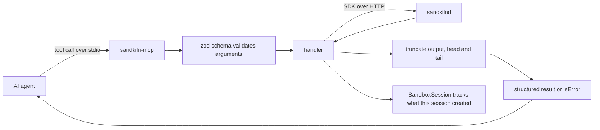
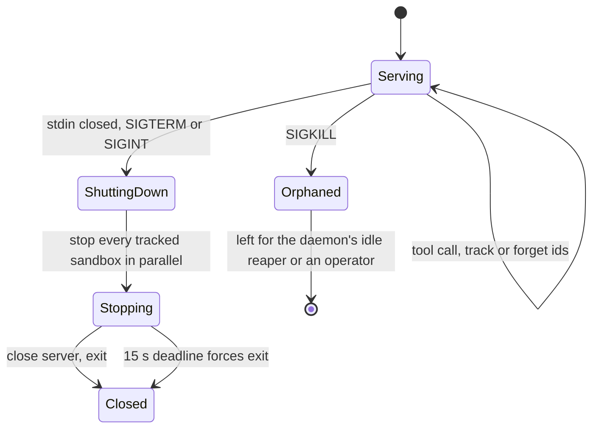
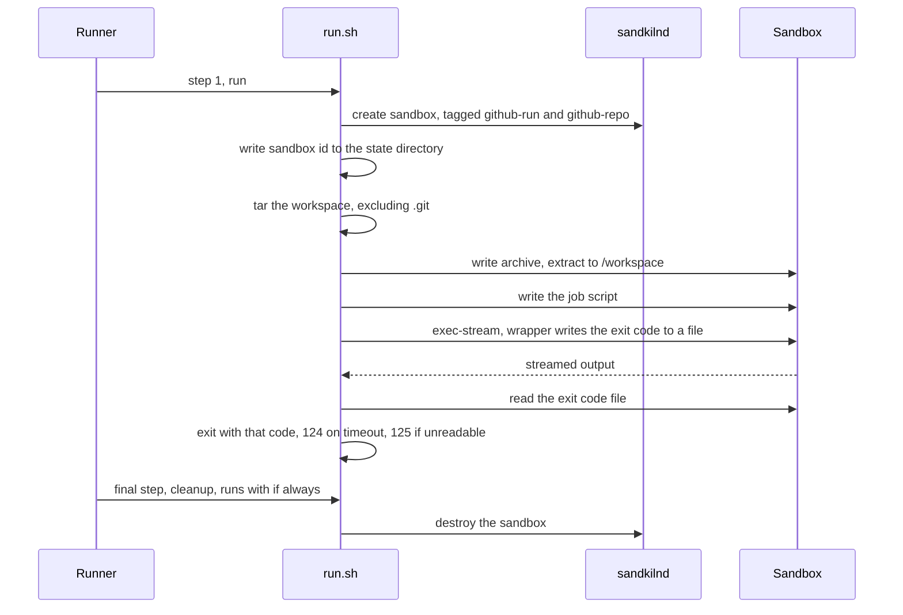
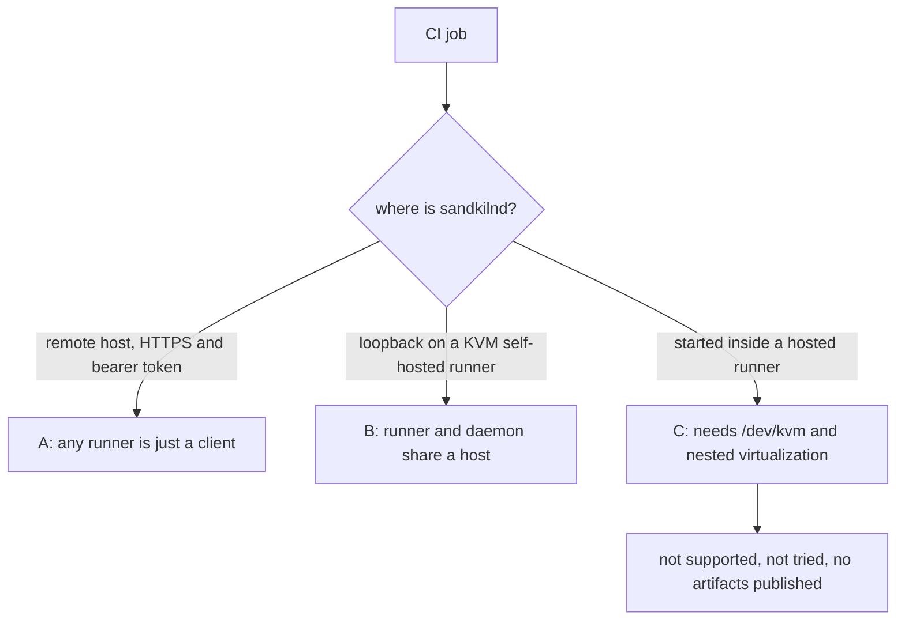

Most of sandkiln was designed for a program that calls the HTTP API and checks every result. Two kinds of caller are different. An AI agent calls tools, reads the text that comes back, and may crash, loop or forget to clean up. A CI job runs unattended, in a place nobody is watching, where a leaked sandbox is a standing cost and a wrong exit code is a green build for broken code.

Both are built as thin layers. The MCP server (`packages/mcp`) sits on the TypeScript SDK. The GitHub Action (`.github/actions/sandkiln-run`) sits on the `kiln` CLI. Neither adds daemon logic. What they add is the part a human caller supplies by judgement: bounding output, shaping errors, and making sure what was started gets stopped.

## Part one: the MCP server

### Shape

`sandkiln-mcp` speaks the Model Context Protocol over stdio and talks to a `sandkilnd` over HTTP. The protocol owns stdout, so every diagnostic goes to stderr. It exposes 12 tools and two resources.

| Group | Tools |
| --- | --- |
| Sandboxes | `sandbox_create`, `sandbox_stop`, `sandbox_list` |
| Commands | `sandbox_exec` |
| Files | `sandbox_write_file`, `sandbox_read_file`, `sandbox_list_dir` |
| Snapshots | `sandbox_snapshot`, `snapshot_list`, `sandbox_resume`, `sandbox_fork` |
| Daemon | `daemon_status` |

The resources are `sandkiln://sandboxes` and `sandkiln://status`. Tool arguments are snake_case, which is the convention models see, while the SDK underneath is camelCase. Each tool is a schema, a description, annotations and a short handler. A shared `defineTool` is the single place where a handler's return value becomes a success result and where a thrown error becomes a failure result, so no tool can leak an exception into the protocol layer.



### Output is bounded before it reaches the model

A command can print a hundred megabytes. A model has a context window. If the server returned everything, one noisy command would flood the window and push out the task. Everything returned to the model passes through `truncate.ts`.

`truncateText` keeps the **head and the tail** of the text within a byte budget and puts a marker in the gap: `[... N bytes omitted of M total ...]`. Both ends matter for command output. The start shows what ran, and the end usually holds the error. The default cap is 32 KiB per tool call, changed with `SANDKILN_MCP_MAX_OUTPUT_BYTES`, and `sandbox_exec` splits it evenly between stdout and stderr so the two together stay within it.

The cut is made on **UTF-8 boundaries**. Bytes are cut, not characters, and a cut that lands inside a multi-byte character would produce invalid text. The code finds a continuation byte (the bit pattern `10xxxxxx`) and moves the head's end backward and the tail's start forward until each lands on the start of a character. The marker reports the exact bytes omitted, which can be slightly more than the budget implies because of that adjustment.

`read_file` returns text as UTF-8 when the bytes are valid text and base64 otherwise, cut to a byte limit. Binary data has no character boundaries, so it is cut at exactly the limit. The result carries the total size, the returned size and a `truncated` flag, so the model can tell that it did not see everything and ask for a different range.

### Errors a model can act on

A failure comes back as an `isError` result with a small JSON object: `kind`, `message`, an HTTP `status` where there was one, and a `hint`. The kinds are fixed and few: `invalid_request`, `unauthorized`, `not_found`, `conflict`, `rate_limited`, `daemon_error`, `daemon_unreachable`, `timeout`, `limit_reached` and `internal`.

The reason for a closed set is that a model chooses its next step from the kind, and a free-text error invites the wrong guess. A 404 maps to `not_found` with the hint that the id may have been stopped or snapshotted and to call `sandbox_list`. A 409 maps to `conflict` and names the common cause, such as a snapshot that already has a live fork. A fetch failure, which is how a down daemon looks from Node, maps to `daemon_unreachable` with a hint to check that `sandkilnd` is running and the URL is right. The daemon's own message is kept in `message`.

One distinction matters: **a command that exits nonzero is not an error.** `sandbox_exec` returns the exit code, stdout and stderr as a normal result. The tool failed only if it could not run the command. An agent that sees `exit_code: 1` has learned something about its code. An agent that sees a tool error would reasonably retry.

### Timeouts are abandoned, not cancelled

`sandbox_exec` takes a timeout, 60 seconds by default and 600 at most. On expiry the call returns a `timeout` error. The limit is honest about what it does not do: the SDK has no abort and the daemon has no exec kill, so the process may keep running in the sandbox. The `timeout` hint says so and suggests running long work in the background and polling. `withTimeout` swallows a late rejection from the abandoned work so it cannot crash the server process. A daemon-side exec timeout was added to the non-streaming `exec` endpoint on the same day this post was written: the request can carry `timeout_secs`, the guest agent kills the process group on expiry, and the daemon answers 504 with the partial output. The MCP server's `sandbox_exec` had not been moved onto it when this was written and still enforces its own client-side limit, so the caveat above describes the MCP code as it stands. The action's streaming path (`exec-stream`) is also not covered by it. Check the MCP package's README for whether that has since changed.

### Session ownership and cleanup

The caller is an agent that may disappear mid-task. The server, not the model, is responsible for what it started. `SandboxSession` tracks every sandbox this process created: create, resume and fork add to it, stop and snapshot remove from it, because a snapshot retires the sandbox's id.

It does two jobs.

- **A per-session cap.** `assertCanCreate` throws a `limit_reached` error before the daemon is asked to boot anything over the limit, 8 by default, changed with `SANDKILN_MCP_MAX_SANDBOXES`. The error's hint says to stop a sandbox first or raise the limit. An agent in a loop that creates sandboxes is stopped at eight, not at the daemon's capacity.
- **Cleanup on the way out.** `index.ts` runs one idempotent `shutdown` on stdin closing, `SIGTERM` and `SIGINT`. stdin closing is the signal that the client went away, so it is the important one. The shutdown stops everything still tracked, with `Promise.all` so that one failed stop never blocks the rest, and reports the ids it could not stop. A 15-second deadline forces the exit, so a hung daemon cannot hold the process open forever. With `SANDKILN_MCP_KEEP_ON_EXIT=1` leftovers are snapshotted instead of destroyed.



### What the MCP server does not do

- **A `SIGKILL` cannot be cleaned up.** Sandboxes created by a killed server remain until the daemon's idle reaper or an operator removes them.
- **Any tool can act on any sandbox id on the daemon**, not only the session's own. The session tracks ownership for cleanup, and it is not an access boundary. Point the server at a daemon whose contents you are willing to expose to the agent, and set the auth token when others can reach it.
- **Egress is open by default.** Code that must stay offline needs `egress: "deny_all"` on `sandbox_create`.
- **The exec timeout does not kill the process**, as above.

The package is published to npm as `sandkiln-mcp` 0.1.0 and was verified from the registry against a live daemon, per the roadmap. `packages/mcp/test/live-smoke.mjs` drives the built server over stdio with the official MCP client against a real daemon, covering create, exec, files, snapshot, resume, errors and cleanup on disconnect. Typecheck and unit tests alone do not prove a tool works, which is why that script exists.

## Part two: the GitHub Action

### Shape

`sandkiln-run` is a **composite action**: a few steps that call one shell script, `run.sh`, which is built on the `kiln` CLI. The alternative was a JavaScript action. The CLI already owns authentication, error shaping and exit codes, and keeping the logic in one shell script means it can be run and tested outside GitHub, which `test/test-run.sh` does offline against a stand-in `kiln`.



### The design decisions

**Upload the workspace as one tar archive.** `run.sh` makes a `tar.gz` of the workspace, writes it through the existing file API, and extracts it in the guest with `exec`, instead of adding a daemon endpoint. The JSON file API base64-encodes the body, so very large workspaces are a poor fit, and the action does not cap the size. Use the `exclude` input to leave out build output.

**Always exclude `.git`.** `actions/checkout` can leave a credential in `.git/config`, and the sandbox is where untrusted code runs. The archive never contains it, and the `exclude` input adds patterns on top.

**Read the exit code back from a file.** The command runs inside a wrapper that writes its exit code to a file in the guest. The reason is a trap in the streaming client: it reports 0 when its connection closes without ever seeing an exit notice. Trusting it alone could turn a dropped connection into a green build. So after the stream ends, `run.sh` reads the file back. If it holds a number, that is the result. If the file is missing or unreadable, the action reports **125** and an error saying the sandbox never reported an exit code.

**A timeout enforced by the client.** The step wraps the stream in `timeout` and a 10-second kill grace. On expiry the step fails with **124**. The daemon has no exec timeout, so the command may keep running until the sandbox is destroyed, which the cleanup step does.

**Network off by default.** The `egress` input defaults to `deny_all`, so the sandbox has no network and no secrets unless the workflow asks. `allow-cidrs` adds specific ranges.

**Always clean up.** Composite actions have no post step, so the action adds a final step with `if: always()`. It runs after a failed command, a timeout or a cancelled job alike, and destroys the sandbox. The sandbox id is written to a state file before anything else can fail, so cleanup always knows what to destroy. If the job's own machine dies, no step runs, so every sandbox is tagged with the run and the repository to make orphans findable. With `keep-on-failure` set, a failed run leaves the sandbox and prints the exact command to remove it.

Cleanup is itself a failure path, and it is built like one. If the destroy call fails, for example because the daemon restarted mid-run, the step reports an error and prints the manual command, instead of pretending it worked.

The action rejects a plain `http://` daemon URL unless it points at loopback, and masks the token in logs.

### Three topologies

Where the daemon runs decides what the CI job can do. The research behind this is in `docs/design-notes/ci-integration.md`, with sources and dates.

| Topology | Where `sandkilnd` runs | Status |
| --- | --- | --- |
| A | A remote daemon the job reaches over HTTPS | Supported. Works on any runner, needs neither KVM nor privileges, and is the topology the main example workflow uses |
| B | The same self-hosted machine as the runner, on loopback | Supported. No public endpoint and the lowest latency, but the host is yours to operate |
| C | The job starts `sandkilnd` itself on a GitHub-hosted runner | **Not supported.** Needs usable `/dev/kvm` on the runner |



Topology C is open for two separate reasons, and the note separates them. First, GitHub's documentation says nested virtualization is "not officially supported" on hosted runners, and whether a given runner exposes `/dev/kvm` is documented nowhere authoritative, only in community reports. Hardware acceleration has been reported on standard Linux runners since a 2024 changelog, after a udev rule opens `/dev/kvm` to the user. Whether Firecracker boots there at all, and at what latency, nobody has shown. This project did not try, and used no GitHub account for the work. Second, even with KVM, `sandkilnd` needs more than a Firecracker binary: a pre-created tap pool, `CAP_NET_ADMIN` on the daemon, a bridge with NAT, a DNS forwarder, a guest kernel and a rootfs with the agent injected. No kernel or rootfs artifact is published, and nothing downloads one. The note lists what would have to exist before C is a feature, and no workflow here pretends to do it.

Topology A has its own sharp edge. Hosted runners come from public, changing IP ranges, so an IP allow-list is not a practical control. The daemon must be reachable and must have an auth token, behind a TLS-terminating proxy or a tunnel, and the token belongs in a repository or environment secret, never in a workflow file. An unauthenticated daemon on the public internet lets anyone run code on your host. Fork pull requests get no secrets, so they cannot reach the daemon, and using `pull_request_target` to change that is only acceptable when nothing from the pull request runs on the runner.

### What was verified

Verified on the development box against a real daemon: success with exit 0, a failing command propagating its exit code (3), a timeout giving 124, keep-on-failure leaving the sandbox, an insecure URL rejected, and the daemon's sandbox list identical before and after each run. The deny-all policy blocked the sample's outbound test. `actionlint` passes on every workflow and the action, and the offline test script passes seven scenarios.

Not verified, because it needs GitHub: the action running on a real runner, including `actions/setup-node`, masking, the `secrets` context, and `if: always()` on a cancelled job. The bearer-token path was not exercised end to end, since the box daemon runs without a token. Any hosted-runner KVM behaviour and fork pull requests are untested. The design note lists each of these as not verified, and so does this post.

## How to reproduce

The MCP server needs a running daemon and an MCP client. The live smoke test is the quickest end-to-end check from a checkout:

```bash
npm run build -w sandkiln
npm run build -w sandkiln-mcp
SANDKILN_DAEMON_URL=http://127.0.0.1:7777 node packages/mcp/test/live-smoke.mjs
```

For the action without GitHub, `run.sh` takes its inputs from `INPUT_*` environment variables, so you can drive it directly against a daemon, which is how the dev box runs were made:

```bash
env 'INPUT_DAEMON-URL=http://127.0.0.1:7777' INPUT_COMMAND='echo hello; exit 3' \
  .github/actions/sandkiln-run/run.sh run; echo "exit $?"
env 'INPUT_DAEMON-URL=http://127.0.0.1:7777' .github/actions/sandkiln-run/run.sh cleanup
```

The first should print the sandbox id, `hello` and the command's exit code 3. The input name contains a hyphen, which is not a valid shell variable name, so it is passed through `env`. The script also needs `kiln` on `PATH`. The offline test needs no daemon: `.github/actions/sandkiln-run/test/test-run.sh`.
