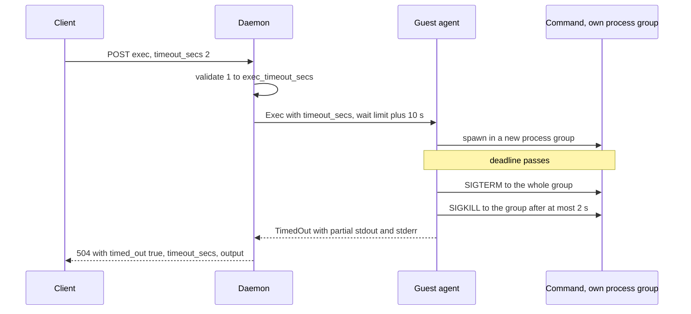
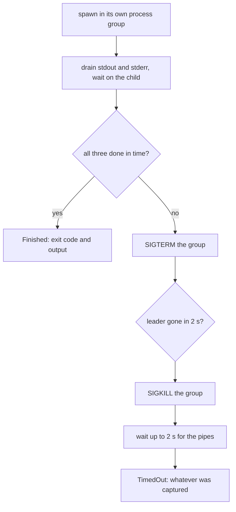

A timeout that only stops waiting is a different thing from a timeout that stops the work. The first kind has been in sandkiln since finding 11: the daemon's `exec_timeout_secs` (600 seconds by default) bounded how long a request waited for the guest, and past it the caller got a `504`. The command did not know. It kept running in the guest, using CPU and holding whatever it held, until the sandbox was destroyed.

For a person at a terminal that is an annoyance. For an AI agent or a CI job it is a leak that compounds: the agent sees a timeout, tries again, and now two copies run. The [agents and CI post](/engineering/33-agents-and-ci) listed this honestly as a gap in both the MCP server and the GitHub Action. This change closes it for the non-streaming exec.

Facts below come from the code, `docs/findings.md`, `CHANGELOG.md`, `docs/design-notes/feature-plan.md` and the integration topic `30-exec-timeout`.

## The shape of the fix

The limit has to be enforced where the process lives. Only the guest agent can signal a guest process, so the request carries the limit to the agent and the agent kills the command.



### On the wire

`Request::Exec` gains an optional `timeout_secs`, and a new response variant `Response::TimedOut { stdout, stderr }` carries the output captured so far.

Two compatibility choices are worth stating.

- **The field is omitted when unset.** A request without a limit serializes byte for byte as it did before, and a unit test pins that wire shape. An agent that predates the field ignores it when it is present and runs the command unbounded. So the limit only takes effect once an image has been re-injected with the new agent. The 504 for a reply that never comes still exists for that case.
- **A timeout is its own variant, not a flag on `Exec`.** There is no meaningful exit code for a command that was killed, and a separate variant means no existing consumer of `Exec` can mistake a killed command for one that finished.

## The agent: one deadline over three events

The agent's bounded exec (`bounded_exec.rs`) has to wait for three things: the child to be reaped, stdout to reach end of file, and stderr to reach end of file. It does not wait for the child alone, and the reason is the whole point of the module. A command can start a background process and exit. That grandchild inherits the pipes and holds them open. Waiting for the child would return at once and then reading the pipe would hang, which is also what `Command::output` does. So each of the three completions is sent on one channel, and a single `recv_timeout` loop enforces one deadline over all of them.



Details that each exist because of a failure mode:

- **The group, not the process.** The command starts with `process_group(0)`, so its pgid is its pid and cannot include the agent. Signals go to the group, which is how a shell's grandchildren die with it. Killing only the shell would leave `sleep` running.
- **SIGTERM first, then SIGKILL.** TERM lets a well-behaved command clean up. After at most 2 seconds the group gets KILL regardless, which sweeps processes that ignore TERM and any stragglers once the leader is gone. A unit test runs `trap '' TERM` and checks the command still dies.
- **Pipes are drained for the whole run.** A command that prints 5 MB would block on a full pipe if nothing read it while the agent waited. Two tests cover it: 5 MB with no timeout, and 3 MB printed before a timeout, all kept.
- **The settle is bounded.** A process that calls `setsid` leaves the group, survives the kill and can keep a pipe open. After the kill the agent waits at most 2 more seconds and returns what it has, rather than hang itself. The worst case is therefore the limit plus about 4 seconds.
- **A command that cannot be spawned is an error, not a timeout.** A missing binary comes back as an error, as before.

The no-limit path is untouched. A request with no `timeout_secs` still goes through the plain `Command::output`.

## The daemon

The route does three things.

**It validates, and does not clamp.** `timeout_secs` must be at least 1 and at most `exec_timeout_secs`, which is also the default when the field is absent. `0` is a `400`. A value above the ceiling is a `400` whose message names `exec_timeout_secs`. A negative or non-numeric value is rejected by the JSON layer as a `422`. Clamping would have been friendlier and wrong: a client would believe it had granted a command more time than it got. The server validates because the HTTP API is the boundary, whatever a client checks first.

**It waits longer than the limit.** The daemon's own wait on the agent is the limit plus a 10 second margin. The agent needs up to 2 seconds of grace and 2 of settle to report, so a 10 second margin means the agent answers first and the caller gets the partial output. If the margin were zero the daemon's wait and the agent's kill would race, and the caller would often get a bare gateway error instead of the output.

**It distinguishes two kinds of 504.** The killed command answers with a body:

```json
{"error": "command timed out after 2s and was killed", "timed_out": true, "timeout_secs": 2, "stdout": "partial\n", "stderr": "oops\n"}
```

A `504` without `timed_out` still means the daemon gave up waiting and the command may still be running, or the guest agent predates the field. Both codes have the same status because both are a gateway timeout, and the body is how a client tells them apart.

Even without a `timeout_secs`, the daemon now sends its own ceiling to the agent, so a command that outlives `exec_timeout_secs` is killed in the guest instead of left running after the `504`.

## The clients

Every client maps the same body to the idiom its users expect.

| Client | How the limit is set | What a timeout looks like |
| --- | --- | --- |
| JS SDK | `runCommand(..., { timeoutSeconds })` | Throws `SandkilnExecTimeoutError`, a subclass of `SandkilnApiError` with status 504, carrying `stdout`, `stderr` and `timeoutSeconds`. Code that already catches the base class keeps working |
| Python | `run_command(..., timeout=)`, sync and async | Raises `SandkilnExecTimeoutError` with `stdout`, `stderr` and `timeout_secs` |
| CLI | `kiln sandbox exec --timeout <seconds>` | Prints the partial output and exits 124, the code coreutils `timeout` uses |
| MCP server | `timeout_seconds` on `sandbox_exec`, default 60 and at most 600 | A `timeout` tool error whose `details` carry the partial output, with a hint to raise the limit or run the work in the background |
| GitHub Action | The `timeout` input | The job runs under `timeout --kill-after=10` inside the sandbox, and the step exits 124 |

The SDK's check is strict. It converts a 504 into the typed error only when the body has `timed_out: true`, so a bare 504 from a host-side wait is never reported as a command that was killed.

The Action is the exception to "uses the daemon's limit", and it is worth understanding why. It runs the job over the streaming exec API, which has no limit of its own. So the limit is enforced inside the guest by wrapping the job in `timeout --kill-after=10`, which signals the command's process group and then kills it. The step treats an exit of 124 or 137 as a timeout. A client-side `timeout` 30 seconds longer sits outside as a backstop. If the image has no `timeout` binary, the wrapper falls back to running the job directly, and then only the client-side backstop applies, which abandons the stream and does not kill the job. The Action's documentation says an image needs `timeout`.

## How it was tested

Unit tests in the agent cover the process module in isolation: a command that finishes reports its exit code and output, expiry kills it and keeps partial output, grandchildren die with the group, a background child holding the pipe cannot outlive the deadline, a command ignoring TERM is killed after the grace, chatty output is drained, and a missing binary is an error.

The integration topic `30-exec-timeout` runs against a real daemon and a real guest. The order of its checks matters.

1. **A positive control first.** The topic needs to know "no `sleep` is left in the guest", and a probe that reads `/proc` could report zero for the wrong reason. So before anything is killed it starts a `sleep 3`, runs the same probe, and asserts it sees one. A later "0" then means something.
2. A command that finishes inside its limit succeeds and keeps its own exit code (3 in the test).
3. `sleep 30` with `timeout_secs` 2 is a `504` whose body says it timed out and names the limit, and it arrives between 1.8 and 6 seconds, not after 30. The feature plan records it answering in 2.0 s. The probe then finds no `sleep` in the guest, so it was killed and not abandoned.
4. A command that prints to both streams and then hangs returns its partial stdout and partial stderr.
5. A shell that starts `sleep 40` and `sleep 41` in the background and waits is a `504`, and afterwards no `sleep` remains. The group kill reached the grandchildren.
6. The sandbox is still usable after all of that.
7. A limit of 0 is a `400`, one above the daemon's ceiling is a `400` that names `exec_timeout_secs`, a negative one is a `422` and a string is a `422`.

The same change was verified by hand against the CLI, both Python clients, the JS SDK, the MCP live smoke test and the Action, per the changelog.

## What is not covered

- **Streamed exec has no timeout.** `exec-stream` carries no limit, which is why the Action wraps its job in `timeout` in the guest. This is on the roadmap.
- **A process that calls `setsid` escapes.** It leaves the process group and survives the kill. The agent abandons its pipe after the 2 second settle and replies, but the process keeps running.
- **A guest agent that predates the field** ignores it. Images must be re-injected with the new agent, and until then a limit is only a daemon-side wait.
- **A reply that never comes** is still a plain `504` and the command may still be running. The two bodies are distinguishable by `timed_out`.

The agents and CI post written the same day says the MCP server still enforced its own client-side limit. That was true when it was written and is not now: the server was moved onto the daemon-side limit afterwards.

## How to reproduce

Against a running daemon, with an agent that has the field:

```bash
B=http://127.0.0.1:7777
ID=$(curl -s -X POST $B/sandboxes -H 'content-type: application/json' -d '{}' | jq -r .id)

time curl -s -X POST $B/sandboxes/$ID/exec -H 'content-type: application/json' \
  -d '{"command":"sh","args":["-c","echo partial; sleep 30"],"timeout_secs":2}'

curl -s -X POST $B/sandboxes/$ID/exec -H 'content-type: application/json' \
  -d '{"command":"sh","args":["-c","grep -lx sleep /proc/[0-9]*/comm | wc -l"]}'

kiln sandbox exec --timeout 2 $ID sleep 30; echo "exit $?"
```

The first call should return a `504` with `timed_out: true` and `partial` in about 2 seconds. The second should report 0 sleepers. The last should exit 124. To run the topic itself, use `scripts/integration-test.sh`, which includes `30-exec-timeout`, and the agent's unit tests with `cargo test -p sandkiln-guest-agent` from `core/`. If a token is configured, add the `Authorization` header.
